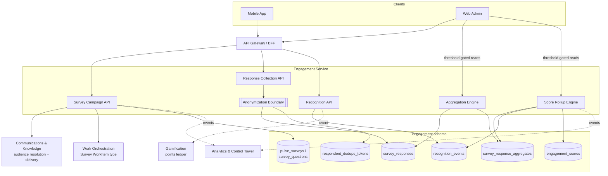
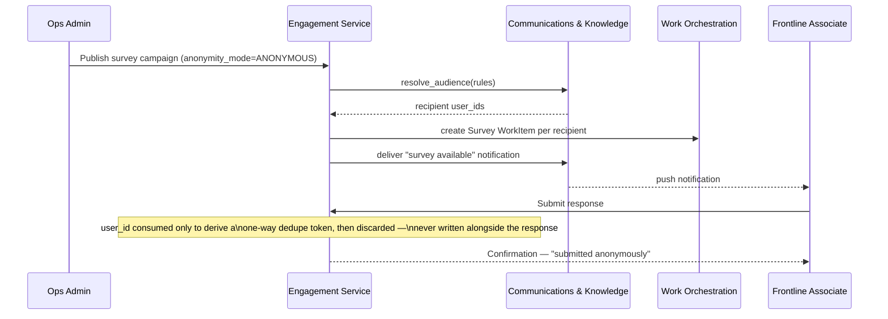
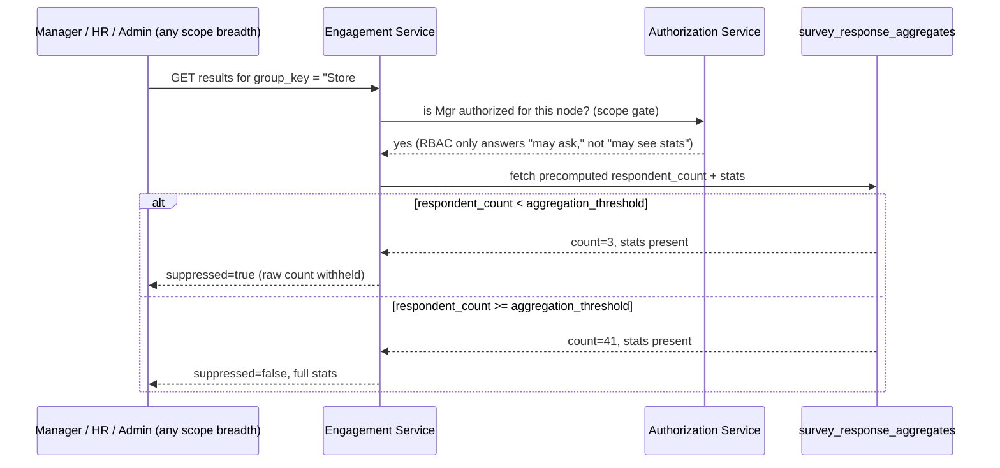
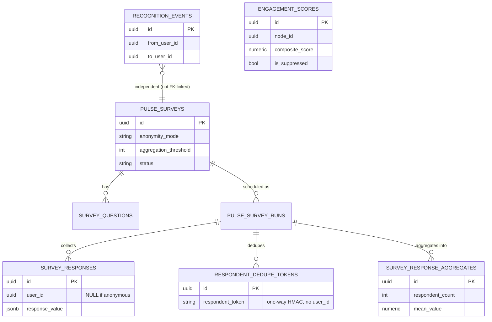
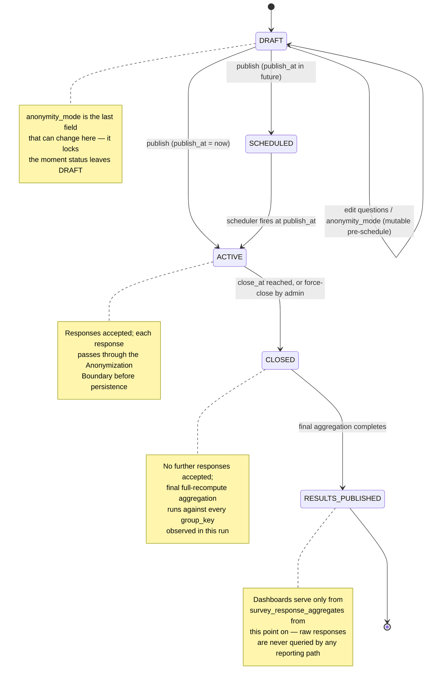

# Employee Engagement & Voice of Frontline — Architecture Diagrams

Module: `18-employee-engagement`

## 1. Component Diagram

**Narration**: The Engagement Service has three write paths (survey design, response collection,
recognition) and two read paths (aggregation, score rollup), and every read path is structurally
separated from raw `survey_responses` — only the Aggregation Engine's background worker ever queries
that table, and even it writes only threshold-annotated results forward. Anonymity is preserved
end-to-end here because the component that *knows* who submitted (the `Anon` boundary, transiently,
during dedupe-token derivation) is a different component from every component that *reports*
results, and no data path connects the two: the boundary throws away the `user_id` before the
response row is ever persisted, and it holds the only key capable of reversing dedupe tokens back to
users, which no other component in this diagram has access to.

## 2. Sequence Diagram — Survey Publish to Response Collection

**Narration**: The audience-resolution and delivery hops are entirely delegated to Communications &
Knowledge — this module never learns how to fan out a notification or evaluate an audience rule; it
only asks Communications for a recipient list and hands it a notification request. Anonymity is
preserved at the last hop: when the associate submits, their identity is used exactly once, inside
the service, to compute a dedupe token, and is never stored next to the answers themselves.

## 3. Sequence Diagram — Anonymity-Safe Aggregation Read

**Narration**: This is the diagram that makes the anonymity guarantee concrete: RBAC and the
aggregation threshold are two independent, sequential gates, and **broad scope never substitutes for
group size** — the same requester gets full data for a large store and a suppressed response for a
small one, in the same session, because the threshold check runs after authorization and depends
only on `respondent_count`, a value RBAC has no opinion on. The raw count itself is withheld even in
the suppressed branch, closing the "3 of 5" inference gap.

## 4. ER Diagram — Owned Entities

**Narration**: `SURVEY_RESPONSES` deliberately has no relationship drawn to any identity table in
this diagram for anonymous runs (`user_id` is nullable and null in that mode); `RESPONDENT_DEDUPE_
TOKENS` has no foreign key to `SURVEY_RESPONSES` at all — the two tables are joined by neither a key
nor application logic, which is what makes "duplicate prevention without identity storage"
structurally true rather than merely a policy promise. `RECOGNITION_EVENTS` is shown unlinked to the
survey subsystem because recognition is intentionally attributed (never anonymous) and must not share
a data model with the anonymity-protected tables.

## 5. State Diagram — PulseSurvey Campaign Lifecycle

**Narration**: Anonymity is preserved across every transition, not just at submission time. The
`anonymity_mode` decision is frozen the instant a survey leaves `DRAFT` (FR-ENG-005), so respondents
who see "this survey is anonymous" during `ACTIVE` can trust that promise was fixed before delivery,
not adjustable after responses start arriving. At `CLOSED → RESULTS_PUBLISHED`, the system performs
its last full aggregate computation and from then on every downstream consumer — manager dashboards,
Analytics, HR reporting — reads exclusively from the threshold-annotated aggregate table, never from
`survey_responses`, which is the structural guarantee that outlives the campaign itself.
