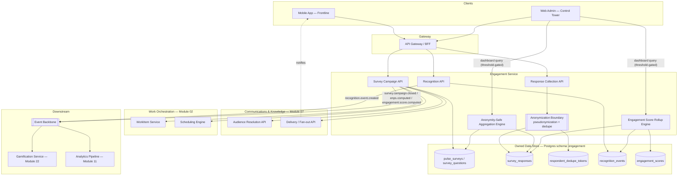

# Employee Engagement & Voice of Frontline — High-Level Design

Module: `18-employee-engagement`

## 1. Module Responsibilities

The **Engagement Service** owns four bounded concerns:

1. **Survey design & lifecycle** — `PulseSurvey`/`SurveyQuestion` authoring, versioning, campaign
   scheduling (built on top of Work Orchestration's scheduling primitives), and being the functional
   owner of the `Survey` WorkItem type.
2. **Response collection & anonymization** — accepting `SurveyResponse` submissions in either
   `ATTRIBUTED` or `ANONYMOUS` mode, with the anonymization boundary enforced inside this service,
   not left to callers.
3. **Anonymity-safe aggregation & eNPS/engagement scoring** — the query and computation layer that
   turns raw responses into group-level statistics, with the aggregation-threshold rule enforced as
   a mandatory gate in every read path, and rollup of `EngagementScore` up the `OrganizationNode`
   tree.
4. **Recognition events** — peer-to-peer and manager-to-associate recognition posts, feed
   distribution, and abuse guardrails, with an outbound event to Gamification for points.

It is explicitly **built on top of Communications & Knowledge's delivery infrastructure rather than
duplicating it** — the Engagement Service has no notification-channel code, no audience-rule
evaluation engine, and no translation pipeline of its own. It is a client of Module 07's internal
APIs for those concerns, in the same way a browser is a client of a CDN rather than reimplementing
one.

## 2. Component Diagram

Narratively: every read of survey/engagement data — whether a manager dashboard or the Analytics
pipeline — passes through the Aggregation Engine or Score Rollup Engine, both of which sit in front
of the raw `survey_responses` table. No component outside the Engagement Service, including internal
BI/export tooling, is permitted a direct query path to `survey_responses` — this is enforced by
schema-level access control (only the Engagement Service's DB role can `SELECT` that table; even an
internal analyst role gets a threshold-safe materialized view, see §5).

## 3. Data Ownership

| Entity | Owned here | Notes |
|---|---|---|
| `PulseSurvey`, `SurveyQuestion` | Yes | Survey design/config; versioned by cloning (FR-ENG-005), not in-place mutation once scheduled. |
| `PulseSurveyRun` (campaign occurrence) | Yes | One per scheduled occurrence of a recurring `PulseSurvey`; bridges to a generated `Survey` WorkItem per recipient. |
| `SurveyResponse` | Yes | Anonymized per §4.3 functional-spec rules; this service is the only writer and the only direct reader. |
| `RespondentDedupeToken` | Yes | Separately-keyed pseudonymization table for anonymous dedupe — logically owned by, and physically isolated within, this service (see LLD §1.3 for the isolation mechanism). |
| `RecognitionEvent` | Yes | Recognition posts and feed source of truth. |
| `EngagementScore` | Yes | Computed/rolled-up fact table; versioned by `(node_id, period, scoring_version)`. |
| `WorkItem` (type=`Survey`) | No (referenced) | Owned by Work Orchestration; this module writes the `Survey`-specific `payload` and reacts to `task.completed` for that type. |
| `OrganizationNode`, `UserScope`, `User` | No (referenced) | Owned by Identity & Organization; consumed read-only for targeting/grouping/authorization. |
| `PointsLedger` | No | Owned by Gamification; this module only emits an event that Gamification may act on. |

## 4. External Interfaces

### Consumed

| Interface | Owner | Purpose |
|---|---|---|
| `POST /internal/v1/comms/audience/resolve` | Communications & Knowledge | Resolve a survey campaign's audience-rule set into a concrete recipient list, identical contract to the announcement resolver (Module 07 LLD §4). |
| `POST /internal/v1/comms/audience/preview` | Communications & Knowledge | Non-anonymous-only recipient sampling for campaign design preview (FR-ENG-008). |
| `POST /internal/v1/comms/delivery/notify` | Communications & Knowledge | Fan-out push/email/in-app "survey available" notifications, reusing dedupe-key delivery semantics. |
| `task.completed` (event, `work_item_type = SURVEY`) | Work Orchestration | Signals a `Survey` WorkItem instance was submitted; triggers this module's response-ingestion handler which resolves the underlying `PulseSurveyRun` and applies the anonymization boundary. |
| `WorkItem` create/read APIs | Work Orchestration | Creates the per-recipient `Survey` WorkItem at campaign publish time; reads status for participation-rate computation. |
| `UserScope`/`OrganizationNode` read APIs | Identity & Organization | Grouping-dimension resolution (location/team/role/tenure band) and authorization checks for who may view which aggregate or attributed-response view. |

### Produced

| Interface | Consumer | Purpose |
|---|---|---|
| `POST /api/v1/engagement/surveys` and campaign CRUD/lifecycle endpoints | Web Admin (via BFF) | Survey design and publish (see LLD §2). |
| `POST /api/v1/engagement/surveys/{run_id}/responses` | Mobile/Web clients (via BFF) | Response submission. |
| `POST /api/v1/engagement/recognitions` | Mobile/Web clients (via BFF) | Recognition creation. |
| `GET /api/v1/engagement/dashboard/...` | Web Admin (via BFF) | Threshold-gated aggregate/eNPS/engagement-score reads. |
| `recognition.event.created` (event) | Gamification (Module 22) | Optional points award trigger. |
| `survey.campaign.published`, `survey.campaign.closed`, `enps.computed`, `engagement.score.computed` (events) | Analytics (Module 11) | Already threshold-safe, non-identifying facts for warehouse ingestion and Control Tower dashboards. |
| `survey.campaign.published` (as an internal call, not just event) | Communications & Knowledge | Triggers the delivery fan-out described above. |

## 5. Scalability

- Survey volume is orders of magnitude lower than Communications' announcement fan-out or IoT's
  sensor-reading volume — a large tenant might run monthly pulses to 100k employees, i.e. ~100k
  `SurveyResponse` rows per occurrence, not a high-frequency time-series workload. Standard Postgres
  row storage with tenant-partitioned indexes is sufficient; no time-series extension is needed here
  (contrast with Module 17's IoT readings).
- The **Aggregation Engine** is read-heavy (dashboards, especially at enterprise rollup levels) and
  write-light (bounded response volume per campaign window) — it is designed around a
  **precomputed, incrementally-updated aggregate table** (`survey_response_aggregates`, LLD §1) that
  is updated by a background worker on response ingestion, rather than computing group statistics
  live from raw rows on every dashboard read. This both protects latency and — critically — means the
  live query path serving dashboards never touches raw `survey_responses` at all, which is a second,
  independent layer of the anonymity guarantee (defense in depth: even a bug in the threshold-check
  code path over raw rows can't leak data if that code path doesn't exist for dashboard reads).
- `EngagementScore` rollup is computed bottom-up (leaf `OrganizationNode` → root) as a scheduled
  batch job (LLD §8), not on-demand per dashboard view, so rollup cost is O(tree size) per period,
  not O(tree size × concurrent viewers).
- Analytics export uses the CDC pipeline (Debezium, per conventions.md) only against
  **already-aggregated, non-identifying tables** (`survey_response_aggregates`,
  `engagement_scores`) — `survey_responses` and `respondent_dedupe_tokens` are explicitly excluded
  from CDC/warehouse replication by configuration, enforced by an infra-level allowlist of
  replicated tables, not a per-column policy that could be misconfigured.

## 6. Multi-Tenancy

Standard tenant isolation applies (`tenant_id` on every table + RLS, per conventions.md). The
module-specific hardening on top of that baseline is the **anonymity-under-RBAC** guarantee:

- An admin with broad `UserScope` (e.g., Enterprise Admin, scope = entire org tree) is authorized by
  RBAC to *request* aggregate data at any node in their scope. RBAC governs **which nodes** they may
  query. The aggregation-threshold rule is a **second, independent gate** evaluated after RBAC scope
  authorization, governing **whether the query returns computed statistics at all** for the
  requested grain. Broad scope answers "are you allowed to ask about this location," never "is this
  location's group large enough to answer safely" — the two checks are implemented as separate,
  sequential authorization steps in the same request path, and both must pass (LLD §5 pseudocode).
- This means the *same* Enterprise Admin gets full results for a 400-person distribution center and
  a suppressed-state response for a 3-person satellite kiosk, in the same dashboard session, purely
  as a function of respondent count at that grain — scope breadth never overrides the threshold.
- The threshold check is evaluated **per requested grouping dimension and grain**, not once per
  request: a request that groups by `(location, shift)` is checked at that combined grain, which is
  necessarily finer (smaller groups) than grouping by `location` alone — a location that individually
  clears the threshold can still have an under-threshold `(location, night_shift)` cell, which is
  suppressed independently (FR-ENG-017).
- Cross-tenant isolation for `respondent_dedupe_tokens` is enforced identically to every other table
  (`tenant_id` + RLS), and additionally the keyed hash used to derive a token is **tenant-scoped**
  (a distinct HMAC key per tenant, managed via the platform's central secret management per
  source-spec §21.2) so that even a key-management failure in one tenant cannot be used to
  cross-reference tokens in another tenant.

## 7. Failure Modes & Degradation

| Failure | Behavior |
|---|---|
| Communications' audience-resolution API unavailable at campaign publish time | Publish is blocked with a retryable `503 DEPENDENCY_UNAVAILABLE` (per conventions.md pattern) rather than falling back to a locally-cached/partial audience — an incomplete or stale audience for a survey is a correctness problem (wrong people surveyed, wrong grouping dimensions later), not a UX degradation to soften. |
| Communications' delivery API unavailable | Campaign publish still succeeds (the `Survey` WorkItems are created and are visible on the frontline "Today" surface immediately, per source-spec §7.3, independent of push/email delivery) — delivery notification failure degrades reach but not availability of the work itself; retried per Module 07's own delivery retry semantics. |
| Aggregation Engine's precomputed aggregate table lags behind latest responses (worker backlog) | Dashboards show a "results as of {timestamp}" freshness indicator rather than blocking; never falls back to querying raw `survey_responses` directly to "catch up," which would bypass the intended query-path isolation (§5). |
| Anonymization boundary component (pseudonymization service) unavailable | Response submission for `ANONYMOUS` surveys is queued (mobile: standard offline queue; web: client-side retry) rather than accepted with a synchronous fallback that skips dedupe-token issuance — a response must never be written to `survey_responses` without a corresponding dedupe check having been attempted, to avoid silently allowing duplicate anonymous responses during an outage. |
| Engagement Score rollup batch job fails partway through the `OrganizationNode` tree | Job is idempotent and resumable per subtree (checkpointed by node); a partial failure does not publish a mix of old and new `scoring_version` values for sibling nodes in the same period — the whole period's rollup for a given root is versioned atomically (LLD §8). |
| Gamification service unreachable when a recognition event with `suggested_points` is created | Recognition event still succeeds and appears in the feed immediately (recognition is not gated on points crediting); `recognition.event.created` is retried via the event backbone's standard redelivery/dead-letter semantics until Gamification processes it. |

## 8. Technology Choices (module-specific)

- **Postgres (existing platform datastore)** for all owned entities — no new datastore is justified;
  survey/recognition/engagement volumes are transactional-scale, not warehouse- or time-series-scale
  (contrast Module 17's IoT readings, which do justify a specialized store).
- **A dedicated, narrowly-scoped Postgres schema (`engagement`) with per-table GRANT restrictions**
  such that `survey_responses` and `respondent_dedupe_tokens` are readable only by the Engagement
  Service's own DB role — not by the general reporting/BI role used for other modules' tables — as an
  additional, database-enforced layer under the application-level threshold gate (defense in depth,
  matching the platform's general RLS-as-backstop philosophy from conventions.md).
- **HMAC-SHA256 keyed hashing** (tenant-scoped key from central secret management) for
  `respondent_token` derivation — a standard, well-understood one-way construction rather than a
  bespoke anonymization scheme, chosen specifically because it must be *deterministic* (to catch
  duplicates) while remaining *non-invertible* (to preserve anonymity); a random UUID would prevent
  dedupe entirely, and reversible encryption would defeat the anonymity guarantee if the key were
  ever compromised in the read path (mitigated further by keeping the key out of any service that
  reads `survey_responses` for reporting — see LLD §8 key-custody note).
- **Temporal.io** (existing platform workflow engine) for campaign recurrence scheduling and the
  engagement-score rollup batch job, consistent with conventions.md's use of Temporal for durable,
  versioned scheduled execution elsewhere in the platform (e.g., Communications' publish/expiry
  timers) — not a bespoke cron implementation.
- **Kafka (existing event backbone)** for `recognition.event.created` and the Analytics-facing facts,
  using the canonical envelope (source-spec §18.4) — no new messaging technology introduced.
