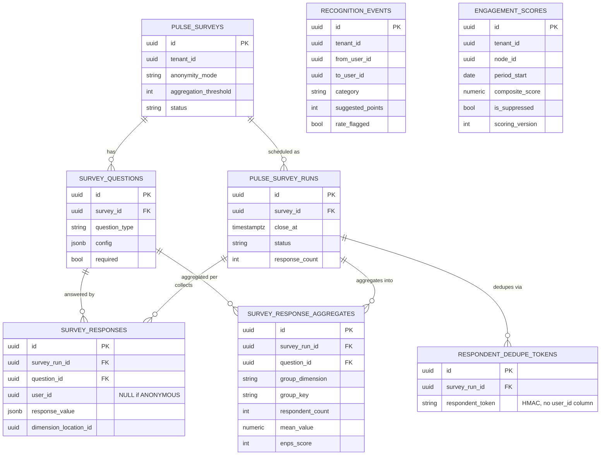
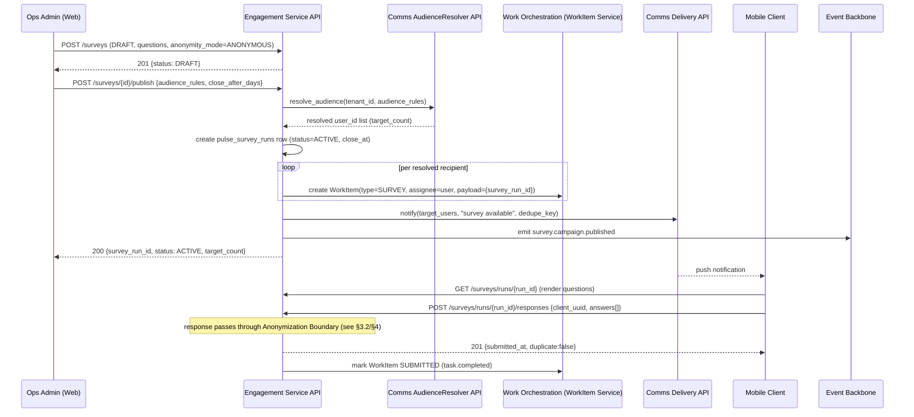
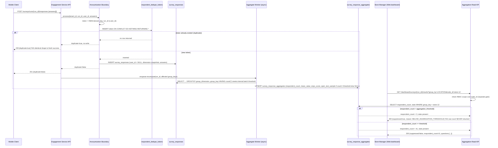
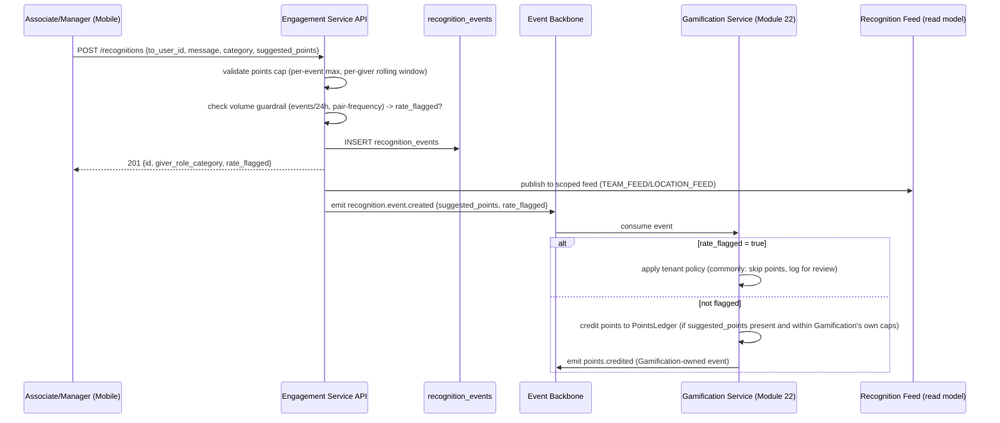

# Employee Engagement & Voice of Frontline — Low-Level Design

Module: `18-employee-engagement`
Schema namespace: `engagement` (Postgres)

## 1. Postgres Schema

All tables carry `tenant_id UUID NOT NULL` and are subject to Row-Level Security
(`USING (tenant_id = current_setting('app.tenant_id')::uuid)`) per conventions.md. Timestamps are
`TIMESTAMPTZ`. Primary keys are `UUID DEFAULT gen_random_uuid()` unless noted. `survey_responses`
and `respondent_dedupe_tokens` additionally have table-level `GRANT` restricted to the Engagement
Service's DB role only (no cross-module or generic-reporting-role `SELECT`), per HLD §8.

### 1.1 `pulse_surveys`

| Column | Type | Notes |
|---|---|---|
| id | UUID PK | Stable logical survey identity |
| tenant_id | UUID NOT NULL | |
| title | TEXT NOT NULL | |
| description | TEXT | |
| survey_type | VARCHAR(20) NOT NULL | `PULSE`,`ENPS`,`CUSTOM` |
| anonymity_mode | VARCHAR(12) NOT NULL | `ANONYMOUS`,`ATTRIBUTED` — immutable once status leaves `DRAFT` |
| aggregation_threshold | INT NOT NULL DEFAULT 5 | CHECK (aggregation_threshold >= 5) — hard floor enforced at DB level |
| recurrence_type | VARCHAR(20) NOT NULL | `ONE_TIME`,`FIXED_INTERVAL`,`CRON` |
| recurrence_config | JSONB | e.g. `{"interval":"MONTHLY","day_of_month":1}` or `{"cron":"0 9 1 * *"}` |
| status | VARCHAR(20) NOT NULL | `DRAFT`,`SCHEDULED`,`ACTIVE`,`CLOSED`,`RESULTS_PUBLISHED` |
| owner_user_id | UUID NOT NULL | |
| created_at | TIMESTAMPTZ NOT NULL DEFAULT now() | |
| updated_at | TIMESTAMPTZ NOT NULL DEFAULT now() | |
| version | INT NOT NULL DEFAULT 1 | Optimistic concurrency |

Indexes: `(tenant_id, status)`, `(tenant_id, owner_user_id)`.
CHECK: `anonymity_mode` transitions are enforced at the application layer (immutability once
`status != 'DRAFT'`), not purely by a DB trigger, so the API can return a clear `409` (LLD §6).

### 1.2 `survey_questions`

| Column | Type | Notes |
|---|---|---|
| id | UUID PK | |
| tenant_id | UUID NOT NULL | |
| survey_id | UUID NOT NULL FK → pulse_surveys | |
| sequence | INT NOT NULL | Display order |
| question_type | VARCHAR(20) NOT NULL | `RATING`,`SINGLE_SELECT`,`MULTI_SELECT`,`OPEN_TEXT`,`ENPS` |
| prompt_text | TEXT NOT NULL | |
| config | JSONB NOT NULL | e.g. `{"scale_max":5}` (RATING), `{"options":["Yes","No","Unsure"]}` (SELECT) |
| required | BOOLEAN NOT NULL DEFAULT true | |
| question_bank_ref | UUID | Optional FK → `survey_question_bank` (reusable template) |

Uniqueness: `UNIQUE (tenant_id, survey_id, sequence)`. Partial unique index:
`UNIQUE (tenant_id, survey_id) WHERE question_type = 'ENPS'` — at most one eNPS question per survey.

### 1.3 `pulse_survey_runs`

One row per scheduled occurrence of a (possibly recurring) `PulseSurvey`.

| Column | Type | Notes |
|---|---|---|
| id | UUID PK | `survey_run_id` referenced elsewhere |
| tenant_id | UUID NOT NULL | |
| survey_id | UUID NOT NULL FK → pulse_surveys | |
| audience_rules | JSONB NOT NULL | Same shape as Communications' `announcement_audience_rules` |
| opened_at | TIMESTAMPTZ | |
| close_at | TIMESTAMPTZ NOT NULL | |
| closed_at | TIMESTAMPTZ | Actual close (may be earlier than close_at if force-closed) |
| status | VARCHAR(20) NOT NULL | `SCHEDULED`,`ACTIVE`,`CLOSED`,`RESULTS_PUBLISHED` |
| target_count | INT | Snapshotted resolved audience size at open |
| response_count | INT NOT NULL DEFAULT 0 | Denormalized counter, updated on ingestion |
| created_at | TIMESTAMPTZ NOT NULL DEFAULT now() | |

Indexes: `(tenant_id, survey_id, status)`, `(tenant_id, status, close_at)`.

### 1.4 `survey_responses`

**Anonymization strategy**: for `ANONYMOUS` runs, `user_id` is `NULL` — never populated, never
backfilled. Respondent context needed for grouping (location, team, role, tenure band) is captured
as **non-identifying dimension snapshot columns** at submission time, not as a foreign key to the
live user record (so it can't be joined back to identity even indirectly via those dimensions in
combination with other systems, and so it reflects the respondent's context *at response time* per
the mid-campaign-transfer edge case).

| Column | Type | Notes |
|---|---|---|
| id | UUID PK | |
| tenant_id | UUID NOT NULL | |
| survey_run_id | UUID NOT NULL FK → pulse_survey_runs | |
| question_id | UUID NOT NULL FK → survey_questions | |
| user_id | UUID | **NULL for ANONYMOUS runs.** Populated only for ATTRIBUTED runs. |
| response_value | JSONB NOT NULL | `{"rating":4}` / `{"selected":["a","c"]}` / `{"text":"..."}` / `{"enps":9}` |
| dimension_location_id | UUID | Snapshot of respondent's location `OrganizationNode` id at submission time |
| dimension_role_id | UUID | Snapshot of respondent's role id at submission time |
| dimension_shift | VARCHAR(20) | Snapshot, if applicable |
| dimension_tenure_band | VARCHAR(20) | e.g. `0-6mo`,`6-24mo`,`24mo+`, computed at submission time |
| submitted_at | TIMESTAMPTZ NOT NULL DEFAULT now() | Server-authoritative |
| client_uuid | UUID | For ATTRIBUTED offline idempotent replay only (not used for ANONYMOUS dedupe — see §1.5) |

Indexes: `(tenant_id, survey_run_id, question_id)`,
`(tenant_id, survey_run_id, dimension_location_id)` (aggregation query path).
Uniqueness for `ATTRIBUTED` runs: `UNIQUE (tenant_id, survey_run_id, question_id, user_id)`
(partial unique index `WHERE user_id IS NOT NULL`). No uniqueness constraint references `user_id`
for anonymous rows — duplicate prevention for those happens entirely in `respondent_dedupe_tokens`
(§1.5), by design, so this table itself never carries anything that could be used to link rows to a
person even under a schema/constraint inspection.

### 1.5 `respondent_dedupe_tokens`

Separately-keyed pseudonymization table — physically and logically isolated from
`survey_responses` (no foreign key between them; a `respondent_token` cannot be joined to a
`survey_responses` row because `survey_responses` does not store the token). This table exists
**solely** to answer "has this user already responded to this survey_run" without storing identity
alongside the response content.

| Column | Type | Notes |
|---|---|---|
| id | UUID PK | |
| tenant_id | UUID NOT NULL | |
| survey_run_id | UUID NOT NULL FK → pulse_survey_runs | |
| respondent_token | TEXT NOT NULL | `HMAC-SHA256(tenant_key, survey_run_id \|\| user_id)`, hex-encoded |
| created_at | TIMESTAMPTZ NOT NULL DEFAULT now() | |

Uniqueness: `UNIQUE (tenant_id, survey_run_id, respondent_token)` — this is the actual duplicate
-prevention mechanism for anonymous responses. **No `user_id` column exists in this table.** The
HMAC key is tenant-scoped and held only by the Anonymization Boundary component (§8); the
Aggregation Engine, dashboard read APIs, and Analytics export path have no access to the key and no
access to this table at all (DB grant excludes them).
Indexes: `(tenant_id, survey_run_id)`.

### 1.6 `survey_response_aggregates`

Precomputed, incrementally-updated aggregate table — the **only** table dashboard reads query
(HLD §5/§6). Already threshold-annotated; the read API additionally re-checks the threshold at query
time (belt-and-suspenders, §5 pseudocode) rather than trusting a stale `is_suppressed` flag alone.

| Column | Type | Notes |
|---|---|---|
| id | UUID PK | |
| tenant_id | UUID NOT NULL | |
| survey_run_id | UUID NOT NULL FK → pulse_survey_runs | |
| question_id | UUID NOT NULL FK → survey_questions | |
| group_dimension | VARCHAR(30) NOT NULL | `LOCATION`,`ROLE`,`SHIFT`,`TENURE_BAND`,`LOCATION_SHIFT`,`ENTERPRISE` |
| group_key | TEXT NOT NULL | e.g. location_id, or composite `"{location_id}:{shift}"` |
| respondent_count | INT NOT NULL | Raw count — used for the threshold check, never returned directly to a below-threshold caller |
| mean_value | NUMERIC | For RATING/ENPS |
| distribution | JSONB | Histogram, e.g. `{"1":2,"2":5,"3":10,...}` |
| enps_score | INT | For ENPS questions only |
| promoter_pct | NUMERIC | |
| detractor_pct | NUMERIC | |
| open_text_sample | JSONB | Only populated when `respondent_count >= threshold`; NULL otherwise (never partially populated) |
| computed_at | TIMESTAMPTZ NOT NULL | |

Uniqueness: `UNIQUE (tenant_id, survey_run_id, question_id, group_dimension, group_key)`.
Indexes: `(tenant_id, survey_run_id, group_dimension)`.

### 1.7 `recognition_events`

| Column | Type | Notes |
|---|---|---|
| id | UUID PK | |
| tenant_id | UUID NOT NULL | |
| from_user_id | UUID NOT NULL | |
| to_user_id | UUID NOT NULL | |
| message | TEXT NOT NULL | Max 500 chars, enforced at API layer |
| category | VARCHAR(40) NOT NULL | Tenant-configurable enum |
| visibility | VARCHAR(20) NOT NULL DEFAULT 'TEAM_FEED' | `TEAM_FEED`,`LOCATION_FEED`,`PRIVATE_TO_RECIPIENT` |
| giver_role_category | VARCHAR(10) NOT NULL | `MANAGER`,`PEER` — computed at creation |
| cross_scope | BOOLEAN NOT NULL DEFAULT false | |
| suggested_points | INT | Nullable; bounded by tenant caps at API validation |
| rate_flagged | BOOLEAN NOT NULL DEFAULT false | Excluded from engagement-score input when true |
| created_at | TIMESTAMPTZ NOT NULL DEFAULT now() | |

Indexes: `(tenant_id, to_user_id, created_at)`, `(tenant_id, from_user_id, created_at)` (rate-limit
window queries), `(tenant_id, visibility, created_at)` (feed queries).

### 1.8 `engagement_scores`

| Column | Type | Notes |
|---|---|---|
| id | UUID PK | |
| tenant_id | UUID NOT NULL | |
| node_id | UUID NOT NULL | FK → OrganizationNode (external ref) |
| period_start | DATE NOT NULL | |
| period_type | VARCHAR(10) NOT NULL | `WEEK`,`MONTH`,`QUARTER` |
| composite_score | NUMERIC NOT NULL | 0–100 |
| participation_rate | NUMERIC | 0–1 |
| mean_rating_component | NUMERIC | Normalized 0–100 |
| enps_component | NUMERIC | Rescaled 0–100 |
| recognition_activity_component | NUMERIC | Normalized 0–100 |
| respondent_count | INT NOT NULL | Drives threshold suppression for **this node's own** display |
| is_suppressed | BOOLEAN NOT NULL | `respondent_count < aggregation_threshold` at this node |
| scoring_version | INT NOT NULL | |
| computed_at | TIMESTAMPTZ NOT NULL | |
| input_response_count | INT NOT NULL | For idempotent-recompute audit (FR-ENG-029) |

Uniqueness: `UNIQUE (tenant_id, node_id, period_start, period_type, scoring_version)`.
Indexes: `(tenant_id, node_id, period_type, period_start)`.

### 1.9 ER Diagram



Note: `RECOGNITION_EVENTS` and `ENGAGEMENT_SCORES` are intentionally not connected by FK to the
survey tables in this diagram — `ENGAGEMENT_SCORES` is *derived from* aggregates and recognition
data by the rollup job (a computed relationship, not a referential one), kept that way so the
survey-anonymity subsystem remains structurally isolated from the rest of the schema.

## 2. REST Endpoints

Base path `/api/v1/engagement/`. OAuth2/OIDC bearer auth; tenant resolved from principal. Mutations
accept `Idempotency-Key`; mutable resources use `ETag`/`version`.

### 2.1 `POST /api/v1/engagement/surveys` — create survey campaign (draft)

Request:
```json
{
  "title": "October Pulse — Team Wellbeing",
  "survey_type": "PULSE",
  "anonymity_mode": "ANONYMOUS",
  "aggregation_threshold": 5,
  "recurrence_type": "FIXED_INTERVAL",
  "recurrence_config": { "interval": "MONTHLY", "day_of_month": 1 },
  "questions": [
    { "sequence": 1, "question_type": "ENPS", "prompt_text": "How likely are you to recommend working here to a friend?", "config": {}, "required": true },
    { "sequence": 2, "question_type": "RATING", "prompt_text": "My manager supports me when I need help.", "config": { "scale_max": 5 }, "required": true },
    { "sequence": 3, "question_type": "OPEN_TEXT", "prompt_text": "What's one thing we could do better this month?", "config": {}, "required": false }
  ]
}
```
Response `201`:
```json
{ "id": "survey-9931", "status": "DRAFT", "version": 1, "created_at": "2026-09-20T10:00:00Z" }
```
Errors: `400 VALIDATION_ERROR` (e.g. more than one `ENPS` question, `aggregation_threshold < 5`).

### 2.2 `POST /api/v1/engagement/surveys/{id}/publish` — schedule/open the next run

Request:
```json
{ "audience_rules": [ { "scope_node_ids": ["node-enterprise-root"], "role_ids": [], "attribute_predicate": null } ], "close_after_days": 5 }
```
Server calls Communications' `resolve_audience` (HLD §4) to compute `target_count`, creates the
`pulse_survey_runs` row, transitions `pulse_surveys.status` `DRAFT/SCHEDULED → ACTIVE`, creates one
`Survey` WorkItem per resolved recipient (via Work Orchestration), and calls Communications'
delivery API.
Response `200`:
```json
{ "survey_run_id": "run-4471", "status": "ACTIVE", "target_count": 812, "close_at": "2026-09-25T00:00:00Z" }
```
Errors: `403 SCOPE_DENIED`, `422 EMPTY_AUDIENCE`, `409 CONFLICT` (anonymity_mode changed after
`DRAFT` — see §6).

### 2.3 `POST /api/v1/engagement/surveys/runs/{run_id}/responses` — submit a response

Request (batched — all answers for one respondent's pass at the survey in one call):
```json
{
  "client_uuid": "c-uuid-7712",
  "answers": [
    { "question_id": "q-1", "response_value": { "enps": 9 } },
    { "question_id": "q-2", "response_value": { "rating": 4 } },
    { "question_id": "q-3", "response_value": { "text": "More cross-training opportunities." } }
  ]
}
```
Response `201` (identical shape regardless of anonymity_mode — the client never needs to know or
handle the anonymization mechanics differently):
```json
{ "survey_run_id": "run-4471", "submitted_at": "2026-09-21T09:14:02Z", "duplicate": false }
```
Errors:
- `404 NOT_FOUND` — run not found, closed, or caller not in resolved target set (never distinguishes
  which, mirroring Communications' ack pattern).
- `409 DUPLICATE_RESPONSE` — returned for `ATTRIBUTED` runs on genuine constraint conflict outside
  the idempotent `client_uuid` path; for `ANONYMOUS` runs a duplicate (matched `respondent_token`)
  returns `200` with `duplicate: true` and **no data write**, not an error — the client experience is
  identical to a fresh submission's confirmation screen, so no observable signal distinguishes "this
  device already responded" from "this device is submitting for the first time" (avoids leaking
  metadata about response history from response behavior itself).
- `422 SURVEY_CLOSED`.

### 2.4 `POST /api/v1/engagement/recognitions` — give recognition

Request:
```json
{
  "to_user_id": "u-2290",
  "message": "Jumped in to cover an extra shift on zero notice and kept the store running smoothly.",
  "category": "ABOVE_AND_BEYOND",
  "visibility": "LOCATION_FEED",
  "suggested_points": 25
}
```
Response `201`:
```json
{ "id": "recog-5510", "giver_role_category": "PEER", "cross_scope": false, "rate_flagged": false, "created_at": "2026-09-21T11:00:00Z" }
```
Errors: `422 POINTS_CAP_EXCEEDED`, `422 MESSAGE_TOO_LONG`, `404 RECIPIENT_NOT_FOUND`.

### 2.5 `GET /api/v1/engagement/dashboard/surveys/{run_id}/results` — aggregation-threshold-enforced read

Query params: `?group_by=LOCATION&node_id=node-store-4412`.
Response `200` — **suppressed example** (below threshold):
```json
{
  "survey_run_id": "run-4471",
  "group_dimension": "LOCATION",
  "group_key": "node-store-4412",
  "suppressed": true,
  "reason": "BELOW_AGGREGATION_THRESHOLD",
  "threshold": 5,
  "message": "Not enough responses to show results for this group (fewer than 5 people) — protecting individual anonymity."
}
```
Response `200` — **shown example** (meets threshold):
```json
{
  "survey_run_id": "run-4471",
  "group_dimension": "LOCATION",
  "group_key": "node-district-northeast",
  "suppressed": false,
  "respondent_count": 63,
  "questions": [
    { "question_id": "q-1", "question_type": "ENPS", "enps_score": 34, "promoter_pct": 0.52, "detractor_pct": 0.18 },
    { "question_id": "q-2", "question_type": "RATING", "mean_value": 4.1, "distribution": {"1":1,"2":3,"3":8,"4":24,"5":27} },
    { "question_id": "q-3", "question_type": "OPEN_TEXT", "sample": ["More cross-training opportunities.", "..."] }
  ]
}
```
Note: `respondent_count` is included **only** in the non-suppressed response — the suppressed
response never carries the raw count (even "3 of 5 needed" is withheld, because in a very small
office that alone can be de-anonymizing — see LLD §4 pseudocode comment).
Errors: `403 SCOPE_DENIED` (requester's `UserScope` does not cover `node_id` at all — a materially
different case from "suppressed," and never conflated with it in the response shape).

### 2.6 `GET /api/v1/engagement/dashboard/engagement-score`

Query params: `?node_id=node-district-northeast&period_type=MONTH&periods=6`.
Response `200`:
```json
{
  "node_id": "node-district-northeast",
  "period_type": "MONTH",
  "series": [
    { "period_start": "2026-04-01", "composite_score": 71.2, "suppressed": false, "respondent_count": 340 },
    { "period_start": "2026-05-01", "composite_score": 73.0, "suppressed": false, "respondent_count": 355 }
  ]
}
```

## 3. Sequence Diagrams

### 3.1 Survey campaign creation → audience resolution via Communications → delivery → response collection



### 3.2 Anonymous response aggregation with small-group suppression enforced server-side



### 3.3 Recognition event → optional points award via Gamification



## 4. Pseudocode: Anonymity-Safe Aggregation Query

```
function get_survey_results(tenant_id, requester, survey_run_id, group_dimension, group_key):
    # Step 1 — RBAC/scope gate: can this requester even ask about this group_key at all?
    if not AuthzService.has_scope(requester, node_of(group_key)):
        return 403 SCOPE_DENIED    # distinct from suppression; never conflated

    survey = load_survey_for_run(tenant_id, survey_run_id)

    # Step 2 — fetch the PRECOMPUTED aggregate row only; never touch survey_responses here
    agg = AggregateStore.get(tenant_id, survey_run_id, group_dimension, group_key)
    if agg is None:
        return { suppressed: false, respondent_count: 0, message: "No responses yet" }
        # zero vs. below-threshold are deliberately different states (functional-spec §6)

    threshold = survey.aggregation_threshold

    # Step 3 — the hard gate. Boundary is inclusive at N (>= shows, < suppresses).
    if agg.respondent_count < threshold:
        return {
            suppressed: true,
            reason: "BELOW_AGGREGATION_THRESHOLD",
            threshold: threshold
            # NOTE: agg.respondent_count is intentionally NOT included in this branch's
            # response payload, even though the server has it. Returning "3 of 5 needed"
            # can itself be de-anonymizing in a very small office (e.g., distinguishing
            # "1 person responded" from "4 people responded" changes what a viewer who
            # knows the roster can infer). Only "suppressed" + the threshold VALUE is safe.
        }

    # Step 4 — safe to return computed statistics
    result = {
        suppressed: false,
        respondent_count: agg.respondent_count,
        questions: []
    }
    for q in agg.per_question_stats:
        if q.question_type == 'OPEN_TEXT':
            # Redundant defense: open_text_sample is only ever populated by the aggregate
            # worker when count >= threshold at WRITE time (see §5 worker logic), so this
            # is a second check on data that should already satisfy it.
            if agg.respondent_count >= threshold and q.open_text_sample is not None:
                result.questions.append({ ...q, sample: q.open_text_sample })
        else:
            result.questions.append(q)
    return result


function compute_aggregate_worker(survey_run_id, group_dimension, group_key):
    # Runs async on response ingestion (batched, not per-row synchronous)
    rows = RawResponseStore.select(
        survey_run_id = survey_run_id,
        group_dimension_matches(group_dimension, group_key)
    )   # this is the ONLY component with SELECT grant on survey_responses
    count = len(rows)

    stats = compute_stats(rows)   # mean, distribution, eNPS, etc.

    open_text_sample = None
    if count >= load_threshold_for(survey_run_id):
        open_text_sample = sample_open_text(rows, max_n=20)
        # sampling itself, not full dump, further limits exposure even above threshold

    AggregateStore.upsert(
        survey_run_id, group_dimension, group_key,
        respondent_count = count,
        stats = stats,
        open_text_sample = open_text_sample   # NULL if below threshold — never written even transiently
    )
```

## 5. Pseudocode: eNPS Computation

```
function classify_enps_response(score):
    # score in [0, 10]
    if score >= 9:  return 'PROMOTER'
    if score >= 7:  return 'PASSIVE'
    return 'DETRACTOR'   # 0-6

function compute_enps(responses):
    # responses: list of integers 0-10 for a single ENPS question within one group_key
    n = len(responses)
    if n == 0:
        return { enps_score: null, promoter_pct: null, detractor_pct: null }

    promoters  = count(r for r in responses if classify_enps_response(r) == 'PROMOTER')
    detractors = count(r for r in responses if classify_enps_response(r) == 'DETRACTOR')

    promoter_pct  = promoters  / n
    detractor_pct = detractors / n

    enps_score = round((promoter_pct - detractor_pct) * 100)   # range -100..100

    return {
        enps_score: enps_score,
        promoter_pct: promoter_pct,
        detractor_pct: detractor_pct,
        n: n   # used by the caller for the threshold check, not returned to below-threshold requesters
    }

# Composite EngagementScore blending (per node, per period) — FR-ENG-026
function compute_engagement_score(node_id, period_start, period_type):
    survey_component  = normalize_0_100(mean_rating_across_surveys(node_id, period_start, period_type))
    enps_raw          = enps_for_node(node_id, period_start, period_type)          # -100..100 or null
    enps_component    = ((enps_raw + 100) / 2) if enps_raw is not null else null   # rescale to 0..100
    participation     = participation_rate(node_id, period_start, period_type)     # 0..1
    recognition_rate  = recognitions_received_per_active_user(node_id, period_start, period_type, exclude_rate_flagged=true)
    recognition_component = normalize_0_100(recognition_rate)

    weights = load_tenant_weights(node_id.tenant_id)  # default {rating:0.40, enps:0.30, participation:0.15, recognition:0.15}

    # Skip a component from the weighted average (and renormalize remaining weights)
    # if that component's underlying respondent_count is below threshold at this node,
    # rather than treating a suppressed component as zero (which would wrongly punish
    # a small team's score for a privacy protection rather than an actual signal).
    components = filter_out_suppressed({rating: survey_component, enps: enps_component,
                                         participation: participation, recognition: recognition_component},
                                        node_id, period_start, period_type)
    composite = weighted_average(components, weights, renormalize=true)

    return composite, participation, respondent_count_at(node_id, period_start, period_type)
```

## 6. Caching Strategy

| Cache | Key shape | TTL / invalidation |
|---|---|---|
| Precomputed survey aggregates | Not a cache in the traditional sense — `survey_response_aggregates` **is** the materialized store; a thin Redis layer (`tenant:{t}:run:{run_id}:agg:{dim}:{key}`) sits in front of it for hot dashboard reads | TTL 60s; invalidated on aggregate-worker upsert for that key |
| Engagement score series (per node/period_type) | `tenant:{t}:node:{n}:score:{period_type}` | TTL 15 min; invalidated on rollup job completion for that node |
| Audience-resolution result (survey campaign) | Delegated to Communications' own cache (Module 07 LLD §6) — this module does not maintain a parallel cache of the same resolution | n/a |
| Tenant HMAC key for `respondent_token` derivation | In-memory, loaded once per Anonymization Boundary process instance from central secret management, never logged, never cached in Redis or any shared store | Rotated per platform key-rotation policy (source-spec §21.2); rotation invalidates dedupe for in-flight survey runs only for the rotation window, mitigated by a grace-period dual-key check during rotation |

No cache anywhere in this module holds raw `survey_responses` rows or anything derivable back to
`user_id` for anonymous runs — caching is strictly limited to already-aggregated, already
threshold-annotated data, consistent with HLD §5's query-path isolation design.

## 7. Concurrency Control

- **Anonymous dedupe**: `INSERT ... ON CONFLICT (tenant_id, survey_run_id, respondent_token) DO
  NOTHING RETURNING *` against `respondent_dedupe_tokens` is the sole concurrency guard — a race
  between two near-simultaneous submissions from the same user (e.g., double-tap, offline replay
  racing a foreground retry) resolves deterministically to exactly one accepted response, with the
  loser receiving `duplicate: true` and no `survey_responses` write, mirroring Communications'
  idempotent-ack pattern (Module 07 LLD §7) but keyed on a pseudonymous token instead of `user_id`.
- **Aggregate recompute races**: the aggregate worker recompute for a given `(survey_run_id,
  group_dimension, group_key)` is single-flighted via a Postgres advisory lock on that composite key
  (hashed), so two concurrent ingestion-triggered recompute jobs for the same group don't race to
  `UPSERT` inconsistent partial results; the upsert itself is a full recompute from current raw rows
  (not an incremental delta), so it is idempotent regardless of ordering.
- **Survey publish**: optimistic concurrency via `version`/`ETag` on `pulse_surveys`, same pattern as
  Communications' announcement publish (409 on stale version).
- **Recognition rate-limit check**: the per-giver rolling-window cap check
  (`SELECT count(*) FROM recognition_events WHERE from_user_id=? AND created_at > now() -
  interval '24 hours' FOR UPDATE SKIP LOCKED`-style guard is unnecessary here since it's a read-check
  before insert, not a shared counter mutation) is a straightforward read-then-insert; a small race
  window allowing a marginal over-cap event is accepted as low-risk (worst case: one extra flagged
  event, caught by the next request's check) rather than adding contention with row locking on a
  high-traffic table.
- **EngagementScore rollup**: computed bottom-up per `OrganizationNode`; sibling subtrees are
  computed independently and in parallel by the batch job, each protected by a
  per-`(node_id, period_start, period_type)` advisory lock so a manual "recompute now" trigger
  doesn't race the scheduled batch run for the same node/period.

## 8. Background Jobs

| Job | Trigger | Behavior |
|---|---|---|
| Survey run scheduler | Temporal timer per `pulse_surveys.recurrence_config` | Fires at each occurrence, creates a new `pulse_survey_runs` row, resolves audience, creates WorkItems, calls delivery — exactly-once via Temporal workflow-per-occurrence semantics |
| Survey run closer | Temporal timer per `pulse_survey_runs.close_at` | Transitions `ACTIVE → CLOSED`; triggers final full aggregate recompute for every `(question, dimension, group_key)` combination observed in that run; on completion transitions `CLOSED → RESULTS_PUBLISHED` and emits `survey.campaign.closed` |
| Aggregate worker | Consumes internal "response ingested" queue message per accepted `survey_responses` insert | Recomputes affected `(group_dimension, group_key)` aggregate rows per §4 pseudocode; batched (debounced ~30s per group_key under high-volume ingestion, not literally per single response, to bound worker load without missing the freshness NFR) |
| Engagement score rollup | Weekly Temporal schedule (also triggerable on-demand by an authorized admin) | Bottom-up traversal of `OrganizationNode` tree per tenant; computes leaf scores from that period's aggregates + recognition data, then rolls up per §5 pseudocode weighted-average logic, writing a new `scoring_version` per run — never mutates a prior `scoring_version` row |
| Recognition rate-flag sweep | Consumes `recognition.event.created` synchronously at creation (not a separate batch job) — listed here for completeness of the guardrail pipeline | Evaluates 24h volume and pair-frequency rules inline before the row is committed (§7); no async lag for this check |
| Dedupe-token retention cleanup | Daily | Purges `respondent_dedupe_tokens` rows for `survey_run_id`s closed more than the tenant's configured retention window ago (default 2 years) — tokens outlive their usefulness once a run can never accept new responses, and pruning them further reduces the (already minimal) footprint of anonymization metadata |
| HMAC key rotation handler | Triggered by central secret management rotation event | During a bounded grace window, dedupe checks accept tokens derived from either the current or immediately-prior key (dual-key check) so in-flight survey runs don't silently lose dedupe protection mid-rotation; after the grace window, only the current key is accepted for new tokens (existing stored tokens remain valid as historical dedupe records regardless of which key produced them) |

## 9. Error Handling

| Scenario | HTTP status | Error code | Notes |
|---|---|---|---|
| Anonymity mode change attempted after `DRAFT` | 409 | `ANONYMITY_MODE_LOCKED` | FR-ENG-005; client must clone into a new draft |
| `aggregation_threshold` below platform hard floor (5) | 422 | `THRESHOLD_BELOW_FLOOR` | Enforced at API validation and DB CHECK constraint (defense in depth) |
| More than one `ENPS` question on a survey | 422 | `MULTIPLE_ENPS_QUESTIONS` | Partial unique index also enforces at DB level |
| Publish with resolved audience of zero | 422 | `EMPTY_AUDIENCE` | Mirrors Communications' pattern |
| Response submitted after `close_at` | 422 | `SURVEY_CLOSED` | Applies both online and to offline-queued responses replayed after close |
| Response for a run the caller is not targeted for | 404 | `NOT_FOUND` | Never distinguishes "doesn't exist" from "not authorized," same rationale as Communications' ack endpoint |
| Duplicate anonymous response (token conflict) | 200 | n/a | `duplicate: true`, no write — never surfaced as an error to preserve identical UX regardless of dedupe outcome |
| Duplicate attributed response (constraint conflict outside client_uuid idempotency) | 409 | `DUPLICATE_RESPONSE` | |
| Aggregate query for a group below threshold | 200 | n/a | `suppressed: true` — an authorized-but-suppressed result is a valid outcome, not an error (mirrors Communications' "no answer available" pattern) |
| Aggregate query for a node outside requester's scope | 403 | `SCOPE_DENIED` | Never conflated with `suppressed: true` in payload shape |
| Recognition points cap exceeded | 422 | `POINTS_CAP_EXCEEDED` | Per-event or per-giver rolling-window cap |
| Recognition message exceeds length limit | 400 | `VALIDATION_ERROR` | |
| Recognition volume guardrail exceeded | 201 (created, not blocked) | n/a | Event is recorded with `rate_flagged: true`, never silently dropped (functional-spec §6 rationale) |
| Gamification service unavailable on points-award attempt | 201 (recognition still succeeds) | n/a | `recognition.event.created` retried via event backbone dead-letter/redelivery; recognition creation itself is never blocked on Gamification's availability |
| Communications audience-resolution API unavailable at publish | 503 | `DEPENDENCY_UNAVAILABLE` | Retryable; publish is not partially completed (HLD §7) |
| Cross-tenant survey_run/recognition reference attempted | 403 | `SCOPE_DENIED` | Defense-in-depth; should be unreachable given RLS, logged as a potential security event |
| Idempotency-Key reused with different payload | 409 | `IDEMPOTENCY_KEY_CONFLICT` | Standard platform-wide contract |
