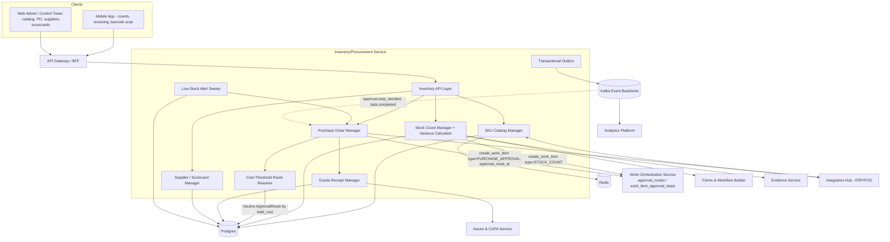
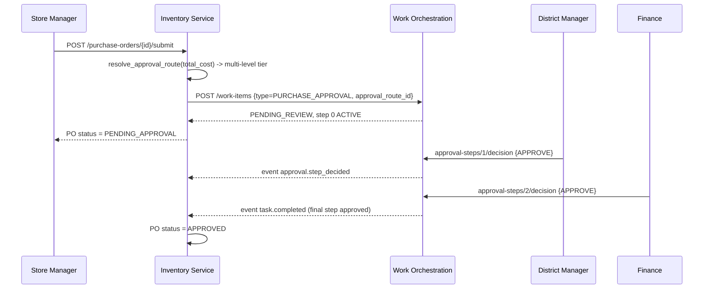
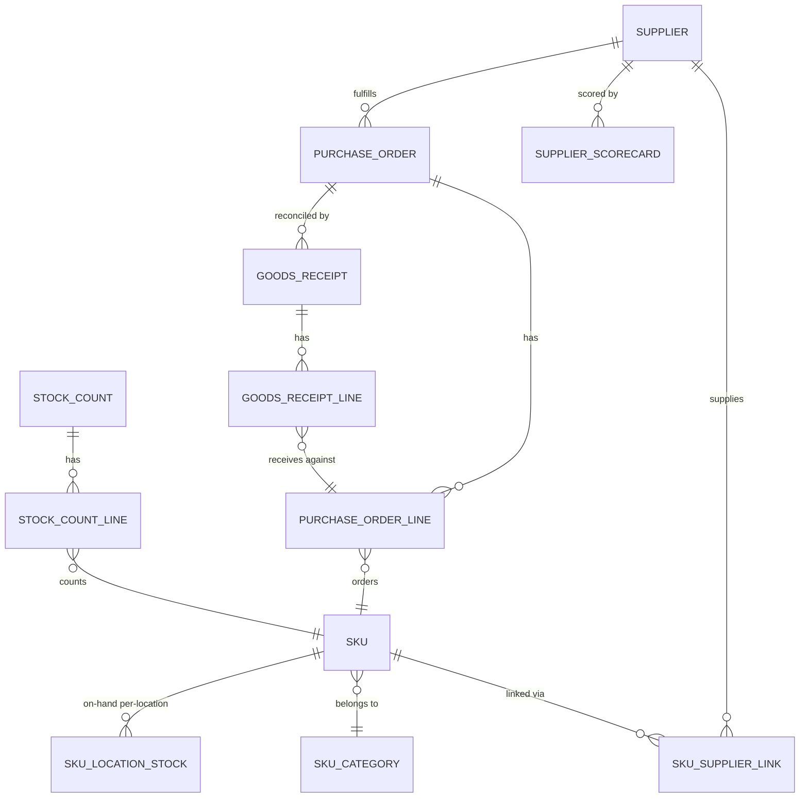
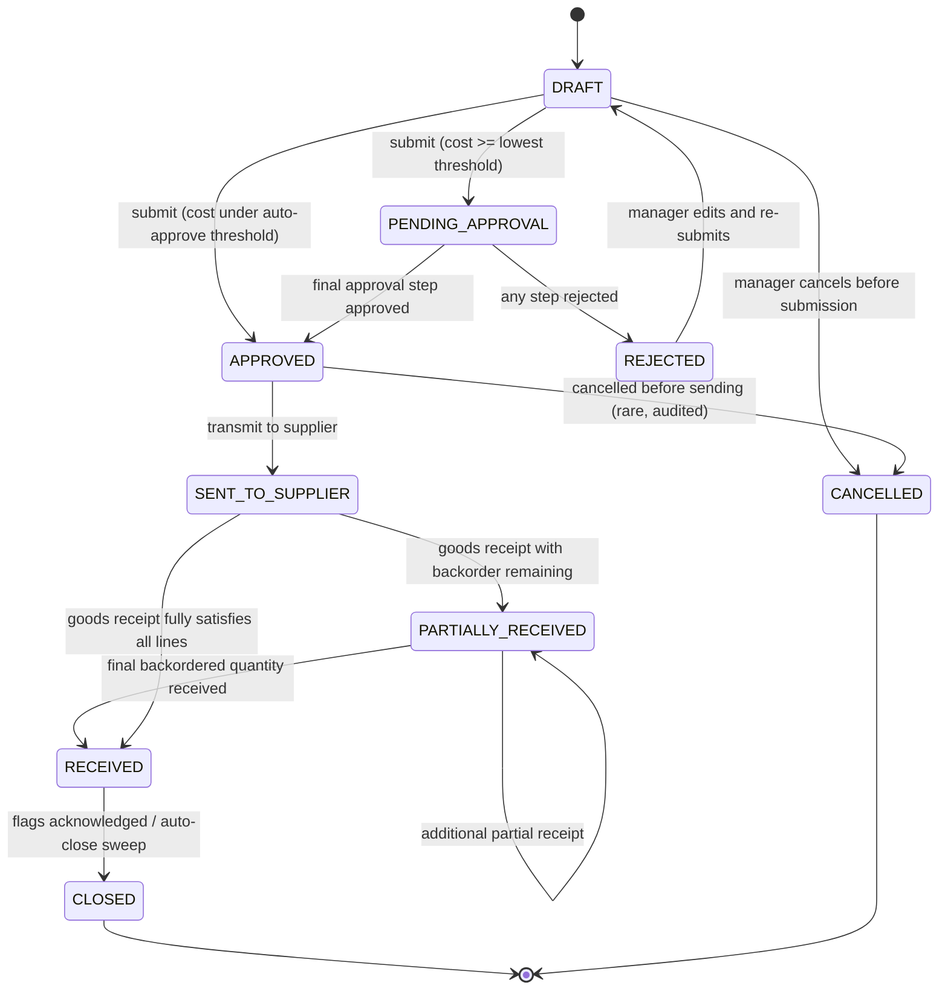

# Inventory, Procurement & Supplier Management — Architecture Diagrams

Focused diagram set for this module only; narrative detail lives in `functional-spec.md`,
`high-level-design.md`, `low-level-design.md`.

## 1. Component / Container Diagram



This module never implements approval logic of its own: the `Cost-Threshold Route Resolver`
computes *which* `ApprovalRoute` applies from a locally-owned config table, then hands off entirely
to Work Orchestration, which owns everything about *how* the multi-step chain executes. The dotted
feedback edge is this service consuming Work Orchestration's approval-outcome events to progress
the PO it owns.

## 2. Sequence Diagram — Purchase order approval (cost-threshold routing, reused multi-level mechanism)



Every decision call in this flow targets Work Orchestration's approval-step endpoint directly; the
Inventory Service never exposes its own decision endpoint for a PO approval step.

## 3. Sequence Diagram — Stock count to variance-flagged completion

```mermaid
sequenceDiagram
    participant ASSOC as Associate
    participant INV as Inventory Service
    participant WORK as Work Orchestration

    INV->>WORK: create_work_item(STOCK_COUNT)
    ASSOC->>INV: enter counted_quantity per line (barcode-assisted)
    INV->>INV: variance = counted - expected; flag if over threshold
    ASSOC->>INV: submit count
    alt flagged lines present
        INV->>WORK: WorkItem -> PENDING_REVIEW (single-step ApprovalRoute)
    end
    INV->>INV: WorkItem -> VERIFIED; apply stock adjustment
```

A stock count's review gate (when flagged lines require manager sign-off) is itself a single-step
instance of the same `ApprovalRoute` mechanism used for multi-level PO approval — one mechanism,
two usage patterns.

## 4. ER Diagram — Owned Entities



`ApprovalRoute` and `WorkItemApprovalStep` are intentionally absent from this diagram: they are
Work Orchestration's tables. `purchase_orders.approval_route_id` / `approval_work_item_id` are
cross-service references, not locally owned entities.

## 5. State Diagram — PurchaseOrder Lifecycle



`PENDING_APPROVAL` is not a self-contained state machine here — it internally delegates entirely to
Work Orchestration's approval-step mechanism, exactly as a generic `WorkItem`'s `PENDING_REVIEW`
state does (source-spec §17.2). This module only observes that delegated process transition to a
terminal `APPROVED`/`REJECTED` outcome via `approval.step_decided`/`task.completed` events and maps
it onto the two outward arrows shown above; it never re-derives approval progress from its own
logic.
