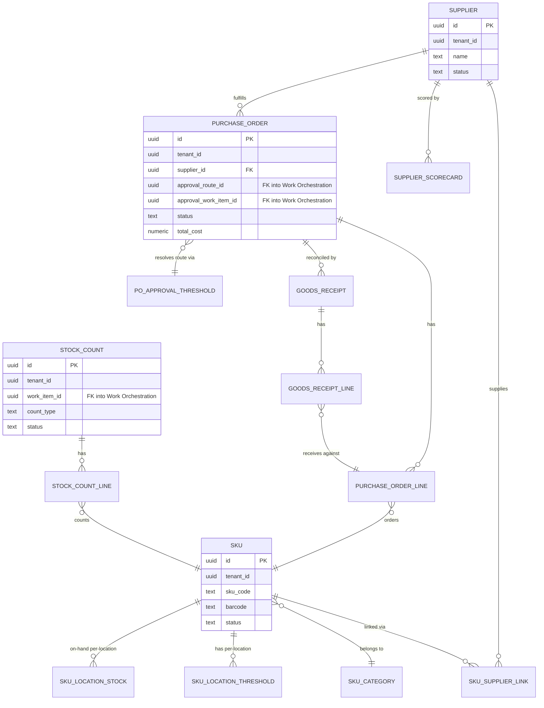
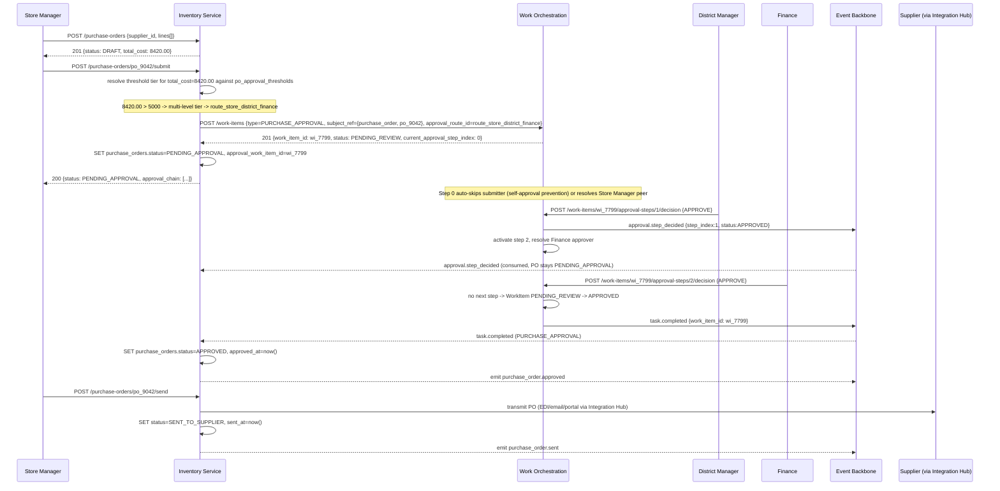
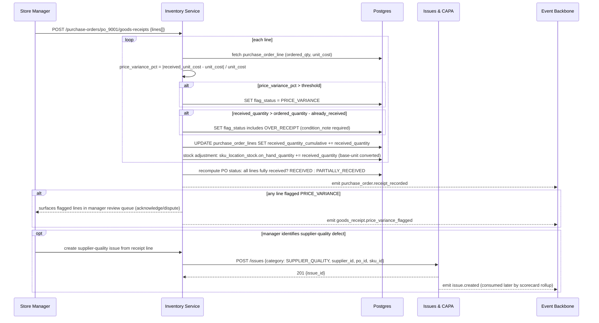

# Inventory, Procurement & Supplier Management — Low-Level Design

Reference: `functional-spec.md`, `high-level-design.md` (this module), `_context/conventions.md`
(API conventions, Postgres/RLS multi-tenancy, event envelope, state machines),
`02-work-orchestration/low-level-design.md` §1.1 (`approval_routes`, `work_item_approval_steps` —
reused by reference, schema not repeated here).

## 1. Database Schema

All tables carry `tenant_id UUID NOT NULL` with RLS policy `USING (tenant_id =
current_setting('app.tenant_id')::uuid)` behind application-layer scoping. Primary keys are UUIDv7.
All tables have `created_at`, `updated_at` (`timestamptz`, server-assigned) unless noted. Money
fields are `numeric(14,4)` with an explicit tenant `currency_code` column at the aggregate root
(PO, not per line) per the functional spec's single-currency-per-tenant MVP assumption.

### 1.1 `skus`

| Column | Type | Notes |
|---|---|---|
| `id` | UUID PK | |
| `tenant_id` | UUID | RLS key |
| `sku_code` | text | not null |
| `barcode` | text | nullable |
| `name` | text | not null |
| `description` | text | |
| `category_id` | UUID | FK `sku_categories.id` |
| `unit_of_measure` | text | `EACH,CASE,KG,LB,L,GAL,CUSTOM` |
| `custom_unit_label` | text | nullable, when `unit_of_measure=CUSTOM` |
| `case_pack_size` | numeric(10,4) | nullable |
| `unit_conversions` | jsonb | `[{from_unit, to_unit, factor}]` |
| `default_supplier_id` | UUID | nullable FK `suppliers.id` |
| `status` | enum | `DRAFT,ACTIVE,DISCONTINUED` |
| `discontinued_at` | timestamptz | nullable |
| `created_by` | UUID | |
| `version` | bigint | optimistic concurrency |
| `created_at`, `updated_at` | timestamptz | |

Unique `(tenant_id, sku_code)`, unique `(tenant_id, barcode)` partial `WHERE barcode IS NOT NULL`.
Index `(tenant_id, category_id, status)`.

### 1.2 `sku_categories`

| Column | Type | Notes |
|---|---|---|
| `id` | UUID PK | |
| `tenant_id` | UUID | |
| `parent_id` | UUID | nullable FK self |
| `name` | text | |
| `path` | ltree or text | materialized path for fast subtree queries, mirrors `OrganizationNode` pattern |
| `created_at`, `updated_at` | timestamptz | |

Index `(tenant_id, parent_id)`, GiST/ltree index on `path`.

### 1.3 `sku_supplier_links`

| Column | Type | Notes |
|---|---|---|
| `id` | UUID PK | |
| `tenant_id` | UUID | |
| `sku_id` | UUID FK `skus.id` | |
| `supplier_id` | UUID FK `suppliers.id` | |
| `supplier_sku_code` | text | supplier's own item code |
| `unit_cost` | numeric(14,4) | current negotiated cost |
| `is_preferred` | boolean | default false |
| `lead_time_days` | integer | |
| `active` | boolean | default true |
| `created_at`, `updated_at` | timestamptz | |

Unique `(tenant_id, sku_id, supplier_id)`. Index `(tenant_id, supplier_id, active)`.

### 1.4 `sku_cost_history`

| Column | Type | Notes |
|---|---|---|
| `id` | UUID PK | |
| `tenant_id` | UUID | |
| `sku_supplier_link_id` | UUID FK | |
| `unit_cost` | numeric(14,4) | |
| `effective_from` | timestamptz | |
| `changed_by` | UUID | |
| `created_at` | timestamptz | |

Index `(sku_supplier_link_id, effective_from desc)`.

### 1.5 `sku_location_thresholds`

| Column | Type | Notes |
|---|---|---|
| `id` | UUID PK | |
| `tenant_id` | UUID | |
| `sku_id` | UUID FK | |
| `location_id` | UUID | ref `organization_nodes` |
| `reorder_point` | numeric(14,4) | base-unit quantity |
| `reorder_quantity` | numeric(14,4) | base-unit quantity |
| `created_at`, `updated_at` | timestamptz | |

Unique `(tenant_id, sku_id, location_id)`.

### 1.6 `sku_location_stock`

| Column | Type | Notes |
|---|---|---|
| `id` | UUID PK | |
| `tenant_id` | UUID | |
| `sku_id` | UUID FK | |
| `location_id` | UUID | |
| `on_hand_quantity` | numeric(14,4) | base unit, authoritative current stock |
| `last_adjustment_source` | enum | `STOCK_COUNT,GOODS_RECEIPT` |
| `last_adjustment_ref_id` | UUID | id of the count or receipt that last touched this row |
| `updated_at` | timestamptz | |

Unique `(tenant_id, sku_id, location_id)`. This is the single authoritative on-hand row read by
count materialization (FR-INV-022) and the low-stock sweep (§10).

### 1.7 `sku_location_scope`

| Column | Type | Notes |
|---|---|---|
| `id` | UUID PK | |
| `tenant_id` | UUID | |
| `sku_id` | UUID FK | |
| `location_subtree_node_id` | UUID | ref `organization_nodes`; NULL row set = catalog-wide |
| `created_at` | timestamptz | |

### 1.8 `stock_counts`

| Column | Type | Notes |
|---|---|---|
| `id` | UUID PK | |
| `tenant_id` | UUID | |
| `work_item_id` | UUID | FK to Work Orchestration `work_items.id` (cross-service reference, not enforced FK) |
| `location_id` | UUID | |
| `count_type` | enum | `CYCLE,FULL,SPOT` |
| `scope_definition` | jsonb | category/SKU ids in scope, copied from template at materialization |
| `status` | enum | mirrors the owning WorkItem's status (`IN_PROGRESS,SUBMITTED,PENDING_REVIEW,VERIFIED,REJECTED,CANCELLED`) — denormalized for local query performance, kept in sync via WorkItem event consumption |
| `total_lines`, `lines_counted` | integer | for running-progress UX |
| `net_variance_value` | numeric(14,4) | running total, recomputed on each line write |
| `submitted_at`, `verified_at` | timestamptz | nullable |
| `created_at`, `updated_at` | timestamptz | |

Index `(tenant_id, location_id, status)`, unique `(work_item_id)`.

### 1.9 `stock_count_lines`

| Column | Type | Notes |
|---|---|---|
| `id` | UUID PK | |
| `tenant_id` | UUID | |
| `stock_count_id` | UUID FK `stock_counts.id` | |
| `sku_id` | UUID FK | |
| `expected_quantity` | numeric(14,4) | base unit, snapshot at materialization |
| `counted_quantity` | numeric(14,4) | nullable until entered, base unit |
| `count_unit_quantity` | numeric(14,4) | as entered by the user, in the count's display unit, pre-conversion |
| `count_unit` | text | unit the associate entered in |
| `variance_quantity` | numeric(14,4) | generated: `counted_quantity - expected_quantity` |
| `variance_value` | numeric(14,4) | generated: `variance_quantity * unit_cost_snapshot` |
| `unit_cost_snapshot` | numeric(14,4) | cost at time of entry, for stable variance-value history |
| `flag_status` | enum | `NONE,NEEDS_REVIEW` |
| `variance_reason` | text | nullable, required if flagged |
| `evidence_id` | UUID | nullable, ref Evidence Service |
| `entered_by` | UUID | actor who entered this specific line (FR-INV-026 shift handoff) |
| `entered_at` | timestamptz | nullable |
| `client_uuid` | uuid, nullable | idempotency key for offline sync |
| `version` | bigint | optimistic concurrency |
| `created_at`, `updated_at` | timestamptz | |

Unique `(stock_count_id, sku_id)`, unique `(stock_count_id, client_uuid)` partial where not null.
Index `(stock_count_id, flag_status)`.

### 1.10 `po_approval_thresholds`

| Column | Type | Notes |
|---|---|---|
| `id` | UUID PK | |
| `tenant_id` | UUID | |
| `location_subtree_node_id` | UUID | nullable — NULL = tenant-wide default row |
| `min_cost` | numeric(14,4) | inclusive lower bound |
| `max_cost` | numeric(14,4) | nullable, NULL = no upper bound |
| `approval_route_id` | uuid, nullable | FK into Work Orchestration's `approval_routes.id`; NULL = auto-approve tier |
| `priority` | integer | for overlapping-scope tie-break (subtree-specific beats tenant-wide) |
| `active` | boolean | |
| `created_at`, `updated_at` | timestamptz | |

Index `(tenant_id, location_subtree_node_id, min_cost)`. Non-overlapping ranges enforced at write
time (application-layer validation, not a DB constraint, since range-exclusion constraints
interact awkwardly with the nullable `max_cost` open-ended top tier).

### 1.11 `purchase_orders`

| Column | Type | Notes |
|---|---|---|
| `id` | UUID PK | |
| `tenant_id` | UUID | |
| `location_id` | UUID | |
| `supplier_id` | UUID FK `suppliers.id` | |
| `status` | enum | `DRAFT,PENDING_APPROVAL,APPROVED,REJECTED,SENT_TO_SUPPLIER,PARTIALLY_RECEIVED,RECEIVED,CLOSED,CANCELLED` |
| `currency_code` | text | ISO 4217 |
| `total_cost` | numeric(14,4) | denormalized sum of line totals, recomputed on line write |
| `approval_route_id` | uuid, nullable | FK Work Orchestration `approval_routes.id`, resolved at submission (FR-INV-033) — **not** a locally-owned route |
| `approval_work_item_id` | uuid, nullable | FK Work Orchestration `work_items.id` — the `PURCHASE_APPROVAL` WorkItem for the current/last approval attempt |
| `approved_by` | uuid, nullable | `SYSTEM_AUTO` sentinel value or a user id |
| `approved_at` | timestamptz | nullable |
| `rejection_reason` | text | nullable |
| `submitted_at`, `sent_at`, `received_at`, `closed_at` | timestamptz | nullable |
| `promised_delivery_date` | date | nullable, from supplier commitment |
| `possible_duplicate_of_po_id` | uuid, nullable | non-blocking advisory reference (FR-INV-036) |
| `created_by` | uuid | |
| `version` | bigint | optimistic concurrency |
| `created_at`, `updated_at` | timestamptz | |

Index `(tenant_id, location_id, status)`, `(tenant_id, supplier_id, status)`,
`(approval_work_item_id)` unique partial where not null.

### 1.12 `purchase_order_lines`

| Column | Type | Notes |
|---|---|---|
| `id` | UUID PK | |
| `tenant_id` | UUID | |
| `purchase_order_id` | UUID FK `purchase_orders.id` | |
| `sku_id` | UUID FK | |
| `quantity` | numeric(14,4) | ordered quantity, in `unit_of_measure` |
| `unit_of_measure` | text | |
| `unit_cost` | numeric(14,4) | |
| `line_total` | numeric(14,4) | generated: `quantity * unit_cost` |
| `received_quantity_cumulative` | numeric(14,4) | default 0, updated by goods receipts |
| `backorder_quantity` | numeric(14,4) | generated: `quantity - received_quantity_cumulative`, floored at 0 |
| `line_index` | smallint | display order |
| `created_at`, `updated_at` | timestamptz | |

Unique `(purchase_order_id, sku_id)`. Index `(purchase_order_id)`.

### 1.13 `suppliers`

| Column | Type | Notes |
|---|---|---|
| `id` | UUID PK | |
| `tenant_id` | UUID | |
| `name` | text | |
| `contact_name`, `contact_email`, `contact_phone` | text | nullable |
| `payment_terms` | text | e.g. `NET_30` |
| `status` | enum | `ACTIVE,SUSPENDED,RETIRED` |
| `integration_ref` | text | nullable, external ERP vendor id |
| `created_at`, `updated_at` | timestamptz | |

Index `(tenant_id, status)`.

### 1.14 `supplier_scorecards`

| Column | Type | Notes |
|---|---|---|
| `id` | UUID PK | |
| `tenant_id` | UUID | |
| `supplier_id` | UUID FK | |
| `location_id` | uuid, nullable | NULL = all-locations rollup |
| `period_type` | enum | `MONTHLY,TRAILING_90D` |
| `period_start`, `period_end` | date | |
| `on_time_delivery_rate` | numeric(5,4) | |
| `fulfillment_accuracy_rate` | numeric(5,4) | |
| `quality_issue_count` | integer | |
| `quality_issue_rate` | numeric(5,4) | |
| `open_issue_count` | integer | |
| `average_lead_time_days` | numeric(6,2) | |
| `computed_at` | timestamptz | the `as_of` freshness marker shown in UX |
| `created_at` | timestamptz | |

Unique `(tenant_id, supplier_id, location_id, period_type, period_start)`.

### 1.15 `goods_receipts`

| Column | Type | Notes |
|---|---|---|
| `id` | UUID PK | |
| `tenant_id` | UUID | |
| `purchase_order_id` | UUID FK | |
| `received_by` | uuid | |
| `received_at` | timestamptz | |
| `invoice_ref` | text | nullable |
| `created_at` | timestamptz | |

Index `(purchase_order_id)`.

### 1.16 `goods_receipt_lines`

| Column | Type | Notes |
|---|---|---|
| `id` | UUID PK | |
| `tenant_id` | UUID | |
| `goods_receipt_id` | UUID FK | |
| `purchase_order_line_id` | UUID FK | |
| `received_quantity` | numeric(14,4) | |
| `received_unit_cost` | numeric(14,4) | |
| `condition_note` | text | nullable |
| `evidence_id` | uuid, nullable | |
| `flag_status` | enum | `NONE,PRICE_VARIANCE,OVER_RECEIPT,PRICE_VARIANCE_AND_OVER_RECEIPT` |
| `acknowledged_by`, `acknowledged_at` | uuid, timestamptz | nullable |
| `created_at` | timestamptz | |

Index `(goods_receipt_id)`, `(purchase_order_line_id)`.

### 1.17 ER Diagram



Note: `ApprovalRoute` and `WorkItemApprovalStep` (Work Orchestration's tables) are deliberately
**not** drawn as owned entities in this ER diagram — `purchase_orders.approval_route_id` and
`approval_work_item_id` are cross-service foreign keys into that module's schema, not local tables.

## 2. REST Endpoints

Base path `/api/v1/`, OAuth2/OIDC bearer auth, tenant from principal, `Idempotency-Key` required on
all POSTs below, `ETag`/`version` optimistic concurrency on mutating PATCH/PUT, cursor pagination.

### 2.1 Create stock count

`POST /api/v1/stock-counts`

Request:
```json
{
  "location_id": "loc_88",
  "count_type": "CYCLE",
  "template_version_id": "tv_cycle_dairy_v3",
  "scope_definition": { "category_ids": ["cat_dairy"] }
}
```

Response `201`:
```json
{
  "id": "sc_1001",
  "work_item_id": "wi_5501",
  "location_id": "loc_88",
  "count_type": "CYCLE",
  "status": "IN_PROGRESS",
  "total_lines": 42,
  "lines_counted": 0,
  "net_variance_value": 0,
  "version": 0
}
```

Internally this calls `POST /api/v1/work-items` (Work Orchestration) with
`type=STOCK_COUNT, template_version_id, location_id` and materializes `stock_count_lines` from the
resolved SKU scope and current `sku_location_stock` values, inside one transaction plus outbox
`stock_count.created` event.

### 2.2 Submit a count line

`PATCH /api/v1/stock-counts/{id}/lines/{line_id}`

Request:
```json
{ "counted_quantity": 18, "count_unit": "CASE", "client_uuid": "c1f0...", "version": 0 }
```

Response `200`:
```json
{
  "id": "scl_77",
  "sku_id": "sku_milk_2pct",
  "expected_quantity": 240,
  "counted_quantity": 216,
  "variance_quantity": -24,
  "variance_value": -57.60,
  "flag_status": "NEEDS_REVIEW",
  "version": 1
}
```

`409 Conflict` on stale `version`. Duplicate `client_uuid` replay returns the existing row unchanged
(idempotent, no double-apply of variance math).

### 2.3 Submit stock count (final)

`POST /api/v1/stock-counts/{id}/submit`

Response `200` (no `NEEDS_REVIEW` lines, auto-verify path):
```json
{ "id": "sc_1001", "status": "VERIFIED", "verified_at": "2026-09-23T14:02:00Z" }
```

Response `200` (has flagged lines, review required):
```json
{ "id": "sc_1001", "status": "PENDING_REVIEW", "work_item_id": "wi_5501" }
```

Error `422 COUNT_HAS_UNRESOLVED_FLAGS` if a `NEEDS_REVIEW` line lacks `variance_reason`/evidence.

### 2.4 Create purchase order

`POST /api/v1/purchase-orders`

Request:
```json
{
  "location_id": "loc_88",
  "supplier_id": "sup_acme_foods",
  "lines": [
    { "sku_id": "sku_milk_2pct", "quantity": 40, "unit_of_measure": "CASE", "unit_cost": 28.50 },
    { "sku_id": "sku_eggs_dozen", "quantity": 20, "unit_of_measure": "CASE", "unit_cost": 32.00 }
  ]
}
```

Response `201`:
```json
{
  "id": "po_9001",
  "status": "DRAFT",
  "currency_code": "USD",
  "total_cost": 1780.00,
  "possible_duplicate_of_po_id": null,
  "lines": [
    { "id": "pol_1", "sku_id": "sku_milk_2pct", "quantity": 40, "unit_cost": 28.50, "line_total": 1140.00 },
    { "id": "pol_2", "sku_id": "sku_eggs_dozen", "quantity": 20, "unit_cost": 32.00, "line_total": 640.00 }
  ],
  "version": 0
}
```

### 2.5 Submit PO for approval (auto-resolved route by cost threshold)

`POST /api/v1/purchase-orders/{id}/submit`

Response `200` — mid-tier, single-step route:
```json
{
  "id": "po_9001",
  "status": "PENDING_APPROVAL",
  "total_cost": 1780.00,
  "approval_route_id": "route_single_dm",
  "approval_work_item_id": "wi_7788",
  "approval_chain": [
    {
      "step_index": 0,
      "approver_type": "ROLE_AT_LOCATION",
      "resolved_approver_user_id": "usr_district_mgr_44",
      "status": "ACTIVE",
      "decision": null
    }
  ]
}
```

Response `200` — high-tier, multi-level route (Store Manager -> District Manager -> Finance):
```json
{
  "id": "po_9042",
  "status": "PENDING_APPROVAL",
  "total_cost": 8420.00,
  "approval_route_id": "route_store_district_finance",
  "approval_work_item_id": "wi_7799",
  "approval_chain": [
    { "step_index": 0, "approver_type": "SPECIFIC_USER", "resolved_approver_user_id": "usr_store_mgr_12", "status": "APPROVED", "decision": "APPROVE" },
    { "step_index": 1, "approver_type": "ROLE_AT_PARENT_NODE", "resolved_approver_user_id": "usr_district_mgr_44", "status": "ACTIVE", "decision": null },
    { "step_index": 2, "approver_type": "ROLE_AT_PARENT_NODE", "resolved_approver_user_id": null, "status": "PENDING", "decision": null }
  ]
}
```

Note the `approval_chain` shape is field-for-field identical to Work Orchestration's own
`GET /api/v1/work-items/{id}/approval-steps` response (FR-INV-034) — this endpoint is a
read-through composition of `purchase_orders` plus a live call to that endpoint, not a locally
cached duplicate.

Response `200` — under threshold, auto-approved, no WorkItem created:
```json
{ "id": "po_8801", "status": "APPROVED", "approved_by": "SYSTEM_AUTO", "approval_work_item_id": null }
```

Approval **decisions** are made via Work Orchestration's own
`POST /api/v1/work-items/{approval_work_item_id}/approval-steps/{step_index}/decision` — this
module exposes no competing decision endpoint (FR-INV-035).

### 2.6 Record goods receipt

`POST /api/v1/purchase-orders/{id}/goods-receipts`

Request:
```json
{
  "invoice_ref": "INV-55231",
  "lines": [
    { "purchase_order_line_id": "pol_1", "received_quantity": 40, "received_unit_cost": 28.50 },
    { "purchase_order_line_id": "pol_2", "received_quantity": 18, "received_unit_cost": 33.20 }
  ]
}
```

Response `201`:
```json
{
  "id": "gr_501",
  "purchase_order_id": "po_9001",
  "purchase_order_status": "PARTIALLY_RECEIVED",
  "lines": [
    { "id": "grl_1", "purchase_order_line_id": "pol_1", "received_quantity": 40, "flag_status": "NONE" },
    { "id": "grl_2", "purchase_order_line_id": "pol_2", "received_quantity": 18, "flag_status": "PRICE_VARIANCE",
      "price_variance_pct": 3.75, "backorder_quantity": 2 }
  ]
}
```

### 2.7 Get supplier scorecard

`GET /api/v1/suppliers/{id}/scorecard?period=TRAILING_90D&location_id=loc_88`

Response `200`:
```json
{
  "supplier_id": "sup_acme_foods",
  "period_type": "TRAILING_90D",
  "period_start": "2026-06-25",
  "period_end": "2026-09-23",
  "on_time_delivery_rate": 0.94,
  "fulfillment_accuracy_rate": 0.97,
  "quality_issue_count": 2,
  "open_issue_count": 1,
  "average_lead_time_days": 3.2,
  "computed_at": "2026-09-23T02:00:00Z"
}
```

### 2.8 Error codes (module-specific)

`SKU_NOT_LINKED_TO_SUPPLIER`, `SKU_DISCONTINUED`, `PO_HAS_NO_LINES`, `SUPPLIER_SUSPENDED`,
`COUNT_HAS_UNRESOLVED_FLAGS`, `SKU_OUT_OF_LOCATION_SCOPE`, `POSSIBLE_DUPLICATE_PO` (warning, not an
error — returned as a `warnings[]` array on the `201`, not a non-2xx status).

## 3. Sequence Diagrams

### 3.1 Stock count creation -> template-backed submission -> variance calculation

```mermaid
sequenceDiagram
    participant MGR as Store Manager (Web)
    participant INV as Inventory Service
    participant WORK as Work Orchestration
    participant FORM as Forms & Workflow Builder
    participant ASSOC as Associate (Mobile)
    participant PG as Postgres

    MGR->>INV: POST /stock-counts {location, count_type=CYCLE, template_version_id}
    INV->>WORK: POST /work-items {type=STOCK_COUNT, template_version_id, location_id}
    WORK-->>INV: 201 {work_item_id: wi_5501, status: AVAILABLE}
    INV->>FORM: GET template_version schema (SKU scope, fields)
    FORM-->>INV: schema + in-scope SKU/category set
    INV->>PG: INSERT stock_counts + materialize stock_count_lines (expected_quantity from sku_location_stock)
    INV-->>MGR: 201 {id: sc_1001, work_item_id: wi_5501, status: IN_PROGRESS}

    ASSOC->>WORK: sync/assignment pickup (offline-capable)
    ASSOC->>INV: PATCH /stock-counts/sc_1001/lines/scl_77 {counted_quantity, client_uuid}
    INV->>PG: UPSERT line WHERE (stock_count_id, client_uuid) idempotent
    INV->>INV: variance_quantity = counted - expected; variance_value = variance_quantity * unit_cost_snapshot
    alt |variance| exceeds threshold
        INV->>PG: SET flag_status = NEEDS_REVIEW
        INV-->>ASSOC: 200 {flag_status: NEEDS_REVIEW} (evidence/reason required to proceed)
    else within threshold
        INV-->>ASSOC: 200 {flag_status: NONE}
    end

    ASSOC->>INV: POST /stock-counts/sc_1001/submit
    INV->>WORK: PATCH /work-items/wi_5501/status {IN_PROGRESS -> SUBMITTED}
    alt any line NEEDS_REVIEW and tenant requires review
        INV->>WORK: (WorkItem enters PENDING_REVIEW via single-step ApprovalRoute, Store Manager)
        WORK-->>INV: approval.step_decided (eventually)
        INV->>PG: apply stock adjustment to sku_location_stock; SET status=VERIFIED
    else no flags
        INV->>PG: apply stock adjustment to sku_location_stock; SET status=VERIFIED
    end
    INV-->>KAFKA: emit stock_count.completed {line-level variance payload}
```

### 3.2 Purchase order creation -> cost-threshold ApprovalRoute resolution -> multi-level approval -> sent to supplier



### 3.3 Goods receipt reconciliation with price/quantity variance flagging



## 4. Pseudocode

### 4.1 Cost-threshold-to-route resolution

```
function resolve_approval_route(tenant_id, location_id, total_cost) -> ResolvedRoute:
    # location-specific rows outrank tenant-wide default rows (higher priority)
    candidates = SELECT * FROM po_approval_thresholds
                 WHERE tenant_id = :tenant_id
                   AND active = true
                   AND (location_subtree_node_id IS NULL
                        OR location_id IN subtree(location_subtree_node_id))
                   AND min_cost <= total_cost
                   AND (max_cost IS NULL OR total_cost < max_cost)
                 ORDER BY priority DESC, location_subtree_node_id NULLS LAST
                 LIMIT 1

    if candidates is empty:
        raise ConfigurationError("no threshold tier covers total_cost; tenant onboarding incomplete")

    tier = candidates[0]
    if tier.approval_route_id is NULL:
        return ResolvedRoute(auto_approve = true)
    else:
        return ResolvedRoute(auto_approve = false, approval_route_id = tier.approval_route_id)


function submit_purchase_order(po_id):
    po = load purchase_order(po_id) with row lock  # FOR UPDATE, guards concurrent submit races
    assert po.status == DRAFT
    assert po.lines is not empty                    # 422 PO_HAS_NO_LINES
    resolved = resolve_approval_route(po.tenant_id, po.location_id, po.total_cost)

    if resolved.auto_approve:
        po.status = APPROVED
        po.approved_by = 'SYSTEM_AUTO'
        po.approved_at = now()
        save(po)
        emit purchase_order.approved
    else:
        work_item = call WorkOrchestration.create_work_item(
            type = 'PURCHASE_APPROVAL',
            tenant_id = po.tenant_id,
            location_id = po.location_id,
            subject_ref = {entity_type: 'purchase_order', entity_id: po.id},
            approval_route_id = resolved.approval_route_id,
            idempotency_key = 'po-submit:' + po.id + ':' + po.version
        )
        po.status = PENDING_APPROVAL
        po.approval_route_id = resolved.approval_route_id
        po.approval_work_item_id = work_item.id
        save(po)
        emit purchase_order.submitted_for_approval
    return po
```

### 4.2 Count-variance calculation (per line, applied on every entry)

```
function apply_count_line_entry(stock_count_id, sku_id, counted_qty_display_unit, count_unit, client_uuid):
    line = SELECT * FROM stock_count_lines
           WHERE stock_count_id = :stock_count_id AND sku_id = :sku_id FOR UPDATE

    if line.client_uuid is not NULL and line.client_uuid == client_uuid:
        return line   # idempotent replay, no re-apply

    base_qty = convert_to_base_unit(sku_id, counted_qty_display_unit, count_unit)
    line.counted_quantity = base_qty
    line.count_unit_quantity = counted_qty_display_unit
    line.count_unit = count_unit
    line.variance_quantity = base_qty - line.expected_quantity
    line.variance_value = line.variance_quantity * line.unit_cost_snapshot

    threshold = get_tenant_variance_thresholds(tenant_id)
    pct = abs(line.variance_quantity) / max(line.expected_quantity, epsilon)
    if pct >= threshold.pct OR abs(line.variance_value) >= threshold.value:
        line.flag_status = NEEDS_REVIEW
    else:
        line.flag_status = NONE

    line.entered_by = current_user_id
    line.entered_at = now()
    line.client_uuid = client_uuid
    line.version += 1
    save(line)

    recompute_stock_count_progress(stock_count_id)   # lines_counted++, net_variance_value += delta
    return line
```

## 5. Caching

- **SKU/barcode lookup:** Redis, key `inv:{tenant_id}:sku:{sku_id}` and
  `inv:{tenant_id}:barcode:{barcode}`, TTL 15 minutes, invalidated synchronously on SKU write
  (write-through invalidation, not TTL-only, since a stale unit-cost during PO line entry would
  silently misprice a purchase).
- **`sku_supplier_links` for a given supplier** (used when populating a PO line's default cost):
  Redis, key `inv:{tenant_id}:supplier_links:{supplier_id}`, TTL 15 minutes.
- **`po_approval_thresholds` table:** small per tenant, loaded into an in-process cache per
  service instance with a 5-minute refresh and immediate invalidation broadcast on admin edit (via
  a lightweight Kafka config-change topic), since it is read on every PO submission and must not
  add a synchronous DB round trip to a latency-sensitive submit path.
- **Supplier scorecard reads:** served directly from `supplier_scorecards` (already a small
  precomputed table); no additional cache layer needed given its low write frequency (batch rollup)
  and small per-tenant row count.
- **No caching of `approval_chain` data.** The PO detail endpoint always reads through to Work
  Orchestration for live `work_item_approval_steps` state (per HLD §4.1) rather than caching it
  locally, to avoid ever showing an approver a stale step they no longer need to act on.

## 6. Concurrency Control

- **Concurrent stock-count line edits (two associates on the same shared count, e.g. a full count
  split across two people).** Each `stock_count_lines` row is keyed uniquely by
  `(stock_count_id, sku_id)`, so two associates never contend on the *same* line unless assigned
  overlapping scope by mistake; the line-level `version` optimistic-concurrency counter (§4.2
  pseudocode `FOR UPDATE`) protects against exactly that overlap case, returning `409 Conflict`
  with the current line state so the second writer's client can re-fetch and decide whether to
  override (a manager decision, not a silent last-write-wins, consistent with the platform's
  domain-specific conflict-resolution rule, source-spec §19.3).
- **PO line-item race (two managers editing the same DRAFT PO concurrently).** The PO's own
  `version` column guards whole-PO structural edits (add/remove line); a `PATCH` with a stale
  `version` returns `409 Conflict` with the current line-item array so the client can merge. Once a
  PO leaves `DRAFT`, lines become immutable except through the formal-revision path (FR-INV-038),
  which itself takes a fresh row lock and re-validates `version` before creating the new version.
- **PO submission race (double-submit).** `POST /purchase-orders/{id}/submit` takes a `SELECT ...
  FOR UPDATE` row lock on the PO and asserts `status == DRAFT` before proceeding; combined with the
  `Idempotency-Key` header, a retried submit either no-ops against the already-`PENDING_APPROVAL`
  PO (idempotent replay) or is rejected with `409` if a genuinely concurrent second submit attempt
  lost the lock race.
- **Stock adjustment race (a stock-count verification and a goods-receipt landing on the same SKU/
  location at nearly the same moment).** `sku_location_stock` updates go through a single
  `UPDATE ... SET on_hand_quantity = on_hand_quantity + :delta WHERE sku_id=... AND location_id=...`
  (atomic increment, not read-then-write), so the two independent adjustment sources (FR-INV-028,
  FR-INV-054) never lose an update to each other regardless of ordering.

## 7. Background Jobs / Workers

| Job | Trigger | Behavior |
|---|---|---|
| Low-stock alert sweep | Scheduled (Temporal cron, default every 4 hours) + event-triggered immediately after `stock_count.completed`/`goods_receipt.recorded` for the affected SKU/location | Scans `sku_location_stock` joined to `sku_location_thresholds` for rows where `on_hand_quantity < reorder_point`; for each breach not already alerted in the current open window, emits a manager-facing alert (via Notification Hub) and, if tenant-configured for auto-draft, creates a `DRAFT` PO pre-filled with `reorder_quantity` against the SKU's preferred/default supplier for one-tap review — never auto-submits it (a human always initiates the actual requisition, per functional-spec §13 Resolved Decisions). |
| Supplier scorecard rollup | Scheduled (Temporal cron, daily incremental + monthly full recompute) | Aggregates `goods_receipt_lines` (on-time, accuracy) and Issues & CAPA data (`issue.created`/`resolved` events consumed into a local `supplier_issue_link` projection table) into `supplier_scorecards` rows per `(supplier_id, location_id or NULL, period)`; writes `computed_at` for UX staleness display. |
| PO auto-close sweep | Scheduled (daily) | Transitions `RECEIVED` POs with no unacknowledged `PRICE_VARIANCE`/`OVER_RECEIPT` flags and no activity for a configurable grace period (default 3 days) to `CLOSED` automatically, reducing manual close-out burden for clean receipts; any flagged line blocks auto-close until acknowledged. |
| Approval-chain reconciliation sweep | Scheduled (hourly), safety net | For any PO in `PENDING_APPROVAL` whose `approval_work_item_id`'s last-known local status hasn't updated in longer than the expected event-lag SLA, performs a synchronous `GET .../approval-steps` read-through against Work Orchestration and reconciles — a backstop against a missed/delayed Kafka event, never the primary state-propagation path. |
| Unit-cost history compaction | Scheduled (monthly) | Prunes `sku_cost_history` rows beyond the tenant's configured audit-retention window, per source-spec §21.4 Data Lifecycle. |

## 8. Error Handling

| Error condition | HTTP status | Code | Handling |
|---|---|---|---|
| SKU has no active link to the PO's supplier | 422 | `SKU_NOT_LINKED_TO_SUPPLIER` | Block line add; UI prompts to create the link or pick a different supplier. |
| SKU is `DISCONTINUED` | 422 | `SKU_DISCONTINUED` | Block new PO lines/new count-template inclusion; historical rows unaffected. |
| PO submitted with zero lines | 422 | `PO_HAS_NO_LINES` | Block submit. |
| Supplier `SUSPENDED` at PO creation | 422 | `SUPPLIER_SUSPENDED` | Block new PO creation against that supplier; in-flight POs unaffected. |
| Count submitted with unresolved `NEEDS_REVIEW` line | 422 | `COUNT_HAS_UNRESOLVED_FLAGS` | Block submit; UI highlights offending lines. |
| Stale `version` on line/PO write | 409 | `CONFLICT` | Machine-readable `conflict` payload with current server state; client merges/retries. |
| No threshold tier configured for a cost value | 500 (internal) surfaced as 422 to caller | `APPROVAL_ROUTE_UNRESOLVED` | Blocks submission; alerts Operations Admin — tenant onboarding gap, must be fixed via `po_approval_thresholds` config, never silently defaults to auto-approve. |
| Work Orchestration unavailable during `PURCHASE_APPROVAL` WorkItem creation | 503 (to caller, retryable) | `APPROVAL_ENGINE_UNAVAILABLE` | PO remains `DRAFT`; idempotent retry safe via `Idempotency-Key`. |
| Duplicate PO detected | 201 (not blocked) | n/a — `warnings: [{code: "POSSIBLE_DUPLICATE_PO", candidate_po_id}]` | Advisory only, per FR-INV-036. |
| Goods receipt against a PO not yet `SENT_TO_SUPPLIER`/`APPROVED` | 409 | `PO_NOT_RECEIVABLE` | Blocks receipt entry; surfaces current PO status. |
| Over-receipt without `condition_note` | 422 | `OVER_RECEIPT_NOTE_REQUIRED` | Blocks receipt line save until noted. |
| Barcode scan matches no SKU in tenant catalog | 404 | `SKU_NOT_FOUND` | UI offers manual SKU search / "not in catalog" quick-add path (Operations Admin scope only). |
| Cross-tenant SKU/supplier/PO id reference | 403 | `SCOPE_DENIED` | Standard tenant-isolation enforcement; logged as a security event per source-spec §21. |
