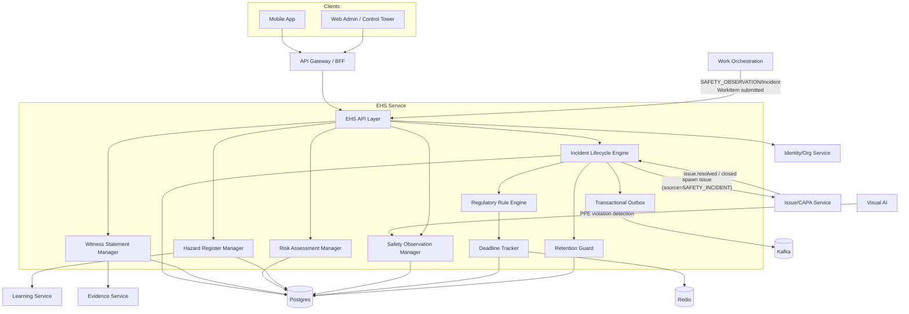
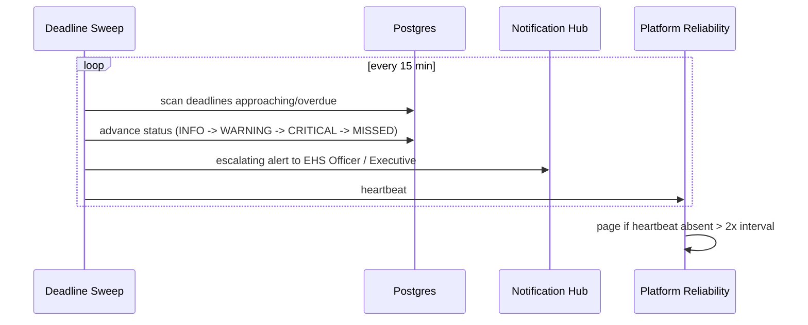
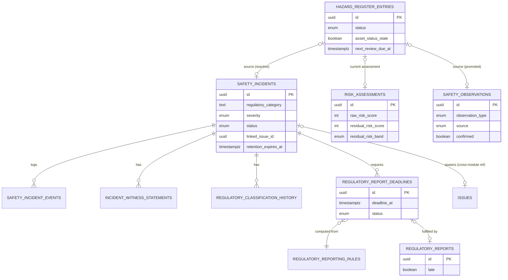
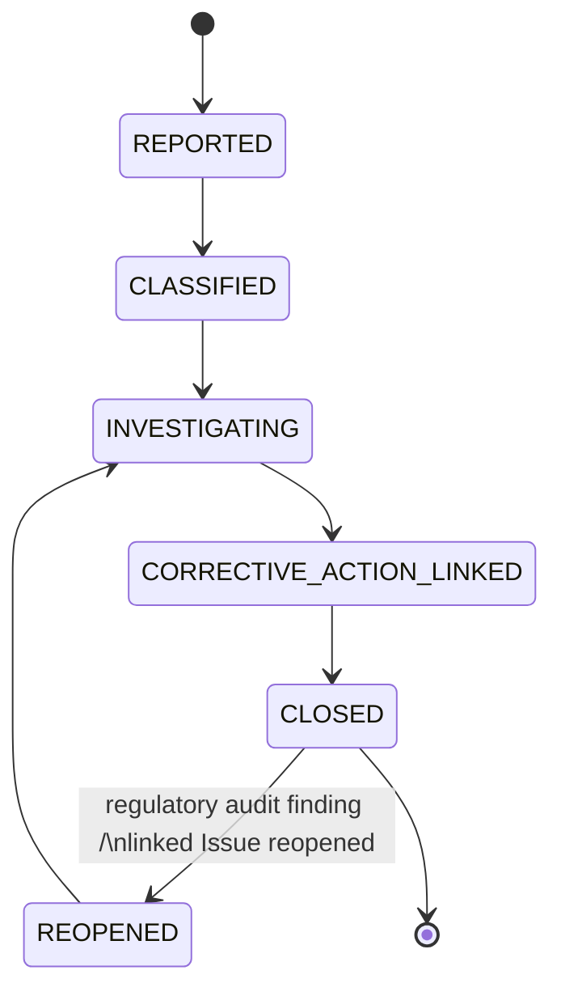

# EHS — Safety Incident & Risk Register — Architecture Diagrams

Corresponds to `new-modules-addendum.md` row 20. Focused diagram set for this module only;
narrative detail lives in `functional-spec.md`, `high-level-design.md`, `low-level-design.md`.

## 1. Component / Container Diagram



Narration: the EHS Service is a peer bounded context to Issue/CAPA, reachable via the normal
gateway path plus two internal paths — Work Orchestration invoking it as the functional processor
of `SAFETY_OBSERVATION`/`Incident` WorkItem submissions, and Visual AI feeding PPE-violation
detections into the Safety Observation Manager. The Incident Lifecycle Engine is the sole writer of
`safety_incidents.status`; the Regulatory Rule Engine and Deadline Tracker run synchronously inside
incident creation/reclassification so no incident is ever persisted without a provisional deadline.

## 2. Sequence Diagram — Incident to Corrective-Action Feedback Loop

```mermaid
sequenceDiagram
    actor Assoc as Associate
    participant EHS as EHS Service
    participant Officer as EHS Officer
    participant Capa as Issue/CAPA Service
    participant Kafka as Event Backbone

    Assoc->>EHS: Report incident (INJURY)
    EHS->>EHS: REPORTED; compute regulatory deadlines
    Officer->>EHS: Classify (regulatory_category=RECORDABLE)
    EHS->>EHS: REPORTED -> CLASSIFIED
    Officer->>EHS: Spawn corrective-action Issue
    EHS->>Capa: create Issue (source=SAFETY_INCIDENT)
    EHS->>EHS: CLASSIFIED -> INVESTIGATING
    Note over Capa: Full RCA + CAPA steps execute inside Issues & CAPA
    Capa->>Kafka: issue.resolved
    Kafka->>EHS: issue.resolved
    EHS->>EHS: CORRECTIVE_ACTION_LINKED (Issue-side gate satisfied)
    Officer->>EHS: File regulatory report
    EHS->>EHS: CLOSED (both gates satisfied)
```

Narration: two independent gates must clear before `CLOSED` — the linked Issue's own resolution and
this module's own regulatory reporting completion — which is the core reason this module owns a
distinct incident lifecycle rather than mirroring `Issue.status`.

## 3. Sequence Diagram — Regulatory Deadline Escalation



Narration: regulatory deadline tracking is a fail-loud path (NFR-EHS-001) — a missing sweep
heartbeat pages Platform Reliability directly, independent of any individual deadline's own alert,
because the platform must never silently stop tracking a legal reporting obligation.

## 4. ER Diagram — Owned Entities



Narration: `SafetyIncident` is the aggregate root for the regulatory record, referencing `Issue` by
ID rather than owning it. `HazardRegisterEntry` and `RiskAssessment` form the proactive risk-
management side, cross-linked to `SafetyIncident`/`SafetyObservation` only through nullable
"source"/"promoted to" references so a hazard can originate reactively or exist purely proactively.

## 5. State Diagram — SafetyIncident Lifecycle



Narration: this state machine is deliberately **distinct from and does not extend** the canonical
`Issue` state machine (`OPEN -> ... -> CLOSED`, `06-issues-capa`) that `conventions.md` requires be
reused verbatim by every module referencing issue state. A `SafetyIncident` delegates all
corrective-action *execution* to a referenced `Issue` (via `linked_issue_id`) once one is spawned —
`INVESTIGATING` here means "regulatory investigation/classification and, if applicable, CAPA is
underway inside Issues & CAPA," not a re-implementation of Issues & CAPA's own `INVESTIGATING`
state. `CORRECTIVE_ACTION_LINKED -> CLOSED` requires **both** the linked Issue reaching `CLOSED`
**and** every applicable `RegulatoryReportDeadline` reaching `SUBMITTED`/`WAIVED` — a dual-gate
transition no single-Issue-state proxy could express, since an incident with no corrective action
at all (a first-aid-only case) must still clear its regulatory-reporting gate to close, and an
incident whose regulatory reporting is already done may still be waiting on a slow-moving CAPA. The
`REOPENED` branch is reachable from `CLOSED` on a regulatory audit finding or a downstream
reopening of the linked Issue (functional-spec FR-EHS-013), always re-entering `INVESTIGATING` —
never skipping back to `REPORTED`/`CLASSIFIED` — since the original classification and reporting
history remain valid and are never erased, only supplemented (functional-spec §10.7, append-only
`RegulatoryClassificationHistory`).
