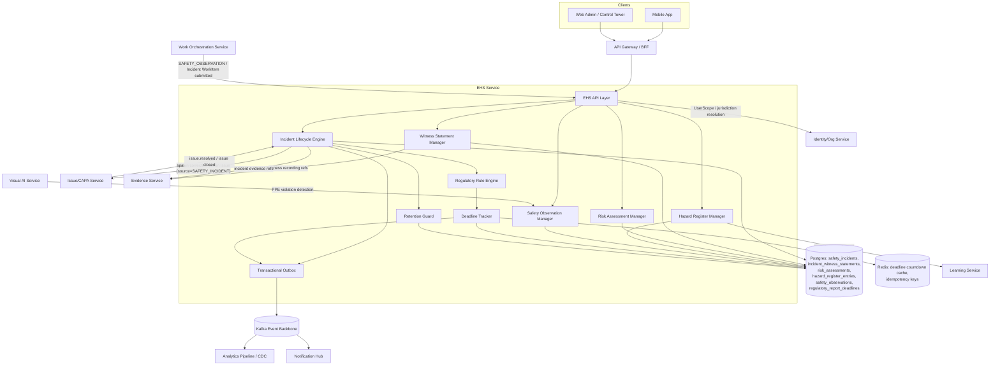

# EHS — Safety Incident & Risk Register — High-Level Design

Corresponds to `new-modules-addendum.md` row 20. Reference: `functional-spec.md` (this module),
`06-issues-capa/high-level-design.md` (the peer service this module wraps), `conventions.md`
(Target Tech Stack, Multi-tenancy Rule, State Machines).

## 1. Module Responsibilities

The **EHS Service** is the authoritative owner of:
- The `SafetyIncident` aggregate and its own lifecycle state machine (`REPORTED -> CLASSIFIED ->
  INVESTIGATING -> CORRECTIVE_ACTION_LINKED -> CLOSED`, with a `REOPENED` branch on regulatory
  audit finding) — a state machine **distinct from `Issue`'s**, because a safety incident's
  progression is gated by two independent completion conditions (regulatory reporting completion
  and, optionally, linked-Issue closure) that a generic Issue never needs to track.
- `IncidentWitnessStatement`, `RegulatoryClassificationHistory`.
- `RiskAssessment` (risk-matrix scoring, controls, residual risk, review cadence).
- `HazardRegisterEntry` (identified hazards, controls, residual risk, review-due tracking).
- `SafetyObservation` (positive/negative observations, near-miss trending fact source).
- `RegulatoryTaxonomy`, `RegulatoryReportingRule`, `RegulatoryReportDeadline`, `RegulatoryReport` —
  the jurisdiction-configurable regulatory classification/reporting/retention machinery that is
  this module's core differentiator versus generic Issues & CAPA.

It is explicitly, by design, **a thin regulatory/classification layer over Issues & CAPA, not a
parallel corrective-action engine**: it does not own root cause analysis, CAPA steps, effectiveness
verification, or CAPA-side SLA/escalation — all of that is delegated to the existing Issue/CAPA
Service by reference (`linked_issue_id`) and by event (`issue.resolved` consumption). This mirrors
the platform's modular-domain principle (source-spec §16.2 — split services only where scale/
deployment/security/ownership justify it): EHS justifies its own service because regulatory
reporting-deadline tracking and legally-mandated retention are a distinct governance/audit posture
that must survive independently of — and often outlive — the operational CAPA record for the same
event.

## 2. Component Diagram

Narration: The EHS Service is a peer bounded context to Issue/CAPA, Evidence, and Work
Orchestration — reachable through the normal gateway path, and internally from Work Orchestration
(when a `SAFETY_OBSERVATION`/`Incident` WorkItem is submitted, this service is the functional
processor of that submission) and from Visual AI (PPE-violation detections feeding observations).
The Incident Lifecycle Engine is the single writer of `safety_incidents.status`; the Regulatory
Rule Engine and Deadline Tracker are invoked synchronously from it at creation/reclassification time
so a `SafetyIncident` is never persisted without at least a provisional deadline computation
(NFR-EHS-003). The Retention Guard is consulted on every mutation attempt against a retention-
protected table, independent of and in addition to the API layer's role checks.

## 3. Data Ownership

| Entity | Owned here | Notes |
|---|---|---|
| `SafetyIncident` | Yes | Own lifecycle state machine, distinct from `Issue`. Sole writer of `safety_incidents.status`. |
| `IncidentWitnessStatement` | Yes | Append-only; versioned on edit. |
| `RegulatoryClassificationHistory` | Yes | Append-only; one row per classification/reclassification. |
| `RiskAssessment` | Yes | Includes raw and residual risk scoring. |
| `HazardRegisterEntry` | Yes | Includes review-cadence and review-due state. |
| `SafetyObservation` | Yes | Functional payload of the `SAFETY_OBSERVATION` WorkItem type. |
| `RegulatoryTaxonomy` / `RegulatoryReportingRule` | Yes | Tenant/jurisdiction configuration, admin-managed. |
| `RegulatoryReportDeadline` | Yes | One row per applicable rule per incident; independent status per row. |
| `RegulatoryReport` | Yes | Filed report record, may reference an exported document `Evidence`. |
| `safety_incident_events` (history) | Yes | Append-only audit trail, mirrors Issues & CAPA's `issue_events` pattern. |
| `Issue` (referenced) | No — Issues & CAPA | Referenced by `SafetyIncident.linked_issue_id`; this service never writes `issues` rows directly, always via Issues & CAPA's internal API. |
| `Evidence` (referenced) | No — Evidence Service | Referenced by ID for incident photos, witness recordings, and filed report documents; this service stamps a retention-override attribute on the linkage row, not on the Evidence record's own storage metadata. |
| `Asset` (referenced) | No — CMMS (module 16) | Referenced by ID from incidents and hazard register entries; read-only, tolerant of the referenced asset later reaching a decommissioned state. |
| `WorkItem` (referenced) | No — Work Orchestration | `Incident`/`SAFETY_OBSERVATION` WorkItem instances; this service is their functional processor, not their scheduling/state owner. |
| `OrganizationNode` / `UserScope` (referenced) | No — Identity/Org | Read-only resolution for jurisdiction-per-location, scope checks. |
| `AgentRun` (referenced) | No — Agent Runtime | Out of scope for this baseline by firm decision (no Safety Agent defined; functional-spec §13 Resolved Decisions); reserved for future use. |

## 4. External Interfaces

### 4.1 Events produced

- `safety_incident.reported` — on `SafetyIncident` creation (state enters `REPORTED`).
- `safety_incident.classified` — on entering `CLASSIFIED` (initial classification complete) and on
  every reclassification (payload includes `previous_regulatory_category`,
  `new_regulatory_category`).
- `safety_incident.issue_spawned` — when a corrective-action `Issue` is created from this incident
  (`linked_issue_id` set).
- `safety_incident.closed` — on entering the terminal `CLOSED` state (both gating conditions met).
- `safety_incident.reopened` — on the `REOPENED` branch (regulatory audit finding, or a linked
  Issue reopening after this incident had already closed).
- `regulatory_deadline.approaching` — on each escalating alert threshold (informational/warning/
  critical, FR-EHS-053).
- `regulatory_deadline.missed` — on `deadline_at` passing without submission; this is the fail-loud
  event NFR-EHS-001 requires never be silently dropped.
- `regulatory_report.submitted` — on report filing (payload includes `late: boolean`).
- `hazard_register.review_due` — on an entry entering its review-due lookahead window.
- `safety_observation.recorded` — on every observation submission, feeding Analytics trending
  directly (high-volume, low-individual-importance event; not part of the canonical
  source-spec §18.3 list, kept as a module-local topic consumed primarily by Analytics via CDC).
- Consumers: Analytics Pipeline (all events, for TRIR/LTIR/near-miss-ratio/hazard-health KPIs),
  Notification Hub (`regulatory_deadline.*`, `hazard_register.review_due`, `safety_incident.reopened`
  for the relevant EHS Officer/manager audience), Executive Control Tower (aggregated
  `regulatory_deadline.missed` as a governance-severity alert independent of the normal safety
  dashboard refresh cycle).

### 4.2 Events consumed

- `issue.resolved` (Issues & CAPA) — advances `SafetyIncident.corrective_action_status` toward
  `RESOLVED` when the event's `issue_id` matches a `linked_issue_id`.
- `issue.escalated` (Issues & CAPA, `REOPENED` entry specifically) — reverts
  `corrective_action_status` to `IN_PROGRESS`; if the parent `SafetyIncident` was already `CLOSED`,
  triggers its own `REOPENED` transition with `reopen_reason = LINKED_ISSUE_REOPENED`.
- `visual_ai.result_available` (Visual AI, module-local event name; not in the canonical §18.3 list)
  — with a PPE-related `violations[]` entry above the tenant's configured action-confidence
  threshold, creates a `SafetyObservation` draft or a suggested-incident prompt per FR-EHS-007; never
  auto-confirms.
- `task.completed` / `task.overdue` (Work Orchestration) — for `Incident`/`SAFETY_OBSERVATION`
  WorkItem submissions, this service's API layer is invoked directly by Work Orchestration's
  submission-processing path (synchronous functional-owner callback) rather than purely via event
  consumption, since the observation/incident record must exist before the WorkItem can be marked
  `SUBMITTED`/`VERIFIED`.
- `training.completed` (Learning, indirect) — informs hazard-control-effectiveness context, does not
  itself drive a state transition.

### 4.3 Synchronous APIs

- Public REST (`/api/v1/safety/...`) for clients — see LLD for the full endpoint list.
- Internal service-to-service call to Issues & CAPA's `create_issue`-equivalent endpoint when
  spawning a corrective-action Issue (FR-EHS-010), authenticated via service credential.
- Internal callback endpoint invoked by Work Orchestration when a `SAFETY_OBSERVATION`/`Incident`
  WorkItem transitions through `SUBMITTED`, so this service can validate/enrich the observation/
  incident payload before the WorkItem is allowed to proceed to `PENDING_REVIEW`.
- No typed agent tools are exposed in this baseline, by firm decision (functional-spec §13 Resolved
  Decisions); the contract is reserved (`create_safety_incident`, `get_hazard_register`,
  `get_regulatory_deadlines`) for a future Safety Agent at L1 Recommend autonomy, should one be built.

## 5. Scalability

- **Deadline-sweep fan-out.** Unlike Issues & CAPA's per-issue Temporal workflow, regulatory
  deadlines are tracked via a **polling sweep**, not a per-incident durable workflow (see HLD §7,
  Technology Choices, for the justification): incident volume and deadline-row volume are orders of
  magnitude lower than WorkItem/Issue volume even at 100k-location scale, and the fail-loud
  reliability requirement (NFR-EHS-001) is better served by a small number of frequently-run,
  independently-monitored sweep jobs than by tens of thousands of long-lived workflow executions
  whose individual health is harder to aggregate into a single "did the sweep run" heartbeat.
- **Read scalability.** The EHS Officer's regulatory-deadline dashboard and the hazard-register
  review-due list are read-heavy and latency-sensitive; a per-tenant deadline-countdown Redis cache
  (LLD §Caching), refreshed by the sweep job rather than computed per-request, absorbs this load.
  Cache entries are invalidated immediately on report submission (a submitted deadline must
  disappear from the "approaching" view without waiting for the next sweep cycle).
- **Burst tolerance.** A multi-injury event or a safety stand-down driving a burst of near-miss/
  observation submissions is handled the same way Issues & CAPA handles issue-creation bursts:
  synchronous work is limited to the transactional Postgres write plus outbox row; deadline
  resolution for a burst of incidents is computed inline per incident (cheap — a small rule lookup,
  not a scan) so bursts do not require special-casing beyond normal connection-pool sizing.

## 6. Multi-Tenancy

Follows the platform convention exactly: every table carries `tenant_id`; Postgres RLS policies
are the defense-in-depth backstop behind application-layer scoping; Kafka topics are partitioned by
`tenant_id:safety_incident_id` for ordering. **Per-jurisdiction regulatory taxonomy configuration**
is the module-specific multi-tenancy dimension beyond the standard tenant/org-scope axes: a single
tenant's `RegulatoryTaxonomy`/`RegulatoryReportingRule` rows are keyed by
`(tenant_id, jurisdiction_code)`, and every `OrganizationNode` used as a `SafetyIncident.location_id`
resolves to exactly one active `jurisdiction_code` at the incident's `occurred_at` (effective-dated,
consistent with the platform's effective-dated organization graph, source-spec §6.1), so a single
multinational tenant with sites across multiple countries applies the correct statutory rule set
per site without per-tenant code branching. A tenant with no jurisdiction configured for a location
falls back to a tenant-level default taxonomy (the generic/configurable pack from functional-spec
§13, never silently "no regulatory tracking at all"), since an unconfigured jurisdiction is a setup
gap that must surface as an admin alert, not a silent scope reduction.

## 7. Failure Modes and Degradation

| Failure | Impact | Degradation strategy |
|---|---|---|
| Regulatory deadline sweep job failure/outage | Approaching-deadline alerts and missed-deadline detection stop advancing. | Treated as fail-loud per NFR-EHS-001: a missing sweep heartbeat within 2x the scheduled interval pages Platform Reliability directly (not merely logged), independent of any per-incident alert. Incident creation and deadline *computation* (which happens synchronously at creation/reclassification, HLD §2) are unaffected — only the ongoing countdown/alert progression stalls, so no deadline silently goes untracked from the start, only its live status updates pause. |
| Issues & CAPA unavailable | Cannot spawn a corrective-action Issue from an incident. | The spawn request is queued locally (`SafetyIncident.issue_spawn_status = PENDING`) with a retry worker (idempotent, keyed on `safety_incident_id`), identical pattern to Issues & CAPA's own Work Orchestration retry (`06-issues-capa` HLD §7). The incident's own classification and regulatory-deadline tracking proceed independently — they never depend on the Issue existing. |
| Evidence Service unavailable | Incident/witness-statement evidence cannot be finalized. | The incident/witness record is saved with a `PENDING_EVIDENCE` sub-status; regulatory classification and deadline tracking are not gated on evidence presence (a report can be classified and its clock started without every photo uploaded yet), consistent with FR-EHS-002's principle that the reporting clock starts on report, not on complete evidence capture. |
| Kafka/event backbone unavailable | Analytics/Notification Hub stop receiving new safety events. | Transactional outbox pattern (same as Issues & CAPA) ensures no event is lost; rows relay once Kafka recovers. Critically, `regulatory_deadline.missed` is never lost this way even though its *notification* delivery is delayed — the underlying deadline-row state change already committed transactionally before the outbox write. |
| Postgres primary unavailable | No new incidents, observations, or deadline state changes can be written. | Standard platform HA/failover for the transactional store (source-spec §16.2); no EHS-specific compensating behavior beyond what applies platform-wide, since this is the authoritative store for the regulatory record and cannot degrade to an eventually-consistent secondary write path without compromising NFR-EHS-004 auditability. |
| Retention Guard misconfiguration (jurisdiction pack error) | A retention window could be computed shorter than statutory minimum, risking premature purge eligibility. | The Retention Guard enforces a hard floor independent of tenant configuration (FR-EHS-060 — configuration can only lengthen, never shorten, the effective retention below the jurisdiction pack's documented minimum), and any attempted purge is additionally gated by the data-access-layer trigger (NFR-EHS-002) that recomputes the window at purge time rather than trusting a cached/stale computed value. |

## 8. Technology Choices (justified)

- **Postgres polling sweep for deadlines, not per-incident Temporal workflows.** Issues & CAPA uses
  one Temporal workflow per Issue because escalation ladders need durable, signal-responsive timers
  at WorkItem/Issue volume and cadence. Regulatory deadlines are lower-volume, longer-horizon (days,
  not minutes), and — most importantly — the governance requirement is "prove the sweep itself never
  silently stopped running," which is easier to monitor as a small number of scheduled jobs with a
  heartbeat metric than as tens of thousands of independent workflow executions. A Temporal workflow
  per incident remains an option if deadline logic grows materially more stateful (e.g. multi-stage
  jurisdiction-specific report workflows); documented here as a considered alternative, not adopted
  for v1.
- **Postgres data-access-layer immutability enforcement for retention**, rather than
  application-layer-only checks, because legal defensibility (NFR-EHS-002) requires the guarantee to
  hold even against a compromised or misconfigured application tier — the same defense-in-depth
  philosophy the platform already applies to tenant isolation (source-spec §21.1).
- **Separate `SafetyIncident` lifecycle rather than extending `Issue` with new states.**
  Considered and rejected: adding safety-specific states to the canonical `Issue` state machine
  would violate `conventions.md`'s "reuse verbatim; do not invent new terminal states" rule and
  would force every other `Issue` consumer (Work Orchestration, Analytics, Agent Runtime) to reason
  about states that only apply to a subset of issues. A distinct `SafetyIncident` state machine that
  references `Issue` by ID keeps the canonical Issue machine untouched while giving safety incidents
  the regulatory-gating behavior they specifically need.
- **JSONB for `RegulatoryReportingRule`/`RegulatoryReport` payloads**, matching Issues & CAPA's
  polymorphic root-cause-method-data pattern, because jurisdiction-specific report shapes vary
  enough (different fields, different national forms) that a fully-normalized relational schema per
  jurisdiction would require a schema migration per new jurisdiction pack — directly contradicting
  the "configurable, not hardcoded to one country" firm decision (functional-spec §13).
