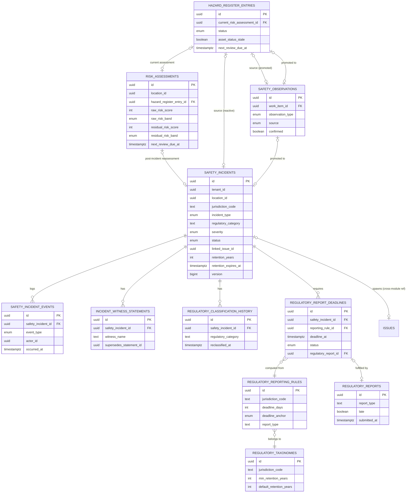
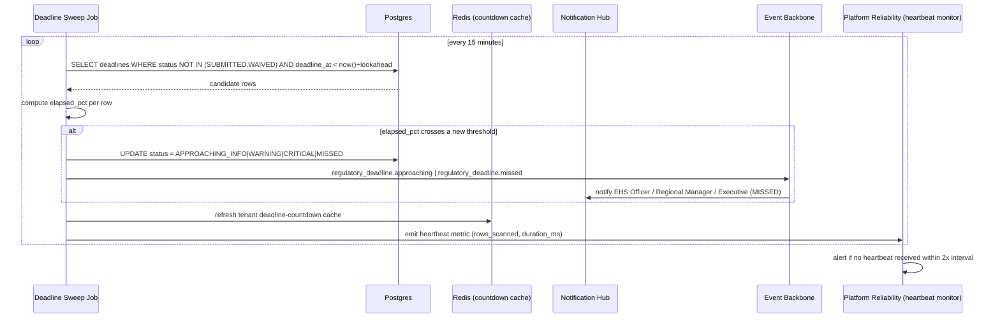

# EHS — Safety Incident & Risk Register — Low-Level Design

Corresponds to `new-modules-addendum.md` row 20. Reference: `functional-spec.md`,
`high-level-design.md` (this module), `conventions.md` (API conventions, Postgres/RLS
multi-tenancy, event envelope, state machines), `06-issues-capa/low-level-design.md` (schema/style
precedent).

## 1. Database Schema

All tables carry `tenant_id UUID NOT NULL` with an RLS policy `USING (tenant_id =
current_setting('app.tenant_id')::uuid)` (defense-in-depth behind application-layer scoping, per
convention). All primary keys are UUIDv7 (time-ordered) unless noted. All tables have `created_at`,
`updated_at` (`timestamptz`, server-assigned).

### 1.1 `safety_incidents`

| Column | Type | Notes |
|---|---|---|
| `id` | UUID PK | |
| `tenant_id` | UUID | RLS key |
| `location_id` | UUID | FK to `organization_nodes`, not null |
| `jurisdiction_code` | text | resolved from `location_id` at `occurred_at`, denormalized for query/report performance |
| `incident_type` | enum | `INJURY`,`ILLNESS`,`NEAR_MISS`,`PROPERTY_DAMAGE` |
| `regulatory_category` | text | current value; taxonomy-defined per jurisdiction (e.g. `RECORDABLE`,`FIRST_AID_ONLY`,`RESTRICTED_WORK`,`LOST_TIME`,`FATALITY`,`NOT_APPLICABLE`) |
| `severity` | enum | `LOW`,`MEDIUM`,`HIGH`,`CRITICAL` — shared enum values with `Issue.severity` |
| `status` | enum | `REPORTED`,`CLASSIFIED`,`INVESTIGATING`,`CORRECTIVE_ACTION_LINKED`,`CLOSED`,`REOPENED` |
| `occurred_at` | timestamptz | not null |
| `employer_notified_at` | timestamptz | nullable, used as deadline anchor when jurisdiction rule specifies |
| `description` | text | |
| `is_anonymous` | boolean | default false |
| `reporter_user_id` | UUID | nullable; must be null when `is_anonymous = true` (CHECK constraint) |
| `asset_id` | UUID | nullable, referenced `Asset` (CMMS), no FK enforcement across module boundary — validated at write time via internal lookup, tolerant of later decommission |
| `linked_issue_id` | UUID | nullable, set once a corrective-action Issue is spawned |
| `issue_spawn_status` | enum | `NOT_REQUESTED`,`PENDING`,`CREATED`,`FAILED` |
| `corrective_action_status` | enum | `NOT_APPLICABLE`,`NOT_STARTED`,`IN_PROGRESS`,`RESOLVED`,`CLOSED` |
| `near_miss_potential_severity` | enum | nullable, `LOW`/`MEDIUM`/`HIGH`/`CRITICAL`, reporter-asserted for near-miss trending escalation |
| `reopen_count` | int | default 0 |
| `reopen_reason` | enum | nullable, `AUDIT_FINDING`,`RECLASSIFICATION_REQUIRED`,`LINKED_ISSUE_REOPENED`,`OTHER` |
| `retention_years` | int | resolved from jurisdiction taxonomy at classification time, floor-enforced |
| `retention_expires_at` | timestamptz | computed = `occurred_at` + `retention_years`; immutability guard keys on this |
| `version` | bigint | optimistic concurrency |
| `created_by` | UUID | |
| `created_at`, `updated_at` | timestamptz | |

Indexes: `(tenant_id, location_id, status)`, `(tenant_id, status, retention_expires_at)`,
`(tenant_id, linked_issue_id)` for the `issue.resolved` consumer lookup, partial
`(tenant_id, jurisdiction_code, regulatory_category)` for reporting rollups.
CHECK: `is_anonymous = false OR reporter_user_id IS NULL`.

### 1.2 `safety_incident_events` (append-only history)

| Column | Type | Notes |
|---|---|---|
| `id` | UUID PK | |
| `tenant_id` | UUID | |
| `safety_incident_id` | UUID | FK, not null |
| `event_type` | enum | `REPORTED`,`CLASSIFIED`,`RECLASSIFIED`,`STATE_TRANSITION`,`WITNESS_ADDED`,`ISSUE_SPAWNED`,`ISSUE_STATUS_CHANGED`,`DEADLINE_CREATED`,`DEADLINE_ALERTED`,`DEADLINE_MISSED`,`REPORT_SUBMITTED`,`REOPENED`,`CLOSED` |
| `from_status`, `to_status` | enum, nullable | for `STATE_TRANSITION` |
| `actor_id` | UUID | nullable (`NULL` = `SYSTEM`) |
| `actor_type` | enum | `USER`,`SYSTEM` |
| `payload` | jsonb | event-specific detail |
| `occurred_at` | timestamptz | server timestamp, authoritative |

Indexes: `(tenant_id, safety_incident_id, occurred_at)`. Append-only — no `UPDATE`/`DELETE` grants
at the application role level, and additionally protected by the retention trigger (§9).

### 1.3 `incident_witness_statements`

| Column | Type | Notes |
|---|---|---|
| `id` | UUID PK | |
| `tenant_id` | UUID | |
| `safety_incident_id` | UUID | FK, not null |
| `witness_name` | text | not null; free text, witness may not be a platform user |
| `witness_user_id` | UUID | nullable FK to `users` |
| `statement_text` | text | |
| `evidence_id` | UUID | nullable, referenced `Evidence` (recording/signed document) |
| `capture_status` | enum | `RECORDED_TEXT`,`RECORDED_AUDIO`,`RECORDED_VIDEO`,`PENDING_SIGNATURE`,`SIGNED` |
| `supersedes_statement_id` | UUID | nullable, self-FK — edits create a new version rather than mutating |
| `captured_by` | UUID | |
| `captured_at` | timestamptz | |
| `created_at`, `updated_at` | timestamptz | |

Indexes: `(tenant_id, safety_incident_id, captured_at)`. Append-only per row (edits insert a new row
with `supersedes_statement_id` set; no destructive update).

### 1.4 `regulatory_classification_history` (append-only)

| Column | Type | Notes |
|---|---|---|
| `id` | UUID PK | |
| `tenant_id` | UUID | |
| `safety_incident_id` | UUID | FK, not null |
| `regulatory_category` | text | value at this point in history |
| `severity` | enum | value at this point in history |
| `reclassified_by` | UUID | nullable (`NULL` for the initial classification, `actor_type = SYSTEM`/`USER` distinguishes) |
| `reclassified_at` | timestamptz | |
| `reason` | text | required when this is a reclassification (not the initial row) |

Indexes: `(tenant_id, safety_incident_id, reclassified_at)`.

### 1.5 `risk_assessments`

| Column | Type | Notes |
|---|---|---|
| `id` | UUID PK | |
| `tenant_id` | UUID | |
| `location_id` | UUID | nullable (may be asset-scoped instead) |
| `asset_id` | UUID | nullable, referenced `Asset` |
| `hazard_register_entry_id` | UUID | nullable FK |
| `safety_incident_id` | UUID | nullable FK, set for post-incident reassessments |
| `template_version_id` | UUID | nullable, referenced `TemplateVersion` when Forms-platform-authored |
| `matrix_scale` | int | tenant-configurable matrix dimension, default 5 |
| `likelihood_value` | int | 1..`matrix_scale` |
| `severity_value` | int | 1..`matrix_scale` |
| `raw_risk_score` | int | computed = `likelihood_value * severity_value` |
| `raw_risk_band` | enum | `LOW`,`MEDIUM`,`HIGH`,`CRITICAL` |
| `controls_in_place` | jsonb | array of `{ description, control_type }`, `control_type` ∈ `ELIMINATION`,`SUBSTITUTION`,`ENGINEERING`,`ADMINISTRATIVE`,`PPE` |
| `residual_likelihood_value` | int | |
| `residual_severity_value` | int | |
| `residual_risk_score` | int | computed |
| `residual_risk_band` | enum | |
| `assessor_user_id` | UUID | |
| `approved_by_user_id` | UUID | nullable, required for `HIGH`/`CRITICAL` bands |
| `next_review_due_at` | timestamptz | derived default, per-entry overridable |
| `status` | enum | `DRAFT`,`APPROVED`,`SUPERSEDED` |
| `superseded_by_id` | UUID | nullable self-FK |
| `version` | bigint | optimistic concurrency |
| `created_at`, `updated_at` | timestamptz | |

Indexes: `(tenant_id, location_id, status)`, `(tenant_id, hazard_register_entry_id)`,
`(tenant_id, next_review_due_at)` partial `WHERE status = 'APPROVED'` for the review-due sweep.

### 1.6 `hazard_register_entries`

| Column | Type | Notes |
|---|---|---|
| `id` | UUID PK | |
| `tenant_id` | UUID | |
| `location_id` | UUID | nullable |
| `asset_id` | UUID | nullable, referenced `Asset` |
| `hazard_description` | text | not null |
| `hazard_category` | text | tenant taxonomy |
| `current_risk_assessment_id` | UUID | nullable FK |
| `source_safety_incident_id` | UUID | nullable FK (reactive creation) |
| `source_observation_id` | UUID | nullable FK (promoted from observation) |
| `owner_user_id` | UUID | |
| `status` | enum | `ACTIVE`,`CONTROLLED`,`RETIRED` |
| `review_cadence_days` | int | nullable override; effective cadence resolved per LLD §5 pseudocode |
| `next_review_due_at` | timestamptz | |
| `asset_status_stale` | boolean | default false, set by the decommission-detection sweep |
| `retirement_reason` | text | nullable, required when `status = RETIRED` |
| `retired_by` | UUID | nullable |
| `identified_by` | UUID | |
| `identified_at` | timestamptz | |
| `version` | bigint | optimistic concurrency |
| `created_at`, `updated_at` | timestamptz | |

Indexes: `(tenant_id, location_id, status)`, `(tenant_id, next_review_due_at)` partial
`WHERE status != 'RETIRED'`, `(tenant_id, asset_id)`.

### 1.7 `safety_observations`

| Column | Type | Notes |
|---|---|---|
| `id` | UUID PK | |
| `tenant_id` | UUID | |
| `work_item_id` | UUID | FK to Work Orchestration's `SAFETY_OBSERVATION` WorkItem instance |
| `location_id` | UUID | |
| `observation_type` | enum | `POSITIVE`,`NEGATIVE` |
| `category` | text | tenant taxonomy, aligned with `hazard_category` |
| `observed_user_id` | UUID | nullable |
| `observer_user_id` | UUID | |
| `description` | text | |
| `evidence_id` | UUID | nullable |
| `immediate_action_taken` | text | nullable, `NEGATIVE` only |
| `source` | enum | `MANUAL`,`VISUAL_AI` |
| `ai_result_ref` | UUID | nullable, referenced Visual AI result, set when `source = VISUAL_AI` |
| `confirmed` | boolean | default true for `MANUAL`; false until human-confirmed for `VISUAL_AI` |
| `promoted_to_hazard_entry_id` | UUID | nullable FK |
| `promoted_to_safety_incident_id` | UUID | nullable FK |
| `created_at`, `updated_at` | timestamptz | |

Indexes: `(tenant_id, location_id, observation_type, created_at)` for trending, `(tenant_id,
category, created_at)`.

### 1.8 `regulatory_taxonomies` / `regulatory_reporting_rules`

| Table | Column | Type | Notes |
|---|---|---|---|
| `regulatory_taxonomies` | `id` | UUID PK | |
| | `tenant_id` | UUID | |
| | `jurisdiction_code` | text | e.g. `US-OSHA`, `UK-RIDDOR`, tenant-defined for unrecognized jurisdictions |
| | `regulatory_categories` | jsonb | ordered list of category codes + display labels + default severity mapping |
| | `min_retention_years` | int | statutory floor, non-negotiable downward |
| | `default_retention_years` | int | tenant-configurable, must be `>= min_retention_years` (CHECK enforced at write) |
| `regulatory_reporting_rules` | `id` | UUID PK | |
| | `tenant_id` | UUID | |
| | `jurisdiction_code` | text | FK to `regulatory_taxonomies` |
| | `applies_to_categories` | text[] | subset of the taxonomy's `regulatory_categories` |
| | `deadline_days` | int | |
| | `deadline_anchor` | enum | `OCCURRED_AT`,`EMPLOYER_NOTIFIED_AT` |
| | `report_type` | text | e.g. `OSHA_300_LOG_ENTRY`, tenant/jurisdiction-pack-defined |
| | `report_payload_schema_id` | UUID | nullable, JSON Schema reference for `report_payload` validation |
| | `active` | boolean | |

Indexes: unique `(tenant_id, jurisdiction_code)` on `regulatory_taxonomies`;
`(tenant_id, jurisdiction_code, active)` on `regulatory_reporting_rules`.

### 1.9 `regulatory_report_deadlines`

| Column | Type | Notes |
|---|---|---|
| `id` | UUID PK | |
| `tenant_id` | UUID | |
| `safety_incident_id` | UUID | FK, not null |
| `reporting_rule_id` | UUID | FK, not null |
| `deadline_at` | timestamptz | computed |
| `status` | enum | `PENDING`,`APPROACHING_INFO`,`APPROACHING_WARNING`,`APPROACHING_CRITICAL`,`MISSED`,`SUBMITTED`,`WAIVED` |
| `waived_reason` | text | nullable, required when `status = WAIVED` |
| `waived_by` | UUID | nullable |
| `reason_created_late` | enum | nullable, `RECLASSIFICATION`,`DELAYED_REPORT`,`OTHER` |
| `last_alert_sent_at` | timestamptz | nullable |
| `regulatory_report_id` | UUID | nullable FK, set on submission |
| `created_at`, `updated_at` | timestamptz | |

Indexes: `(tenant_id, status, deadline_at)` — the sweep's primary scan index —
`(tenant_id, safety_incident_id)`.

### 1.10 `regulatory_reports`

| Column | Type | Notes |
|---|---|---|
| `id` | UUID PK | |
| `tenant_id` | UUID | |
| `report_type` | text | |
| `report_payload` | jsonb | validated against `report_payload_schema_id` at submit time |
| `document_evidence_id` | UUID | nullable, exported/generated document |
| `regulator_confirmation_ref` | text | nullable |
| `submitted_by` | UUID | |
| `submitted_at` | timestamptz | |
| `late` | boolean | computed at submit time, permanent |
| `created_at` | timestamptz | |

Indexes: `(tenant_id, report_type, submitted_at)`.

### 1.11 ER Diagram



## 2. REST Endpoints

Base path `/api/v1/safety/`. OAuth2/OIDC bearer auth, tenant resolved from principal.
`Idempotency-Key` required on all POST endpoints. `ETag`/`version` optimistic concurrency on PATCH.

### 2.1 Report an incident

`POST /api/v1/safety/incidents`

```json
// Request
{
  "incident_type": "INJURY",
  "location_id": "loc_9a2f...",
  "occurred_at": "2026-09-20T14:32:00Z",
  "description": "Associate slipped on wet floor near dairy case.",
  "is_anonymous": false,
  "asset_id": null
}
```

```json
// Response 201
{
  "id": "sinc_01H...",
  "status": "REPORTED",
  "jurisdiction_code": "US-OSHA",
  "regulatory_category": null,
  "severity": "MEDIUM",
  "retention_years": 5,
  "regulatory_deadlines": [
    { "id": "rdl_01H...", "reporting_rule_id": "rrr_01H...",
      "deadline_at": "2026-09-27T14:32:00Z", "status": "PENDING" }
  ],
  "version": 1,
  "created_at": "2026-09-20T14:35:11Z"
}
```

Errors: `400 VALIDATION_ERROR` (missing required field), `403 SCOPE_DENIED` (no `safety:report`
scope at `location_id`), `409 POSSIBLE_DUPLICATE` (blocking duplicate confirmation required per
FR-EHS edge case 10.5 — response includes `existing_incident_id` and a
`confirm_duplicate_endpoint`).

### 2.2 Add a witness statement

`POST /api/v1/safety/incidents/{incident_id}/witness-statements`

```json
// Request
{
  "witness_name": "Jordan Blake",
  "witness_user_id": null,
  "statement_text": "I saw the spill about ten minutes before the fall and reported it to a supervisor.",
  "evidence_id": null,
  "capture_status": "RECORDED_TEXT"
}
```

```json
// Response 201
{ "id": "wst_01H...", "safety_incident_id": "sinc_01H...", "captured_at": "2026-09-20T14:41:02Z" }
```

Errors: `403 SCOPE_DENIED`, `404 INCIDENT_NOT_FOUND` (scope-filtered, not existence-leaking),
`409 INCIDENT_RETENTION_LOCKED` is never returned here — witness statements are additive and
always permitted regardless of retention state (edge case 10.7).

### 2.3 Create a risk assessment

`POST /api/v1/safety/risk-assessments`

```json
// Request
{
  "location_id": "loc_9a2f...",
  "hazard_register_entry_id": "haz_01H...",
  "matrix_scale": 5,
  "likelihood_value": 4,
  "severity_value": 3,
  "controls_in_place": [
    { "description": "Wet floor signage + hourly floor sweep log", "control_type": "ADMINISTRATIVE" }
  ],
  "residual_likelihood_value": 2,
  "residual_severity_value": 3,
  "assessor_user_id": "usr_01H..."
}
```

```json
// Response 201
{
  "id": "risk_01H...",
  "raw_risk_score": 12,
  "raw_risk_band": "HIGH",
  "residual_risk_score": 6,
  "residual_risk_band": "MEDIUM",
  "next_review_due_at": "2027-09-20T00:00:00Z",
  "status": "DRAFT",
  "version": 1
}
```

Errors: `400 VALIDATION_ERROR`, `422 APPROVAL_REQUIRED` (attempting to set `status=APPROVED` on a
`HIGH`/`CRITICAL` band assessment without `approved_by_user_id` distinct from `assessor_user_id`).

### 2.4 Create a hazard register entry

`POST /api/v1/safety/hazard-register`

```json
// Request
{
  "location_id": "loc_9a2f...",
  "asset_id": null,
  "hazard_description": "Recurring condensation drip near dairy case creates wet floor.",
  "hazard_category": "SLIP_TRIP_FALL",
  "owner_user_id": "usr_01H...",
  "identified_at": "2026-09-20T15:00:00Z"
}
```

```json
// Response 201
{ "id": "haz_01H...", "status": "ACTIVE", "next_review_due_at": null, "version": 1 }
```

Errors: `400 VALIDATION_ERROR`, `403 SCOPE_DENIED`.

### 2.5 Submit a safety observation

`POST /api/v1/safety/observations`

```json
// Request
{
  "work_item_id": "wi_01H...",
  "location_id": "loc_9a2f...",
  "observation_type": "NEGATIVE",
  "category": "PPE",
  "observed_user_id": null,
  "description": "Associate on ladder without spotter in stockroom aisle 4.",
  "immediate_action_taken": "Verbally corrected on the spot; spotter assigned."
}
```

```json
// Response 201
{ "id": "obs_01H...", "confirmed": true, "created_at": "2026-09-20T16:02:44Z" }
```

Errors: `400 VALIDATION_ERROR`, `403 SCOPE_DENIED`, `409 CONFLICT` (duplicate `work_item_id`
submission — idempotent on `Idempotency-Key` + `work_item_id`).

### 2.6 Regulatory-deadline dashboard

`GET /api/v1/safety/regulatory-deadlines?status=APPROACHING_WARNING,APPROACHING_CRITICAL,MISSED&cursor=...&limit=50`

```json
// Response 200
{
  "items": [
    {
      "id": "rdl_01H...",
      "safety_incident_id": "sinc_01H...",
      "location_id": "loc_9a2f...",
      "report_type": "OSHA_300_LOG_ENTRY",
      "deadline_at": "2026-09-27T14:32:00Z",
      "status": "APPROACHING_WARNING",
      "hours_remaining": 36
    }
  ],
  "next_cursor": "eyJvZmZzZXQiOjUwfQ=="
}
```

Errors: `403 SCOPE_DENIED` (scope-filtered server-side, no cross-location leakage).

## 3. Sequence Diagrams

### 3.1 Incident report → classification → spawned Issue → CAPA execution → incident closure feedback loop

```mermaid
sequenceDiagram
    actor Assoc as Associate
    participant EHS as EHS Service
    participant Mgr as Store Manager / EHS Officer
    participant Capa as Issue/CAPA Service
    participant Kafka as Event Backbone

    Assoc->>EHS: POST /incidents (INJURY, location, description)
    EHS->>EHS: REPORTED; resolve jurisdiction; compute regulatory_deadlines
    EHS->>Kafka: safety_incident.reported
    Mgr->>EHS: complete classification (regulatory_category=RECORDABLE, severity=HIGH)
    EHS->>EHS: REPORTED -> CLASSIFIED
    EHS->>Kafka: safety_incident.classified
    Mgr->>EHS: spawn corrective-action issue
    EHS->>Capa: create Issue (category=SAFETY, source=SAFETY_INCIDENT, source_ref.safety_incident_id)
    Capa-->>EHS: issue_id
    EHS->>EHS: CLASSIFIED -> INVESTIGATING; linked_issue_id set
    EHS->>Kafka: safety_incident.issue_spawned
    Note over Capa: Full CAPA lifecycle proceeds inside Issues & CAPA\n(RCA, corrective/preventive action, verification)
    Capa->>Kafka: issue.resolved
    Kafka->>EHS: issue.resolved
    EHS->>EHS: corrective_action_status -> RESOLVED
    EHS->>EHS: INVESTIGATING -> CORRECTIVE_ACTION_LINKED
    Note over Capa: Issue reaches CLOSED
    Capa->>EHS: issue closed (CDC / issue_events read)
    EHS->>EHS: corrective_action_status -> CLOSED
    Mgr->>EHS: file regulatory report (all deadlines)
    EHS->>EHS: all regulatory_report_deadlines = SUBMITTED
    EHS->>EHS: CORRECTIVE_ACTION_LINKED -> CLOSED (both gates satisfied)
    EHS->>Kafka: safety_incident.closed
```

Narration: closure requires two independent gates — the linked Issue reaching `CLOSED` *and* every
applicable regulatory deadline reaching `SUBMITTED`/`WAIVED` — which is precisely why this module
cannot proxy `Issue.status` directly (functional-spec §10.8, FR-EHS-062).

### 3.2 Regulatory deadline tracking and escalating alert as deadline approaches



Narration: the sweep is deliberately simple and independently monitorable (NFR-EHS-001) — a missing
heartbeat is itself an incident, separate from any single missed regulatory deadline, since the
platform must never be in a position where deadlines silently stopped being tracked without anyone
knowing.

### 3.3 Hazard register periodic review cycle

```mermaid
sequenceDiagram
    participant Sweep as Hazard Review Sweep Job
    participant PG as Postgres
    participant CMMS as Asset Service (CMMS)
    participant Notif as Notification Hub
    participant Owner as Hazard Entry Owner

    loop daily
        Sweep->>PG: SELECT hazard_register_entries WHERE status != RETIRED\nAND (next_review_due_at < now()+lookahead OR asset_id IS NOT NULL)
        PG-->>Sweep: candidate rows
        par asset staleness check
            Sweep->>CMMS: get_asset_status(asset_id) for rows with asset_id set
            CMMS-->>Sweep: status (ACTIVE|DECOMMISSIONED|unknown)
            Sweep->>PG: UPDATE asset_status_stale = true WHERE status = DECOMMISSIONED
        end
        Sweep->>PG: mark rows within lookahead as review-due
        Sweep->>Notif: notify owner_user_id (review due / asset stale)
    end
    Owner->>PG: perform review -> create/APPROVE new RiskAssessment version
    PG->>PG: hazard_register_entries.current_risk_assessment_id updated;\nnext_review_due_at recomputed from new assessment
```

Narration: asset-decommission detection runs alongside, not instead of, the calendar-based review
sweep — a decommissioned asset flags the entry for review sooner than its normal cadence but never
auto-retires it (FR-EHS-033).

## 4. Pseudocode

### 4.1 Regulatory-deadline calculation per jurisdiction taxonomy

```
function resolve_and_create_deadlines(incident):
    jurisdiction = resolve_jurisdiction(incident.location_id, incident.occurred_at)
    incident.jurisdiction_code = jurisdiction.code

    taxonomy = load_regulatory_taxonomy(incident.tenant_id, jurisdiction.code)
    if taxonomy is None:
        taxonomy = load_default_generic_taxonomy(incident.tenant_id)
        raise_admin_alert("UNCONFIGURED_JURISDICTION", jurisdiction.code)

    incident.retention_years = max(
        taxonomy.default_retention_years,
        taxonomy.min_retention_years
    )
    incident.retention_expires_at = incident.occurred_at + years(incident.retention_years)

    rules = load_active_reporting_rules(incident.tenant_id, jurisdiction.code)
    applicable_rules = [r for r in rules
                        if incident.regulatory_category in r.applies_to_categories
                        or incident.regulatory_category is None]  # unclassified still gets provisional rules

    created_deadlines = []
    for rule in applicable_rules:
        anchor = incident.occurred_at if rule.deadline_anchor == OCCURRED_AT \
                 else (incident.employer_notified_at or incident.occurred_at)
        deadline_at = anchor + days(rule.deadline_days)

        status = MISSED if deadline_at < now() else PENDING
        reason_created_late = None
        if status == MISSED and incident.is_reclassification_triggered:
            reason_created_late = RECLASSIFICATION

        deadline = create_row(RegulatoryReportDeadline,
            safety_incident_id=incident.id, reporting_rule_id=rule.id,
            deadline_at=deadline_at, status=status,
            reason_created_late=reason_created_late)
        created_deadlines.append(deadline)

        if status == MISSED:
            emit_event("regulatory_deadline.missed", deadline)  # fail-loud, immediate, not sweep-deferred

    return created_deadlines


function recompute_on_reclassification(incident, new_category, actor, reason):
    # append-only history, never overwrite
    insert_row(RegulatoryClassificationHistory,
        safety_incident_id=incident.id, regulatory_category=new_category,
        severity=recompute_severity(incident, new_category),
        reclassified_by=actor, reclassified_at=now(), reason=reason)

    incident.regulatory_category = new_category
    incident.severity = recompute_severity(incident, new_category)
    incident.is_reclassification_triggered = True   # transient flag, not persisted

    # existing deadlines are NOT deleted; new applicable rules produce new rows
    existing_rule_ids = {d.reporting_rule_id for d in load_deadlines(incident.id)}
    new_deadlines = resolve_and_create_deadlines(incident)
    net_new = [d for d in new_deadlines if d.reporting_rule_id not in existing_rule_ids]
    return net_new
```

### 4.2 Risk-matrix scoring

```
function score_risk(likelihood_value, severity_value, matrix_scale, band_cutoffs):
    # band_cutoffs: tenant-configurable, default for scale=5:
    #   LOW: 1-4, MEDIUM: 5-9, HIGH: 10-15, CRITICAL: 16-25
    # for other scales, cutoffs are proportionally configured per tenant, not auto-derived,
    # since the qualitative meaning of "high" on a 3x3 vs 5x5 matrix is a tenant policy choice
    assert 1 <= likelihood_value <= matrix_scale
    assert 1 <= severity_value <= matrix_scale

    raw_score = likelihood_value * severity_value
    band = lookup_band(raw_score, band_cutoffs)
    return raw_score, band


function score_assessment(assessment):
    assessment.raw_risk_score, assessment.raw_risk_band = score_risk(
        assessment.likelihood_value, assessment.severity_value,
        assessment.matrix_scale, tenant_band_cutoffs(assessment.tenant_id, assessment.matrix_scale))

    assessment.residual_risk_score, assessment.residual_risk_band = score_risk(
        assessment.residual_likelihood_value, assessment.residual_severity_value,
        assessment.matrix_scale, tenant_band_cutoffs(assessment.tenant_id, assessment.matrix_scale))

    if assessment.residual_risk_score >= assessment.raw_risk_score:
        add_validation_warning(assessment,
            "Controls should reduce risk; residual score is not lower than raw score.")
        # soft warning only — not a hard block (FR-EHS-021)

    band_review_days = {"CRITICAL": 365, "HIGH": 365, "MEDIUM": 730, "LOW": 1095}
    assessment.next_review_due_at = now() + days(
        band_review_days[assessment.residual_risk_band])

    return assessment
```

## 5. Caching

- **Deadline-countdown cache** — Redis, key `tenant:{tenant_id}:deadline_dashboard`, refreshed by
  the deadline sweep job (§3.2) rather than computed per dashboard request; invalidated immediately
  (not lazily) on any `regulatory_report_deadlines` write (submission, waiver) so the "approaching"
  view never shows a stale entry that was just resolved.
- **Jurisdiction/taxonomy resolution cache** — Redis, key
  `tenant:{tenant_id}:jurisdiction:{location_id}`, TTL 1 hour, invalidated on `OrganizationNode`
  effective-dated changes affecting jurisdiction assignment; a cache miss falls back to the
  authoritative Identity/Org resolution, never to a hardcoded default silently.
- **Hazard register review-due list cache** — Redis, key
  `tenant:{tenant_id}:hazard_review_due`, refreshed by the daily hazard review sweep (§3.3);
  read-heavy EHS Officer dashboard hits this cache first.
- Idempotency keys (mutation endpoints) — Redis, standard platform pattern, TTL 24h.

## 6. Concurrency

- `safety_incidents.version` optimistic concurrency: a classification or state-transition write
  supplies the last-seen `version`; a mismatch returns `409 Conflict` with the current server state,
  consistent with the platform-wide rule against silent last-write-wins (conventions.md §19.3) —
  material for this module because two managers (or a manager and the sweep job) could attempt to
  transition state concurrently (e.g. a manual reclassification racing the sweep's missed-deadline
  status update on a *different* row, `regulatory_report_deadlines`, which has its own independent
  `version`-free but single-writer-per-row update path since only the sweep and the submission
  endpoint ever write it, and submission always wins by checking `status NOT IN (SUBMITTED,WAIVED)`
  before applying a sweep-driven status change).
- `regulatory_report_deadlines` writes: the sweep job and the report-submission endpoint are the
  only two writers; submission acquires a row-level `SELECT ... FOR UPDATE` to guarantee a
  concurrently-running sweep cannot flip a row from `PENDING` to `MISSED` in the instant after
  submission has already recorded `SUBMITTED` but before its transaction commits.
- `hazard_register_entries.current_risk_assessment_id` update and the creation of a new
  `RiskAssessment` version happen in a single transaction, so a reader never observes a hazard entry
  pointing at a `SUPERSEDED` assessment as "current."

## 7. Background Jobs

| Job | Trigger | Behavior |
|---|---|---|
| `regulatory-deadline-sweep` | Scheduled, every 15 minutes per tenant-tier queue | Scans `regulatory_report_deadlines` for status transitions per §3.2/§4.1; emits `regulatory_deadline.approaching`/`.missed`; refreshes the Redis countdown cache; emits a heartbeat metric monitored per NFR-EHS-001. |
| `hazard-register-review-sweep` | Scheduled, daily | Flags entries entering their review-due lookahead window; checks `asset_id` status via CMMS for staleness (§3.3); emits `hazard_register.review_due`; notifies `owner_user_id`. |
| `deadline-heartbeat-monitor` | Scheduled, every 30 minutes (2x sweep interval) | Verifies the deadline sweep emitted a heartbeat within the expected window; pages Platform Reliability if not — independent process from the sweep itself so a sweep-job crash cannot also silently disable its own monitor. |
| `orphaned-safety-owner-sweep` | Scheduled, daily | Mirrors Issues & CAPA's orphaned-issue-owner sweeper (FR-CAPA-022 pattern): flags `hazard_register_entries.owner_user_id` and `safety_incidents` (pending classification/spawn decisions) whose owner no longer has an active `UserScope` covering the relevant location; escalates to the next org level. |
| `witness-statement-pending-signature-reminder` | Scheduled, daily | Reminds `captured_by` and the named witness (if a platform user) of any `PENDING_SIGNATURE` statement older than a tenant-configurable threshold. |

## 8. Error Handling

| Scenario | HTTP status | Error code | Notes |
|---|---|---|---|
| Missing required field on incident creation | 400 | `VALIDATION_ERROR` | Field-level detail in `error.details[]`. |
| Anonymous report attempted for non-`NEAR_MISS` type | 400 | `ANONYMOUS_NOT_ALLOWED_FOR_TYPE` | FR-EHS-004/10.4. |
| Attempt to attach reporter to an anonymous record | 409 | `ANONYMITY_IMMUTABLE` | Edge case 10.4. |
| Possible duplicate incident within window | 409 | `POSSIBLE_DUPLICATE` | Blocking; includes `existing_incident_id` (edge case 10.5). |
| No `safety:*` scope at location | 403 | `SCOPE_DENIED` | Never 404; consistent with FR-CAPA-085 pattern. |
| Deep link to out-of-scope incident | 403 | `SCOPE_DENIED` | Pre-filtered lists never leak existence. |
| Concurrent write to same incident/assessment/entry | 409 | `CONFLICT` | Includes current server `version` for client merge. |
| Retention-protected row DELETE/purge attempt before window lapses | 403 | `RETENTION_LOCKED` | NFR-EHS-002; enforced additionally at the DB layer (trigger raises `RETENTION_VIOLATION`). |
| Reclassification without `reason` | 400 | `VALIDATION_ERROR` | `reason` required on every `RegulatoryClassificationHistory` row past the first. |
| Approving a `HIGH`/`CRITICAL` risk assessment with `approved_by_user_id == assessor_user_id` | 422 | `SEGREGATION_OF_DUTIES_VIOLATION` | FR-EHS-023. |
| Spawning a second Issue for an incident that already has `linked_issue_id` set | 409 | `ISSUE_ALREADY_SPAWNED` | Idempotency guard, FR-EHS-010. |
| Attempting to close an incident with unresolved regulatory deadlines | 409 | `REGULATORY_DEADLINES_INCOMPLETE` | FR-EHS-062; response lists the blocking `regulatory_report_deadlines` rows. |
| Report payload fails jurisdiction JSON Schema validation | 422 | `REPORT_SCHEMA_INVALID` | Includes schema validation error path. |
| Jurisdiction not configured for a location | 201 (creation still succeeds) | n/a — logged as `UNCONFIGURED_JURISDICTION` admin alert | Falls back to generic taxonomy per §4.1 pseudocode; never blocks incident creation itself, since failing to record an incident is worse than an imperfect deadline computation. |
| Downstream Issues & CAPA unavailable at spawn time | 202 | n/a — `issue_spawn_status = PENDING` | Async retry per HLD §7; client is told the spawn is queued, not failed. |
