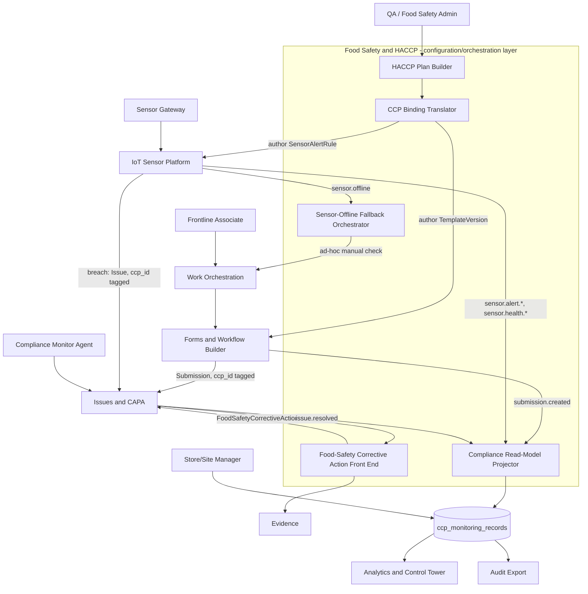
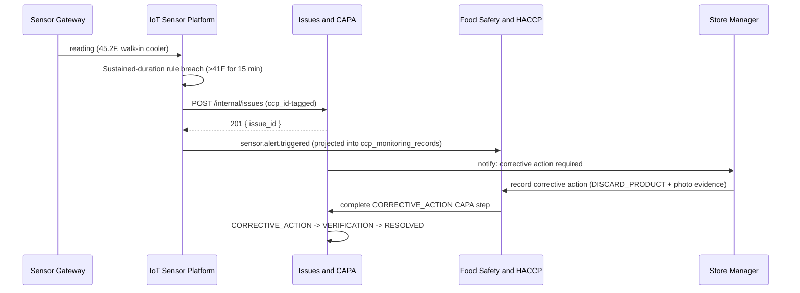
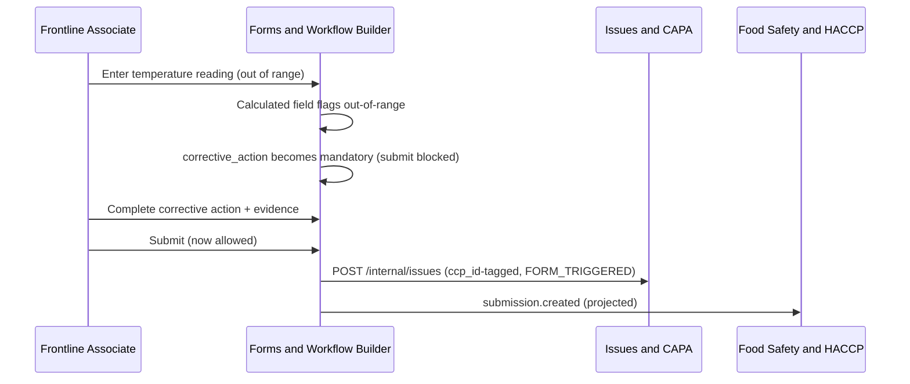
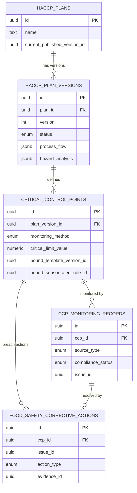
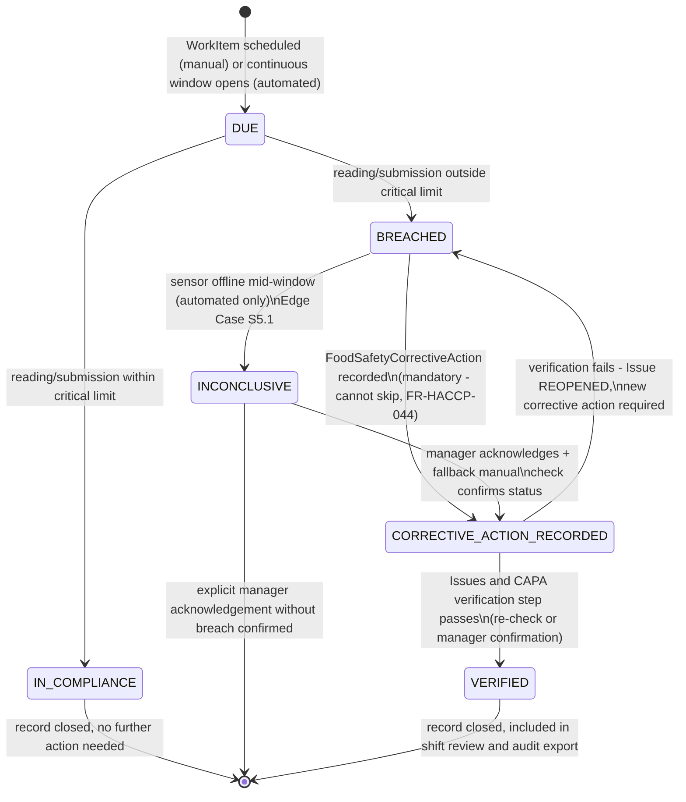

# Food Safety & HACCP — Architecture Diagrams

Focused Mermaid diagrams for this module only. See `high-level-design.md` and
`low-level-design.md` for full narrative and schema detail.

## 1. Component / Container Diagram

This module owns five small, purely orchestration/configuration components — no ingestion, no
form-rendering, no exception-lifecycle logic. The Binding Translator is the fork point (manual vs.
automated); everything after a breach is detected flows through the same Issues & CAPA surface
regardless of which path produced it.

## 2. Sequence Diagram — Golden Path: Automated CCP Breach to Corrective Action

This is the platform's Appendix A golden scenario, formalized under a named CCP: the breach and
Issue mechanics are entirely IoT Sensor Platform's and Issues & CAPA's existing machinery; this
module supplies the CCP tag and the food-safety-worded corrective-action capture that satisfies the
same CAPA gate a generic Issue would require anyway.

## 3. Sequence Diagram — Manual CCP Check with Blocking Breach Sub-Flow

The blocking gate is Forms' own conditional-mandatory validation (Module 03) — this module never
implements a second, competing validation layer; it only configures the field logic at
CCP-authoring time and reads the resulting submission afterward.

## 4. ER Diagram — Owned Entities

`CCP_MONITORING_RECORDS` is a read-model table, not a system of record — it is populated entirely
from events produced by Forms and IoT Sensor Platform (LLD §1.3), which is why this diagram shows
no other module's tables even though the data ultimately originates elsewhere.

## 5. State Diagram — CCP Monitoring Record Lifecycle

`BREACHED` can never transition directly to `[*]` or to `VERIFIED` — every path out of a breach
passes through `CORRECTIVE_ACTION_RECORDED` first, which is the state-machine expression of
FR-HACCP-044 ("cannot skip past a failed CCP"). `VERIFIED` is reached only via Issues & CAPA's own
verification step (Module 06), reflecting that this module never grants itself authority to close
out a breach on its own — verification remains that module's gate, reused unchanged.
