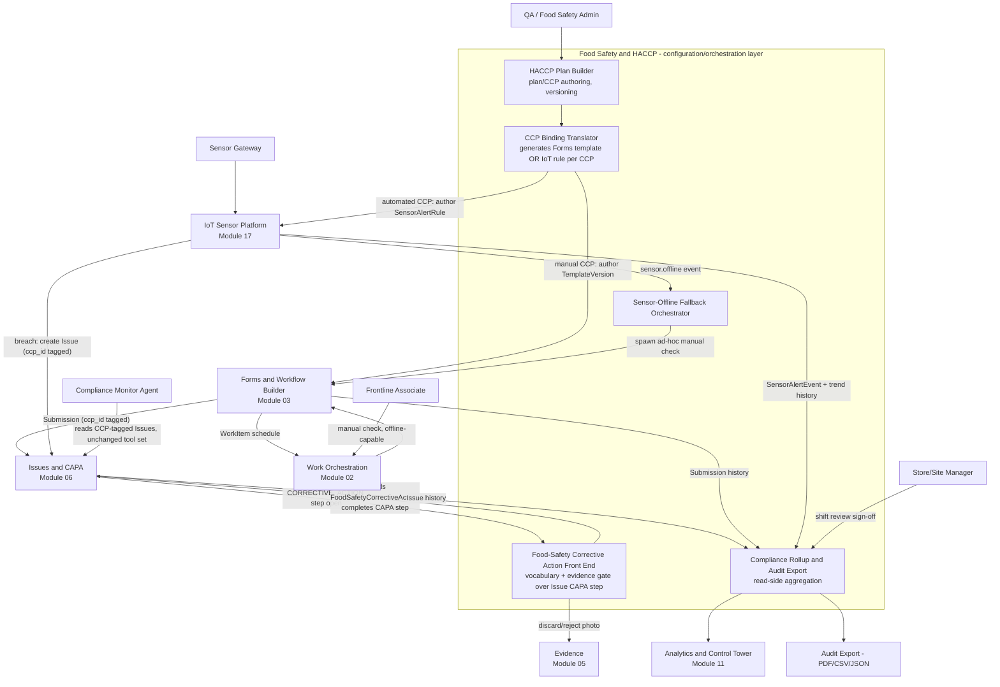

# Food Safety & HACCP — High-Level Design

Reference: `functional-spec.md` (this module), `new-modules-addendum.md` (Module 21 row —
"largely a configuration layer on IoT Sensor Platform... Forms & Workflow Builder... and Issues &
CAPA"), `conventions.md` (tech stack, multi-tenancy, state machines), `17-iot-sensor-platform/high-
level-design.md`, `03-forms-workflow-builder/*`, `06-issues-capa/high-level-design.md` (the three
peer services this module orchestrates rather than replaces).

## 1. Module Responsibilities

**Food Safety & HACCP is a thin configuration and orchestration layer, not a new execution
engine.** This is a deliberate architectural stance, not an implementation shortcut: the addendum
explicitly frames Tier-3 vertical modules as accelerators/template packs over existing platform
primitives, and every piece of runtime behavior a HACCP program actually needs — scheduled work,
form rendering and validation, offline capture, sensor ingestion and alerting, exception
management with SLAs and CAPA steps, evidence storage — already exists in modules 02/03/04/05/06/17.
Rebuilding any of that inside this module would fork behavior the platform has already hardened
(idempotent submission, offline-first capture, debounced sensor alerting, SLA escalation) into a
second, food-safety-specific copy that would drift over time.

What this module **does** own:

- The `HACCPPlan` and `CriticalControlPoint` domain objects: the structured 7-principle metadata
  that represents *what a location's food-safety program is*, independent of which underlying
  mechanism (form or sensor) monitors any given CCP.
- **Translation/binding logic**: given a `CriticalControlPoint`'s configuration, generate/keep in
  sync (a) a Forms `TemplateVersion` for a manual CCP, or (b) an IoT `SensorAlertRule` for an
  automated CCP — and tag the resulting Submission/SensorAlertEvent/Issue with `ccp_id` and
  `haccp_plan_version_id` so everything downstream can be queried "by CCP."
- `FoodSafetyCorrectiveAction`: a food-safety-vocabulary specialization recorded **alongside** (not
  instead of) an `Issue`'s CAPA step.
- Compliance-history rollups (read-side), shift-review sign-off, and audit-ready export — all
  read/aggregation logic over data that Forms, IoT, and Issues & CAPA already store as the system
  of record.
- The sensor-offline-for-CCP fallback decision (spawn a manual check) — this is genuinely
  HACCP-specific orchestration logic that neither Module 17 nor Module 03 has a reason to know
  about on its own.

What this module explicitly **does not** own (owned by the named peer module instead):

| Capability | Owned by | This module's relationship |
|---|---|---|
| Sensor ingestion, protocol termination, rule evaluation, debounce, sensor health state | IoT Sensor Platform (17) | Configures a `SensorAlertRule` scoped to a CCP; reads breach/health events. |
| Form rendering, form logic engine (conditional/mandatory/calculated fields), submission storage, offline sync | Forms & Workflow Builder (03) + Mobile & Offline (04) | Authors `TemplateVersion` content for a manual CCP; reads resulting `Submission`s. |
| Issue lifecycle/state machine, SLA timers, CAPA-step gating, root-cause methods, repeat-failure detection | Issues & CAPA (06) | Every breach creates/joins an `Issue` through Module 06's existing internal creation path; `FoodSafetyCorrectiveAction` is a specialized front end over the `CORRECTIVE_ACTION` CAPA step. |
| Evidence storage/hashing/retention | Evidence (05) | Calls Evidence's API to attach discard/reject photos. |
| Work scheduling, assignment, escalation ladders | Work Orchestration (02) | Manual CCP checks and shift reviews are ordinary `WorkItem`s scheduled through Module 02's primitives. |

## 2. Component Diagram

Narration: both the manual path (top) and the automated path (bottom) converge on the same
`Issues & CAPA` breach-handling surface — the CCP Binding Translator is the only place this
module's logic diverges by monitoring method, and it diverges *before* any reading/submission
exists, at configuration time. Once a breach happens, both paths look identical to Issues & CAPA;
this module's `FoodSafetyCorrectiveAction` front end sits on top of that single, shared CAPA step,
never forking it.

## 3. Data Ownership

| Entity | Owned here | Modeling decision |
|---|---|---|
| `HACCPPlan` / `HACCPPlanVersion` | Yes | Modeled as a **specialized `TemplateVersion`-shaped object** (own table, own lifecycle enum reusing the platform's `DRAFT -> REVIEW -> APPROVED -> PUBLISHED -> SUPERSEDED -> RETIRED` state machine) rather than literally rows in Module 03's `template_versions` table, because a HACCP plan's structure (process flow, hazard analysis, CCP list) is materially different content from a Forms field-schema and deserves its own schema and its own admin authoring UI — but it **behaves** identically for versioning/immutability/Impact-Preview purposes, which is why it reuses the same lifecycle rather than inventing a new one. |
| `CriticalControlPoint` | Yes | Owned here; references (never duplicates) the Forms `template_version_id` or IoT `sensor_alert_rule_id` it is bound to. |
| `TemperatureLog` | **No dedicated table — modeled as a view/reference over `Submission` (Forms) and `SensorReading`/`SensorAlertEvent` (IoT)**, not a duplicated log table. See rationale below. |
| `FoodSafetyCorrectiveAction` | Yes | One row per recorded corrective action, foreign-keyed to the `Issue`/CAPA-step it completes; this module owns this table because the structured fields (action type, quantity discarded, jurisdiction-specific reason codes) are food-safety-specific and have no equivalent in generic Issues & CAPA. |
| `HACCPShiftReview` | Yes | The sign-off record; the reviewing act itself is a Work Orchestration `WorkItem` (Approval type), but the food-safety-specific rollup snapshot (per-CCP counts at time of sign-off) is owned here. |
| `Submission` (referenced) | No — Forms (03) | This module reads submissions tagged with its `ccp_id` metadata; never writes to `submissions`. |
| `SensorReading` / `SensorAlertEvent` (referenced) | No — IoT Sensor Platform (17) | Read via Module 17's trend/history API and consumed events; never duplicated into a local time-series table. |
| `Issue` (referenced) | No — Issues & CAPA (06) | Created via Module 06's existing internal API; this module stores only `issue_id` back-references. |
| `Evidence` (referenced) | No — Evidence (05) | Metadata records created via Evidence's API. |

### Why `TemperatureLog` is a view, not a duplicated table

The addendum explicitly poses this as a modeling choice to justify. This design chooses **a
reference/view over the underlying `Submission` and `SensorReading`/`SensorAlertEvent` data**,
rather than a denormalized `temperature_logs` table populated by dual-writing from both sources,
for three reasons:

1. **Single source of truth, zero replication lag.** A dual-write denormalized table introduces a
   second place a reading/submission can be "current," with the attendant risk of the copy drifting
   from the original (a corrected submission, a retracted sensor reading correction, a late-arriving
   replayed sensor reading) unless this module builds its own reconciliation logic — logic Module 17
   and Module 03 already don't need because they never denormalize their own data elsewhere.
2. **No dual-write failure mode to design for.** A table populated by two independent upstream
   writers (Forms submissions, IoT readings) needs idempotency, ordering, and partial-failure
   handling across two systems' write paths into a third. A read-time view has none of that — it
   simply queries the two systems of record directly (or, at the scale described below, via a
   materialized read model kept current by consuming the same events those systems already emit).
3. **The addendum's stated intent for this module** is a configuration layer over primitives, not a
   parallel data plane; owning a denormalized time-series copy of sensor readings would duplicate
   exactly the high-volume storage/partitioning problem Module 17 already solved (TimescaleDB
   hypertable, retention/downsampling, compression) for no benefit specific to food safety.

**Concrete implementation**: `TemperatureLog` is exposed as a **materialized, tenant-scoped read
model** (`ccp_monitoring_records`, see LLD §1.3) populated by a lightweight projector consuming
`submission.created` (Forms, filtered to `ccp_id`-tagged submissions) and `sensor.alert.*`/periodic
downsampled-reading events (IoT) — i.e., it is a *read-side denormalization for query performance*,
not a second write path with independent business logic. The projector never originates data; it
only republishes what Forms/IoT already recorded, keyed by `ccp_id`, so a compliance-history or
audit-export query does not need to fan out live to two different services' APIs for every request.
This is explicitly a caching/read-optimization decision (see LLD §5), not a data-ownership one —
Forms and IoT remain the systems of record, and the projector can be rebuilt from their event
history at any time without data loss.

## 4. External Interfaces

### 4.1 Calls made by this module
- **Forms & Workflow Builder — `POST /api/v1/forms/templates` / `POST .../versions`** to
  generate/update the `TemplateVersion` backing a manual CCP (FR-HACCP-011.1).
- **IoT Sensor Platform — `POST /api/v1/iot/alert-rules`** to generate/update the `SensorAlertRule`
  backing an automated CCP (FR-HACCP-011.2), and **`GET /api/v1/iot/sensors/{id}/readings`** for
  trend/current-value display (FR-HACCP-031).
- **Issues & CAPA — `POST /api/v1/issues/{id}/capa-steps`** (or the equivalent CAPA-step-completion
  endpoint) to record a `FoodSafetyCorrectiveAction`'s effect on the underlying Issue's
  `CORRECTIVE_ACTION` step (FR-HACCP-042); this module never calls Issues & CAPA's issue-creation
  path directly for the manual path — that flows through Form Platform's existing rule-triggered
  path, unchanged.
- **Evidence — `POST /api/v1/evidence`** for discard/reject-delivery photo attachments.
- **Work Orchestration — `POST /api/v1/work-items`** (internal scheduling call, matching the pattern
  Module 03 already uses to schedule a form-bearing WorkItem) for the shift-review approval WorkItem
  and for ad-hoc fallback manual checks (Edge Case §5.1).

### 4.2 Interfaces exposed by this module
- **Public REST** (`/api/v1/haccp/...`) for plan/CCP authoring, compliance-history queries, shift
  review, and audit export — see LLD for the full endpoint list.
- **Events produced**: `haccp_plan.published`, `ccp.breach_detected` (a thin wrapper/annotation
  emitted alongside — not instead of — the underlying `issue.created`/`sensor.alert.triggered`
  event, carrying the `ccp_id` for consumers that want a food-safety-specific event stream without
  subscribing to every Issue in the tenant), `ccp.corrective_action_recorded`,
  `haccp_shift_review.completed` — canonical envelope shape per conventions.md.
- **Events consumed**: `submission.created` (Forms, filtered to `ccp_id`-tagged), `sensor.alert.*`
  and `sensor.offline`/`sensor.recovered` (IoT), `issue.resolved`/`issue.reopened` (Issues & CAPA) —
  all feed the `ccp_monitoring_records` read model (§3) and the sensor-offline fallback orchestrator.

## 5. Scalability

- **No new high-volume data path.** This module deliberately avoids owning anything with IoT
  Sensor Platform's ingestion volume profile; its own write volume (plan/CCP authoring,
  corrective-action records, shift reviews) is orders of magnitude lower than sensor readings or
  even form submissions, and scales with location count and CCP count per location, not with
  reading frequency — a large enterprise tenant with 5,000 locations and 15 CCPs/location is
  ~75,000 `CriticalControlPoint` rows, trivial for a standard Postgres table.
- **The `ccp_monitoring_records` read model is the one component with meaningful volume**, roughly
  tracking manual-submission + sensor-breach-event volume for food-safety-tagged CCPs specifically
  (a small subset of Module 17's total reading volume, since it stores breach/summary events and
  periodic rollups, not every raw reading). It is designed as an ordinary partitioned Postgres table
  (partitioned by month + tenant), not a hypertable, because its write rate is nowhere near Module
  17's raw-reading volume — see LLD §1.3.
- **Audit export is the module's heaviest read pattern** (a full date-range, multi-location pull);
  it is handled as an asynchronous job (FR-HACCP-062) reading from the same `ccp_monitoring_records`
  read model plus direct joins to `Issue`/`Evidence` metadata, never a synchronous request that could
  time out on a large enterprise export.

## 6. Multi-Tenancy

Follows the platform convention exactly: `haccp_plans`, `haccp_plan_versions`,
`critical_control_points`, `food_safety_corrective_actions`, `haccp_shift_reviews`, and
`ccp_monitoring_records` all carry `tenant_id` with RLS as the defense-in-depth backstop. Because
this module is a thin layer over three peer services, tenant isolation is enforced twice for
anything that crosses a service boundary: once by this module's own tenant-resolved API calls to
Forms/IoT/Issues & CAPA (never passing a client-supplied tenant context), and once again by each of
those services' own RLS/scope enforcement — this module adds no isolation shortcut and relies on no
implicit trust between services beyond the platform's standard service-to-service auth.

## 7. Failure Modes and Degradation

| Failure | Impact | Degradation strategy |
|---|---|---|
| IoT Sensor Platform unavailable when authoring/updating a `SensorAlertRule` | A CCP configuration change (new automated CCP, limit change) cannot propagate. | The `HACCPPlan`/`CriticalControlPoint` change is saved in this module's own store as `binding_sync_status = PENDING`; a retry worker (idempotent, keyed on `ccp_id` + target version) completes the binding once Module 17 recovers. The plan version does not silently publish with a stale/missing sensor rule — Impact Preview (FR-HACCP-004) surfaces any CCP still `PENDING` sync as a publish blocker. |
| Forms & Workflow Builder unavailable when authoring/updating a manual-CCP `TemplateVersion` | Same pattern as above, mirrored for the manual path. | Same `PENDING` retry pattern; publish blocked until synced. |
| A bound sensor goes `OFFLINE` (Module 17's own failure mode, surfacing here) | An automated CCP is no longer being continuously monitored. | This module's Sensor-Offline Fallback Orchestrator (§1, §2) spawns ad-hoc manual checks for the CCP's configured cadence until the sensor recovers (Edge Case §5.1 of the functional spec) — this is the one genuinely HACCP-specific degradation behavior this module implements, because neither Module 17 nor Module 03 has the context to know a CCP needs a fallback monitoring method at all. |
| `ccp_monitoring_records` read-model projector falls behind or fails | Compliance-history dashboards and audit export show stale data; the underlying Forms/IoT/Issues data is never at risk (they remain the systems of record). | Projector is a standard at-least-once Kafka consumer with idempotent upserts keyed on the source event's id; a stalled projector triggers standard consumer-lag alerting (source-spec §22.2) and the read model catches up fully once resumed — no manual reconciliation step is required because it can always be rebuilt from event history. |
| Issues & CAPA unavailable when recording a `FoodSafetyCorrectiveAction` | Cannot complete the underlying CAPA step. | The corrective-action selection is still captured locally (mobile offline-capable, same guarantee as any Forms submission) and the sync retries against Issues & CAPA's idempotent CAPA-step endpoint once reachable; the Associate-facing UI does not lose the recorded action even if the network call fails — consistent with the platform's offline-is-normal principle (P2). |
| Audit export job fails partway (large multi-location export) | Partial/incomplete export. | Job is retryable and idempotent per export request id; the reconciliation check (NFR-HACCP-003) prevents a partial export from ever being marked `READY` and handed to the requester — it either completes fully or surfaces a failed state with a retry action. |

## 8. Technology Choices (justified)

- **No new datastore, no new messaging technology, no new backend framework.** This module is
  built with the same Kotlin + Spring Boot service pattern as every other module (conventions.md),
  reading/writing ordinary partitioned Postgres tables (RLS-enforced, same as every module) and
  participating in the same Kafka event backbone. The explicit design intent is that this module
  should be indistinguishable, technologically, from any other configuration-heavy module (e.g.
  Module 23 Store Launch Management, which the addendum describes with the identical "configuration/
  orchestration layer... not a new execution engine" framing) — introducing a bespoke stack here
  would contradict the Tier-3 vertical-accelerator positioning the addendum calls for.
- **`ccp_monitoring_records` as an ordinary partitioned Postgres table, not a TimescaleDB
  hypertable.** Unlike Module 17's `sensor_readings`, this table stores breach/summary/rollup-grain
  events for food-safety-tagged CCPs, not raw high-frequency readings — its write rate is
  comparable to Issues & CAPA's `issue_events` table, which is ordinary Postgres. Adopting
  TimescaleDB here would be solving a volume problem this module does not have, at the cost of an
  unnecessary second partitioning scheme to operate.
- **Event-driven read-model projection (not synchronous fan-out queries) for compliance history.**
  Chosen because a synchronous "join across three services live" approach for every dashboard/export
  request would couple this module's read latency and availability to all three upstream services
  simultaneously being fast and up — exactly the coupling a configuration-layer module should avoid
  introducing into read paths that Analytics and audit workflows depend on. The event-driven
  projector trades a small amount of read-model staleness (bounded by normal Kafka consumer lag,
  typically sub-second to low-seconds) for read-path independence from upstream service health.
- **Reuse of `TemplateVersion`'s state-machine shape for `HACCPPlanVersion`**, rather than inventing
  a new lifecycle enum, because the platform's state-machine convention (conventions.md) explicitly
  says not to invent new terminal states where an existing lifecycle already fits — a HACCP plan
  version's authoring/approval/publication/supersession semantics are identical in shape to a
  template version's, even though its schema (process flow, hazards, CCPs) is domain-specific.
