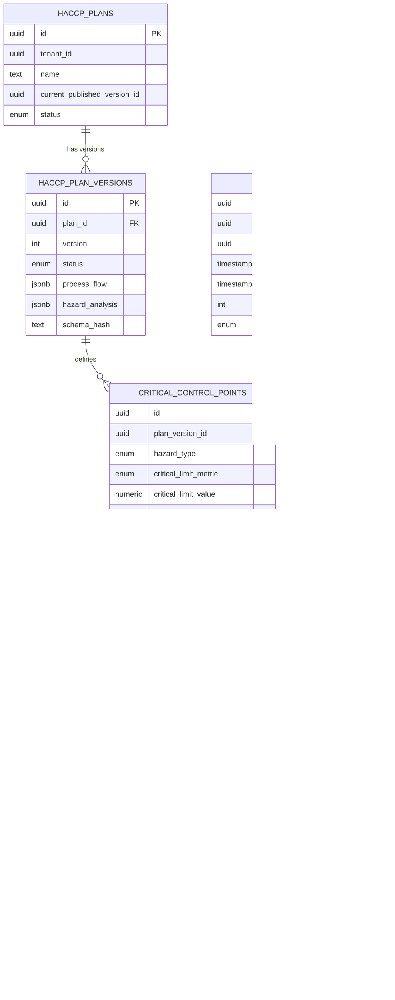
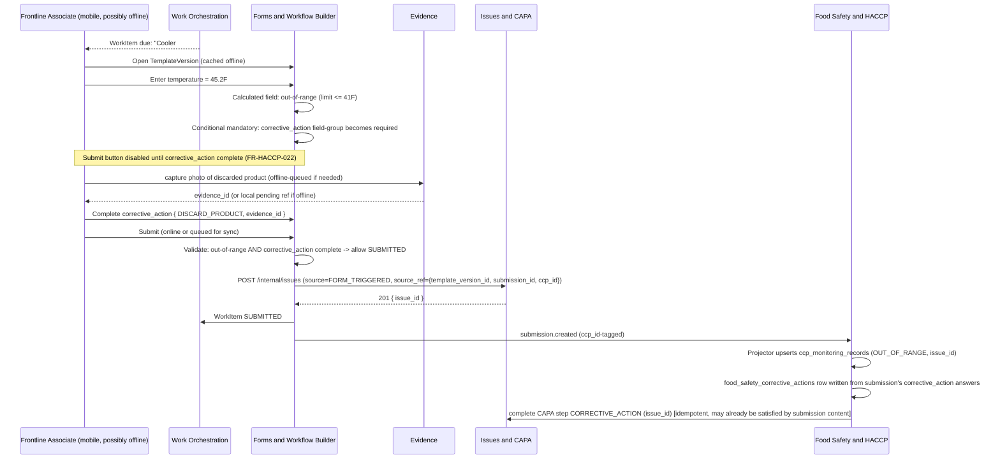

# Food Safety & HACCP — Low-Level Design

Reference: `functional-spec.md`, `high-level-design.md` (this module), `conventions.md` (API
conventions, Postgres/RLS multi-tenancy, event envelope), `17-iot-sensor-platform/low-level-
design.md` (the `SensorAlertRule` authoring contract and breach event shapes this module binds
to), `03-forms-workflow-builder/*` (the `TemplateVersion`/`Submission` contract), `06-issues-
capa/low-level-design.md` (the `POST /internal/issues` and CAPA-step contracts this module calls
into).

## 1. Database Schema

All tables carry `tenant_id UUID NOT NULL` with RLS policy `USING (tenant_id =
current_setting('app.tenant_id')::uuid)`, per convention. Primary keys are UUIDv7 unless noted.

### 1.1 `haccp_plans` / `haccp_plan_versions`

`haccp_plans` holds the stable logical identity (mirrors `Template`); `haccp_plan_versions` holds
the immutable, versioned content (mirrors `TemplateVersion`).

**`haccp_plans`**

| Column | Type | Notes |
|---|---|---|
| `id` | UUID PK | |
| `tenant_id` | UUID | RLS key |
| `name` | text | e.g. "QSR Cold Chain & Cooking HACCP Plan" |
| `brand_scope` | text | free-text or FK to a brand/business-unit dimension (Module 01) |
| `current_published_version_id` | UUID | nullable FK to `haccp_plan_versions.id` |
| `status` | enum | `ACTIVE`, `ARCHIVED` |
| `created_by`, `created_at` | UUID, timestamptz | |

**`haccp_plan_versions`**

| Column | Type | Notes |
|---|---|---|
| `id` | UUID PK | |
| `tenant_id` | UUID | |
| `plan_id` | UUID | FK to `haccp_plans` |
| `version` | int | monotonically increasing per `plan_id` |
| `status` | enum | `DRAFT`,`REVIEW`,`APPROVED`,`PUBLISHED`,`SUPERSEDED`,`RETIRED` (reuses `TemplateVersion` lifecycle verbatim, HLD §8) |
| `process_flow` | jsonb | ordered list of `{step_id, name, description}` |
| `hazard_analysis` | jsonb | list of `{step_id, hazard_type, description, likelihood, severity}` |
| `verification_procedures` | jsonb | text/structured description of §3.6 verification cadence |
| `record_keeping_requirements` | jsonb | retention/export expectations narrative + `retention_years` |
| `schema_hash` | text | hash of the full plan-version content, for integrity/audit (mirrors `TemplateVersion.schema_hash`) |
| `superseded_version_id` | UUID | nullable self-FK |
| `published_at`, `retired_at` | timestamptz | nullable |
| `created_by`, `created_at` | UUID, timestamptz | |

Indexes: unique `(tenant_id, plan_id, version)`; `(tenant_id, plan_id, status)` partial `WHERE
status = 'PUBLISHED'` for fast current-version lookup.

### 1.2 `critical_control_points`

| Column | Type | Notes |
|---|---|---|
| `id` | UUID PK | logical CCP identity, stable across plan versions |
| `tenant_id` | UUID | |
| `plan_version_id` | UUID | FK to `haccp_plan_versions` — a CCP is defined *within* a specific plan version (immutable once published, FR-HACCP-013) |
| `process_step_id` | text | references `haccp_plan_versions.process_flow[].step_id` |
| `hazard_type` | enum | `BIOLOGICAL`,`CHEMICAL`,`PHYSICAL` |
| `name` | text | e.g. "Walk-in Cooler Temperature" |
| `critical_limit_metric` | enum | `TEMPERATURE_F`,`TEMPERATURE_C`,`TIME_MINUTES`,`PH`,`WATER_ACTIVITY` |
| `critical_limit_operator` | enum | `LT`,`LTE`,`GT`,`GTE`,`BETWEEN` |
| `critical_limit_value` | numeric | |
| `critical_limit_value_max` | numeric | nullable, used with `BETWEEN` |
| `jurisdiction_override_allowed` | boolean | default false (Edge Case §5.3) |
| `monitoring_frequency` | jsonb | `{type: "INTERVAL"|"PER_EVENT"|"CONTINUOUS", interval_minutes?, event_trigger?}` |
| `monitoring_method` | enum | `MANUAL`,`AUTOMATED` |
| `visual_distinction` | enum | `MANUAL`,`AUTOMATED` (denormalized copy of `monitoring_method` for UI, FR-HACCP-014; can diverge transiently during a binding migration) |
| `bound_template_version_id` | UUID | nullable FK (Forms `template_versions.id`) — set when `monitoring_method = MANUAL` |
| `bound_sensor_alert_rule_id` | UUID | nullable FK (IoT `sensor_alert_rules.id`) — set when `monitoring_method = AUTOMATED` |
| `corrective_action_definitions` | jsonb | allowed `FoodSafetyCorrectiveAction` types for this CCP (FR-HACCP-041) |
| `binding_sync_status` | enum | `SYNCED`,`PENDING`,`FAILED` (HLD §7 failure-mode field) |
| `status` | enum | `ACTIVE`,`RETIRED` |
| `created_at`, `updated_at` | timestamptz | |

Indexes: `(tenant_id, plan_version_id)`; `(tenant_id, monitoring_method, status)`;
`(tenant_id, binding_sync_status)` partial `WHERE binding_sync_status != 'SYNCED'` (retry-worker
queue).

### 1.3 `ccp_monitoring_records` (read model — denormalized log table)

**Design choice**: implemented as a **thin denormalized log table populated by an event-driven
projector**, not a live SQL view/union over `submissions` and `sensor_readings`. A live `UNION`
view was considered and rejected: `submissions` (Module 03) and `sensor_readings`/
`sensor_alert_events` (Module 17, RLS-scoped, and `sensor_readings` specifically is a
cross-service hypertable this module has no direct query access to by design, HLD §3) live in
different services' schemas in a modular-monolith-adjacent, service-per-bounded-context
deployment (conventions.md §16.2 — "split services... where scale, deployment independence,
security boundaries... justify it"); a cross-service live `JOIN`/`UNION` is not physically
possible once Forms, IoT, and HACCP are independently deployable services with their own
databases, only a cross-service query fan-out (rejected in HLD §8 for coupling reasons) or an
async projection (chosen). The projector is a pure denormalization for read performance — it
never originates data, is fully rebuildable from upstream event history, and Forms/IoT remain the
systems of record (HLD §3).

| Column | Type | Notes |
|---|---|---|
| `id` | UUID PK | |
| `tenant_id` | UUID | |
| `ccp_id` | UUID | FK to `critical_control_points` |
| `haccp_plan_version_id` | UUID | denormalized, for export without a join |
| `location_id` | UUID | |
| `source_type` | enum | `MANUAL_SUBMISSION`,`AUTOMATED_SENSOR_SUMMARY` |
| `source_submission_id` | UUID | nullable, set when `source_type = MANUAL_SUBMISSION` |
| `source_sensor_alert_event_id` | UUID | nullable, set when `source_type = AUTOMATED_SENSOR_SUMMARY` |
| `recorded_at` | timestamptz | `server_received_at`/submission-completion time, authoritative ordering |
| `metric` | enum | mirrors `critical_control_points.critical_limit_metric` |
| `value_numeric` | double precision | nullable |
| `compliance_status` | enum | `IN_RANGE`,`OUT_OF_RANGE`,`INCONCLUSIVE` (mirrors IoT's `RULE_INCONCLUSIVE`, Edge Case §5.1) |
| `issue_id` | UUID | nullable FK (Issues & CAPA), set when this record is/joins a breach |
| `food_safety_corrective_action_id` | UUID | nullable FK, set once a breach's corrective action is recorded |
| `ccp_context_mismatch_suspected` | boolean | default false (Edge Case §5.4) |
| `ccp_retired_at_capture` | boolean | default false; set when the projector receives an event for a `ccp_id` whose `critical_control_points.status = RETIRED` at projection time — the row is still written (never dropped) but flagged for QA Admin review, distinct from `ccp_context_mismatch_suspected` (§8 error table) |
| `projected_at` | timestamptz | when the projector wrote this row (for staleness monitoring) |

Indexes: `(tenant_id, ccp_id, recorded_at DESC)` — the primary compliance-history query path;
`(tenant_id, location_id, recorded_at DESC)` — the shift-review rollup query path; unique
`(tenant_id, source_type, source_submission_id)` and `(tenant_id, source_type,
source_sensor_alert_event_id)` (partial, each `WHERE` its own `source_type`) — idempotent
projector upserts. Partitioned by `RANGE (recorded_at)` monthly (ordinary Postgres declarative
partitioning, not a TimescaleDB hypertable — HLD §8 justifies why this table's volume does not
warrant one).

### 1.4 `food_safety_corrective_actions`

| Column | Type | Notes |
|---|---|---|
| `id` | UUID PK | |
| `tenant_id` | UUID | |
| `ccp_id` | UUID | FK |
| `ccp_monitoring_record_id` | UUID | FK to the breaching record |
| `issue_id` | UUID | FK (Issues & CAPA) — the Issue whose `CORRECTIVE_ACTION` CAPA step this action completes |
| `action_type` | enum | `DISCARD_PRODUCT`,`REJECT_DELIVERY`,`RECOOK_TO_TEMPERATURE`,`RECOOL_AND_RETEST`,`RECALIBRATE_EQUIPMENT`,`HOLD_FOR_MANAGER_REVIEW`,`OTHER` |
| `quantity_affected` | text | free-form (e.g. "12 lb ground beef"), nullable |
| `notes` | text | required when `action_type = OTHER` |
| `evidence_id` | UUID | nullable FK (Evidence); required (enforced at API layer) for `DISCARD_PRODUCT`/`REJECT_DELIVERY` (FR-HACCP-043) |
| `recorded_by` | UUID | user |
| `recorded_at` | timestamptz | |

Indexes: `(tenant_id, ccp_id, recorded_at DESC)`; `(tenant_id, issue_id)`.

### 1.5 `haccp_shift_reviews`

| Column | Type | Notes |
|---|---|---|
| `id` | UUID PK | |
| `tenant_id` | UUID | |
| `location_id` | UUID | |
| `work_item_id` | UUID | FK (Work Orchestration `WorkItem`, type `APPROVAL`) |
| `period_start`, `period_end` | timestamptz | |
| `reviewed_by` | UUID | nullable until submitted |
| `reviewed_at` | timestamptz | nullable |
| `ccp_summary` | jsonb | per-CCP snapshot: `{ccp_id, in_range_count, out_of_range_count, inconclusive_count, open_breach_count}` |
| `outstanding_breach_count` | int | at time of sign-off; must be 0 or each acknowledged (FR-HACCP-052) |
| `acknowledged_open_breaches` | jsonb | list of `{issue_id, reason}` for breaches explicitly signed off as still open |
| `status` | enum | `PENDING`,`SUBMITTED` |
| `created_at` | timestamptz | |

Indexes: `(tenant_id, location_id, period_start DESC)`; unique `(tenant_id, location_id,
period_start, period_end)`.

### 1.6 ER Diagram



## 2. REST Endpoints

Base path `/api/v1/haccp/`. All mutating endpoints require `Idempotency-Key`, optimistic
concurrency via `version`/`ETag`, and emit a canonical event per the platform envelope. Errors
follow `{ "error": { "code", "message", "trace_id" } }`.

### 2.1 Create HACCP Plan

`POST /api/v1/haccp/plans`
```json
{
  "name": "QSR Cold Chain & Cooking HACCP Plan",
  "brand_scope": "brand_burgerco",
  "clone_from_plan_id": null
}
```
`201 Created`
```json
{ "id": "hcp_9021", "status": "ACTIVE", "current_published_version_id": null }
```

`POST /api/v1/haccp/plans/{id}/versions` creates a new `DRAFT` version:
```json
{
  "process_flow": [
    {"step_id": "receiving", "name": "Receiving"},
    {"step_id": "cold_storage", "name": "Cold Storage"},
    {"step_id": "cooking", "name": "Cooking"}
  ],
  "hazard_analysis": [
    {"step_id": "cold_storage", "hazard_type": "BIOLOGICAL",
     "description": "Pathogen growth above 41F", "likelihood": "MEDIUM", "severity": "HIGH"}
  ],
  "verification_procedures": {"cadence": "PER_SHIFT", "reviewer_role": "store_manager"},
  "record_keeping_requirements": {"retention_years": 2}
}
```
`201 Created` — `{ "id": "hpv_4402", "plan_id": "hcp_9021", "version": 1, "status": "DRAFT" }`

Error codes: `400 VALIDATION_ERROR` (malformed `process_flow`/`hazard_analysis` shape), `404
PLAN_NOT_FOUND`.

### 2.2 Define CCP with Manual-or-Automated Monitoring Config

`POST /api/v1/haccp/plan-versions/{plan_version_id}/ccps`

Manual example:
```json
{
  "process_step_id": "cold_storage",
  "hazard_type": "BIOLOGICAL",
  "name": "Walk-in Cooler #2 Temperature",
  "critical_limit_metric": "TEMPERATURE_F",
  "critical_limit_operator": "LTE",
  "critical_limit_value": 41,
  "monitoring_frequency": {"type": "INTERVAL", "interval_minutes": 120},
  "monitoring_method": "MANUAL",
  "corrective_action_definitions": ["DISCARD_PRODUCT", "RECALIBRATE_EQUIPMENT", "HOLD_FOR_MANAGER_REVIEW"]
}
```
`201 Created`
```json
{
  "id": "ccp_5510",
  "monitoring_method": "MANUAL",
  "binding_sync_status": "PENDING",
  "bound_template_version_id": null
}
```
This module asynchronously calls Forms & Workflow Builder to generate the `TemplateVersion`; on
success `binding_sync_status` transitions `PENDING -> SYNCED` and `bound_template_version_id` is
populated (event `haccp_ccp.binding_synced` — see §3 sequence for the automated equivalent).

Automated example:
```json
{
  "process_step_id": "cold_storage",
  "hazard_type": "BIOLOGICAL",
  "name": "Walk-in Cooler #2 Temperature",
  "critical_limit_metric": "TEMPERATURE_F",
  "critical_limit_operator": "LTE",
  "critical_limit_value": 41,
  "monitoring_frequency": {"type": "CONTINUOUS"},
  "monitoring_method": "AUTOMATED",
  "sensor_binding": {"scope_type": "SENSOR_TAG", "scope_value": "walk-in-cooler-2", "condition_type": "SUSTAINED_DURATION", "duration_seconds": 900},
  "corrective_action_definitions": ["DISCARD_PRODUCT", "RECALIBRATE_EQUIPMENT"]
}
```
`201 Created` — same shape, `bound_sensor_alert_rule_id` populated once
`binding_sync_status = SYNCED`.

Error codes: `422 INVALID_MONITORING_CONFIG` (e.g. `AUTOMATED` without `sensor_binding`, or a
`critical_limit_operator = BETWEEN` missing `critical_limit_value_max`), `409
PLAN_VERSION_NOT_DRAFT` (CCPs can only be added/edited on a `DRAFT` version, per FR-HACCP-013).

### 2.3 Record Manual CCP Check (via Forms-Backed WorkItem)

This module does not expose its own submission-capture endpoint — a manual CCP check is submitted
through Forms & Workflow Builder's standard submission endpoint
(`03-forms-workflow-builder` §2, `POST /api/v1/forms/submissions`), with the `TemplateVersion`
metadata carrying `ccp_id`/`haccp_plan_version_id`. This module's projector then materializes the
resulting `ccp_monitoring_records` row. For completeness, the manual check submission shape (as
rendered by the CCP's generated template) looks like:

```json
{
  "template_version_id": "tv_7781",
  "client_uuid": "1d9a...-offline-generated",
  "answers": {
    "temperature_reading": 45.2,
    "corrective_action": {
      "action_type": "DISCARD_PRODUCT",
      "quantity_affected": "8 lb deli meat",
      "evidence_id": "evd_3390"
    }
  }
}
```
The calculated out-of-range indicator and the conditional `corrective_action` mandatory gate are
Forms-engine behavior (FR-HACCP-021/022); this module supplies the field/logic configuration at
CCP-authoring time (§2.2), not at submission time.

### 2.4 Get CCP Compliance History

`GET /api/v1/haccp/ccps/{ccp_id}/compliance-history?from=2026-09-01T00:00:00Z&to=2026-09-23T00:00:00Z&cursor=...&limit=50`

`200 OK`
```json
{
  "ccp_id": "ccp_5510",
  "items": [
    {
      "id": "cmr_8801",
      "recorded_at": "2026-09-22T14:02:00Z",
      "source_type": "AUTOMATED_SENSOR_SUMMARY",
      "value_numeric": 45.2,
      "compliance_status": "OUT_OF_RANGE",
      "issue_id": "iss_7c31",
      "food_safety_corrective_action_id": "fsca_120"
    }
  ],
  "compliance_rate_pct": 96.4,
  "next_cursor": "eyJ..."
}
```
`404 CCP_NOT_FOUND`; `403 SCOPE_DENIED` if caller lacks `UserScope` at the CCP's location.

### 2.5 Record Corrective Action on Breach

`POST /api/v1/haccp/ccp-monitoring-records/{id}/corrective-action`
```json
{
  "action_type": "DISCARD_PRODUCT",
  "quantity_affected": "8 lb deli meat",
  "evidence_id": "evd_3390"
}
```
`201 Created`
```json
{
  "id": "fsca_120",
  "issue_id": "iss_7c31",
  "capa_step_status": "COMPLETE"
}
```
Internally: validates `evidence_id` is present when `action_type` requires it (`422
EVIDENCE_REQUIRED` otherwise), writes `food_safety_corrective_actions`, then calls Issues & CAPA's
CAPA-step-completion endpoint to close the `CORRECTIVE_ACTION` step, then updates the
`ccp_monitoring_records` row's `food_safety_corrective_action_id`.

Error codes: `422 EVIDENCE_REQUIRED`, `409 ALREADY_RECORDED` (a corrective action already exists
for this monitoring record — idempotent replay returns the existing `fsca_*` id with `200 OK`
instead), `404 MONITORING_RECORD_NOT_FOUND`.

### 2.6 Error Code Table (module-specific, in addition to platform-wide codes)

| Code | HTTP | Meaning |
|---|---|---|
| `INVALID_MONITORING_CONFIG` | 422 | CCP monitoring config inconsistent with `monitoring_method`. |
| `PLAN_VERSION_NOT_DRAFT` | 409 | Attempted to add/edit a CCP on a non-`DRAFT` plan version. |
| `EVIDENCE_REQUIRED` | 422 | `DISCARD_PRODUCT`/`REJECT_DELIVERY` action recorded without `evidence_id`. |
| `ALREADY_RECORDED` | 409 (returns 200 on idempotent replay) | Corrective action already exists for this monitoring record. |
| `CCP_NOT_FOUND` | 404 | Unknown `ccp_id`. |
| `MONITORING_RECORD_NOT_FOUND` | 404 | Unknown `ccp_monitoring_record_id`. |
| `BINDING_SYNC_PENDING` | 409 | Attempted to publish a plan version with a CCP still `binding_sync_status != SYNCED`. |
| `SHIFT_REVIEW_HAS_UNACKNOWLEDGED_BREACHES` | 422 | Sign-off attempted while an open breach in the window is neither resolved nor acknowledged (FR-HACCP-052). |

## 3. Sequence Diagrams

### 3.1 Automated CCP Monitoring via IoT Sensor → Breach → Mandatory Corrective Action Before Issue Closes

```mermaid
sequenceDiagram
    participant Sensor as Sensor Gateway
    participant IoT as IoT Sensor Platform
    participant HACCP as Food Safety and HACCP
    participant Capa as Issues and CAPA
    participant Notif as Notification Hub
    participant Mgr as Store Manager (mobile)
    participant Evid as Evidence

    Sensor->>IoT: reading (45.2F, walk-in cooler)
    IoT->>IoT: Evaluate SUSTAINED_DURATION rule (>41F for 15 min)
    IoT->>Capa: POST /internal/issues (source=RULE_TRIGGERED, source_ref={rule_id, sensor_id, breach_window_id, ccp_id})
    Capa-->>IoT: 201 { issue_id }
    IoT->>Notif: notify_role: store_manager
    IoT->>HACCP: sensor.alert.triggered (ccp_id-tagged, consumed by projector)
    HACCP->>HACCP: Projector upserts ccp_monitoring_records (OUT_OF_RANGE, issue_id)
    Notif-->>Mgr: push: "Walk-in Cooler #2 breach - action required"
    Mgr->>HACCP: GET ccp-monitoring-records/{id} (breach detail)
    Mgr->>Evid: upload photo of discarded product
    Evid-->>Mgr: evidence_id
    Mgr->>HACCP: POST .../corrective-action { DISCARD_PRODUCT, evidence_id }
    HACCP->>HACCP: write food_safety_corrective_actions
    HACCP->>Capa: complete CAPA step CORRECTIVE_ACTION (issue_id)
    Capa->>Capa: CORRECTIVE_ACTION -> VERIFICATION (per Issues and CAPA policy for FOOD_SAFETY category)
    Capa->>Capa: (verification step, unchanged - re-check or manager confirmation)
    Capa->>Capa: VERIFICATION -> RESOLVED
    Capa->>HACCP: issue.resolved (consumed by projector)
    HACCP->>HACCP: ccp_monitoring_records.compliance_status stays OUT_OF_RANGE (historical fact); issue_id shows RESOLVED via join
```

Narration: this module's involvement begins only after IoT Sensor Platform has already created the
Issue exactly as it would for any other sensor breach; the only HACCP-specific additions are the
`ccp_id` tag threaded through from rule authoring, the projector materializing a compliance-history
row, and the food-safety-worded corrective-action capture that completes the same CAPA step Issues
& CAPA already gates on before the Issue can leave `CORRECTIVE_ACTION`.

### 3.2 Manual CCP Check via Forms-Backed WorkItem with In-Line Breach-Handling Sub-Flow



Narration: the blocking sub-flow is enforced entirely by Forms' own conditional-mandatory
validation (Module 03) — this module never runs a second, competing validation pass. The
corrective action captured inside the form submission is projected into this module's
`food_safety_corrective_actions` table for food-safety-specific reporting, but the actual
submit-blocking gate already happened before the submission ever left the device.

### 3.3 Sensor-Offline Fallback: Prompting a Manual Check

```mermaid
sequenceDiagram
    participant IoT as IoT Sensor Platform
    participant HACCP as Food Safety and HACCP (Fallback Orchestrator)
    participant Work as Work Orchestration
    participant Forms as Forms and Workflow Builder
    participant Mgr as Store Manager (mobile)
    participant Assoc as Frontline Associate (mobile)

    IoT->>IoT: Health sweep detects sensor OFFLINE (Module 17 S3.2)
    IoT->>HACCP: sensor.offline (sensor bound to ccp_id via SensorDeviceBinding/CCP link)
    HACCP->>HACCP: Find AUTOMATED CCP(s) bound to this sensor
    HACCP->>Mgr: push: "Sensor offline - manual check required for Cooler #2"
    loop every monitoring_frequency interval while sensor remains OFFLINE
        HACCP->>Forms: Generate/reuse ad-hoc TemplateVersion for this CCP's manual fallback
        HACCP->>Work: POST /work-items (type=TASK, category=FOOD_SAFETY_CCP_CHECK, ad_hoc=true)
        Work-->>Assoc: WorkItem due: "Cooler #2 temp check (sensor offline - manual required)"
        Assoc->>Forms: Complete manual check as in S3.2
    end
    IoT->>HACCP: sensor.recovered
    HACCP->>HACCP: Stop spawning ad-hoc manual checks; automated monitoring resumes
```

Narration: the fallback orchestrator is the one piece of genuinely new run-time logic this module
contributes (HLD §1) — it reacts to an IoT health event by reusing Forms' existing template-
generation and Work Orchestration's existing ad-hoc WorkItem creation, rather than building a
parallel notification or scheduling mechanism.

## 4. Pseudocode

### 4.1 CCP Compliance-Rate Calculation

```
function calculateComplianceRate(ccp_id, from, to):
    records = ccpMonitoringRecords.query(
        ccp_id=ccp_id, recorded_at BETWEEN from AND to)

    if records.isEmpty():
        return { rate: null, reason: "NO_RECORDS_IN_WINDOW" }   # never silently report 100%

    total = 0
    compliant = 0
    inconclusive = 0

    for record in records:
        total += 1
        if record.compliance_status == IN_RANGE:
            compliant += 1
        elif record.compliance_status == INCONCLUSIVE:
            inconclusive += 1
        # OUT_OF_RANGE counts toward total but not compliant, regardless of whether
        # a corrective action was later recorded - the CCP was still breached at that
        # moment; corrective action affects Issue resolution, not the historical fact
        # of the breach (mirrors platform principle P7, historical truth)

    denominator = total - inconclusive   # inconclusive windows excluded from the rate,
                                          # not counted as compliant or non-compliant,
                                          # per Edge Case S5.1 - absence of data is never
                                          # evidence of compliance, so it must not silently
                                          # inflate the rate either
    if denominator == 0:
        return { rate: null, reason: "ALL_RECORDS_INCONCLUSIVE" }

    rate = compliant / denominator * 100.0
    return {
        rate: round(rate, 1),
        total_records: total,
        inconclusive_excluded: inconclusive,
        reason: null
    }
```

### 4.2 Manual/Automated Fallback Decision Logic

```
function onSensorHealthEvent(event):
    if event.type not in (SENSOR_OFFLINE, SENSOR_DEGRADED, SENSOR_RECOVERED):
        return

    boundCcps = criticalControlPoints.query(
        monitoring_method=AUTOMATED,
        bound_sensor_alert_rule_id_sensor = event.sensor_id,   # via SensorAlertRule -> Sensor scope resolution
        status=ACTIVE)

    for ccp in boundCcps:
        if event.type in (SENSOR_OFFLINE, SENSOR_DEGRADED):
            if not fallbackScheduleExists(ccp.id):
                startFallbackSchedule(ccp.id, cadence=ccp.monitoring_frequency)
                notify(ccp.location_id, role="store_manager",
                       message=f"Sensor offline for {ccp.name} - manual checks required")
            # SENSOR_DEGRADED is treated identically to SENSOR_OFFLINE for fallback purposes -
            # "reporting late" is not "reporting reliably enough to trust as sole CCP evidence"
        elif event.type == SENSOR_RECOVERED:
            if fallbackScheduleExists(ccp.id):
                stopFallbackSchedule(ccp.id)
                notify(ccp.location_id, role="store_manager",
                       message=f"Sensor recovered for {ccp.name} - automated monitoring resumed")

function startFallbackSchedule(ccp_id, cadence):
    ccp = criticalControlPoints.get(ccp_id)
    templateVersionId = ensureFallbackTemplateVersion(ccp_id)   # reuses/generates the same
                                                                  # shape as a MANUAL CCP's
                                                                  # TemplateVersion (FR-HACCP-011.1)
    workOrchestrationClient.createRecurringAdHocWorkItem(
        type=TASK, category=FOOD_SAFETY_CCP_CHECK,
        template_version_id=templateVersionId,
        location_id=ccp.location_id,
        cadence=cadence,
        tag="SENSOR_OFFLINE_FALLBACK",
        idempotency_key=hash(ccp_id, "fallback_schedule"))
    fallbackSchedules.upsert(ccp_id, active=true)

function stopFallbackSchedule(ccp_id):
    workOrchestrationClient.cancelRecurringAdHocWorkItem(
        tag="SENSOR_OFFLINE_FALLBACK", ccp_id=ccp_id)
    fallbackSchedules.upsert(ccp_id, active=false)
```

## 5. Caching

- **CCP binding cache.** `critical_control_points` rows (small, low-churn) are cached in Redis
  keyed `tenant:{tenant_id}:ccp:{ccp_id}` with event-driven invalidation on any CCP edit, used by
  the manual-check submission handler and the sensor-breach event handler to resolve `ccp_id` ->
  `critical_limit`/`corrective_action_definitions` without a Postgres round trip on every breach.
- **Compliance-rate cache.** A rolling 30-day compliance rate per CCP (the figure most often shown
  on a manager dashboard tile) is cached in Redis with a short TTL (5 minutes) and invalidated
  eagerly whenever the projector writes a new `ccp_monitoring_records` row for that CCP — avoids
  recomputing the aggregate (§4.1) on every dashboard load while keeping it effectively real-time
  for the rate that actually matters operationally (recent compliance, not the full historical
  export, which is never cached and always computed fresh for audit integrity, NFR-HACCP-003).
- **No caching of `ccp_monitoring_records` list/export data** — audit exports and compliance-
  history drill-throughs always query Postgres directly; correctness for an audit-facing record
  takes priority over shaving latency on an infrequent, already-asynchronous export path.

## 6. Concurrency

- **CCP binding sync is idempotent and retry-safe.** The call to Forms/IoT to create a
  `TemplateVersion`/`SensorAlertRule` carries an `Idempotency-Key` derived from `(tenant_id,
  ccp_id, plan_version_id)`; a retry after a timeout cannot create a second template/rule for the
  same CCP — it returns the original.
- **Plan-version publication is optimistic-concurrency-controlled** (`version`/`ETag` on
  `haccp_plan_versions`), matching the platform convention; publishing while a CCP's
  `binding_sync_status != SYNCED` is rejected (`409 BINDING_SYNC_PENDING`) rather than allowing a
  half-configured plan to go live.
- **Corrective-action recording is idempotent on `ccp_monitoring_record_id`** (unique constraint
  implied by application-level check before insert plus a `409 ALREADY_RECORDED` -> `200` replay
  pattern, §2.5) — a duplicate submit (e.g. a flaky mobile network retry) cannot record two
  corrective actions for one breach.
- **The read-model projector uses upsert-on-conflict** keyed on `(tenant_id, source_type,
  source_submission_id | source_sensor_alert_event_id)` so at-least-once event delivery (standard
  Kafka consumer semantics) never produces duplicate `ccp_monitoring_records` rows.
- **Shift-review sign-off** uses the underlying Work Orchestration `WorkItem`'s own optimistic
  concurrency for the approval action itself; the `ccp_summary` snapshot is computed at submission
  time from the current `ccp_monitoring_records` state and frozen into the row (never recomputed
  retroactively), so a later corrective action recorded against an already-reviewed period does not
  silently rewrite a past sign-off's summary.

## 7. Background Jobs

| Job | Trigger | Responsibility |
|---|---|---|
| CCP-monitoring read-model projector | Continuous Kafka consumer (`submission.created` filtered `ccp_id`-tagged, `sensor.alert.*`, `sensor.health.*`, `issue.resolved`/`issue.reopened`) | Upserts `ccp_monitoring_records`; the sole writer of this table. |
| Sensor-offline fallback orchestrator | Continuous Kafka consumer (`sensor.offline`, `sensor.recovered`, `sensor.degraded`) | Runs §4.2's decision logic; starts/stops ad-hoc manual-check `WorkItem` schedules. |
| Binding-sync retry sweep | Cron, every 5 min | Retries CCPs with `binding_sync_status IN (PENDING, FAILED)` against Forms/IoT authoring APIs; escalates to `FAILED` with an admin notification after a bounded retry count so a persistently broken binding is visible, not silently retried forever. |
| Compliance-rate cache refresh | Event-driven (on projector write) + 5 min TTL safety net | Recomputes and caches the rolling compliance rate per affected CCP (§5). |
| Shift-review reminder | Cron, aligned to configured shift boundaries per location | Creates the `HACCPShiftReview` `WorkItem` at shift end if not already created (mirrors Work Orchestration's own scheduling primitive — this job only decides *when* a review window closes for HACCP purposes). |
| Audit export job | On-demand (API-triggered), async worker | Runs the export query, reconciliation check (NFR-HACCP-003), and PDF/CSV/JSON generation; notifies requester with a signed download URL on completion. |
| Retention enforcement sweep | Cron, nightly | Enforces `record_keeping_requirements.retention_years` (default 2 years, NFR-HACCP-005) against `ccp_monitoring_records`/`food_safety_corrective_actions`/`haccp_shift_reviews`, following the platform's `ACTIVE -> ARCHIVED -> RETENTION HOLD -> DELETE/DESTROY` lifecycle; never deletes a record still referenced by an open `Issue` or an in-progress audit export. |

## 8. Detailed Error Handling Table

| Scenario | Detection point | System behavior | User-facing result |
|---|---|---|---|
| CCP defined with `AUTOMATED` method but no `sensor_binding` | API validation | Rejected before create | `422 INVALID_MONITORING_CONFIG` |
| Plan version published with a CCP still `binding_sync_status = PENDING`/`FAILED` | Publish-time check | Publish rejected | `409 BINDING_SYNC_PENDING` with the offending `ccp_id`(s) listed |
| Forms/IoT authoring call fails when creating a CCP binding | Synchronous call failure/timeout | CCP saved with `binding_sync_status = FAILED`; retry sweep requeues (§7) | CCP shows a "sync failed, retrying" badge in the Builder; publish remains blocked |
| Corrective action recorded without required evidence | API validation (`action_type` requiring evidence) | Rejected before write | `422 EVIDENCE_REQUIRED` |
| Duplicate corrective-action submission for the same breach | Unique-constraint / pre-check | No second row written; existing record returned | `200 OK` with existing `fsca_*` id (idempotent replay, not an error to the client) |
| Shift review sign-off attempted with unacknowledged open breaches | API validation against `ccp_monitoring_records`/`Issue` status | Rejected before sign-off recorded | `422 SHIFT_REVIEW_HAS_UNACKNOWLEDGED_BREACHES`, response lists the offending `issue_id`s |
| Manual CCP submission out-of-range but corrective action incomplete | Forms engine (Module 03), not this module | Submission blocked at the Forms layer, never reaches this module | Standard Forms validation error surfaced inline on the field |
| Compliance-history query for a CCP with zero records in window | Rate-calculation pseudocode (§4.1) | Returns `rate: null, reason: NO_RECORDS_IN_WINDOW` rather than a misleading 0% or 100% | Dashboard shows "No monitoring records in this period" rather than a rate |
| Projector receives an event for a `ccp_id` whose CCP has since been retired | Projector lookup finds `critical_control_points.status = RETIRED` | Event is still projected (row written against the retired `ccp_id`, no data loss); `ccp_retired_at_capture = true` is set (a marker distinct from `ccp_context_mismatch_suspected`, which is reserved for Edge Case §5.4's location/asset mismatch) | Historical row remains visible in audit export, clearly marked as captured under a since-retired CCP definition |
| Audit export reconciliation check fails (record-count mismatch) | Export job's post-generation check | Export not marked `READY`; job retried once automatically, then surfaces a failure state | Requester sees "Export failed validation — retrying" rather than receiving a silently incomplete file |
| Retention sweep would delete a record still referenced by an open Issue | Retention job's referential check | Deletion deferred; record held past its nominal retention window until the Issue closes | No user-visible error; record simply persists longer than the configured minimum (never shorter) |
