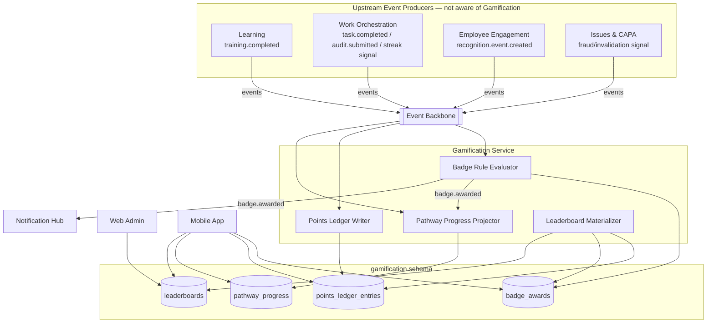
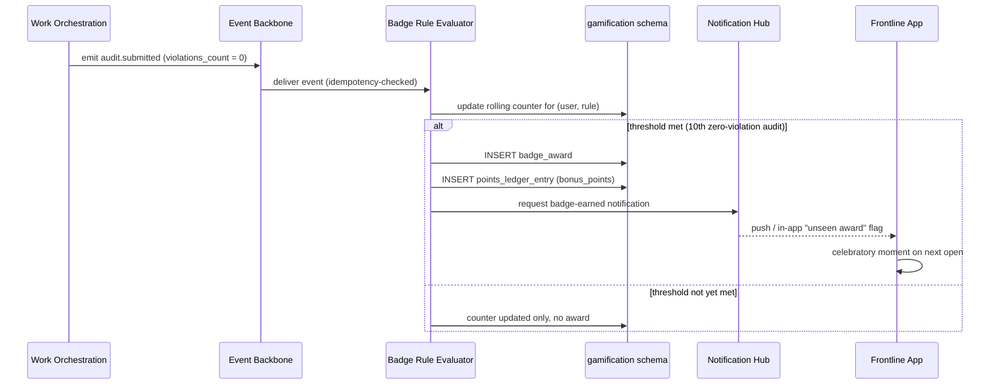
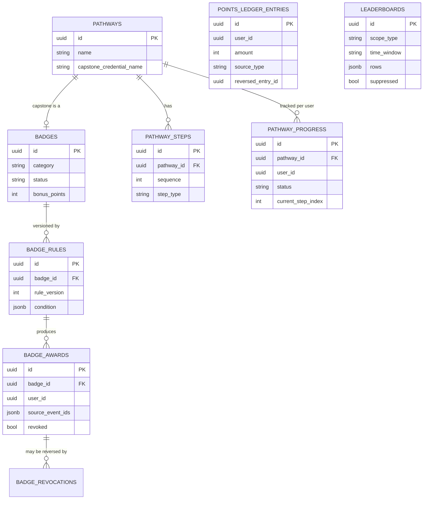
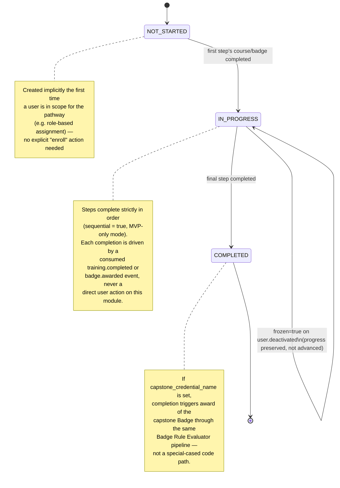

# Gamification & Recognition — Architecture Diagrams

Module: `22-gamification`

## 1. Component Diagram



**Narration**: This is an event-consumer architecture, not a request/response service — every arrow
into the Gamification Service from an upstream module is an asynchronous event, never a synchronous
call the upstream module waits on. The Badge Rule Evaluator, Points Ledger Writer, and Pathway
Progress Projector each independently consume the same event stream and write to their own tables;
the Leaderboard Materializer is the one component that runs on a schedule rather than reactively,
reading the already-durable ledger and award tables to produce the precomputed views mobile/web
clients actually query. No component here ever calls back into Learning, Work Orchestration, or
Employee Engagement to drive their behavior — the dependency arrow points one way.

## 2. Sequence Diagram — Badge Award From a Cross-Module Event



**Narration**: The associate who triggers the tenth qualifying audit never interacts with
Gamification directly — the badge is a side effect of doing their normal job. The celebratory moment
is decoupled from the notification's delivery success: the award and points are already durably
committed before the notification is even attempted, so a lost push notification cannot cause a lost
badge, only a delayed celebration (surfaced instead via the "unseen award" flag on next app open).

## 3. Sequence Diagram — Points Reversal on Upstream Invalidation

```mermaid
sequenceDiagram
    participant Issues as Issues & CAPA
    participant Kafka as Event Backbone
    participant Ledger as Points Ledger Writer
    participant DB as gamification schema
    participant App as Frontline App

    Issues->>Kafka: emit issue.created (AUDIT_FRAUD, ref_event_id)
    Kafka->>Ledger: deliver invalidation event
    Ledger->>DB: locate original points_ledger_entry by source_event_id
    Ledger->>DB: INSERT reversal entry (negative amount, reversed_entry_id set)
    Ledger->>DB: check dependent badge_awards; revoke if condition no longer met
    Ledger->>App: (async, next sync) points history shows struck-through reversed entry
    Note over App: revocation UX is low-key/neutral —\nassociate is not assumed to be at fault
```

**Narration**: Reversal never mutates or deletes the original entry — it appends a compensating
transaction, preserving a complete, honest history (the platform's historical-truth principle applied
at this module's scale). A dependent badge is revoked only if, with the invalidated event excluded,
the rule's condition would no longer hold; the revocation UX is deliberately understated because the
associate receiving the badge is very often not the party responsible for the underlying invalidation.

## 4. ER Diagram — Owned Entities



**Narration**: `POINTS_LEDGER_ENTRIES` and `LEADERBOARDS` are deliberately not drawn with a rigid FK
into `BADGE_AWARDS`/`PATHWAYS` — the ledger is an independent, append-only record that merely
*references* a badge award when relevant (`related_badge_award_id`), and leaderboards are a
*computed* projection over the ledger and award tables, refreshed by a batch job rather than kept
live-consistent by a database constraint. This separation is what makes the ledger safely reversible
without needing to touch or recompute badge/pathway state synchronously.

## 5. State Diagram — PathwayProgress Lifecycle



**Narration**: `PathwayProgress` has no failure/reset terminal state — a pathway is not something a
learner can "fail," only pause (frozen on deactivation) or complete. Every transition is driven purely
by events this module already consumes for badges and points (`training.completed`, `badge.awarded`),
so a Pathway is, structurally, just a saved sequence of badge/course completions with a progress bar
drawn over it — consistent with this module's positioning as a lightweight visualization and
motivation layer rather than a new execution engine (`new-modules-addendum.md` row 22).
