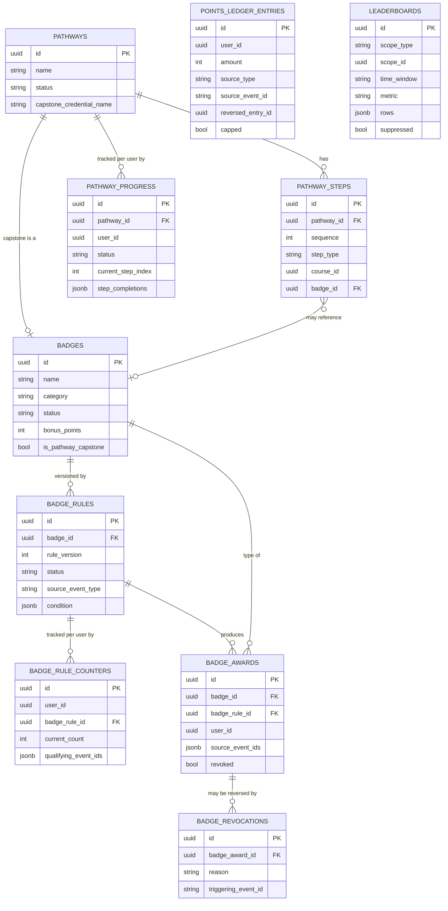
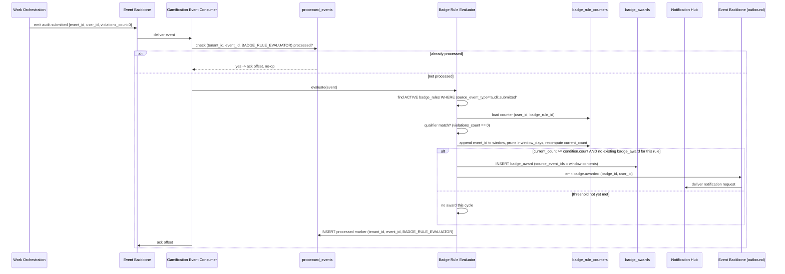
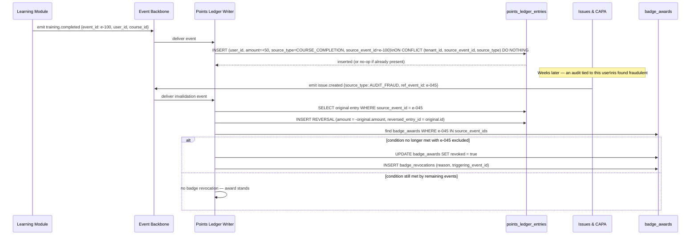
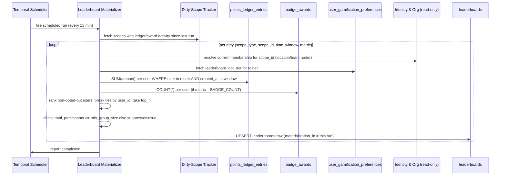

# Gamification & Recognition — Low-Level Design

Module: `22-gamification`
Schema namespace: `gamification` (Postgres)

## 1. Postgres Schema

All tables carry `tenant_id UUID NOT NULL` and are subject to Row-Level Security
(`USING (tenant_id = current_setting('app.tenant_id')::uuid)`) per conventions.md. Timestamps are
`TIMESTAMPTZ`. Primary keys are `UUID DEFAULT gen_random_uuid()` unless noted.

### 1.1 `badges`

| Column | Type | Notes |
|---|---|---|
| id | UUID PK | Stable logical badge identity |
| tenant_id | UUID NOT NULL | |
| name | TEXT NOT NULL | |
| description | TEXT | |
| icon_ref | TEXT | Object-storage reference |
| category | VARCHAR(20) NOT NULL | `COMPLIANCE`,`LEARNING`,`CONSISTENCY`,`RECOGNITION`,`PATHWAY_CAPSTONE` |
| status | VARCHAR(10) NOT NULL DEFAULT 'DRAFT' | `DRAFT`,`ACTIVE`,`RETIRED` |
| bonus_points | INT NOT NULL DEFAULT 0 | Points credited at award time, if any |
| is_pathway_capstone | BOOLEAN NOT NULL DEFAULT false | True for internally-generated capstone badges (FR-GAM-033) |
| pathway_id | UUID | FK → pathways, set only when `is_pathway_capstone = true` |
| created_by | UUID NOT NULL | |
| created_at | TIMESTAMPTZ NOT NULL DEFAULT now() | |
| updated_at | TIMESTAMPTZ NOT NULL DEFAULT now() | |
| version | INT NOT NULL DEFAULT 1 | Optimistic concurrency |

Indexes: `(tenant_id, status)`, `(tenant_id, category)`.

### 1.2 `badge_rules`

Versioned condition definitions, mirroring `TemplateVersion` (source-spec §17.1). Only one version
per `badge_id` is `ACTIVE` at a time.

| Column | Type | Notes |
|---|---|---|
| id | UUID PK | `badge_rule_version_id` referenced elsewhere |
| tenant_id | UUID NOT NULL | |
| badge_id | UUID NOT NULL FK → badges | |
| rule_version | INT NOT NULL | Monotonic per badge_id |
| status | VARCHAR(10) NOT NULL | `DRAFT`,`ACTIVE`,`SUPERSEDED` |
| source_event_type | VARCHAR(60) NOT NULL | e.g. `audit.submitted`, `training.completed`, `task.streak_classified`, `recognition.event.created`, `pathway.completed` |
| condition | JSONB NOT NULL | e.g. `{"count":10,"window_days":90,"qualifier":{"violations_count":0}}` |
| idempotency_scope | VARCHAR(20) NOT NULL DEFAULT 'PER_USER' | `PER_USER` (MVP only) |
| published_at | TIMESTAMPTZ | Null while DRAFT |
| created_by | UUID NOT NULL | |
| created_at | TIMESTAMPTZ NOT NULL DEFAULT now() | |

Uniqueness: `UNIQUE (tenant_id, badge_id, rule_version)`. Partial unique index:
`UNIQUE (tenant_id, badge_id) WHERE status = 'ACTIVE'` — at most one active rule version per badge.
Indexes: `(tenant_id, source_event_type, status)` (the Evaluator's primary lookup path: "which active
rules subscribe to this incoming event type").

### 1.3 `badge_rule_counters`

Per-user incremental rolling-window state, avoiding a full historical re-scan per event (high-level-
design.md §5).

| Column | Type | Notes |
|---|---|---|
| id | UUID PK | |
| tenant_id | UUID NOT NULL | |
| user_id | UUID NOT NULL | |
| badge_rule_id | UUID NOT NULL FK → badge_rules | |
| qualifying_event_ids | JSONB NOT NULL DEFAULT '[]' | Bounded ring buffer of `{event_id, occurred_at}`, pruned to `window_days` on each update |
| current_count | INT NOT NULL DEFAULT 0 | Count of currently-valid entries in the window |
| last_updated_at | TIMESTAMPTZ NOT NULL DEFAULT now() | |

Uniqueness: `UNIQUE (tenant_id, user_id, badge_rule_id)`. Indexes: `(tenant_id, badge_rule_id)`
(used by the Impact Preview, FR-GAM-063, to estimate how many users are close to a threshold).

### 1.4 `badge_awards`

| Column | Type | Notes |
|---|---|---|
| id | UUID PK | |
| tenant_id | UUID NOT NULL | |
| badge_id | UUID NOT NULL FK → badges | |
| badge_rule_id | UUID NOT NULL FK → badge_rules | Which rule VERSION produced this award |
| user_id | UUID NOT NULL | |
| source_event_ids | JSONB NOT NULL | Array of qualifying event ids (audit trail, FR-GAM-005) |
| awarded_at | TIMESTAMPTZ NOT NULL DEFAULT now() | |
| seen_by_user | BOOLEAN NOT NULL DEFAULT false | Drives the celebratory-moment "unseen award" flag |
| revoked | BOOLEAN NOT NULL DEFAULT false | Denormalized flag for fast profile reads; source of truth is `badge_revocations` |

Uniqueness: `UNIQUE (tenant_id, badge_id, user_id, badge_rule_id)` — a user cannot be awarded the same
badge twice under the same rule version (idempotency backstop alongside the event-level marker in
§1.7). Indexes: `(tenant_id, user_id, revoked)`, `(tenant_id, badge_id)`.

### 1.5 `badge_revocations`

| Column | Type | Notes |
|---|---|---|
| id | UUID PK | |
| tenant_id | UUID NOT NULL | |
| badge_award_id | UUID NOT NULL FK → badge_awards | |
| reason | TEXT NOT NULL | |
| triggering_event_id | TEXT NOT NULL | The invalidation event that caused this (FR-GAM-064) |
| revoked_at | TIMESTAMPTZ NOT NULL DEFAULT now() | |

Indexes: `(tenant_id, badge_award_id)`.

### 1.6 `points_ledger_entries`

Append-only. No `UPDATE`/`DELETE` grant for any application role except the reversal path, which is
itself an `INSERT`, never a mutation of an existing row.

| Column | Type | Notes |
|---|---|---|
| id | UUID PK | |
| tenant_id | UUID NOT NULL | |
| user_id | UUID NOT NULL | |
| amount | INT NOT NULL | Signed; positive = earn, negative = reversal/manual debit |
| source_type | VARCHAR(20) NOT NULL | `STREAK`,`COURSE_COMPLETION`,`RECOGNITION`,`BADGE_BONUS`,`MANUAL_ADJUSTMENT`,`REVERSAL` |
| source_event_id | TEXT | The upstream `event_id` this entry was derived from; NULL only for `MANUAL_ADJUSTMENT` |
| related_badge_award_id | UUID | FK → badge_awards, nullable |
| reversed_entry_id | UUID | FK → points_ledger_entries (self), set only on `REVERSAL` rows, points at the entry being reversed |
| capped | BOOLEAN NOT NULL DEFAULT false | True if this credit was reduced/suppressed by an anti-gaming rate cap (FR-GAM-040) |
| reason | TEXT | Human-readable; mandatory for `MANUAL_ADJUSTMENT` |
| created_by | UUID | Set for `MANUAL_ADJUSTMENT` only |
| created_at | TIMESTAMPTZ NOT NULL DEFAULT now() | |

Uniqueness: `UNIQUE (tenant_id, source_event_id, source_type) WHERE source_event_id IS NOT NULL`
(the core idempotency guard, FR-GAM-061). Indexes: `(tenant_id, user_id, created_at)` (history view
and balance sum), `(tenant_id, user_id) INCLUDE (amount)` (balance aggregate).

### 1.7 `processed_events`

Generic idempotency marker table shared by the Badge Rule Evaluator and Points Ledger Writer —
distinct from `points_ledger_entries`'s own uniqueness constraint because badge-rule evaluation needs
a processed marker even for events that do **not** result in a ledger write (e.g., an event that
increments a counter but doesn't yet cross the threshold).

| Column | Type | Notes |
|---|---|---|
| tenant_id | UUID NOT NULL | |
| event_id | TEXT NOT NULL | Platform-standard event envelope `event_id` |
| consumer_name | VARCHAR(40) NOT NULL | `BADGE_RULE_EVALUATOR`,`POINTS_LEDGER_WRITER`,`PATHWAY_PROJECTOR` |
| processed_at | TIMESTAMPTZ NOT NULL DEFAULT now() | |

Primary key: `(tenant_id, event_id, consumer_name)`. Retention: pruned after 180 days (well beyond any
reconciliation lookback window, §8).

### 1.8 `leaderboards`

Materialized, rebuilt wholesale per cycle (write-then-swap by `materialization_id`, not row-patched).

| Column | Type | Notes |
|---|---|---|
| id | UUID PK | |
| tenant_id | UUID NOT NULL | |
| scope_type | VARCHAR(10) NOT NULL | `LOCATION`,`TEAM`,`TENANT` |
| scope_id | UUID | NULL when `scope_type = TENANT` |
| time_window | VARCHAR(10) NOT NULL | `WEEKLY`,`MONTHLY`,`ALL_TIME` |
| metric | VARCHAR(15) NOT NULL | `POINTS`,`BADGE_COUNT` |
| period_start | DATE | NULL for `ALL_TIME` |
| rows | JSONB NOT NULL | Ordered array: `[{rank, user_id, value}]`, bounded to top N (default 10) |
| total_participants | INT NOT NULL | Includes opted-out count for the footer computation |
| opted_out_count | INT NOT NULL DEFAULT 0 | |
| suppressed | BOOLEAN NOT NULL DEFAULT false | True when `total_participants < min_group_size` (FR-GAM-025) |
| materialized_at | TIMESTAMPTZ NOT NULL | |
| materialization_id | UUID NOT NULL | Groups all cells written in one materializer run, for atomic swap |

Uniqueness: `UNIQUE (tenant_id, scope_type, scope_id, time_window, metric, period_start)` — a new
materialization for the same key **upserts** this row (the "swap" is a single-row `UPDATE`, not a
delete-and-reinsert, so a reader never sees a transient empty state). Indexes:
`(tenant_id, scope_type, scope_id, time_window, metric)`.

### 1.9 `pathways`

| Column | Type | Notes |
|---|---|---|
| id | UUID PK | |
| tenant_id | UUID NOT NULL | |
| name | TEXT NOT NULL | |
| status | VARCHAR(10) NOT NULL DEFAULT 'DRAFT' | `DRAFT`,`ACTIVE`,`RETIRED` |
| sequential | BOOLEAN NOT NULL DEFAULT true | MVP only supports `true` |
| capstone_credential_name | TEXT | Nullable; if set, a `badges` row with `is_pathway_capstone=true` is created on ACTIVE |
| created_by | UUID NOT NULL | |
| created_at | TIMESTAMPTZ NOT NULL DEFAULT now() | |
| version | INT NOT NULL DEFAULT 1 | |

Indexes: `(tenant_id, status)`.

### 1.10 `pathway_steps`

| Column | Type | Notes |
|---|---|---|
| id | UUID PK | |
| tenant_id | UUID NOT NULL | |
| pathway_id | UUID NOT NULL FK → pathways | |
| sequence | INT NOT NULL | Display/completion order |
| step_type | VARCHAR(10) NOT NULL | `COURSE`,`BADGE` |
| course_id | UUID | Set when `step_type = COURSE` (external ref → Learning module) |
| badge_id | UUID | Set when `step_type = BADGE` (FK → badges) |

Uniqueness: `UNIQUE (tenant_id, pathway_id, sequence)`. CHECK: exactly one of `course_id`/`badge_id`
is non-null per `step_type`.

### 1.11 `pathway_progress`

| Column | Type | Notes |
|---|---|---|
| id | UUID PK | |
| tenant_id | UUID NOT NULL | |
| pathway_id | UUID NOT NULL FK → pathways | |
| user_id | UUID NOT NULL | |
| status | VARCHAR(15) NOT NULL DEFAULT 'NOT_STARTED' | `NOT_STARTED`,`IN_PROGRESS`,`COMPLETED` |
| current_step_index | INT NOT NULL DEFAULT 0 | |
| step_completions | JSONB NOT NULL DEFAULT '[]' | `[{step_id, completed_at, source_event_id}]` |
| started_at | TIMESTAMPTZ | |
| completed_at | TIMESTAMPTZ | |
| frozen | BOOLEAN NOT NULL DEFAULT false | Set true on `user.deactivated` (FR-GAM-066) |

Uniqueness: `UNIQUE (tenant_id, pathway_id, user_id)`. Indexes: `(tenant_id, pathway_id, status)`.

### 1.12 `user_gamification_preferences`

| Column | Type | Notes |
|---|---|---|
| tenant_id | UUID NOT NULL | |
| user_id | UUID NOT NULL | |
| leaderboard_opt_out | BOOLEAN NOT NULL DEFAULT false | |
| notify_on_badge | BOOLEAN NOT NULL DEFAULT true | |
| updated_at | TIMESTAMPTZ NOT NULL DEFAULT now() | |

Primary key: `(tenant_id, user_id)`.

### 1.13 `tenant_gamification_settings`

| Column | Type | Notes |
|---|---|---|
| tenant_id | UUID PK | |
| leaderboards_enabled | BOOLEAN NOT NULL DEFAULT true | FR-GAM-022 |
| min_group_size | INT NOT NULL DEFAULT 5 | FR-GAM-025 |
| leaderboard_top_n | INT NOT NULL DEFAULT 10 | FR-GAM-024 |
| rate_limit_config | JSONB NOT NULL | Per-`source_type` caps (FR-GAM-040) |
| penalize_user_on_fraud_reversal | BOOLEAN NOT NULL DEFAULT false | FR-GAM-064 |

### 1.14 ER Diagram



Note: `POINTS_LEDGER_ENTRIES` and `LEADERBOARDS` are intentionally not drawn with a direct FK to
`BADGE_AWARDS`/`PATHWAYS` in this diagram — the ledger references a badge award optionally
(`related_badge_award_id`) and leaderboards are computed *from* the ledger and awards by the
materializer job, a computed relationship rather than a rigid referential one, consistent with the
ledger's role as an independent source of truth (HLD §8).

## 2. REST Endpoints

Base path `/api/v1/gamification/`. OAuth2/OIDC bearer auth; tenant resolved from principal. Mutations
accept `Idempotency-Key`; mutable resources use `ETag`/`version`.

### 2.1 `POST /api/v1/gamification/badges` — define a badge

Request:
```json
{
  "name": "Perfect Auditor",
  "description": "10 audits submitted with zero violations within 90 days",
  "category": "COMPLIANCE",
  "icon_ref": "icons/perfect-auditor.svg",
  "bonus_points": 100
}
```
Response `201`:
```json
{ "id": "badge-7701", "status": "DRAFT", "version": 1 }
```

### 2.2 `POST /api/v1/gamification/badges/{id}/rules` — define/publish a badge rule

Request:
```json
{
  "source_event_type": "audit.submitted",
  "condition": { "count": 10, "window_days": 90, "qualifier": { "violations_count": 0 } },
  "publish": true
}
```
Server behavior: creates a new `badge_rule_version` (`rule_version = max+1`), and if `publish: true`,
runs the **Impact Preview** (FR-GAM-063) synchronously before committing the `ACTIVE` transition,
returning the preview in the response so the admin sees it even on immediate publish.
Response `200`:
```json
{
  "badge_rule_id": "rule-3391",
  "rule_version": 2,
  "status": "ACTIVE",
  "impact_preview": {
    "users_with_partial_progress": 214,
    "users_who_would_have_qualified_under_old_rule_but_not_new": 12,
    "previous_rule_version": 1
  }
}
```
Errors: `400 VALIDATION_ERROR` (unknown `source_event_type`, malformed `condition` schema),
`409 CONFLICT` (stale `version` on the badge).

### 2.3 `GET /api/v1/gamification/me/badges` — my badges

Response `200`:
```json
{
  "items": [
    { "badge_id": "badge-7701", "name": "Perfect Auditor", "category": "COMPLIANCE",
      "awarded_at": "2026-08-14T10:03:00Z", "seen_by_user": false, "revoked": false }
  ],
  "next_cursor": null
}
```

### 2.4 `GET /api/v1/gamification/me/points` — my points ledger + balance

Query params: `?cursor=...&limit=50`.
Response `200`:
```json
{
  "balance": 1240,
  "items": [
    { "id": "pl-991", "amount": 100, "source_type": "BADGE_BONUS", "reason": "Perfect Auditor badge", "created_at": "2026-08-14T10:03:00Z", "reversed_entry_id": null },
    { "id": "pl-990", "amount": -50, "source_type": "REVERSAL", "reason": "Linked audit later invalidated", "created_at": "2026-08-10T09:00:00Z", "reversed_entry_id": "pl-880" }
  ],
  "next_cursor": "eyJvZmZzZXQiOjUwfQ"
}
```

### 2.5 `GET /api/v1/gamification/leaderboards` — get leaderboard for a scope

Query params: `?scope_type=LOCATION&scope_id=node-store-12&time_window=MONTHLY&metric=POINTS`.
Response `200` — normal case:
```json
{
  "scope_type": "LOCATION", "scope_id": "node-store-12", "time_window": "MONTHLY", "metric": "POINTS",
  "period_start": "2026-09-01", "materialized_at": "2026-09-23T08:15:00Z",
  "suppressed": false,
  "rows": [
    { "rank": 1, "user_id": "u-2290", "display_name": "J. Rivera", "value": 980 },
    { "rank": 2, "user_id": "u-1187", "display_name": "A. Chen", "value": 875 }
  ],
  "my_rank": { "rank": 7, "value": 410 },
  "opted_out_count": 2,
  "total_participants": 34
}
```
Response `200` — suppressed (below `min_group_size`):
```json
{
  "scope_type": "TEAM", "scope_id": "team-4", "time_window": "WEEKLY", "metric": "POINTS",
  "suppressed": true, "reason": "GROUP_TOO_SMALL", "min_group_size": 5,
  "rows": [
    { "user_id": "u-2290", "display_name": "J. Rivera" },
    { "user_id": "u-1187", "display_name": "A. Chen" }
  ]
}
```
Note: the suppressed response returns an **unranked participant list**, not raw scores (FR-GAM-025) —
distinct from Employee Engagement's suppression, which withholds the list entirely; here the roster
itself is not sensitive (leaderboard participation is not anonymous), only the head-to-head ranking of
a very small group is softened.
Errors: `403 SCOPE_DENIED`, `404 LEADERBOARDS_DISABLED` (tenant-wide toggle off).

### 2.6 `POST /api/v1/gamification/me/leaderboard-opt-out` — opt out/in

Request:
```json
{ "leaderboard_opt_out": true }
```
Response `200`:
```json
{ "leaderboard_opt_out": true, "updated_at": "2026-09-23T09:00:00Z" }
```

## 3. Sequence Diagrams

### 3.1 Event consumption → badge rule evaluation → badge award → notification



### 3.2 Points ledger entry creation and reversal (audit later invalidated)



### 3.3 Leaderboard materialization job



## 4. Pseudocode

### 4.1 Badge-rule evaluation (idempotent on source event id)

```
function handle_incoming_event(tenant_id, event):
    if ProcessedEvents.exists(tenant_id, event.event_id, consumer='BADGE_RULE_EVALUATOR'):
        return ACK   # already handled — redelivery is a pure no-op

    matching_rules = BadgeRules.find(
        tenant_id = tenant_id,
        source_event_type = event.event_type,
        status = 'ACTIVE'
    )

    for rule in matching_rules:
        user_id = extract_user_id(event)  # from event payload/actor_id
        if not passes_qualifier(event, rule.condition.qualifier):
            continue   # e.g. violations_count != 0 for a zero-violation rule

        counter = BadgeRuleCounters.get_or_create(tenant_id, user_id, rule.id)
        counter.qualifying_event_ids.append({event_id: event.event_id, occurred_at: event.occurred_at})
        prune_older_than(counter.qualifying_event_ids, rule.condition.window_days)
        counter.current_count = len(counter.qualifying_event_ids)
        BadgeRuleCounters.save(counter)

        if counter.current_count >= rule.condition.count:
            existing = BadgeAwards.find(tenant_id, rule.badge_id, user_id, rule.id)
            if existing is None:
                award = BadgeAwards.insert(
                    tenant_id = tenant_id,
                    badge_id = rule.badge_id,
                    badge_rule_id = rule.id,
                    user_id = user_id,
                    source_event_ids = counter.qualifying_event_ids
                )   # UNIQUE (tenant_id, badge_id, user_id, badge_rule_id) — second idempotency backstop
                credit_bonus_points_if_any(tenant_id, user_id, rule.badge_id, award.id)
                EventBackbone.emit('badge.awarded', {badge_id: rule.badge_id, user_id, award_id: award.id})
                NotificationHub.notify(user_id, template='BADGE_EARNED', badge_id=rule.badge_id)
            # else: threshold re-crossed by a later event but award already exists — no-op,
            # consistent with "monotonic accumulation" rule design (functional-spec FR-GAM-007)

    ProcessedEvents.insert(tenant_id, event.event_id, consumer='BADGE_RULE_EVALUATOR')
    return ACK
```

### 4.2 Leaderboard ranking computation

```
function materialize_leaderboard(tenant_id, scope_type, scope_id, time_window, metric):
    settings = TenantGamificationSettings.get(tenant_id)
    if not settings.leaderboards_enabled:
        return SKIP

    roster = OrgService.resolve_current_members(tenant_id, scope_type, scope_id)  # current membership only (FR-GAM-062)
    prefs = UserGamificationPreferences.bulk_get(tenant_id, roster.user_ids)

    period_start, period_end = resolve_window(time_window)  # NULL/NULL for ALL_TIME

    if metric == 'POINTS':
        raw_scores = PointsLedger.sum_amount_per_user(
            tenant_id, roster.user_ids, created_at_between=(period_start, period_end)
        )
    else:  # BADGE_COUNT
        raw_scores = BadgeAwards.count_per_user(
            tenant_id, roster.user_ids, revoked=false, awarded_at_between=(period_start, period_end)
        )

    eligible = [(u, v) for u, v in raw_scores if not prefs[u].leaderboard_opt_out]
    opted_out_count = count(u for u in raw_scores if prefs[u].leaderboard_opt_out)

    # Deterministic tie-break: score desc, then user_id asc
    ranked = sort(eligible, key=lambda (u, v): (-v, u))
    top_n = ranked[:settings.leaderboard_top_n]

    total_participants = len(eligible)
    suppressed = total_participants < settings.min_group_size

    rows = [] if suppressed else [
        { rank: i+1, user_id: u, value: v } for i, (u, v) in enumerate(top_n)
    ]
    unranked_roster = [] if not suppressed else [u for u, _ in eligible]  # names only, no scores

    Leaderboards.upsert(
        tenant_id, scope_type, scope_id, time_window, metric, period_start,
        rows = rows if not suppressed else unranked_roster,
        total_participants = total_participants,
        opted_out_count = opted_out_count,
        suppressed = suppressed,
        materialized_at = now(),
        materialization_id = current_run_id
    )
```

## 5. Caching Strategy

| Cache | Key shape | TTL / invalidation |
|---|---|---|
| Materialized leaderboard read | `tenant:{t}:lb:{scope_type}:{scope_id}:{window}:{metric}` (Redis, JSON of the `leaderboards` row) | TTL = materialization cadence (15 min weekly/monthly, 1h all-time); invalidated on next materializer upsert for that key |
| User's own points balance | `tenant:{t}:user:{u}:points_balance` | TTL 60s; invalidated on any new `points_ledger_entries` insert for that user (cache-aside, write-through on credit path) |
| User's own badge list | `tenant:{t}:user:{u}:badges` | TTL 5 min; invalidated on `badge.awarded`/revocation for that user |
| `badge_rule_counters` hot lookup during evaluation | Not cached separately — read/write directly against Postgres, since evaluation throughput is bounded by upstream event volume (low relative to, e.g., Work Orchestration's own write volume) and per-user-keyed partitioning already limits contention | n/a |

## 6. Concurrency Control

- **Event processing idempotency**: `processed_events` primary key `(tenant_id, event_id,
  consumer_name)` is the authoritative guard; a concurrent redelivery (two consumer instances briefly
  processing the same partition during a rebalance) resolves via `INSERT ... ON CONFLICT DO NOTHING`
  on the processed-marker, with the loser's badge/points side-effects rolled back in the same
  transaction as the marker insert attempt (all evaluation writes for one event happen inside one DB
  transaction alongside the marker insert, so a conflict on the marker aborts the whole side-effect
  set atomically).
- **Points ledger credit**: `UNIQUE (tenant_id, source_event_id, source_type)` on
  `points_ledger_entries` is the ledger's own independent idempotency guard (defense in depth alongside
  `processed_events`, since the ledger table is also written to directly by the manual-adjustment admin
  path, which has no upstream `event_id`).
- **Badge award**: `UNIQUE (tenant_id, badge_id, user_id, badge_rule_id)` on `badge_awards` similarly
  backstops the evaluator's own no-duplicate-award logic at the database level.
- **Leaderboard materialization**: each `(tenant_id, scope_type, scope_id, time_window, metric,
  period_start)` cell is protected by a Postgres advisory lock (hashed key) during its compute-and-
  upsert step, so an on-demand "recompute my location now" admin trigger cannot race the scheduled
  cycle for the same cell; the upsert is a full recompute from current ledger/award state, not an
  incremental delta, so it is naturally idempotent regardless of which run wins the race.
- **Badge rule counter updates**: updates to a given `(tenant_id, user_id, badge_rule_id)` counter row
  are serialized via `SELECT ... FOR UPDATE` inside the evaluation transaction — safe because
  Kafka partitioning by `tenant_id:user_id` already ensures a single user's events are processed
  in order by a single consumer instance in the common case; the row lock is a defense-in-depth
  backstop for rebalance/retry edge cases, not the primary ordering mechanism.

## 7. Background Jobs

| Job | Trigger | Behavior |
|---|---|---|
| Leaderboard Materializer | Temporal schedule: every 15 min (weekly/monthly scopes), hourly (all-time) | Recomputes only "dirty" scopes (activity since last run) per §4.2 pseudocode; each cell atomically upserted; emits `leaderboard.materialized` per completed cell for Analytics freshness tracking |
| Badge-Award Backfill Reconciliation | Nightly (Temporal schedule), also on-demand-triggerable by an Operations Admin after a known upstream incident | Pages through upstream modules' event logs (via a bounded internal query API, not a live re-subscription) for a 7-day lookback window; for each event whose `(tenant_id, event_id, BADGE_RULE_EVALUATOR)` has no `processed_events` row, replays it through the same `handle_incoming_event` logic (§4.1) — additive and idempotent, never a full historical replay |
| Rolling-window counter pruning | Runs inline as part of every evaluation (§4.1), plus a weekly sweep job that prunes stale `badge_rule_counters` rows whose window has fully expired with no new qualifying events, to bound table growth for users who stopped accumulating toward a given badge | Deletes/trims `qualifying_event_ids` entries older than `window_days`; does not delete the counter row itself unless `current_count` reaches 0 and no activity in 2x window_days |
| Pathway completion sweep | Consumes `training.completed`/`badge.awarded` inline (not a separate batch), listed here for completeness of the pathway pipeline | Advances `pathway_progress.current_step_index` when the current step's referenced course/badge completes for that user; on final step, transitions to `COMPLETED` and triggers capstone badge award via the same Badge Rule Evaluator pipeline (a `PATHWAY_COMPLETION`-type rule bound to the pathway) |
| `processed_events` retention cleanup | Daily | Purges markers older than 180 days — well past the reconciliation job's 7-day lookback, so pruning never risks re-enabling a duplicate award for an event that could still be replayed by reconciliation |

## 8. Error Handling

| Scenario | HTTP status | Error code | Notes |
|---|---|---|---|
| Event redelivered (already processed) | n/a (async) | n/a | Silent idempotent no-op; not surfaced as an error anywhere (FR-GAM-060) |
| Badge rule references an unknown/unregistered `source_event_type` | 400 | `UNKNOWN_EVENT_TYPE` | Validated against a platform-maintained allowlist of canonical event types at rule-creation time |
| Publish a badge rule with `count <= 0` or `window_days <= 0` | 422 | `VALIDATION_ERROR` | |
| Leaderboard requested for a scope outside requester's `UserScope` | 403 | `SCOPE_DENIED` | Never conflated with `suppressed` |
| Leaderboard requested while tenant-wide toggle is off | 404 | `LEADERBOARDS_DISABLED` | Distinct from `suppressed` (small group) — the surface itself doesn't exist for this tenant |
| Leaderboard scope below `min_group_size` | 200 | n/a | `suppressed: true`, unranked participant list only (FR-GAM-025) — a valid, non-error outcome |
| Manual points adjustment without a `reason` | 400 | `VALIDATION_ERROR` | `reason` mandatory for `MANUAL_ADJUSTMENT` (FR-GAM-012) |
| Reversal event references a `source_event_id` with no matching original ledger entry | 200 (async, logged) | n/a | Recorded as a data-quality warning (dead-letter-adjacent log), not a hard failure — the invalidation event itself may have arrived before the original credit in rare out-of-order delivery; reconciliation job re-checks and applies the reversal once the original entry exists |
| Anti-gaming rate cap exceeded on a would-be credit | 200 (async) | n/a | Entry recorded with `capped: true` and reduced/zero `amount`; never silently dropped without a ledger trace (FR-GAM-040) |
| Reciprocal-recognition throttle triggered | 200 (async) | n/a | Points credit suppressed for that recognition event only; the event itself (owned by Employee Engagement) is unaffected |
| Idempotency-Key reused with different payload (REST mutation endpoints) | 409 | `IDEMPOTENCY_KEY_CONFLICT` | Standard platform-wide contract |
| Badge rule publish attempted with stale `version` | 409 | `CONFLICT` | Optimistic concurrency, standard platform pattern |
| Cross-tenant reference in a consumed event (e.g., malformed `tenant_id`) | 403 (internal) | `SCOPE_DENIED` | Defense-in-depth; should be unreachable given the event backbone's tenant-partitioned topics, logged as a potential integrity issue |
| Upstream event payload fails schema validation | n/a (async) | n/a | Routed to dead-letter topic per platform-standard pattern (source-spec §22.3); DLQ volume alert fires per module HLD §7 |
