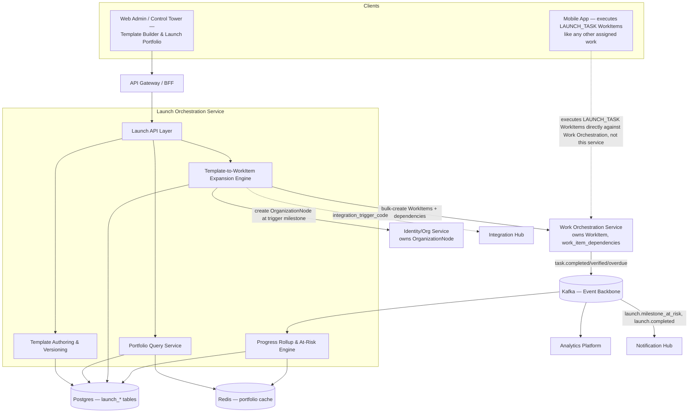
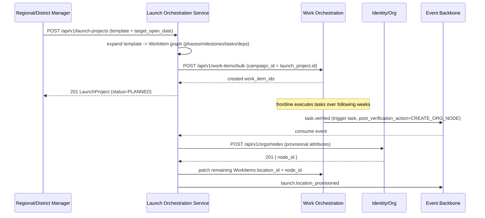
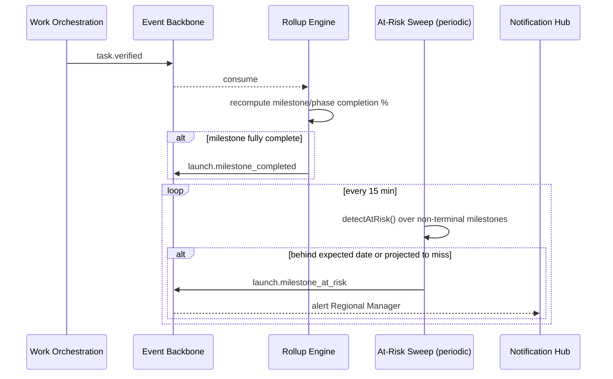
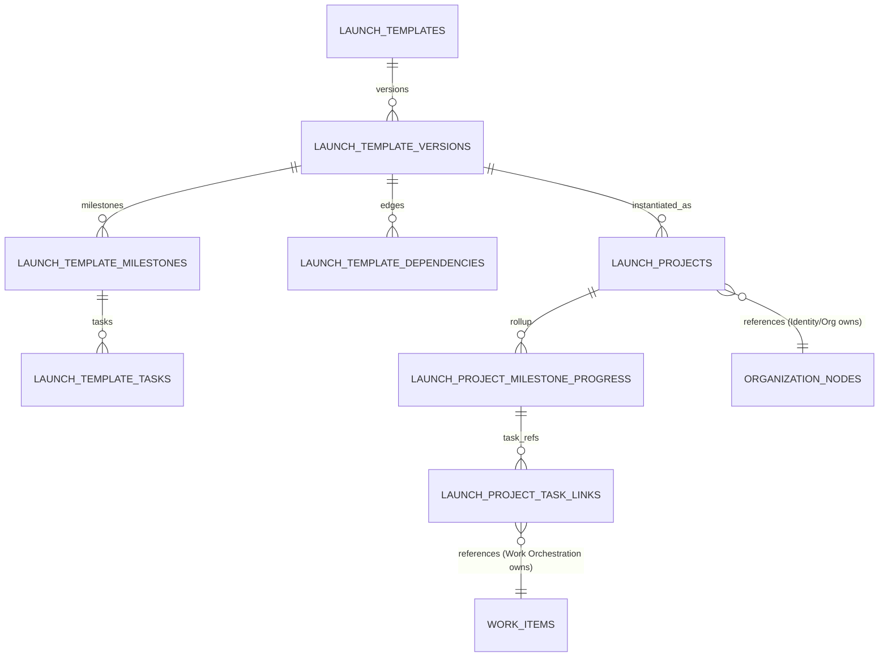
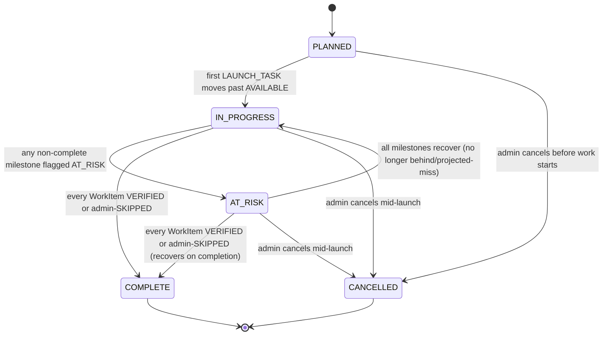

# New-Location Launch Management — Architecture Diagrams

Corresponds to addendum Module 23 (EPIC-03 extension). Focused diagram set for this module only;
narrative detail lives in `functional-spec.md`, `high-level-design.md`, `low-level-design.md`.

## 1. Component / Container Diagram

This module sits beside, not inside, Work Orchestration: the only write path into `WorkItem`/
`work_item_dependencies` is the Expansion Engine's bulk-creation call, and the only write path into
`OrganizationNode` is that same engine's node-creation call at the configured trigger milestone.
Frontline execution of the generated `LAUNCH_TASK` WorkItems flows entirely through Work
Orchestration's own mobile/offline path — this service never sits in that runtime loop.

## 2. Sequence Diagram — Launch Instantiation and Deferred OrganizationNode Creation

The OrganizationNode is deliberately created only once the configured milestone task is verified —
not at instantiation time — so provisional/uncommitted openings never pollute live location-scoped
reporting or RBAC scope prematurely (functional-spec §8 Resolved Decisions).

## 3. Sequence Diagram — Progress Rollup and At-Risk Detection

Rollup is purely event-driven off Work Orchestration's own canonical events, with a periodic sweep
(reconciliation and at-risk detection) as the backstop for missed events and for the time-based
projection logic that no single event can trigger on its own.

## 4. ER Diagram — Owned Entities

Only `LaunchTemplate`/`LaunchTemplateVersion`/`LaunchTemplateMilestone`/`LaunchTemplateTask`/
`LaunchProject`/`LaunchProjectMilestoneProgress`/`LaunchProjectTaskLinks` are owned here; `WorkItem`
and `OrganizationNode` are drawn as external references to make the ownership boundary explicit in
the diagram itself.

## 5. State Diagram — LaunchProject Lifecycle

This state machine is **independent of, but entirely derived from**, the underlying WorkItem
completion states that Work Orchestration owns: `LaunchProject.status` is never set directly by a
user action on the project itself (except the explicit `CANCELLED` transition) — it is always a
computed rollup of the aggregate status of the `LAUNCH_TASK` WorkItems and
`LaunchProjectMilestoneProgress` rows underneath it, recomputed by the Rollup Engine and At-Risk
Sweep described in low-level-design.md §3.2–3.3. The platform's canonical `WorkItem` state machine
(`DRAFT → SCHEDULED → AVAILABLE → IN_PROGRESS → SUBMITTED → PENDING_REVIEW → APPROVED → VERIFIED`,
plus `BLOCKED`/`OVERDUE`/`ESCALATED`/`REJECTED` branches) continues to govern every individual task
exactly as it does for any other WorkItem type; this diagram is the launch-level abstraction over
many concurrent instances of that machine, not a replacement for it.
