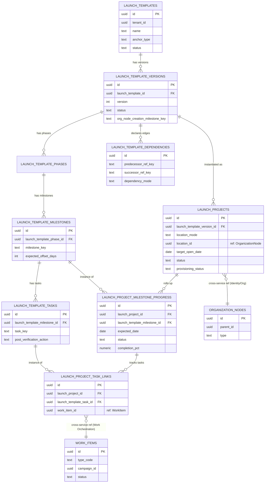
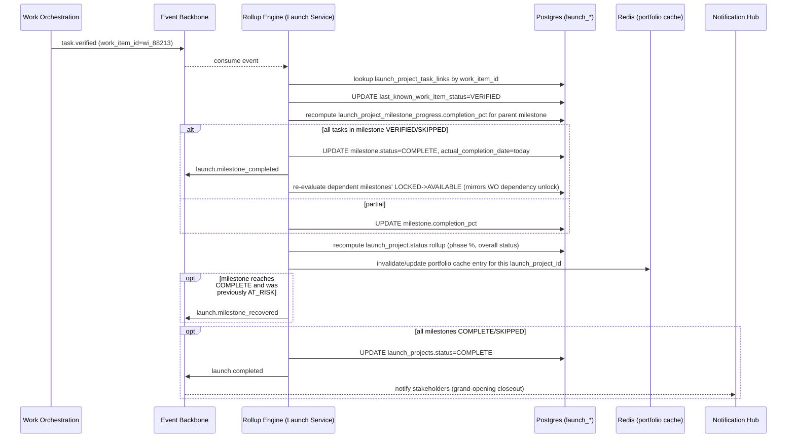
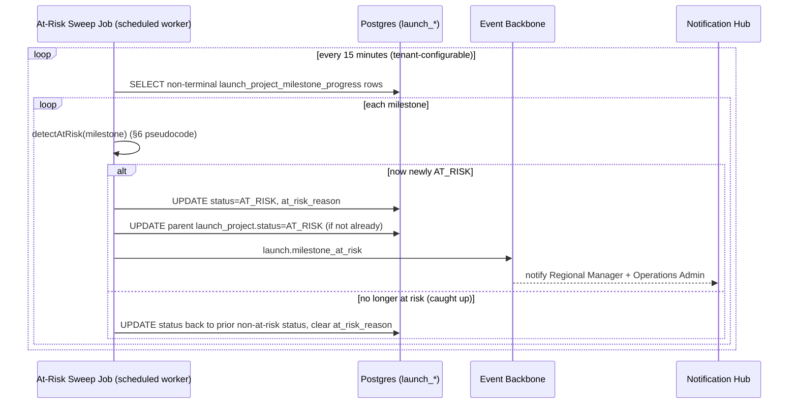

# New-Location Launch Management — Low-Level Design

Corresponds to **EPIC-03 (Work Core) extension**, addendum Module 23. Reuses conventions.md API/
event/error conventions and cross-references Work Orchestration's and Identity/Org's owned tables/
APIs rather than duplicating them.

## 1. Database Schema

### 1.1 Tables

**`launch_templates`** — stable logical identity of a reusable launch template (mirrors the platform
`Template` pattern).

| Column | Type | Notes |
|---|---|---|
| `id` | `uuid` PK | |
| `tenant_id` | `uuid` | NOT NULL, indexed |
| `name` | `text` | NOT NULL |
| `description` | `text` | |
| `owner_org_node_id` | `uuid` | FK → Identity/Org `organization_nodes.id`; authoring/instantiation scope |
| `anchor_type` | `text` | `TARGET_OPEN_DATE` \| `PROJECT_START`; ENUM |
| `status` | `text` | `DRAFT`\|`REVIEW`\|`APPROVED`\|`PUBLISHED`\|`SUPERSEDED`\|`RETIRED` |
| `current_published_version_id` | `uuid` | FK → `launch_template_versions.id`, nullable until first publish |
| `created_by` | `uuid` | FK → `users.id` |
| `created_at` / `updated_at` | `timestamptz` | |

**`launch_template_versions`** — immutable snapshot on publish.

| Column | Type | Notes |
|---|---|---|
| `id` | `uuid` PK | |
| `tenant_id` | `uuid` | NOT NULL |
| `launch_template_id` | `uuid` | FK → `launch_templates.id` |
| `version` | `int` | monotonically increasing per template |
| `schema_snapshot_hash` | `text` | hash of the full phase/milestone/task/dependency graph, for integrity/traceability (mirrors `TemplateVersion.schema_hash`) |
| `published_at` | `timestamptz` | NULL while `DRAFT`/`REVIEW`/`APPROVED` |
| `published_by` | `uuid` | FK → `users.id` |
| `status` | `text` | `DRAFT`\|`REVIEW`\|`APPROVED`\|`PUBLISHED`\|`SUPERSEDED`\|`RETIRED` |
| `org_node_creation_milestone_key` | `text` | references a milestone `key` within this version; nullable if template is existing-location-only |
| `created_at` | `timestamptz` | |

Unique constraint: `(launch_template_id, version)`.

**`launch_template_phases`** — denormalized phase grouping within a version (kept as its own table
rather than a free-text column on milestones, so phase metadata such as display order and phase-
level default anchor sign can evolve independently).

| Column | Type | Notes |
|---|---|---|
| `id` | `uuid` PK | |
| `tenant_id` | `uuid` | |
| `launch_template_version_id` | `uuid` | FK |
| `phase_code` | `text` | `CONSTRUCTION`\|`PERMITTING`\|`STAFFING`\|`INVENTORY_MERCHANDISING`\|`MARKETING`\|`GRAND_OPENING`\|tenant-custom |
| `display_order` | `int` | |
| `name` | `text` | |

**`launch_template_milestones`**

| Column | Type | Notes |
|---|---|---|
| `id` | `uuid` PK | |
| `tenant_id` | `uuid` | |
| `launch_template_version_id` | `uuid` | FK |
| `launch_template_phase_id` | `uuid` | FK |
| `milestone_key` | `text` | stable short key unique within the version, used by dependency edges and `org_node_creation_milestone_key` |
| `name` | `text` | |
| `expected_offset_days` | `int` | signed; interpreted relative to `anchor_type` (negative = days before target open date) |
| `display_order` | `int` | |

**`launch_template_tasks`**

| Column | Type | Notes |
|---|---|---|
| `id` | `uuid` PK | |
| `tenant_id` | `uuid` | |
| `launch_template_milestone_id` | `uuid` | FK |
| `task_key` | `text` | stable short key unique within the version |
| `name` | `text` | |
| `description` | `text` | |
| `template_version_id` | `uuid` | FK → Forms module `template_versions.id`, nullable |
| `default_assignee_role_id` | `uuid` | FK → `roles.id`, nullable — passed through to the generated WorkItem |
| `expected_duration_days` | `int` | used by at-risk velocity projection |
| `integration_trigger_code` | `text` | nullable; opaque code Integration Hub subscribes to |
| `post_verification_action` | `text` | nullable; `CREATE_ORG_NODE` on the designated trigger task, else NULL |
| `display_order` | `int` | |

**`launch_template_dependencies`** — the cross-phase/same-phase dependency graph, edges between
milestone or task refs.

| Column | Type | Notes |
|---|---|---|
| `id` | `uuid` PK | |
| `tenant_id` | `uuid` | |
| `launch_template_version_id` | `uuid` | FK |
| `predecessor_ref_type` | `text` | `MILESTONE`\|`TASK` |
| `predecessor_ref_key` | `text` | milestone_key or task_key |
| `successor_ref_type` | `text` | `MILESTONE`\|`TASK` |
| `successor_ref_key` | `text` | |
| `dependency_mode` | `text` | `ALL`\|`ANY`\|`THRESHOLD` |
| `threshold_n` | `int` | nullable, used when `dependency_mode = THRESHOLD` |

**`launch_projects`** — the instantiated project.

| Column | Type | Notes |
|---|---|---|
| `id` | `uuid` PK | also used as Work Orchestration `campaign_id` |
| `tenant_id` | `uuid` | NOT NULL, indexed |
| `launch_template_version_id` | `uuid` | FK, immutable once set |
| `name` | `text` | e.g. "Denver — Colfax Ave Launch" |
| `location_mode` | `text` | `NEW_LOCATION`\|`EXISTING_LOCATION` |
| `location_id` | `uuid` | FK → Identity/Org `organization_nodes.id`; NULL until node created for `NEW_LOCATION` mode |
| `provisional_location_name` | `text` | used while `location_id` is NULL |
| `provisional_location_attributes` | `jsonb` | address, brand, format, etc. — passed verbatim to node-creation call |
| `target_open_date` | `date` | NOT NULL |
| `project_start_date` | `date` | nullable, required if `anchor_type = PROJECT_START` |
| `status` | `text` | `PLANNED`\|`IN_PROGRESS`\|`AT_RISK`\|`COMPLETE`\|`CANCELLED` |
| `provisioning_status` | `text` | `NOT_APPLICABLE`\|`PENDING`\|`SUCCEEDED`\|`FAILED` — tracks the async node-creation call |
| `cancelled_reason` | `text` | nullable |
| `cancelled_at` | `timestamptz` | nullable |
| `created_by` | `uuid` | FK → `users.id` |
| `idempotency_key` | `text` | unique per tenant, supports FR-LAUNCH-014 |
| `version` | `int` | optimistic concurrency (ETag) |
| `created_at` / `updated_at` | `timestamptz` | |

Indexes: `(tenant_id, status)`, `(tenant_id, target_open_date)`, unique `(tenant_id, idempotency_key)`.

**`launch_project_milestone_progress`** — this module's own rollup metadata per milestone instance.

| Column | Type | Notes |
|---|---|---|
| `id` | `uuid` PK | |
| `tenant_id` | `uuid` | |
| `launch_project_id` | `uuid` | FK → `launch_projects.id` |
| `launch_template_milestone_id` | `uuid` | FK → `launch_template_milestones.id` (points into the immutable version the project started with) |
| `expected_date` | `date` | resolved at instantiation from `expected_offset_days` + anchor |
| `actual_completion_date` | `date` | nullable until complete |
| `status` | `text` | `LOCKED`\|`AVAILABLE`\|`IN_PROGRESS`\|`AT_RISK`\|`COMPLETE`\|`SKIPPED` |
| `completion_pct` | `numeric(5,2)` | recomputed from linked task progress |
| `at_risk_reason` | `text` | nullable; `BEHIND_EXPECTED_DATE`\|`PROJECTED_MISS` |
| `updated_at` | `timestamptz` | |

**`launch_project_task_links`** — the join between a template task instance and the Work
Orchestration WorkItem it materialized as (cross-service reference, **not** an owned copy of the
WorkItem).

| Column | Type | Notes |
|---|---|---|
| `id` | `uuid` PK | |
| `tenant_id` | `uuid` | |
| `launch_project_id` | `uuid` | FK → `launch_projects.id` |
| `launch_project_milestone_progress_id` | `uuid` | FK |
| `launch_template_task_id` | `uuid` | FK → `launch_template_tasks.id` |
| `work_item_id` | `uuid` | **cross-service reference** → Work Orchestration `work_items.id`; no FK constraint enforceable across service/schema boundary, validated at write time via the bulk-creation response, reconciled by the sweep job |
| `last_known_work_item_status` | `text` | denormalized cache of the WorkItem's status, updated by event consumption, never authoritative (Work Orchestration is authoritative) |
| `updated_at` | `timestamptz` | |

Unique constraint: `(launch_project_id, launch_template_task_id)`.

### 1.2 ER Diagram



## 2. REST Endpoints

All endpoints under `/api/v1/`, standard auth/idempotency/pagination/error conventions apply.

### 2.1 Create Launch Template

`POST /api/v1/launch-templates`

Request:
```json
{
  "name": "QSR Standard New-Store Launch",
  "description": "Standard 90-day launch checklist for a new QSR location",
  "owner_org_node_id": "org_brand_acme_qsr",
  "anchor_type": "TARGET_OPEN_DATE",
  "phases": [
    { "phase_code": "PERMITTING", "display_order": 1, "name": "Permitting" },
    { "phase_code": "CONSTRUCTION", "display_order": 2, "name": "Construction" },
    { "phase_code": "STAFFING", "display_order": 3, "name": "Staffing" },
    { "phase_code": "INVENTORY_MERCHANDISING", "display_order": 4, "name": "Inventory & Merchandising" },
    { "phase_code": "MARKETING", "display_order": 5, "name": "Marketing" },
    { "phase_code": "GRAND_OPENING", "display_order": 6, "name": "Grand Opening" }
  ],
  "milestones": [
    { "milestone_key": "M_LEASE_SIGNED", "phase_code": "PERMITTING", "name": "Lease Signed", "expected_offset_days": -90 },
    { "milestone_key": "M_PERMITS_APPROVED", "phase_code": "PERMITTING", "name": "Permits Approved", "expected_offset_days": -60 },
    { "milestone_key": "M_STAFFED", "phase_code": "STAFFING", "name": "Store Fully Staffed", "expected_offset_days": -14 },
    { "milestone_key": "M_OPEN", "phase_code": "GRAND_OPENING", "name": "Grand Opening Day", "expected_offset_days": 0 }
  ],
  "tasks": [
    { "task_key": "T_SIGN_LEASE", "milestone_key": "M_LEASE_SIGNED", "name": "Execute lease agreement", "post_verification_action": "CREATE_ORG_NODE" },
    { "task_key": "T_SUBMIT_PERMIT", "milestone_key": "M_PERMITS_APPROVED", "name": "Submit building permit application" },
    { "task_key": "T_POST_GM_ROLE", "milestone_key": "M_STAFFED", "name": "Post store manager job requisition" },
    { "task_key": "T_RIBBON_CUTTING", "milestone_key": "M_OPEN", "name": "Run grand opening event", "integration_trigger_code": "POS_ACTIVATE_STORE" }
  ],
  "dependencies": [
    { "predecessor_ref_type": "MILESTONE", "predecessor_ref_key": "M_PERMITS_APPROVED", "successor_ref_type": "MILESTONE", "successor_ref_key": "M_STAFFED", "dependency_mode": "ALL" }
  ],
  "org_node_creation_milestone_key": "M_LEASE_SIGNED"
}
```

Response `201`: the created `LaunchTemplate` + its `DRAFT` `LaunchTemplateVersion` (full nested
shape mirrored back), `Location: /api/v1/launch-templates/{id}`.

`POST /api/v1/launch-templates/{id}/publish` — validates acyclic graph (`422
DEPENDENCY_CYCLE_DETECTED` listing offending edges) and unresolved references
(`422 INVALID_TEMPLATE_REFERENCE`), else transitions the current `DRAFT/REVIEW/APPROVED` version to
`PUBLISHED`, marks any prior `PUBLISHED` version `SUPERSEDED`, emits `launch.template_published`.

### 2.2 Instantiate Launch Project

`POST /api/v1/launch-projects`

Headers: `Idempotency-Key: <client-generated>` (required).

Request (new-location mode):
```json
{
  "launch_template_id": "tpl_qsr_standard",
  "location_mode": "NEW_LOCATION",
  "provisional_location_name": "Store 4471 — Denver, Colfax Ave",
  "provisional_location_attributes": {
    "address": "1234 Colfax Ave, Denver, CO",
    "brand": "Acme QSR",
    "format": "drive_thru"
  },
  "target_open_date": "2027-01-15"
}
```

Request (existing-location / relaunch mode):
```json
{
  "launch_template_id": "tpl_remodel_refresh",
  "location_mode": "EXISTING_LOCATION",
  "location_id": "org_store_1187",
  "target_open_date": "2026-11-01"
}
```

Response `201`:
```json
{
  "id": "launch_9f21...",
  "status": "PLANNED",
  "provisioning_status": "NOT_APPLICABLE",
  "target_open_date": "2027-01-15",
  "phase_summary": [
    { "phase_code": "PERMITTING", "completion_pct": 0, "milestones": 2 }
  ],
  "work_orchestration_campaign_id": "launch_9f21...",
  "version": 1
}
```
`409 LAUNCH_ALREADY_ACTIVE_FOR_LOCATION` if `EXISTING_LOCATION` mode targets a node with an active
launch and `allow_concurrent` was not set. Duplicate `Idempotency-Key` returns the original `201`
body with the same `id` (no new project created), per FR-LAUNCH-014.

**Bulk WorkItem-creation payload this endpoint sends to Work Orchestration** (illustrating the
template-expansion output, § 6 pseudocode):
```json
POST /api/v1/work-items/bulk   (Work Orchestration; internal service-to-service call)
{
  "operation": "CREATE",
  "campaign_id": "launch_9f21...",
  "items": [
    {
      "client_ref": "T_SIGN_LEASE",
      "type_code": "LAUNCH_TASK",
      "location_id": null,
      "provisional_location_ref": "launch_9f21...",
      "due_at": "2026-10-17T00:00:00Z",
      "default_assignee_role_id": "role-regional-manager",
      "metadata": { "launch_project_id": "launch_9f21...", "post_verification_action": "CREATE_ORG_NODE" }
    },
    {
      "client_ref": "T_SUBMIT_PERMIT",
      "type_code": "LAUNCH_TASK",
      "provisional_location_ref": "launch_9f21...",
      "due_at": "2026-11-16T00:00:00Z",
      "metadata": { "launch_project_id": "launch_9f21..." }
    }
  ],
  "dependencies": [
    { "predecessor_client_ref": "T_SUBMIT_PERMIT", "successor_client_ref": "T_POST_GM_ROLE", "dependency_mode": "ALL" }
  ]
}
```
Work Orchestration responds with the created `work_item_id` per `client_ref`, which this module
persists into `launch_project_task_links`.

### 2.3 Get Launch Portfolio Dashboard

`GET /api/v1/launch-projects?status=IN_PROGRESS,AT_RISK&region_node_id=org_region_west&cursor=...&limit=25`

Response `200`:
```json
{
  "items": [
    {
      "id": "launch_9f21...",
      "name": "Store 4471 — Denver, Colfax Ave",
      "template_name": "QSR Standard New-Store Launch",
      "location_mode": "NEW_LOCATION",
      "location_display_name": "Store 4471 — Denver, Colfax Ave",
      "target_open_date": "2027-01-15",
      "days_to_launch": 84,
      "status": "AT_RISK",
      "current_phase": "PERMITTING",
      "overall_completion_pct": 22.5,
      "at_risk_milestones": ["M_PERMITS_APPROVED"]
    }
  ],
  "next_cursor": "..."
}
```
Served from the Redis-backed cache (§7); falls back to a direct Postgres aggregation on cache miss.

### 2.4 Get Single Launch Project Progress

`GET /api/v1/launch-projects/{id}`

Response `200`:
```json
{
  "id": "launch_9f21...",
  "status": "AT_RISK",
  "target_open_date": "2027-01-15",
  "days_to_launch": 84,
  "provisioning_status": "NOT_APPLICABLE",
  "phases": [
    {
      "phase_code": "PERMITTING",
      "completion_pct": 50.0,
      "milestones": [
        {
          "milestone_key": "M_PERMITS_APPROVED",
          "name": "Permits Approved",
          "expected_date": "2026-11-16",
          "status": "AT_RISK",
          "at_risk_reason": "PROJECTED_MISS",
          "completion_pct": 40.0,
          "tasks": [
            { "task_key": "T_SUBMIT_PERMIT", "work_item_id": "wi_88213", "status": "IN_PROGRESS" }
          ]
        }
      ]
    }
  ]
}
```
`404 LAUNCH_PROJECT_NOT_FOUND`. `PATCH /api/v1/launch-projects/{id}` supports `target_open_date`
change (FR-LAUNCH-055) and requires `If-Match`/`version` optimistic-concurrency header, returning
`409 Conflict` with the standard conflict payload on mismatch. `POST
/api/v1/launch-projects/{id}/cancel` requires `{ "reason": "..." }`.

## 3. Sequence Diagrams

### 3.1 Launch Project Instantiation → Template Expansion → Bulk WorkItem/Dependency Creation → OrganizationNode Creation at Milestone

```mermaid
sequenceDiagram
    participant Mgr as Regional/District Manager (Web Admin)
    participant GW as API Gateway
    participant LS as Launch Orchestration Service
    participant PG as Postgres (launch_*)
    participant WO as Work Orchestration Service
    participant KAFKA as Event Backbone

    Mgr->>GW: POST /api/v1/launch-projects (Idempotency-Key)
    GW->>LS: forward request
    LS->>PG: check idempotency_key (dedupe)
    PG-->>LS: not found — proceed
    LS->>PG: load launch_template_version (immutable snapshot)
    LS->>LS: expandTemplateToWorkItemGraph() (§6 pseudocode)
    LS->>PG: INSERT launch_project (status=PLANNED, provisioning_status per mode)
    LS->>PG: INSERT launch_project_milestone_progress rows (expected dates resolved)
    LS->>WO: POST /api/v1/work-items/bulk (items + dependencies, campaign_id=launch_project.id)
    WO->>WO: validate acyclic, create WorkItems + work_item_dependencies (single transaction)
    WO-->>LS: 201 { work_item_id per client_ref }
    LS->>PG: INSERT launch_project_task_links (work_item_id per task)
    LS-->>GW: 201 LaunchProject summary
    GW-->>Mgr: 201 response

    Note over WO,KAFKA: ... time passes; frontline/store-manager-designate\nexecutes T_SIGN_LEASE WorkItem via mobile/web ...

    WO->>KAFKA: task.verified (work_item_id=wi_lease, metadata.post_verification_action=CREATE_ORG_NODE)
    KAFKA-->>LS: consume task.verified
    LS->>PG: lookup launch_project_task_links by work_item_id
    LS->>LS: confirm task carries post_verification_action=CREATE_ORG_NODE
    LS->>ORG: POST /api/v1/orgs/nodes (provisional_location_attributes)
    ORG-->>LS: 201 { node_id }
    LS->>PG: UPDATE launch_projects SET location_id=node_id, provisioning_status=SUCCEEDED
    LS->>WO: PATCH remaining not-yet-materialized WorkItems.location_id = node_id
    LS->>KAFKA: launch.instantiated / launch.location_provisioned
```

Narrative: instantiation is a single logical operation from the caller's perspective, but internally
it is two phases — synchronous graph expansion + bulk creation, and an asynchronous, event-driven
node-creation step that only fires once the designated milestone task is actually `VERIFIED` by a
real user, never eagerly.

### 3.2 Milestone Completion Rollup as Underlying WorkItems Complete



### 3.3 At-Risk Detection When a Milestone's Tasks Are Behind the Template's Expected Timeline



## 4. Pseudocode

### 4.1 Template-to-WorkItem-Graph Expansion

```
function expandTemplateToWorkItemGraph(launch_template_version, target_open_date, project_start_date):
    anchor_date = target_open_date if launch_template_version.anchor_type == TARGET_OPEN_DATE
                  else project_start_date

    milestone_progress_rows = []
    task_items = []          # bulk-create payload items, keyed by task_key as client_ref
    dependency_edges = []    # translated into WorkItem-level edges

    for phase in launch_template_version.phases (ordered by display_order):
        for milestone in phase.milestones:
            expected_date = anchor_date + milestone.expected_offset_days   # signed offset
            milestone_progress_rows.append({
                launch_template_milestone_id: milestone.id,
                expected_date: expected_date,
                status: LOCKED,               # resolved to AVAILABLE below if no unmet predecessor
                completion_pct: 0
            })
            for task in milestone.tasks:
                task_items.append({
                    client_ref: task.task_key,
                    type_code: "LAUNCH_TASK",
                    due_at: expected_date,     # tasks inherit their milestone's expected date as due date
                    default_assignee_role_id: task.default_assignee_role_id,
                    metadata: {
                        launch_project_id: <pending, filled after launch_project insert>,
                        post_verification_action: task.post_verification_action,
                        integration_trigger_code: task.integration_trigger_code
                    }
                })

    # Translate template-level milestone/task dependency edges into WorkItem-level edges.
    # A MILESTONE ref expands to "every task under that milestone" on that side of the edge.
    for edge in launch_template_version.dependencies:
        predecessor_task_keys = resolveRefToTaskKeys(edge.predecessor_ref_type, edge.predecessor_ref_key)
        successor_task_keys   = resolveRefToTaskKeys(edge.successor_ref_type, edge.successor_ref_key)
        for succ in successor_task_keys:
            dependency_edges.append({
                predecessor_client_refs: predecessor_task_keys,
                successor_client_ref: succ,
                dependency_mode: edge.dependency_mode,
                threshold_n: edge.threshold_n
            })

    assertAcyclic(task_items, dependency_edges)   # defense-in-depth; already checked at publish time

    # Any milestone with no unmet predecessor edge starts AVAILABLE, not LOCKED.
    for row in milestone_progress_rows:
        if hasNoIncomingDependencyEdge(row.launch_template_milestone_id, dependency_edges):
            row.status = AVAILABLE

    return { milestone_progress_rows, task_items, dependency_edges }


function resolveRefToTaskKeys(ref_type, ref_key):
    if ref_type == TASK:
        return [ref_key]
    else:  # MILESTONE
        return [t.task_key for t in tasksUnderMilestone(ref_key)]
```

### 4.2 At-Risk / Behind-Schedule Detection

```
function detectAtRisk(milestone_progress, now, lookahead_days = 5):
    if milestone_progress.status in (COMPLETE, SKIPPED):
        return NOT_AT_RISK

    # Rule (a): hard breach — expected date already passed and not complete.
    if now.date() > milestone_progress.expected_date:
        return AT_RISK(reason = BEHIND_EXPECTED_DATE)

    days_remaining = (milestone_progress.expected_date - now.date()).days
    if days_remaining > lookahead_days:
        return NOT_AT_RISK   # too early to project; avoid false positives far out

    # Rule (b): velocity projection inside the look-ahead window.
    tasks = getTasksForMilestone(milestone_progress.id)
    total = len(tasks)
    completed = count(t for t in tasks if t.status in (VERIFIED, SKIPPED))
    remaining = total - completed

    if remaining == 0:
        return NOT_AT_RISK   # will reconcile to COMPLETE on next rollup pass

    # Estimate remaining-task completion velocity from tasks completed so far
    # against elapsed time since the milestone's tasks first became AVAILABLE.
    elapsed_days = max(1, (now.date() - milestone_progress.first_available_date).days)
    velocity = completed / elapsed_days                      # tasks/day, 0 if none completed yet
    projected_days_to_finish = remaining / velocity if velocity > 0 else INFINITY

    if projected_days_to_finish > days_remaining:
        return AT_RISK(reason = PROJECTED_MISS)

    return NOT_AT_RISK
```

Rationale: rule (a) is a simple, always-correct backstop (never misses an actual date breach). Rule
(b) exists so a manager gets an early warning inside the configurable look-ahead window rather than
learning about a miss only on the day it happens; using zero velocity (no tasks yet completed but
plenty of time elapsed) deliberately trends toward `AT_RISK` rather than `NOT_AT_RISK`, since silence
from an assigned team close to a deadline is itself a risk signal.

## 5. Caching

- **Portfolio dashboard cache** — Redis, key `launch:portfolio:{tenant_id}:{org_scope_hash}:{filter_hash}`,
  value = serialized page of portfolio rows, TTL 5 minutes as a backstop, actively invalidated
  (single-launch row updated in place) on every `launch.milestone_completed`,
  `launch.milestone_at_risk`, `launch.completed`, `launch.cancelled` event the Rollup Engine
  processes — so the common case is push-invalidated and fresh, with the TTL only guarding against a
  missed invalidation.
- **Single-launch detail** is not cached (low read volume per launch relative to portfolio scans);
  served directly from Postgres with the standard read-replica-eligible query pattern.
- **Template snapshot reads** (immutable once published) are cacheable indefinitely by
  `launch_template_version_id`; safe because published versions never mutate.

## 6. Concurrency

- `launch_projects.version` (optimistic concurrency / ETag) guards `PATCH` (target-date change) and
  `cancel` against concurrent admin edits, per conventions.md.
- Instantiation's idempotency check (`(tenant_id, idempotency_key)` unique constraint) is enforced at
  the database level, not just application-level, to close the race between two concurrent identical
  requests.
- The Rollup Engine consumes Work Orchestration events per-`launch_project_id` in order (Kafka
  partition key = `tenant_id:launch_project_id`, consistent with conventions.md's tenant-partitioned
  topic ordering guarantee) so milestone/task status updates for a single launch are never applied
  out of order relative to each other.
- The At-Risk Sweep job takes an advisory lock per `tenant_id` batch to avoid two overlapping sweep
  runs (e.g., a slow run plus the next scheduled tick) double-processing the same rows.

## 7. Background Jobs

| Job | Trigger | Responsibility |
|---|---|---|
| Progress-rollup recompute (event-driven, primary path) | `task.completed`/`task.verified`/`task.cancelled` events (filtered `type_code=LAUNCH_TASK`) | Update `launch_project_task_links`, recompute milestone/phase/project completion percentages |
| Progress-rollup reconciliation sweep | Every 30 minutes, per tenant | Re-derives rollup state directly from current WorkItem statuses (batched read from Work Orchestration) to catch any missed/out-of-order event; guards against event-stream gaps per HLD §7 |
| At-risk sweep | Every 15 minutes (tenant-configurable), per tenant | Runs `detectAtRisk` over all non-terminal milestone rows; flips status, fires `launch.milestone_at_risk`/recovery events |
| OrganizationNode-creation retry | Triggered on `provisioning_status=FAILED`; retried with exponential backoff, capped at 24h then surfaced as a persistent admin alert | Retries the Identity/Org node-creation call for a `VERIFIED` trigger task that hasn't yet produced a node |
| Template-version impact preview refresh | On demand (template list view load) + nightly batch | Counts active `LaunchProject` rows per `launch_template_version_id` for FR-LAUNCH-042 |

## 8. Error Handling

| Scenario | HTTP status | Error code | Notes |
|---|---|---|---|
| Dependency cycle at template publish | 422 | `DEPENDENCY_CYCLE_DETECTED` | Lists every offending edge, not just the first |
| Template task references nonexistent `template_version_id`/`integration_trigger_code` | 422 | `INVALID_TEMPLATE_REFERENCE` | Batched validation errors |
| Instantiate against unpublished template | 409 | `TEMPLATE_NOT_PUBLISHED` | |
| Instantiate existing-location mode against a node with an active launch, no override | 409 | `LAUNCH_ALREADY_ACTIVE_FOR_LOCATION` | Override via `allow_concurrent=true` |
| Duplicate idempotency key | 200/201 | n/a | Returns original resource, no error |
| Optimistic concurrency mismatch on PATCH/cancel | 409 | `CONFLICT` | Standard conflict payload with current `version` |
| Work Orchestration bulk-creation call fails | 502 | `DOWNSTREAM_WORK_ORCHESTRATION_ERROR` | `LaunchProject` left in `PLANNED`/`provisioning_status=FAILED`; safe to retry via same idempotency key |
| Identity/Org node-creation call fails | n/a (async) | n/a | Not surfaced as a request-time error (call happens post-verification, asynchronously); reflected as `provisioning_status=FAILED` + retry job |
| Launch project not found | 404 | `LAUNCH_PROJECT_NOT_FOUND` | |
| Caller lacks scope at `owner_org_node_id`/target location | 403 | `SCOPE_DENIED` | Standard scope enforcement |
| Cancel an already-terminal (`COMPLETE`/`CANCELLED`) project | 409 | `INVALID_STATE_TRANSITION` | |
