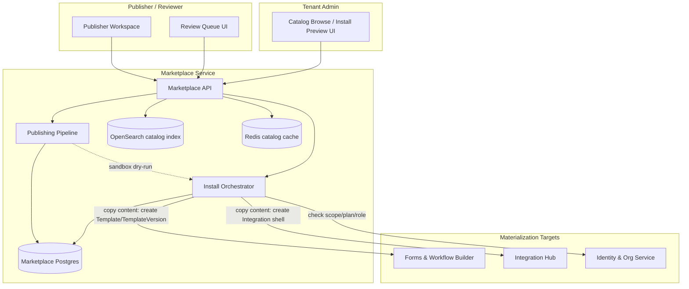
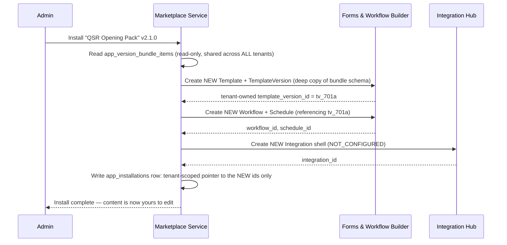
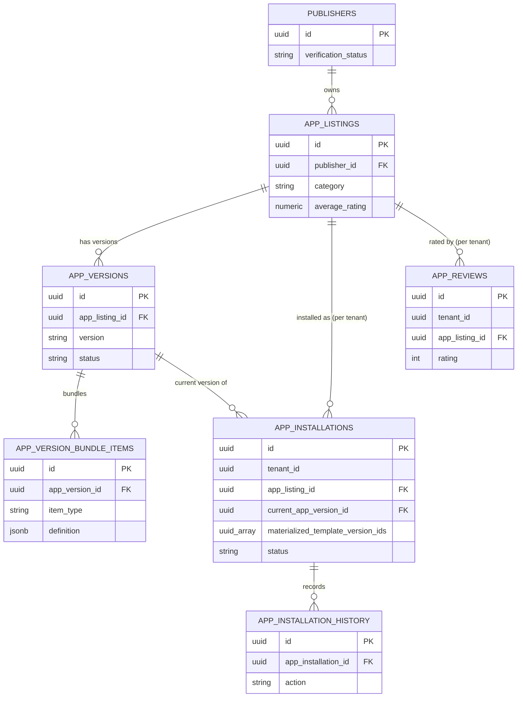
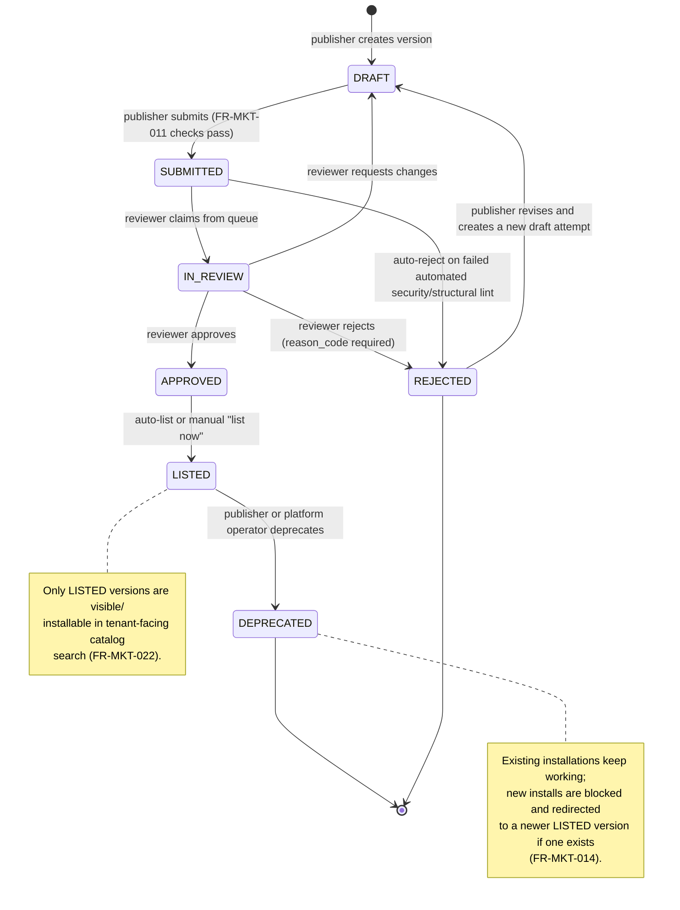

# Architecture Diagrams — App Marketplace & Template Catalog

Module: `24-app-marketplace` (shortcode `MKT`)

## 1. Component Diagram



**Narrative**: Publishers and Reviewers operate entirely against the Marketplace Service's own
store — nothing they do touches tenant data until a Reviewer's sandbox dry-run, which reuses the
same orchestrator code path a real tenant install uses but targets a disposable sandbox tenant.
Tenant admins browse a cached/indexed read model and, on install, the Install Orchestrator is the
**only** component in this module that calls another module's write API — and it always calls it as
a normal tenant-scoped client, creating brand-new rows in Forms & Workflow Builder / Integration
Hub rather than writing into their tables directly or handing out a reference to marketplace-owned
content.

## 2. Sequence Diagram — Tenant Install (Copy-on-Install Emphasis)



**Narrative**: The bundle definition read from `app_version_bundle_items` is never mutated and never
referenced by foreign key from the newly created `tenant-owned` rows — every downstream create call
returns a brand-new id that belongs entirely to the installing tenant. If a second tenant installs
the same `AppVersion` a minute later, this exact sequence repeats independently and produces a
second, completely distinct set of ids with no relationship to the first tenant's copy other than
both having originated from the same immutable bundle content.

## 3. Sequence Diagram — Update Available, Opt-In Upgrade

```mermaid
sequenceDiagram
    participant Publisher
    participant MKT as Marketplace Service
    participant Admin as Tenant Admin
    participant Forms as Forms & Workflow Builder

    Publisher->>MKT: List AppVersion 2.1.0
    MKT->>MKT: Flag update_available=true on every ACTIVE installation of this listing
    MKT-->>Admin: "Update available" badge + changelog
    Admin->>MKT: Request upgrade (opt-in)
    MKT->>MKT: Diff installed content vs. tenant's current (possibly customized) content
    alt Tenant has NOT customized
        MKT->>Forms: Publish new TemplateVersion (auto-adopt)
    else Tenant HAS customized
        MKT-->>Admin: Manual reconciliation view (adopt / keep / parallel, per item)
        Admin->>MKT: Reconciliation choices
        MKT->>Forms: Apply only the chosen changes per item
    end
    MKT->>MKT: Update app_installations.current_app_version_id; retain full history
    MKT-->>Admin: Upgrade complete — no silent overwrite occurred
```

**Narrative**: An update is never pushed; it is only ever pulled, and pulling it never overwrites a
tenant's customization without an explicit per-item choice when divergence is detected. Declining to
upgrade is a fully supported, indefinite state.

## 4. ER Diagram — Owned Entities



**Narrative**: Note that `APP_INSTALLATIONS.materialized_template_version_ids` is a plain array of
ids, not a foreign key relationship into a tenant's `template_versions` table — deliberately, since
that table lives in the Forms & Workflow Builder's own schema (a different bounded context) and this
module never joins across that boundary at the database level, only via API calls (see
high-level-design.md §6).

## 5. State Diagram — AppVersion Publishing Lifecycle



**Narrative**: The lifecycle mirrors the platform's existing `TemplateVersion` state-machine style
(immutable-once-published, explicit deprecation rather than deletion) so publishers and reviewers
experience a governance model consistent with the rest of the platform. The mandatory `IN_REVIEW`
human gate before `APPROVED`/`LISTED` is the module's primary defense against malicious or broken
submissions reaching tenants (functional-spec.md §6), and it is structurally impossible to skip —
there is no transition from `SUBMITTED` or `DRAFT` directly to `LISTED`.
