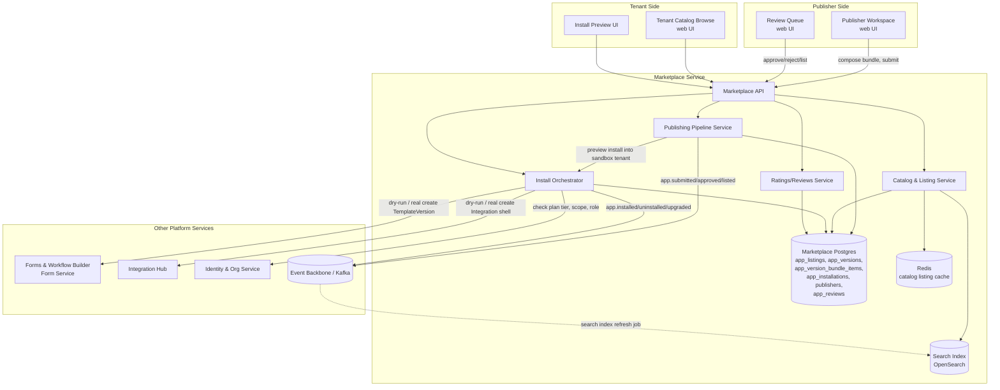

# High-Level Design — App Marketplace & Template Catalog

Module: `24-app-marketplace` (shortcode `MKT`) · Owning service: **Marketplace Service**

## 1. Module Responsibilities and Boundaries

The Marketplace Service is a **catalog + packaging + install-orchestration layer**. It is
explicitly *not* a content-authoring tool and *not* a second copy of tenant operational data. Its
responsibilities:

1. **Own the catalog**: `AppListing`, `AppVersion`, `Publisher`, `AppReview` — tenant-agnostic
   "marketplace master" content that describes and packages reusable configuration, plus the
   review/publishing workflow that gates what reaches the catalog.
2. **Own per-tenant install state**: `AppInstallation` — a thin, tenant-scoped linkage record
   between a tenant and the `AppVersion`(s) it has installed, and the ids of the objects that
   installation produced in other services.
3. **Orchestrate materialization**: on install/update, call the Forms & Workflow Builder's (and
   optionally Integration Hub's) own write APIs to create real, independent, tenant-owned copies of
   the bundled content. The Marketplace Service never writes directly into another module's tables
   and never becomes the runtime owner of installed content.

It deliberately does **not**: render or validate form schemas (Forms & Workflow Builder does that),
execute workflows or schedule `WorkItem`s (Work Orchestration/Temporal do that), store integration
credentials or run connector syncs (Integration Hub does that), or evaluate tenant permissions from
first principles (Identity & Organization's scope model is consumed, not reimplemented).

## 2. Component Diagram

**Narrative**: A Publisher composes and submits a bundle, which lands in the Publishing Pipeline
Service and, once a Reviewer approves it, is written to the catalog store (`app_listings` /
`app_versions`) and indexed for search. A tenant admin browses the catalog (served from cache/search
index for speed) and requests an install preview; the Install Orchestrator performs a **dry-run**
against Forms Service/Integration Hub (no writes) to build the diff view, then on confirmation
performs the **real** materialization calls — this is the one place the Marketplace Service reaches
into another module's write path, and it always does so as a normal tenant-scoped API client of that
module, never as a direct database writer.

## 3. Data Ownership

| Entity | Owned by this module? | Notes |
|---|---|---|
| `AppListing` | Yes | Tenant-agnostic catalog identity. |
| `AppVersion` | Yes | Immutable versioned bundle + publishing lifecycle state. |
| `AppVersionBundleItem` | Yes | Marketplace-owned staging representation of a template/workflow/connector definition — **not** a live tenant Forms/Integration row. |
| `Publisher` | Yes | Authoring identity; references `User`/organization identity owned by Identity & Org but the publisher-specific profile (verification status, listings owned) lives here. |
| `AppInstallation` | Yes | Tenant-scoped linkage record; references (by id only) `TemplateVersion`, `Workflow`, `Schedule`, `Integration` ids owned by other services. |
| `AppReview` | Yes | Tenant rating/review of an installed app. |
| `TemplateVersion` (materialized) | **No** — owned by Forms & Workflow Builder from the instant of creation | This module only records the resulting id. |
| `Workflow` / `Schedule` (materialized) | **No** — owned by Work Orchestration / Forms & Workflow Builder | Same pattern. |
| `Integration` (materialized shell) | **No** — owned by Integrations & Extensibility | Same pattern; credentials never touch this module. |

## 4. External Interfaces

### 4.1 Consumed

| Interface | Direction | Purpose |
|---|---|---|
| Forms & Workflow Builder — `POST /api/v1/templates` (create) / template export contract | Marketplace → Forms Service | Materialize a bundled template as a tenant-owned `Template`/`TemplateVersion`; also used in reverse by Publisher Workspace to import a reference template into a bundle item. |
| Integration Hub — `POST /api/v1/integrations` (create shell) | Marketplace → Integration Hub | Provision a tenant-owned `Integration` record in `NOT_CONFIGURED` state pre-populated from the bundle's connector config template. |
| Identity & Org — scope/role/plan-tier lookup | Marketplace → Identity Service | Authorize install/uninstall/publish actions; check tenant plan tier and feature flags against `AppVersion.minimum_plan_tier`/`required_feature_flags`. |
| Event Backbone | Consumed | Subscribes to Forms/Integration lifecycle events only incidentally (e.g., to detect if a materialized `TemplateVersion` was independently retired by the tenant, for uninstall-impact accuracy) — not a primary dependency. |

### 4.2 Produced

| Interface | Direction | Purpose |
|---|---|---|
| `POST /api/v1/marketplace/apps/{app_version_id}/install` | Tenant admin → Marketplace | Triggers materialization (see low-level-design.md). |
| `GET /api/v1/marketplace/apps` (search/browse) | Tenant admin → Marketplace | Catalog query. |
| Canonical events: `app.submitted`, `app.review_started`, `app.approved`, `app.rejected`,
  `app.listed`, `app.deprecated`, `app.installed`, `app.uninstalled`, `app.updated`, `app.rated` | Marketplace → Event Backbone | Standard envelope per conventions.md; consumed by Analytics (adoption KPIs) and Notification Hub (publisher/tenant notifications). |

## 5. Scalability

- **Catalog browse/search at scale**: with a "500+ apps" (and growing, multi-publisher) catalog
  target, browse/search is served by an OpenSearch index (`app_listings` + current `LISTED`
  `AppVersion` metadata, denormalized) rather than ad hoc Postgres full-text queries, so filter/
  facet/search-relevance queries stay sub-second regardless of catalog size (source-spec's
  Search & Retrieval component, reused per the shared conventions rather than a bespoke search
  engine). A Redis cache sits in front of the most common unfiltered/lightly-filtered "top of
  catalog" queries (§ low-level-design.md §6).
- **Install throughput**: install is a bounded, synchronous orchestration (bundle sizes are capped —
  see low-level-design.md validation) rather than a bulk-data operation, so it scales horizontally
  with ordinary stateless service replicas; there is no shared mutable state across concurrent
  installs beyond the read-only `AppVersion` bundle (§7 below).
- **Review queue**: expected volume is orders of magnitude smaller than catalog browse traffic
  (publisher submissions, not tenant installs); a simple FIFO queue table with an SLA-reminder job
  is sufficient — no dedicated queueing infrastructure needed at current projected scale.

## 6. Multi-Tenancy — Copy-on-Install Is the Central Design Point

This is the trickiest and most important property of this module, so it is stated explicitly and
repeatedly across all four spec documents:

> **An app's "master" bundle is tenant-agnostic content living entirely in the Marketplace
> Service's own store (`app_version_bundle_items`, a staging format). Installing an app never
> creates a live, shared, or mutable cross-tenant reference. Every install performs a full COPY of
> the bundle's content into the installing tenant's own Forms & Workflow Builder tables (and,
> optionally, Integration Hub tables). From the moment those tenant-owned rows exist, they are
> ordinary tenant content, indistinguishable from anything hand-built in the Builder, and are
> subject only to that tenant's own edit/version/retire rules.**

Concretely:

- `app_version_bundle_items.template_definition` (a JSON schema blob, marketplace-owned) is **read
  many times** — once per tenant that ever installs that `AppVersion` — and **never referenced by
  foreign key** from any tenant `Template`/`TemplateVersion` row. The tenant row's schema content is
  a deep copy taken at materialization time.
- Two tenants who install the same `AppVersion` end up with two entirely independent
  `Template`/`TemplateVersion` rows, in their own tenant-scoped tables (enforced by the same
  `tenant_id`-on-every-table rule from conventions.md), with independent ids, independently
  editable, independently versionable, independently deletable.
- A tenant customizing their installed copy (adding a field, changing a threshold) has **zero**
  effect on: the marketplace master bundle, any other tenant's installed copy, or even that same
  tenant's ability to later pull an *update* cleanly (handled via the reconciliation view in
  functional-spec.md §4.5, not via shared state).
- This module's only durable cross-reference is the **id pointer** in `AppInstallation`
  (`template_version_ids[]`, `workflow_id`, `integration_id`) — used purely for traceability
  ("this template came from App X v2.1") and for update-notification matching. It is not a live
  data dependency: deleting the `AppInstallation` row (uninstall "unlink only", functional-spec.md
  §4.6) has zero effect on the materialized objects themselves, because they were never
  foreign-keyed to it in the direction that would allow that.

## 7. Failure Modes and Degradation

| Failure | Behavior |
|---|---|
| Forms Service unavailable during install | Install Orchestrator fails the install request atomically (no partial materialization is left visible — see functional-spec.md FR-MKT-035) and returns a retriable `503`-class error; the tenant's existing installed apps are entirely unaffected since they do not depend on Forms Service being reachable *now*, only having been reachable at install time. |
| Integration Hub unavailable during install (connector bundle item present) | The orchestrator degrades gracefully: it materializes the template/workflow bundle items successfully and marks the connector step as "pending — retry from your installed app's detail page," rather than failing the whole install, since the connector shell is the lowest-criticality bundle item (functional-spec.md §6 treats a plan-tier-unavailable connector the same way). |
| Publisher content review backlog | Because review is a human gate (functional-spec.md §4.2), a backlog delays new listings/updates reaching tenants but has zero effect on already-`LISTED` apps or already-completed installs; the SLA-reminder background job (low-level-design.md §9) surfaces backlog risk to platform operations before it becomes a customer-visible delay, and reviewer capacity is a staffing/tooling lever outside this module's runtime behavior. |
| Search index (OpenSearch) unavailable | Catalog browse degrades to a Postgres-backed query against `app_listings`/`app_versions` directly (unfiltered relevance ranking, slower, but functional) rather than a hard outage of the browse surface — install/uninstall of already-known apps (deep link, "my installed apps" list) is entirely unaffected since it does not depend on search. |
| Marketplace Service fully down | Already-installed apps continue to run exactly as before: their materialized `TemplateVersion`/`Workflow`/`Integration` objects live in, and are served by, their owning modules, which have no runtime dependency on Marketplace Service. Only *new* browsing/installing/updating is unavailable — this is the direct payoff of the copy-on-install architecture. |

## 8. Technology Choices, Justified

- **Copy-on-install vs. shared-reference architecture — copy-on-install is the only safe option.**
  A shared-reference design (tenant `TemplateVersion` rows pointing at a shared marketplace-owned
  schema definition) was considered and rejected: (a) it would violate the platform's per-tenant
  immutability/versioning principle (source-spec P7, P10) the instant a publisher updates the
  shared definition — every installing tenant's "live" template would silently change underneath
  in-flight work, which directly contradicts the acceptance test in source-spec §24.1
  ("Historical submission still renders exactly against the original template version"); (b) it
  would make per-tenant customization impossible without forking anyway, so the "shared" reference
  buys nothing once any tenant edits their copy — the module would need copy-on-write semantics
  regardless, which is just copy-on-install done lazily and with more edge cases (first-edit race,
  ambiguous "which fields are still shared" state); (c) it would create a cross-tenant blast radius
  for a single publisher's mistake or malicious update, directly contradicting the tenant-isolation
  principle in source-spec §21.1. Copy-on-install trades a small amount of storage duplication and a
  materialization latency cost (§ functional-spec.md §7 NFR) for total tenant isolation, full
  compatibility with existing immutability/versioning guarantees in Forms & Workflow Builder, and a
  simple mental model ("install = create, nothing more").
- **Own Postgres schema, not a shared table with Forms Service**: bundle items are staging content,
  not runnable templates (they lack a `tenant_id`, are not schema-hash-validated against the live
  Forms schema version, and may reference in-bundle logical ids that only resolve after
  materialization) — mixing them into the Forms Service's own tables would blur the ownership
  boundary this module depends on (§1) and would leak marketplace-internal concepts (bundle items,
  draft versions) into a service whose consumers assume every row is a real, immutable-once-
  published tenant object. A separate schema/service keeps that contract clean.
- **OpenSearch for catalog search**: reuses the platform's existing Search & Retrieval component
  (conventions.md) rather than introducing a second search technology; catalog documents are small,
  denormalized, and update-infrequently (only on `app.listed`/`app.deprecated`/rating-change
  events), which fits OpenSearch's strengths without needing streaming-ingestion complexity.
- **Redis cache in front of catalog browse**: catalog content changes infrequently relative to read
  volume (many tenants browsing, few publish events), making it a textbook cache-aside candidate
  using the platform's standard Redis cache layer.
