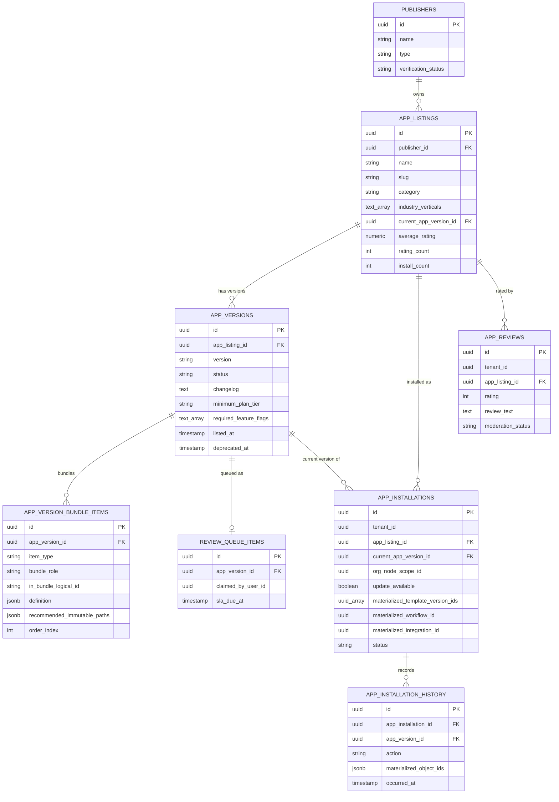
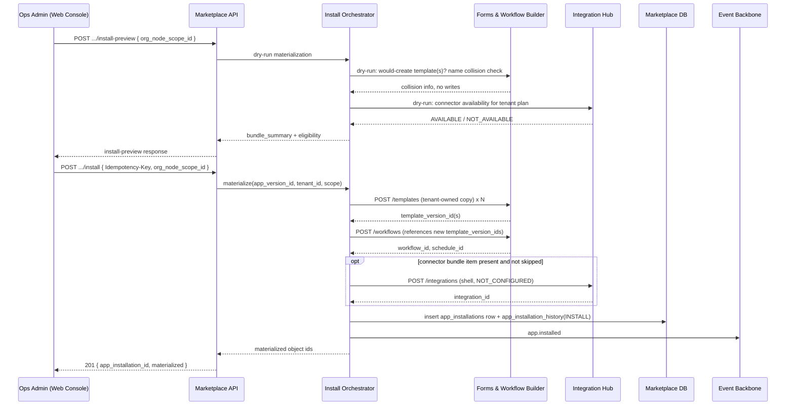

# Low-Level Design — App Marketplace & Template Catalog

Module: `24-app-marketplace` (shortcode `MKT`) · Owning service: **Marketplace Service**

## 1. Database Schema

All tables carry `tenant_id` per the multi-tenancy rule in conventions.md **except** the
tenant-agnostic catalog tables (`publishers`, `app_listings`, `app_versions`,
`app_version_bundle_items`, `app_reviews`'s listing-side aggregate) which are marketplace-global —
`app_reviews` and `app_installations` carry `tenant_id` because they are per-tenant facts about a
global listing. Postgres RLS policies (conventions.md) are applied to every `tenant_id`-bearing
table here exactly as elsewhere in the platform.

| Table | Key columns | Notes |
|---|---|---|
| `publishers` | `id` (PK), `name`, `type` (`INTERNAL`\|`PARTNER`), `verification_status` (`PENDING`\|`VERIFIED`\|`SUSPENDED`), `owner_user_id`, `support_contact`, `created_at` | Global — not tenant-scoped. |
| `app_listings` | `id` (PK), `publisher_id` (FK), `name`, `slug` (unique), `category`, `industry_verticals` (text[]), `short_description`, `long_description`, `icon_object_key`, `current_app_version_id` (FK, nullable until first `LISTED`), `average_rating` (numeric(2,1)), `rating_count`, `install_count`, `created_at`, `updated_at` | Global. `slug` used in catalog URLs. |
| `app_versions` | `id` (PK), `app_listing_id` (FK), `version` (semver string), `status` (enum, §2), `changelog`, `minimum_plan_tier`, `required_feature_flags` (text[]), `screenshots` (jsonb array of object keys), `submitted_by_user_id`, `submitted_at`, `reviewed_by_user_id`, `review_decision_reason`, `reviewed_at`, `listed_at`, `deprecated_at`, `created_at` | Global. Immutable body once `status != DRAFT` (enforced at application layer + a DB trigger rejecting UPDATE of bundle-affecting columns once status advances past `DRAFT`). |
| `app_version_bundle_items` | `id` (PK), `app_version_id` (FK), `item_type` (`TEMPLATE`\|`WORKFLOW`\|`CONNECTOR_CONFIG`), `bundle_role` (`PRIMARY`\|`SECONDARY`\|`DEFAULT`), `in_bundle_logical_id` (string, stable within the bundle, e.g. `"tmpl_opening_checklist"`), `definition` (jsonb — the staging-format template/workflow/connector-config shape), `recommended_immutable_paths` (jsonb array of json-pointer strings, FR-MKT-003), `order_index`, `created_at` | Global, keyed to a specific immutable `app_version_id`. `definition` is never a live tenant object — see high-level-design.md §6. |
| `app_installations` | `id` (PK), `tenant_id`, `app_listing_id` (FK), `current_app_version_id` (FK), `org_node_scope_id` (FK to `OrganizationNode`), `installed_by_user_id`, `installed_at`, `update_available` (boolean), `materialized_template_version_ids` (uuid[]), `materialized_workflow_id` (uuid, nullable), `materialized_schedule_id` (uuid, nullable), `materialized_integration_id` (uuid, nullable), `status` (`ACTIVE`\|`UNINSTALLED`), `uninstalled_at`, `uninstall_mode` (`UNLINK_ONLY`\|`UNLINK_AND_RETIRE`, nullable) | Unique on `(tenant_id, app_listing_id)` while `status = ACTIVE` — a tenant has at most one active installation per listing (upgrades mutate this row; §7). |
| `app_installation_history` | `id` (PK), `app_installation_id` (FK), `app_version_id` (FK), `action` (`INSTALL`\|`UPGRADE`\|`UNINSTALL`), `materialized_object_ids` (jsonb snapshot), `actor_user_id`, `occurred_at` | Append-only audit trail of every materialization event against an `AppInstallation`, per source-spec P7 historical truth. |
| `app_reviews` | `id` (PK), `tenant_id`, `app_listing_id` (FK), `rating` (int 1–5), `review_text`, `author_user_id`, `moderation_status` (`VISIBLE`\|`HIDDEN`), `moderated_by_user_id`, `created_at`, `updated_at` | Unique on `(tenant_id, app_listing_id)` (FR-MKT-060: one per tenant). |
| `review_queue_items` | `id` (PK), `app_version_id` (FK, unique while unresolved), `claimed_by_user_id` (nullable), `claimed_at`, `sla_due_at`, `sla_reminder_sent_at` (nullable) | Backs the FIFO review queue and the SLA-reminder job (§9). |

### ER Diagram



## 2. App Version Publishing States

`app_versions.status` enum: `DRAFT`, `SUBMITTED`, `IN_REVIEW`, `APPROVED`, `LISTED`, `DEPRECATED`,
`REJECTED`. Full transition diagram in architecture-diagram.md §4.

## 3. REST Endpoints

Base path `/api/v1/marketplace/` per conventions.md. All mutation endpoints accept
`Idempotency-Key`; list endpoints use cursor pagination (`?cursor=&limit=`).

### 3.1 Publisher — submit app for review

`POST /api/v1/marketplace/app-listings/{listing_id}/versions/{version_id}/submit`

Request:
```json
{
  "attestation_accepted": true
}
```

Response `202 Accepted`:
```json
{
  "app_version_id": "av_8f2c...",
  "status": "SUBMITTED",
  "review_queue_position": 4,
  "sla_due_at": "2026-09-30T00:00:00Z"
}
```

Errors: `400 VALIDATION_FAILED` (structural validation, missing screenshot/changelog — FR-MKT-011),
`409 CONFLICT` (another `DRAFT`/`SUBMITTED`/`IN_REVIEW` version already exists for this listing —
FR-MKT-005), `403 SCOPE_DENIED` (publisher not `VERIFIED`).

### 3.2 Reviewer — approve/publish app version

`POST /api/v1/marketplace/app-versions/{version_id}/review-decision`

Request:
```json
{
  "decision": "APPROVE",
  "comments": "Clean install, good field coverage.",
  "auto_list": true
}
```
`decision` ∈ `APPROVE` \| `REJECT` \| `REQUEST_CHANGES`; `REJECT`/`REQUEST_CHANGES` require
`reason_code` (enum: `CONTENT_QUALITY`, `SECURITY_CONCERN`, `POLICY_VIOLATION`,
`FUNCTIONAL_DEFECT`, `OTHER`) and `comments`.

Response `200 OK`:
```json
{
  "app_version_id": "av_8f2c...",
  "status": "LISTED",
  "listed_at": "2026-09-24T10:03:00Z"
}
```

Errors: `409 CONFLICT` (version not in `IN_REVIEW`), `403 SCOPE_DENIED` (caller lacks
`marketplace:review` role).

### 3.3 Browse/search catalog

`GET /api/v1/marketplace/apps?q=refrigeration&category=FOOD_SAFETY&industry=QSR_RESTAURANT&cursor=&limit=20`

Response `200 OK`:
```json
{
  "items": [
    {
      "app_listing_id": "al_1a2b...",
      "name": "QSR Opening & Closing Essentials",
      "publisher_name": "Platform Team",
      "category": "OPENING_CLOSING",
      "industry_verticals": ["QSR_RESTAURANT"],
      "icon_url": "https://cdn.../icon.png",
      "average_rating": 4.8,
      "rating_count": 42,
      "current_version": "2.1.0",
      "minimum_plan_tier": "STANDARD",
      "eligible_for_tenant": true,
      "already_installed": false
    }
  ],
  "next_cursor": "eyJvZ..."
}
```

### 3.4 Preview install impact

`POST /api/v1/marketplace/app-versions/{version_id}/install-preview`

Request:
```json
{ "org_node_scope_id": "org_root_001" }
```

Response `200 OK`:
```json
{
  "app_version_id": "av_8f2c...",
  "bundle_summary": {
    "templates": [
      {
        "logical_id": "tmpl_opening_checklist",
        "name": "Opening Checklist",
        "field_count": 24,
        "name_collision": {
          "detected": true,
          "existing_template_id": "tmpl_9f01",
          "resolution": "AUTO_SUFFIX",
          "proposed_name": "Opening Checklist (App: QSR Essentials)"
        }
      }
    ],
    "workflow": {
      "logical_id": "wf_daily_opening",
      "summary": "Runs daily at 08:00 store-local time, assigned to Store Manager role",
      "schedule_summary": "Calendar-based, daily, Mon-Sun"
    },
    "connector": {
      "connector_type": "SLACK",
      "required_scopes": ["channel:write"],
      "availability": "AVAILABLE"
    }
  },
  "eligibility": {
    "plan_tier_ok": true,
    "feature_flags_ok": true,
    "missing_permissions": []
  }
}
```

### 3.5 Install app (materialize)

`POST /api/v1/marketplace/app-versions/{version_id}/install`
Header: `Idempotency-Key: <client-generated-uuid>`

Request:
```json
{
  "org_node_scope_id": "org_root_001",
  "skip_bundle_items": []
}
```
(`skip_bundle_items` lists `in_bundle_logical_id`s the tenant chose to skip — e.g., an unavailable
connector, functional-spec.md §6.)

Response `201 Created`:
```json
{
  "app_installation_id": "ai_44cd...",
  "status": "ACTIVE",
  "materialized": {
    "template_version_ids": ["tv_701a", "tv_701b"],
    "workflow_id": "wf_5522",
    "schedule_id": "sc_9910",
    "integration_id": "int_3301"
  }
}
```

Errors: `402 PLAN_INELIGIBLE`, `403 SCOPE_DENIED`, `409 ALREADY_INSTALLED` (active installation
exists — client should call the upgrade endpoint instead), `422 MATERIALIZATION_FAILED` (bundle
item rejected downstream; response body includes `rolled_back: true` and the failing item's
`in_bundle_logical_id`).

### 3.6 Get installed apps for tenant

`GET /api/v1/marketplace/installations?status=ACTIVE&cursor=&limit=20`

Response `200 OK`:
```json
{
  "items": [
    {
      "app_installation_id": "ai_44cd...",
      "app_listing_id": "al_1a2b...",
      "app_name": "QSR Opening & Closing Essentials",
      "installed_version": "2.0.0",
      "update_available": true,
      "latest_version": "2.1.0",
      "installed_at": "2026-08-01T09:00:00Z"
    }
  ],
  "next_cursor": null
}
```

### 3.7 Upgrade an installation

`POST /api/v1/marketplace/installations/{installation_id}/upgrade`
Header: `Idempotency-Key`

Request:
```json
{ "target_app_version_id": "av_9c31...", "reconciliation": [
  { "logical_id": "tmpl_opening_checklist", "action": "ADOPT_NEW" },
  { "logical_id": "tmpl_closing_checklist", "action": "KEEP_CUSTOMIZED" }
]}
```
`action` ∈ `ADOPT_NEW` \| `KEEP_CUSTOMIZED` \| `INSTALL_AS_NEW_PARALLEL` (FR-MKT-042).

Response `200 OK`: same shape as install response, plus `previous_app_version_id`.

### 3.8 Uninstall

`DELETE /api/v1/marketplace/installations/{installation_id}?mode=UNLINK_AND_RETIRE`

Response `200 OK`:
```json
{
  "app_installation_id": "ai_44cd...",
  "status": "UNINSTALLED",
  "mode": "UNLINK_AND_RETIRE",
  "impact": {
    "templates_retired": 2,
    "workflow_deactivated": true,
    "open_work_items_orphaned_from_scheduling": 3,
    "historical_submissions_preserved": 1042
  }
}
```

Errors: `404 NOT_FOUND`, `409 CONFLICT` (already `UNINSTALLED`).

### 3.9 Rate/review an installed app

`PUT /api/v1/marketplace/app-listings/{listing_id}/reviews/me`

Request:
```json
{ "rating": 5, "review_text": "Cut our onboarding time in half." }
```

Response `200 OK` — echoes the stored review; triggers async rating-aggregate recompute (§9).

## 4. Sequence Diagrams

### 4.1 Publisher submission through review to listing

```mermaid
sequenceDiagram
    participant Pub as Publisher Workspace
    participant API as Marketplace API
    participant DB as Marketplace DB
    participant Q as Review Queue
    participant Rev as Marketplace Reviewer
    participant Sandbox as Sandbox Tenant (Forms/IntHub)
    participant Evt as Event Backbone

    Pub->>API: POST .../submit (attestation_accepted=true)
    API->>DB: validate bundle structure, screenshots, changelog
    DB-->>API: OK
    API->>DB: status = SUBMITTED
    API->>Q: enqueue review_queue_item (sla_due_at = now+5bd)
    API->>Evt: app.submitted
    API-->>Pub: 202 { status: SUBMITTED }

    Rev->>Q: claim next FIFO item
    Q-->>Rev: app_version_id
    API->>DB: status = IN_REVIEW
    API->>Evt: app.review_started
    Rev->>API: run "preview install" into sandbox
    API->>Sandbox: dry-run materialization (same code path as tenant install-preview)
    Sandbox-->>API: preview result (success/errors)
    API-->>Rev: preview result + content/security checklist

    alt Approved
        Rev->>API: POST review-decision { APPROVE, auto_list:true }
        API->>DB: status = APPROVED then LISTED; app_listings.current_app_version_id = this
        API->>Evt: app.approved, app.listed
        API-->>Rev: 200 { status: LISTED }
    else Rejected
        Rev->>API: POST review-decision { REJECT, reason_code, comments }
        API->>DB: status = REJECTED
        API->>Evt: app.rejected
        API-->>Rev: 200 { status: REJECTED }
    else Changes requested
        Rev->>API: POST review-decision { REQUEST_CHANGES, comments }
        API->>DB: status = DRAFT (comments attached)
        API-->>Rev: 200 { status: DRAFT }
    end
```

### 4.2 Tenant install — preview, confirm, materialization



### 4.3 Update available — tenant opts to upgrade

```mermaid
sequenceDiagram
    participant Pub as Publisher
    participant Rev as Reviewer
    participant MKT as Marketplace Service
    participant Admin as Ops Admin
    participant Forms as Forms & Workflow Builder

    Pub->>MKT: submit new AppVersion 2.1.0
    Rev->>MKT: approve -> LISTED
    MKT->>MKT: for each ACTIVE app_installation of this listing: update_available = true
    MKT-->>Admin: (next catalog/installed-apps view load) update-available badge + changelog diff

    Admin->>MKT: GET install-preview for target_app_version_id=2.1.0 (upgrade mode)
    MKT-->>Admin: diff: which bundle items changed vs. installed 2.0.0; divergence flags
    alt no divergence detected
        Admin->>MKT: POST .../upgrade (no reconciliation needed)
        MKT->>Forms: publish new TemplateVersion under existing tenant Template(s)
        Forms-->>MKT: new template_version_id(s)
    else divergence detected (tenant customized)
        Admin->>MKT: POST .../upgrade { reconciliation: [ per-item choices ] }
        loop each bundle item
            alt ADOPT_NEW
                MKT->>Forms: publish new TemplateVersion (overwrite content, keep template id)
            else KEEP_CUSTOMIZED
                MKT->>MKT: no change to that tenant Template; only linkage metadata updates
            else INSTALL_AS_NEW_PARALLEL
                MKT->>Forms: POST /templates (new tenant Template, independent of the customized one)
            end
        end
    end
    MKT->>MKT: update app_installations.current_app_version_id; insert app_installation_history(UPGRADE)
    MKT-->>Admin: 200 { materialized, previous_app_version_id }
```

## 5. Materialization Pseudocode

### 5.1 Install materialization

```
function materializeInstall(tenantId, appVersionId, orgNodeScopeId, skipLogicalIds, idempotencyKey):
    if existingResultFor(idempotencyKey) exists:
        return existingResultFor(idempotencyKey)

    assertNoActiveInstallation(tenantId, appListingIdFor(appVersionId))  # 409 ALREADY_INSTALLED
    assertEligible(tenantId, appVersionId)                                # plan tier, feature flags -> 402
    assertAuthorized(callerUser, orgNodeScopeId, ["template:create","workflow:create","integration:create"])

    bundleItems = loadBundleItems(appVersionId, orderBy=order_index)
    createdObjects = []          # for rollback
    logicalIdToTenantId = {}     # in-bundle logical id -> real tenant object id

    try:
        for item in bundleItems where item.item_type == TEMPLATE and item.logical_id not in skipLogicalIds:
            proposedName = item.definition.name
            if tenantTemplateNameExists(tenantId, proposedName):
                proposedName = autoSuffix(proposedName, appListingName(appVersionId))  # FR collision handling
            newTemplate = FormsService.createTemplate(
                tenantId, orgNodeScopeId,
                name=proposedName,
                schema=deepCopy(item.definition.schema),
                sourceAppVersionId=appVersionId    # provenance tag only, not a live FK
            )
            createdObjects.append(("template", newTemplate.template_id))
            logicalIdToTenantId[item.logical_id] = newTemplate.current_template_version_id

        for item in bundleItems where item.item_type == WORKFLOW and item.logical_id not in skipLogicalIds:
            resolvedRefs = resolveLogicalRefs(item.definition, logicalIdToTenantId)  # swap bundle-local ids for real tenant TemplateVersion ids
            newWorkflow = FormsService.createWorkflow(tenantId, orgNodeScopeId, resolvedRefs)
            createdObjects.append(("workflow", newWorkflow.workflow_id))
            if item.definition.schedule present:
                newSchedule = FormsService.createSchedule(tenantId, newWorkflow.workflow_id, item.definition.schedule)
                createdObjects.append(("schedule", newSchedule.schedule_id))

        for item in bundleItems where item.item_type == CONNECTOR_CONFIG and item.logical_id not in skipLogicalIds:
            availability = IntegrationHub.checkAvailability(tenantId, item.definition.connector_type)
            if availability != AVAILABLE:
                continue   # disclosed partial skip, not a failure — functional-spec.md §6
            newIntegration = IntegrationHub.createShell(tenantId, orgNodeScopeId, item.definition)
            createdObjects.append(("integration", newIntegration.integration_id))

    catch DownstreamError as e:
        for (kind, id) in reverse(createdObjects):
            callOwningServiceDeleteApi(kind, id)     # real delete, since these are already real tenant objects
        raise MaterializationFailed(failingItem=e.item, rolledBack=true)   # -> 422 MATERIALIZATION_FAILED

    installation = upsertAppInstallation(tenantId, appVersionId, orgNodeScopeId, createdObjects)
    recordHistory(installation.id, appVersionId, action=INSTALL, createdObjects)
    publishEvent("app.installed", tenantId, installation.id)
    persistIdempotencyResult(idempotencyKey, installation)
    return installation
```

### 5.2 Install-preview diff generation

```
function generateInstallPreview(tenantId, appVersionId, orgNodeScopeId):
    bundleItems = loadBundleItems(appVersionId)
    summary = { templates: [], workflow: null, connector: null }

    for item in bundleItems where item.item_type == TEMPLATE:
        existing = findTenantTemplateByName(tenantId, item.definition.name)
        entry = {
            logical_id: item.logical_id,
            name: item.definition.name,
            field_count: count(item.definition.schema.fields),
            name_collision: existing != null
                ? { detected: true, existing_template_id: existing.id,
                    resolution: "AUTO_SUFFIX", proposed_name: autoSuffix(item.definition.name, appListingName(appVersionId)) }
                : { detected: false }
        }
        summary.templates.append(entry)

    workflowItem = find(bundleItems, item_type == WORKFLOW)
    if workflowItem:
        summary.workflow = humanReadableSummary(workflowItem.definition)   # e.g. schedule cadence, default assignee role

    connectorItem = find(bundleItems, item_type == CONNECTOR_CONFIG)
    if connectorItem:
        availability = IntegrationHub.checkAvailability(tenantId, connectorItem.definition.connector_type)
        summary.connector = {
            connector_type: connectorItem.definition.connector_type,
            required_scopes: connectorItem.definition.required_scopes,
            availability: availability   # AVAILABLE | NOT_AVAILABLE_FOR_PLAN | NOT_CONFIGURED_ELSEWHERE
        }

    eligibility = {
        plan_tier_ok: tenantPlanTier(tenantId) >= appVersion(appVersionId).minimum_plan_tier,
        feature_flags_ok: allEnabled(tenantId, appVersion(appVersionId).required_feature_flags),
        missing_permissions: computeMissingPermissions(callerUser, orgNodeScopeId)
    }

    return { bundle_summary: summary, eligibility: eligibility }   # NO writes performed anywhere in this function
```

## 6. Caching Strategy

| Cache | Key | TTL / invalidation |
|---|---|---|
| Catalog listing page cache (Redis) | `mkt:catalog:{filters_hash}:{cursor}` | TTL 5 min; explicitly invalidated (key-pattern purge on `app_listing_id`-scoped keys) on `app.listed`, `app.deprecated`, and rating-recompute events, so a publish or a moderation action never waits out a stale TTL. |
| App detail cache (Redis) | `mkt:app_detail:{app_listing_id}` | TTL 5 min; invalidated on the same events plus `app.rated`. |
| Search index (OpenSearch) | Document id = `app_listing_id` | Refreshed by the background index-refresh job (§9), not read-through — search always reads the index, never falls through to Postgres except in the degraded mode in high-level-design.md §7. |
| Eligibility check (plan tier/feature flags) | Not cached | Always evaluated live against Identity & Org at preview/install time — eligibility is a security-relevant decision and must reflect the tenant's current plan, not a stale cache. |

## 7. Concurrency Control

- **Concurrent installs of the same `AppVersion` by many tenants**: each install is scoped by
  `tenant_id` and executes independent calls to Forms Service/Integration Hub; the only shared read
  is the immutable `app_version_bundle_items.definition` blob, which is never written during install
  — there is no lock contention between tenants by construction (high-level-design.md §6).
- **Two concurrent install attempts for the same tenant + same `AppListing`**: guarded by the
  partial unique index on `app_installations (tenant_id, app_listing_id) WHERE status = 'ACTIVE'`;
  the second concurrent request fails fast with `409 ALREADY_INSTALLED` rather than racing to create
  two installations. Combined with the `Idempotency-Key` check, a retried request from the same
  client after a timeout is safely deduplicated instead of hitting this conflict.
- **Concurrent upgrade + uninstall on the same `AppInstallation`**: both endpoints take an optimistic
  `version`/`ETag` on the `app_installations` row (conventions.md standard); a losing concurrent
  writer receives `409 Conflict` with the current row state, per standard platform convention — no
  silent overwrite.
- **Publisher editing a `DRAFT` while a reviewer has claimed a different version of the same
  listing**: prevented structurally by FR-MKT-005 (at most one `DRAFT`/`SUBMITTED`/`IN_REVIEW`
  version per listing at a time), so there is nothing to race.

## 8. Background Jobs

| Job | Trigger | Action |
|---|---|---|
| Review-queue SLA reminder | Scheduled (every 4h) via Temporal | Scans `review_queue_items` where `sla_due_at - now() < 20% of SLA window` and `sla_reminder_sent_at is null`; notifies the reviewer pool lead via Notification Hub; sets `sla_reminder_sent_at`. Escalates to a second reminder + platform-ops alert if `sla_due_at` is breached with no decision. |
| Catalog search index refresh | Event-driven (consumes `app.listed`, `app.deprecated`, `app.rated` from Event Backbone) + a nightly full-reindex safety sweep via Temporal | Upserts/deletes the corresponding OpenSearch document; the nightly sweep guards against missed/failed event deliveries. |
| Rating aggregate recompute | Event-driven (consumes create/update/delete on `app_reviews`) | Recomputes `average_rating`/`rating_count` on `app_listings` for the affected `app_listing_id`; invalidates the app-detail cache entry. |
| Update-available fan-out | Event-driven (consumes `app.listed` where it is not the first version of a listing) | Sets `update_available = true` on every `ACTIVE` `app_installations` row for that listing; enqueues a per-tenant-admin notification via Notification Hub. |
| Stale sandbox cleanup | Scheduled (daily) | Removes ephemeral sandbox-tenant materializations created by reviewer "preview install" runs (FR-MKT-012) older than 7 days, keeping sandbox tenant storage bounded. |

## 9. Error Handling Table

| Error code | HTTP status | Condition | Client guidance |
|---|---|---|---|
| `VALIDATION_FAILED` | 400 | Bundle fails structural validation on submit | Show field-level errors in Publisher Workspace; version stays `DRAFT`. |
| `SCOPE_DENIED` | 403 | Caller lacks required role/permission at target scope | Do not retry; surface required permission name. |
| `PLAN_INELIGIBLE` | 402 | Tenant plan tier / feature flags below `AppVersion` requirement | Show upsell CTA; do not retry. |
| `ALREADY_INSTALLED` | 409 | Active `AppInstallation` exists for this listing | Redirect client to the upgrade endpoint. |
| `CONFLICT` (version state) | 409 | Review decision posted against a version not in the expected state (e.g., already `LISTED`) | Refresh state; no retry with same payload. |
| `MATERIALIZATION_FAILED` | 422 | A downstream create call failed during install/upgrade | Orchestrator has already rolled back partial objects; safe to retry the same `Idempotency-Key` once the downstream cause is resolved. |
| `NOT_FOUND` | 404 | Unknown `app_version_id`/`app_listing_id`/`installation_id` | Standard not-found handling. |
| `RATE_LIMITED` | 429 | Tenant/principal exceeded catalog query or install rate limit | Standard backoff per conventions.md. |
| Downstream `Forms Service` / `Integration Hub` error surfaced during dry-run preview | 200 (embedded in response body as a per-item warning, not an HTTP error) | Preview is designed to always return a result so the admin sees *why* an item can't install, rather than a generic failure. | UI renders the per-item warning inline. |
