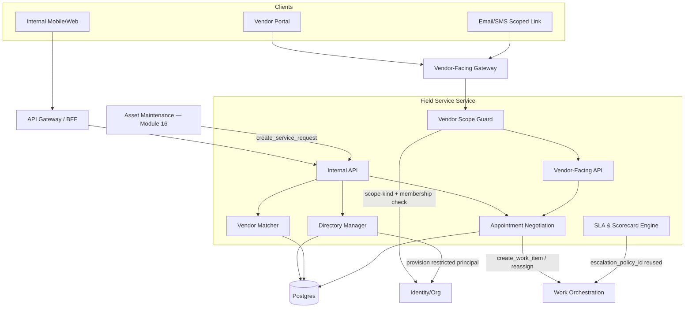
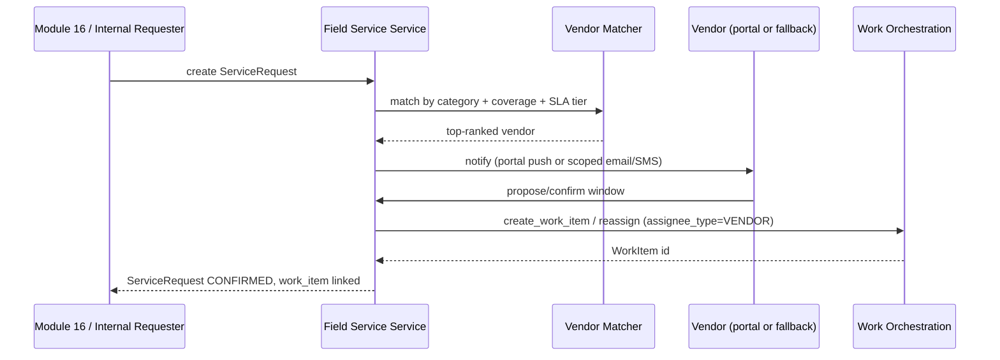
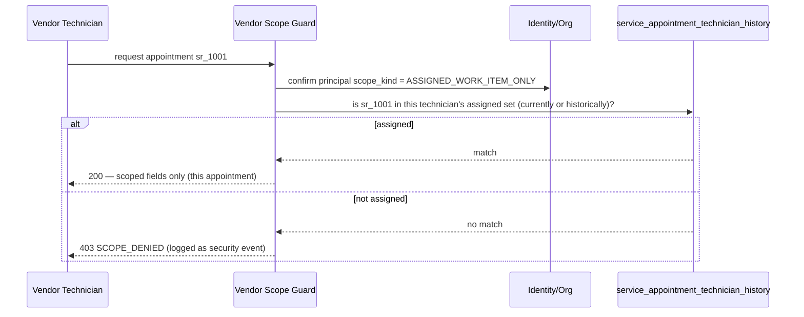
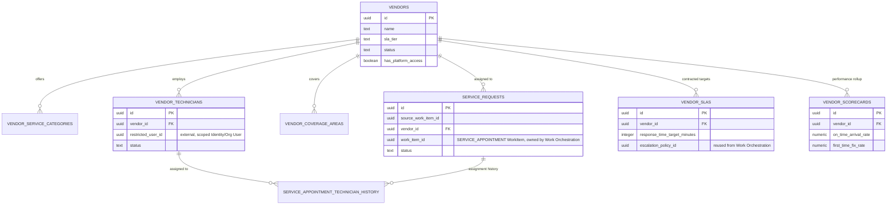
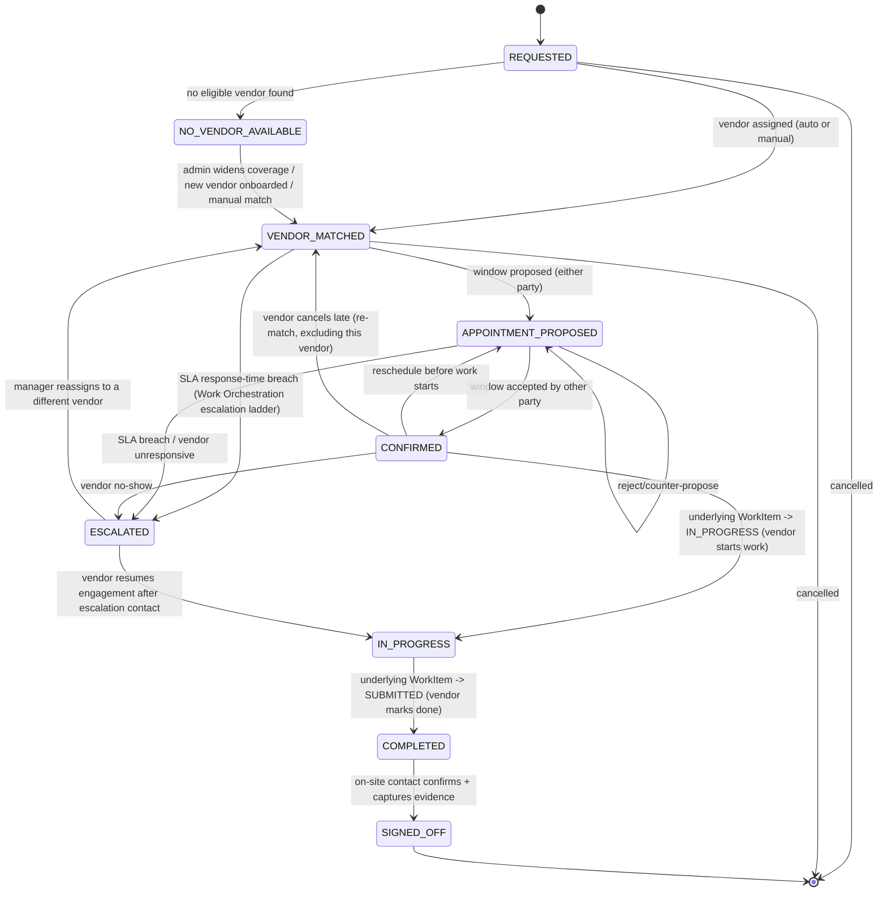

# Field Service & Third-Party Vendor Scheduling — Architecture Diagrams

Focused diagram set for this module only. Full narrative in `functional-spec.md`,
`high-level-design.md`, `low-level-design.md`.

## 1. Component / Container Diagram

Internal traffic and vendor-facing traffic enter through physically separate gateway routes. Every
vendor-facing call passes through the Vendor Scope Guard before reaching the Vendor-Facing API layer
— there is no code path from `VGW` to Postgres that skips it. The Appointment Negotiation component
is the only one that calls Work Orchestration to create or reassign the underlying `WorkItem`; this
module never writes `work_items.status` itself, matching the non-duplication pattern Module 16
already established for `MaintenanceWorkOrder`.

## 2. Sequence Diagram — Service Request to Confirmed Appointment

This is the "happy path" flow underlying FR-FSVC-010/011/020/021/030–032: matching and negotiation
are entirely this module's own state; the `WorkItem` is created or reassigned only at the moment a
window is actually confirmed, never earlier, so no orphaned `WorkItem` exists for a request that
never finds a vendor.

## 3. Sequence Diagram — Vendor Technician Scoped Access Check

This is the module's central security guarantee: a vendor technician's authorization predicate is
"is this specific `WorkItem` id in my dynamically computed assigned set," never "am I granted this
location/tenant" — narrower than the platform's narrowest internal role. The check runs on every
vendor-facing call, including list queries (the assigned-set is injected as the query's `WHERE`
clause, not applied as a post-fetch filter), so there is no code path that can leak an unassigned
appointment.

## 4. ER Diagram — Owned Entities

Note `service_requests.work_item_id` and `vendor_slas.escalation_policy_id` are the two explicit
seams into Work Orchestration's own schema (`work_items`, `escalation_policies`) — referenced by id
only, never duplicated, per the module's non-duplication rule.

## 5. State Diagram — ServiceRequest Lifecycle

This is this module's **own** lifecycle — it wraps but never replaces the underlying `WorkItem`
state machine (`DRAFT → SCHEDULED → AVAILABLE → IN_PROGRESS → SUBMITTED → PENDING_REVIEW → APPROVED →
VERIFIED`, owned by Work Orchestration). `IN_PROGRESS`/`COMPLETED` here are driven one-way by that
underlying WorkItem's own transitions (via `task.status_changed` events); `SIGNED_OFF` is the one
state this module adds independently, representing the vendor-scheduling-specific concept of an
on-site attestation layered on top of (and typically preceding or coinciding with) the WorkItem's own
`VERIFIED` status. The `ESCALATED` branch is likewise driven by Work Orchestration's reused
escalation-ladder mechanism (`task.overdue`/`task.escalated` events against the `VendorSLA`-configured
`escalation_policy_id`), not a second SLA-timer implementation.
