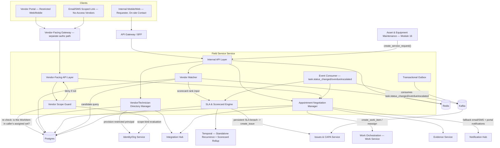

# Field Service & Third-Party Vendor Scheduling — High-Level Design

Corresponds to **EPIC-25**. Reads consistently with `conventions.md` (tech stack, multi-tenancy rule,
state machine reuse) and `new-modules-addendum.md` (Module 25 row, the platform-wide
`WorkItem.assignee_type = VENDOR` extension). Detailed requirements in `functional-spec.md`;
schema/API/algorithm detail in `low-level-design.md`. Read alongside
`docs/modules/16-asset-maintenance-cmms/high-level-design.md`, whose non-duplication pattern
(module owns supporting entities, Work Orchestration owns the `WorkItem`) this module follows for
the identical structural reason.

## 1. Module Responsibilities

This module is the **Field Service Service**: vendor/technician directory + vendor-facing scheduling
and communication + vendor SLA tracking. It explicitly reuses Work Orchestration's `WorkItem`/
escalation machinery for the actual appointment lifecycle rather than building a second execution
engine. Concretely, this module owns:

1. **Vendor/technician directory** — `Vendor`, `VendorTechnician`, service categories, coverage areas.
2. **Service request intake & vendor matching** — `ServiceRequest` creation (from Module 16 handoff or
   standalone), manual/auto vendor assignment, ranking.
3. **Vendor-facing appointment negotiation** — proposed/confirmed windows, the vendor portal (or
   email/SMS fallback), en-route/arrival tracking, sign-off.
4. **Vendor SLA tracking and scorecarding** — `VendorSLA` targets, `VendorScorecard` rollups, feeding
   both the Control Tower and the auto-match ranking function.

It explicitly does **not** own: the `ServiceAppointment` `WorkItem`'s execution state machine,
assignment write path, escalation ladder timers, or approval routing — all of that is Work
Orchestration's responsibility, invoked through its public/internal APIs (§4), exactly as Module 16
established for `MaintenanceWorkOrder`. It also does not own `Asset`/parts data (Module 16) or the
underlying identity/session/scope-evaluation mechanics for the restricted vendor principal
(Identity/Org) — it defines the *requirements* of that restricted principal type and consumes
Identity/Org's provisioning and scope-evaluation APIs.

## 2. Component Diagram

Narration: internal traffic (requesters, on-site contacts, admins) flows through the normal API
Gateway/BFF path used by every other module. Vendor-facing traffic — the portal and the
unauthenticated scoped fallback link — is deliberately routed through a **separate vendor-facing
gateway path** that terminates at a dedicated `VAPI` layer, which in turn calls a mandatory
`Vendor Scope Guard` component on every single request before any read or write reaches Postgres.
This physical/logical separation (distinct gateway route, distinct API layer, a non-bypassable guard
component) is the primary structural defense described in §7 — it is not merely a convention
followed by individual endpoint handlers. The `Appointment Negotiation Manager` is the only component
that calls Work Orchestration to create or reassign a `WorkItem`; it never mutates `work_items.status`
or `assignee_*` directly. The Event Consumer is the only inbound path from Work Orchestration,
advancing `ServiceRequest.status` from `task.status_changed` and feeding the SLA/scorecard engine
from `task.overdue`/`task.escalated`.

## 3. Data Ownership

| Entity | Owned here | Referenced from elsewhere |
|---|---|---|
| `Vendor` | Yes | `WorkItem.assignee_id` (Work Orchestration, when `assignee_type=VENDOR`), `MaintenanceWorkOrder` vendor reference (Module 16) |
| `VendorTechnician` | Yes | `restricted_user_id` FK into Identity/Org's `User` table (Identity/Org owns the `User` row itself; this module owns the technician-domain extension row) |
| `VendorServiceCategory`, `VendorCoverageArea` | Yes | — |
| `ServiceRequest` | Yes | References `source_work_item_id`/`asset_id` (Module 16) when handed off from a `MaintenanceWorkOrder` |
| `VendorSLA`, `VendorScorecard` | Yes | Consumed by Analytics/Control Tower via CDC feed |
| `ServiceAppointment` (i.e., `WorkItem` rows with `type_code=SERVICE_APPOINTMENT`) | **No** — owned entirely by Work Orchestration | This module creates/reassigns via API, never writes the row directly |
| `Asset`, `MaintenanceWorkOrder` data | **No** — owned by Asset & Equipment Maintenance (Module 16) | Referenced by id only (`asset_id`, `source_work_item_id`) |
| Vendor technician's `User`/session/scope rows | **No** — owned by Identity/Org | This module requests provisioning and reads scope-check results; it never stores credentials |
| `Evidence` (sign-off photos, signatures) | **No** — owned by Evidence Service | Referenced by ID from sign-off events |
| `Issue` (vendor performance) | **No** — owned by Issues & CAPA | Created via `create_issue` on persistent SLA breach |

## 4. External Interfaces

### Consumed (this module calls out)

- **Work Orchestration — `POST /api/v1/work-items`** (internal service-to-service variant), called by
  the Appointment Negotiation Manager when a standalone `ServiceRequest`'s window is confirmed, with
  `type_code = SERVICE_APPOINTMENT`, `assignee_type = VENDOR`.
- **Work Orchestration — `POST /api/v1/work-items/{id}/reassign`**, called when a
  `MaintenanceWorkOrder`-originated `ServiceRequest`'s window is confirmed, reassigning the existing
  `WorkItem` to `assignee_type = VENDOR`.
- **Work Orchestration — escalation policy reference** — this module sets
  `work_items.escalation_policy_id` at creation/reassignment time from `VendorSLA.escalation_policy_id`
  rather than implementing its own SLA timer (FR-FSVC-070/071); it does not call a separate escalation
  API beyond referencing the policy id Work Orchestration already resolves and runs.
- **Identity/Org — provision restricted principal API** — requests a `User` row with the
  `ASSIGNED_WORK_ITEM_ONLY` scope kind for a portal-enabled `VendorTechnician`; deprovisions on
  `VendorTechnician`/`Vendor` deactivation.
- **Identity/Org — scope-evaluation API** — the Vendor Scope Guard (§7) calls this synchronously on
  every vendor-facing request rather than caching a broad grant.
- **Issues & CAPA — `create_issue` tool/API** — called on persistent vendor SLA underperformance
  (FR-FSVC-070 rollup crossing a tenant-configured threshold).
- **Evidence Service — `POST /api/v1/evidence`** — for sign-off photos, signatures, vendor-submitted
  completion photos.
- **Notification Hub** — vendor-facing email/SMS for the no-platform-access fallback (FR-FSVC-045) and
  push/email for portal-enabled vendor and internal-user notifications.
- **Integration Hub** — vendor-facing webhook subscriptions / API key issuance for vendors with their
  own dispatch systems.

### Produced (this module emits)

- `service_request.created`, `service_request.vendor_matched`, `service_request.window_proposed`,
  `service_request.confirmed`, `service_request.rescheduled`, `service_request.signed_off`,
  `service_request.no_vendor_available`, `service_request.escalated` (module-specific events,
  canonical envelope shape).
- `vendor_sla.breach_detected`, `vendor_scorecard.updated` (consumed by Notification Hub, Analytics,
  and optionally Module 16's vendor-assignment UI to surface a warning before manual assignment).

### Consumed (this module listens)

- `task.status_changed`, `task.overdue`, `task.escalated`, `task.rejected` (canonical events,
  source-spec §18.3) — filtered server-side to events where `type_code = SERVICE_APPOINTMENT`,
  driving `ServiceRequest` state advancement (§FR-FSVC-051) and SLA breach detection.
- `user.deactivated` — reconciles a `VendorTechnician.restricted_user_id` account's deactivation with
  this module's own `VendorTechnician.status`, in case deactivation is initiated from the Identity/Org
  side directly (e.g., a security incident response) rather than through this module's own
  deactivation flow.

## 5. Scalability

- Vendor/technician/coverage volume is small relative to `WorkItem` volume (thousands of vendors,
  tens of thousands of technicians per large tenant at the high end) — the directory tables need no
  special partitioning beyond standard `tenant_id`-scoped indexing.
- `ServiceRequest`/`ServiceAppointment` volume rides on the platform's general `WorkItem` scale
  characteristics and is partitioned the same way (`tenant_id_bucket` hashing) as
  Module 16's tables and Work Orchestration's `work_items`.
- The vendor-matching computation (FR-FSVC-021) is a bounded, indexed multi-predicate query
  (category × coverage subtree × status), not a scan — coverage-area membership is resolved via the
  same `OrganizationNode` path/materialized-subtree lookup pattern used platform-wide for scope
  checks, so it scales with the platform's existing org-graph query performance rather than
  introducing a new bottleneck.
- `VendorScorecard` rollups are computed by a scheduled background job (§ LLD §7), not on the read
  path, so scorecard dashboard reads are always a cheap point lookup regardless of the appointment
  history volume behind them.

## 6. Multi-Tenancy

Every table carries `tenant_id` with Postgres RLS as the defense-in-depth backstop (per
`conventions.md`), identical to every other module, and every internal-facing query additionally
scopes by `OrganizationNode` subtree via the requesting user's `UserScope`. This module adds nothing
novel on the *internal*-user side of multi-tenancy — the novel dimension is external-actor isolation,
covered in full in §7.

## 7. External-Actor Isolation (the module's most security-sensitive design point)

A vendor technician's scoping must be **strictly narrower** than even the platform's narrowest
existing internal restricted role. An internal role scoped to a single location still implicitly sees
*everything* at that location — every `WorkItem`, every user, every asset. A vendor technician must
see **only the specific `ServiceAppointment` `WorkItem` row(s)** currently or historically assigned
to them, and nothing else — not other appointments at the same location, not the location's other
metadata, not other technicians from their own vendor company, nothing.

**The enforcement mechanism, precisely:**

1. **A new `UserScope` kind, not a location grant.** Identity/Org's `UserScope` model is extended
   with a scope kind `ASSIGNED_WORK_ITEM_ONLY` (alongside the existing subtree-membership kind used
   by every internal role). A `UserScope` row of this kind carries no `node_id` subtree at all — it
   is a marker that this principal's authorization predicate is **not** "is this resource under a
   node I have a grant on" but **"is this resource's id currently present in my dynamically computed
   assigned-work-item set."**
2. **The assigned-work-item set is computed from `work_item_assignments` (Work Orchestration's
   existing append-only assignment-history table, `02-work-orchestration/low-level-design.md` §1.1),
   not from a static grant.** A vendor technician is "assigned" to a `WorkItem` id if a
   `work_item_assignments` row exists for that `work_item_id` with `assignee_type = VENDOR` and
   either (a) `assignee_id` matches their `Vendor` (company-level assignment, before a specific
   technician is named) and this module's `ServiceAppointment.assigned_technician_id` matches them,
   or (b) an FSVC-owned `service_appointment_technician_history` row names them directly for that
   `work_item_id`. This means the set changes automatically and immediately as assignment changes
   (FR-FSVC-024 mid-appointment reassignment) — no manual grant/revoke step is needed or possible for
   an admin to forget.
3. **Every vendor-facing API call re-checks membership server-side, on every request, not once at
   login.** The `Vendor Scope Guard` component (§2) intercepts every `VAPI` request, extracts the
   `work_item_id`/`service_request_id` the request targets, and calls Identity/Org's scope-evaluation
   API (or a local cached evaluation backed by the same source data, §LLD caching) with
   `(principal_id, resource_id, scope_kind=ASSIGNED_WORK_ITEM_ONLY)`. A miss returns
   `403 SCOPE_DENIED` before any query touches the underlying `ServiceRequest`/`WorkItem` row's data —
   the check happens *before* data retrieval, not as a post-hoc filter on a fetched row, closing the
   IDOR class of error where a resource is fetched by id first and "checked" after.
4. **No list/search endpoint exists on the vendor-facing API surface that is not pre-scoped at the
   query level.** `GET /api/v1/vendor-portal/appointments` (§LLD §2) is implemented as
   `WHERE id IN (assigned-set for this principal)`, never as a general appointments list with a
   scope filter bolted on — there is structurally no query path that can return an unassigned
   appointment, by construction, rather than by an application-layer check that could be missed on a
   new endpoint.
5. **The guard is a platform-level component, not a per-endpoint discipline.** Every new vendor-facing
   endpoint this module (or Integrations, for the vendor webhook path) ever adds is required to route
   through the same `Vendor Scope Guard`; this is enforced structurally by the vendor-facing gateway
   route (§2) terminating only at `VAPI`, which has no code path that skips the guard — there is no
   "trusted internal call" shortcut analogous to the ones the internal `API` layer sometimes takes for
   service-to-service calls.
6. **Fallback-link tokens (FR-FSVC-045) carry the same guarantee by construction, not by discipline.**
   A scoped email/SMS token encodes exactly one `service_request_id`/appointment id and is verified
   against that single id server-side on every use — it is not a session token and grants no broader
   query capability even in principle, since the unauthenticated view's only server-side query is
   "fetch the one record this token names," with the token itself (not a role) as the authorization
   artifact.
7. **Verification.** NFR-FSVC-001 requires this scope kind to carry the same regression-test rigor as
   the platform's general authorization tests (source-spec §6.1): horizontal escalation (technician A
   requests technician B's appointment id), IDOR (sequential/guessable id probing), stale-scope
   (technician reassigned away from an appointment mid-session still holding an old token/session
   cannot act on it), and cross-tenant access (a vendor technician account, though external, still
   belongs to exactly one tenant's `Vendor` and must never resolve an appointment id belonging to a
   different tenant even if ids collide across tenants — enforced by `tenant_id` being part of every
   scope-evaluation predicate, never inferred from the resource alone). See `low-level-design.md` §3(b)
   for the concrete sequence diagram of this check.

## 8. Failure Modes and Degradation

| Failure | Degradation strategy |
|---|---|
| Work Orchestration unavailable when confirming a window | The `create_work_item`/`reassign` call is retried with backoff via the standard idempotent-mutation pattern (`Idempotency-Key`); the `ServiceRequest` stays in `CONFIRMED` with an internal `work_item_sync_pending` flag rather than silently dropping the confirmation — the requester sees "confirming with scheduling system…" rather than a false success. |
| Identity/Org unavailable for a vendor scope check | **Fail closed, never fail open.** If the scope-evaluation call cannot be completed, the Vendor Scope Guard denies the request (`503`-mapped to a client-visible "try again" state) rather than granting access on a stale cache or a default-allow path — this is the one place on the platform where availability is explicitly sacrificed for isolation correctness, consistent with NFR-FSVC-001 treating this as a hard security requirement. A short-TTL local cache of *already-verified* assignments (§ LLD caching) reduces how often this path is exercised without weakening the fail-closed guarantee for anything not already cached. |
| Vendor has no platform access at all | This is not a failure but a modeled first-class path (FR-FSVC-045) — email/SMS fallback with scoped single-use links, using the Notification Hub's standard delivery guarantees; no degraded audit trail relative to the portal path (NFR-FSVC-004). |
| Notification Hub unavailable when a fallback link needs sending | Queued and retried via the standard outbox pattern (same as Module 16 uses for `create_issue`); the `ServiceRequest` does not silently stall — a manual "resend vendor coordination" action is always available to the internal requester regardless of Notification Hub availability. |
| Issues & CAPA unavailable when a persistent SLA breach fires | The `create_issue` call is retried via transactional outbox; the underlying escalation ladder (owned by Work Orchestration) and the vendor scorecard computation are both unaffected, since Issue creation is a side effect, not a gate. |
| Redis vendor-matching/scope cache unavailable | Falls back to a direct (uncached) Postgres query — slower, not incorrect, for matching; for the scope-check cache specifically, falls back to the synchronous Identity/Org call per the fail-closed rule above rather than ever serving a stale "allow." |
| Vendor's own external system (Integration Hub webhook path) unavailable/misbehaving | Standard Integration Hub retry/dead-letter handling applies; a vendor's appointment does not get stuck — the internal requester always retains the ability to fall back to manual phone/email coordination and record the outcome directly, since this module's own state (not the vendor's system) is authoritative for the `ServiceRequest`. |

## 9. Technology Choices and Justification

- **Why `VENDOR` is an `assignee_type` extension rather than a parallel work-assignment system.**
  Work Orchestration's `work_items.assignee_type` enum (`USER, ROLE, LOCATION, QUEUE`) already
  encodes "who is responsible for this unit of work" generically, and every downstream mechanism that
  cares about assignment — the Today/Next mobile list, the manager Exceptions view, escalation-ladder
  notification targeting, reassignment history, offline sync's "my work" filter — is already written
  against that enum rather than against assignee-type-specific tables. Introducing `VENDOR` as a fifth
  enum value and reusing `assignee_id` (pointed at a `Vendor` row) makes a `ServiceAppointment`
  automatically show up correctly everywhere a `WorkItem` already shows up correctly, with zero new
  code in Work Orchestration beyond accepting the new enum value and this module supplying the
  candidate/eligibility resolution (mirroring exactly how Module 16 added skill/certification-based
  eligibility on top of the existing `ROLE`/`USER` resolution without inventing a new assignment
  concept). A parallel work-assignment system would require every one of those downstream consumers
  (mobile Today list, Exceptions view, escalation ladder, offline sync, analytics rollups) to be
  taught about a second assignment model, for a distinction — "the assignee happens to be external" —
  that only matters to this module's own scoping and portal logic, not to the generic work-tracking
  machinery. The platform-wide principle this follows is the addendum's explicit instruction:
  "document it as an extension of the existing `assignee_type` enum, not a parallel field."
- **Why `ServiceRequest` is a separate table layered around the `WorkItem`, not folded into
  `work_items.type_config`.** The vendor-facing negotiation concerns (proposed windows from either
  party, which party proposed, sign-off contact and attestation, first-time-fix determination,
  reassignment history distinct from `work_item_assignments`) are richer and more relational than a
  single JSONB payload should reasonably hold, and — critically — a `ServiceRequest` can exist
  (`REQUESTED`, `VENDOR_MATCHED`, `NO_VENDOR_AVAILABLE`) *before* any `WorkItem` exists at all for a
  standalone request (§FR-FSVC-011/032), which a `type_config` column on a not-yet-created `WorkItem`
  row cannot represent. A first-class table with its own lifecycle, joined to the `WorkItem` once one
  exists, is the natural fit — the same reasoning Module 16 applied when it kept `MaintenanceSchedule`
  as its own table rather than trying to express meter-based recurrence inside Work Orchestration's
  `schedules` row.
- **Why the Vendor Scope Guard is a distinct component with its own gateway route, not a
  library/middleware applied per-endpoint.** Per-endpoint middleware discipline is exactly the
  pattern that produces IDOR bugs when a new endpoint is added and someone forgets to apply it. A
  structurally separate vendor-facing ingress path that has no route to Postgres except through the
  guard removes "did the engineer remember" from the correctness argument, which is the right
  trade-off given NFR-FSVC-001's severity classification.
- **Postgres for all module-owned tables**, consistent with the platform's "modular domain
  architecture first" principle — vendor/appointment volume does not approach a scale requiring a
  specialized store.
- **Temporal** for the module's own standalone recurring `ServiceRequest` workflow (FR-FSVC-012) and
  the periodic `VendorScorecard` rollup job (§LLD §7), reusing the identical
  checkpoint/high-water-mark pattern Work Orchestration and Module 16 already established, for the
  same reason Module 16 gave: avoid a second bespoke recurrence-correctness implementation.
