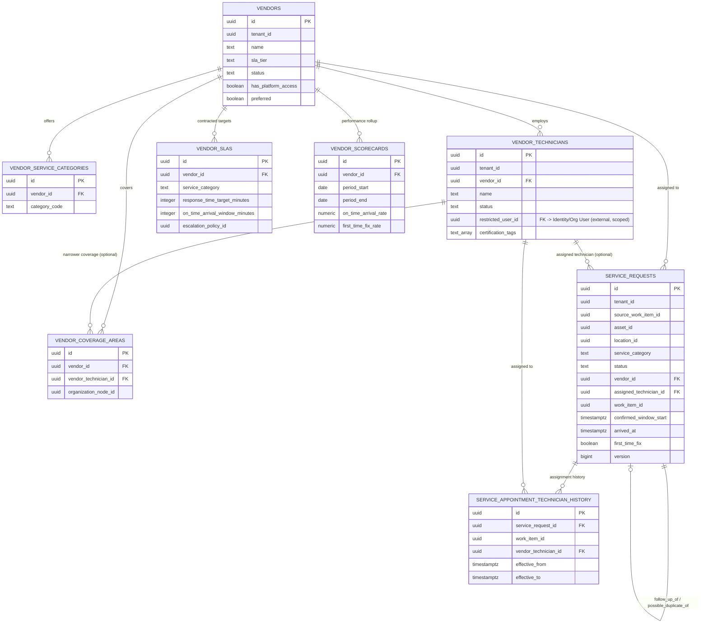
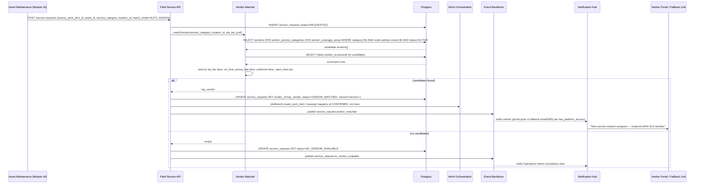
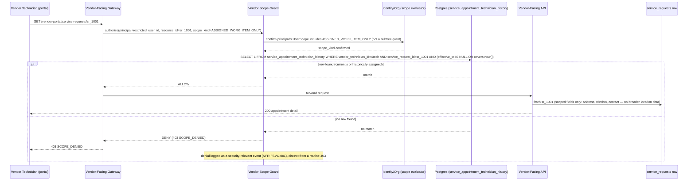
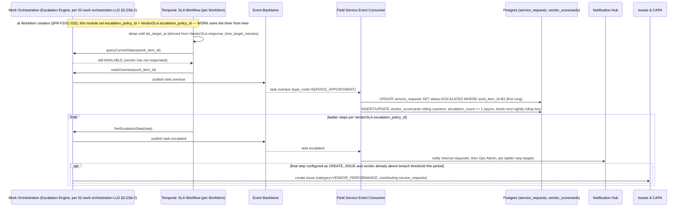

# Field Service & Third-Party Vendor Scheduling — Low-Level Design

## 1. Postgres Schema

### 1.1 Tables

**vendors**

| Column | Type | Notes |
|---|---|---|
| id | uuid PK | |
| tenant_id | uuid | |
| name | text | |
| legal_entity_name | text, nullable | |
| primary_contact_name | text, nullable | |
| primary_contact_phone | text, nullable | |
| primary_contact_email | text, nullable | |
| sla_tier | text | `STANDARD, PREFERRED, PREMIUM` (tenant-extensible) |
| status | text | `ACTIVE, SUSPENDED, INACTIVE` |
| has_platform_access | boolean | drives portal provisioning vs. fallback, FR-FSVC-045 |
| preferred | boolean | default false |
| contract_reference | text, nullable | free-text/document link |
| created_at, updated_at | timestamptz | |

Indexes: `(tenant_id, status)`, `(tenant_id, preferred)`.

**vendor_service_categories** (many-to-many, vendor-level)

| Column | Type | Notes |
|---|---|---|
| id | uuid PK | |
| tenant_id | uuid | |
| vendor_id | uuid FK -> vendors | |
| category_code | text | e.g. `HVAC`, `PEST_CONTROL`, `ELEVATOR`, `PLUMBING`, `ELECTRICAL`, `APPLIANCE_REPAIR`, `JANITORIAL`, `GENERAL_CONTRACTOR` (tenant-extensible catalog table `service_category_definitions` not shown; seeded globally, tenant may add) |
| created_at | timestamptz | |

Unique `(vendor_id, category_code)`. Index `(tenant_id, category_code)` (drives matching, §4).

**vendor_technicians**

| Column | Type | Notes |
|---|---|---|
| id | uuid PK | |
| tenant_id | uuid | |
| vendor_id | uuid FK -> vendors | |
| name | text | |
| phone | text, nullable | |
| email | text, nullable | |
| status | text | `ACTIVE, INACTIVE` |
| restricted_user_id | uuid, nullable FK -> Identity/Org `users.id` (cross-service ref, not enforced FK) | set only when `vendors.has_platform_access = true`; the `User` row carries a `UserScope` of kind `ASSIGNED_WORK_ITEM_ONLY` — see §3(b) |
| certification_tags | text[] | subset of/matching the vendor's `vendor_service_categories` |
| created_at, updated_at | timestamptz | |

Index `(tenant_id, vendor_id, status)`, unique partial `(restricted_user_id)` where not null.

**vendor_coverage_areas**

| Column | Type | Notes |
|---|---|---|
| id | uuid PK | |
| tenant_id | uuid | |
| vendor_id | uuid FK -> vendors | |
| vendor_technician_id | uuid, nullable FK -> vendor_technicians | narrower coverage than the vendor overall, FR-FSVC-004 |
| organization_node_id | uuid | subtree root (Identity/Org `OrganizationNode` ref, not enforced cross-service FK) |
| created_at | timestamptz | |

Index `(tenant_id, organization_node_id)`, `(tenant_id, vendor_id)`.

**service_requests**

| Column | Type | Notes |
|---|---|---|
| id | uuid PK | |
| tenant_id | uuid | |
| tenant_id_bucket | smallint | generated: `hash(tenant_id) % 64`, matches platform partitioning convention |
| source_work_item_id | uuid, nullable | set when originated from a `MaintenanceWorkOrder` handoff (Module 16) |
| asset_id | uuid, nullable | ref to Module 16 `Asset`, context only |
| location_id | uuid | ref to `OrganizationNode` |
| service_category | text | required primary trade |
| secondary_category_tags | text[], nullable | |
| description | text | |
| urgency | text | `ROUTINE, URGENT, EMERGENCY` |
| requested_window_start, requested_window_end | timestamptz, nullable | for standalone requests |
| status | text | `REQUESTED, VENDOR_MATCHED, APPOINTMENT_PROPOSED, CONFIRMED, IN_PROGRESS, COMPLETED, SIGNED_OFF, NO_VENDOR_AVAILABLE, ESCALATED, CANCELLED` |
| vendor_id | uuid, nullable FK -> vendors | set at `VENDOR_MATCHED` |
| assigned_technician_id | uuid, nullable FK -> vendor_technicians | may be set later than `vendor_id` |
| work_item_id | uuid, nullable | set once the `SERVICE_APPOINTMENT` WorkItem exists (immediately for Module-16-originated; at `CONFIRMED` for standalone) |
| confirmed_window_start, confirmed_window_end | timestamptz, nullable | |
| on_site_contact_user_id | uuid, nullable | defaults to requester |
| en_route_at, arrived_at | timestamptz, nullable | FR-FSVC-034 |
| signed_off_at | timestamptz, nullable | |
| first_time_fix | boolean, nullable | recorded at sign-off |
| completion_rating | smallint, nullable | 1-5 |
| follow_up_of_request_id | uuid, nullable FK -> service_requests | FR-FSVC-062 |
| possible_duplicate_of | uuid, nullable FK -> service_requests | FR-FSVC edge case 12.7 |
| recurrence_schedule_id | uuid, nullable | this module's own recurrence config, FR-FSVC-012 |
| requested_by | uuid | |
| client_uuid | uuid, nullable | offline-created sign-off/completion path |
| version | bigint | optimistic concurrency |
| created_at, updated_at | timestamptz | |

Partitioned by LIST(`tenant_id_bucket`) then RANGE(`created_at`) monthly, mirroring `work_items`.
Indexes: `(tenant_id, status, location_id)`, `(tenant_id, vendor_id, status)`, `(work_item_id)`
unique partial where not null, `(source_work_item_id)` unique partial where not null,
`(tenant_id, service_category, location_id, status)` (matching query, §4).

**service_appointment_technician_history** (append-only; drives the assigned-work-item set, HLD §7)

| Column | Type | Notes |
|---|---|---|
| id | uuid PK | |
| tenant_id | uuid | |
| service_request_id | uuid FK -> service_requests | |
| work_item_id | uuid | denormalized for the scope-check query's hot path |
| vendor_technician_id | uuid FK -> vendor_technicians | |
| effective_from | timestamptz | |
| effective_to | timestamptz, nullable | null = currently assigned |
| assigned_by | uuid, nullable | actor; null for vendor-company self-assignment |
| reason | text, nullable | |
| created_at | timestamptz | |

Index `(vendor_technician_id, effective_to)` — this is the index the Vendor Scope Guard's
membership check reads: *"rows for this technician where effective_to IS NULL or covers now(),
matching the requested work_item_id."* Unique partial `(work_item_id, vendor_technician_id,
effective_to)` where `effective_to IS NULL` (prevents double-active assignment rows for the same
pair).

**vendor_slas**

| Column | Type | Notes |
|---|---|---|
| id | uuid PK | |
| tenant_id | uuid | |
| vendor_id | uuid FK -> vendors | |
| service_category | text, nullable | null = applies to all categories for this vendor |
| response_time_target_minutes | integer | |
| on_time_arrival_window_minutes | integer | grace window |
| target_first_time_fix_rate | numeric(5,2), nullable | e.g. 85.00 |
| escalation_policy_id | uuid | FK into Work Orchestration's `escalation_policies` (cross-service ref) |
| effective_from | timestamptz | |
| effective_to | timestamptz, nullable | supports contract renewal versioning |
| created_at, updated_at | timestamptz | |

Unique `(vendor_id, service_category, effective_from)`. Index `(tenant_id, vendor_id)`.

**vendor_scorecards** (periodic rollup, one row per vendor per period)

| Column | Type | Notes |
|---|---|---|
| id | uuid PK | |
| tenant_id | uuid | |
| vendor_id | uuid FK -> vendors | |
| period_start, period_end | date | default rolling 90-day window, recomputed nightly |
| total_appointments | integer | |
| response_time_p50_minutes, response_time_p90_minutes | integer, nullable | |
| on_time_arrival_rate | numeric(5,2), nullable | |
| first_time_fix_rate | numeric(5,2), nullable | |
| escalation_count | integer | |
| average_completion_rating | numeric(3,2), nullable | |
| computed_at | timestamptz | |

Unique `(vendor_id, period_start, period_end)`. Index `(tenant_id, vendor_id, period_end desc)`.

### 1.2 ER Diagram



## 2. REST Endpoints

All under `/api/v1/`, OAuth2/OIDC bearer, `Idempotency-Key` required on POST/PATCH, `ETag`/`version`
optimistic concurrency, cursor pagination, standard error envelope. Vendor-facing endpoints live
under `/api/v1/vendor-portal/` and are additionally gated by the Vendor Scope Guard (HLD §7) on every
call, regardless of the caller's session validity.

### 2.1 Register vendor
`POST /api/v1/vendors`
```json
{
  "name": "Metro HVAC Services",
  "primary_contact_name": "D. Alvarez",
  "primary_contact_phone": "+1-555-0110",
  "sla_tier": "PREFERRED",
  "has_platform_access": true,
  "service_categories": ["HVAC"],
  "coverage": [{ "organization_node_id": "node_region_west" }]
}
```
Response `201`:
```json
{ "id": "vendor_771", "status": "ACTIVE", "version": 0, "created_at": "2026-09-23T10:00:00Z" }
```
Errors: `400 VALIDATION_ERROR`, `403 SCOPE_DENIED` (caller lacks `field_service:manage_vendors`).

### 2.2 Create service request — auto-match or manual vendor selection
`POST /api/v1/service-requests`

Auto-match request:
```json
{
  "location_id": "loc_9a1",
  "service_category": "HVAC",
  "description": "Rooftop unit making grinding noise, intermittent cooling loss.",
  "urgency": "URGENT",
  "match_mode": "AUTO_ASSIGN"
}
```
Manual selection request:
```json
{
  "location_id": "loc_9a1",
  "service_category": "PEST_CONTROL",
  "description": "Quarterly pest control visit.",
  "urgency": "ROUTINE",
  "match_mode": "MANUAL",
  "vendor_id": "vendor_552"
}
```
From a Module-16 handoff (internal service-to-service):
```json
{
  "source_work_item_id": "wi_8831",
  "asset_id": "asset_4471",
  "location_id": "loc_9a1",
  "service_category": "HVAC",
  "urgency": "EMERGENCY",
  "match_mode": "RECOMMEND"
}
```
Response `201` (auto-assigned):
```json
{
  "id": "sr_1001",
  "status": "VENDOR_MATCHED",
  "vendor_id": "vendor_771",
  "version": 0,
  "created_at": "2026-09-23T10:05:00Z"
}
```
Response `201` (no eligible vendor):
```json
{ "id": "sr_1002", "status": "NO_VENDOR_AVAILABLE", "version": 0 }
```
Errors: `400 VALIDATION_ERROR`, `403 SCOPE_DENIED`, `404 VENDOR_NOT_FOUND` (manual mode, bad
`vendor_id`), `422 VENDOR_NOT_ELIGIBLE` (manual mode, vendor fails category/coverage/status check —
manual selection is still validated, not a bypass).

### 2.3 Vendor confirms/proposes appointment window
Internal-proposes (requester proposes, vendor confirms):
`POST /api/v1/service-requests/{id}/propose-window`
```json
{ "proposed_by": "INTERNAL", "window_start": "2026-09-25T14:00:00Z", "window_end": "2026-09-25T16:00:00Z", "version": 1 }
```
Vendor confirms (vendor-portal endpoint):
`POST /api/v1/vendor-portal/service-requests/{id}/confirm-window`
```json
{ "window_start": "2026-09-25T14:00:00Z", "window_end": "2026-09-25T16:00:00Z", "technician_id": "tech_330" }
```
Vendor proposes (vendor-facing, vendor-initiated flow):
`POST /api/v1/vendor-portal/service-requests/{id}/propose-window`
```json
{ "candidate_windows": [
    { "window_start": "2026-09-25T09:00:00Z", "window_end": "2026-09-25T11:00:00Z" },
    { "window_start": "2026-09-26T13:00:00Z", "window_end": "2026-09-26T15:00:00Z" }
  ] }
```
Response `200` (confirmed):
```json
{
  "id": "sr_1001",
  "status": "CONFIRMED",
  "confirmed_window_start": "2026-09-25T14:00:00Z",
  "confirmed_window_end": "2026-09-25T16:00:00Z",
  "work_item_id": "wi_9942",
  "version": 2
}
```
Errors: `409 VERSION_CONFLICT`, `403 SCOPE_DENIED` (vendor-portal call against a request not
assigned to caller's vendor/technician — see §3(b)), `422 WINDOW_OUTSIDE_REQUESTED_RANGE` (proposed
window falls outside a standalone request's `requested_window_start/end`, when the tenant policy
requires strict adherence).

### 2.4 Record on-site completion sign-off
`POST /api/v1/service-requests/{id}/sign-off`
```json
{
  "on_site_contact_user_id": "usr_204",
  "work_confirmed": true,
  "first_time_fix": true,
  "completion_rating": 5,
  "evidence_ids": ["ev_5591", "ev_5592"],
  "arrived_on_time_attestation": true,
  "version": 5,
  "client_uuid": "c-uuid-88"
}
```
Response `200`:
```json
{ "id": "sr_1001", "status": "SIGNED_OFF", "signed_off_at": "2026-09-25T15:40:00Z", "version": 6 }
```
Errors: `409 VERSION_CONFLICT`, `422 WORK_ITEM_NOT_SUBMITTED` (vendor has not yet marked their side
of the work done — sign-off cannot precede the vendor's own completion signal), `403 SCOPE_DENIED`.

### 2.5 Get vendor scorecard
`GET /api/v1/vendors/{id}/scorecard?period=90d`

Response `200`:
```json
{
  "vendor_id": "vendor_771",
  "period_start": "2026-06-25",
  "period_end": "2026-09-23",
  "total_appointments": 42,
  "response_time_p50_minutes": 38,
  "response_time_p90_minutes": 145,
  "on_time_arrival_rate": 91.5,
  "first_time_fix_rate": 87.2,
  "escalation_count": 2,
  "average_completion_rating": 4.6,
  "computed_at": "2026-09-23T02:00:00Z"
}
```
Errors: `404 SCORECARD_NOT_FOUND` (no computed rollup yet — e.g., brand-new vendor), `403
SCOPE_DENIED`.

### 2.6 Vendor portal — list my appointments (scoped by construction)
`GET /api/v1/vendor-portal/service-requests?status=CONFIRMED,APPOINTMENT_PROPOSED&cursor=...`

Response `200`:
```json
{
  "items": [
    {
      "id": "sr_1001",
      "status": "CONFIRMED",
      "service_category": "HVAC",
      "location_address": "1420 Market St, Suite 4",
      "confirmed_window_start": "2026-09-25T14:00:00Z",
      "on_site_contact_name": "J. Rao",
      "on_site_contact_phone": "+1-555-0199"
    }
  ],
  "next_cursor": null
}
```
Note: the query underlying this endpoint is `WHERE id IN (assigned-set for caller)` — see HLD §7
point 4; there is no unscoped variant of this endpoint reachable by a vendor-portal principal.
`location_address` is a street-level display field only, never the full `OrganizationNode` record.

## 3. Sequence Diagrams

### 3(a) Service request → vendor auto-match by category + coverage + SLA-tier → WorkItem created → vendor notified



### 3(b) Vendor technician's scoped access check when opening an appointment



Note: the same check runs for every vendor-facing call, including list endpoints (§2.6), where the
membership predicate is applied as the query's `WHERE` clause rather than a post-fetch filter — there
is no code path where a row is read before the check succeeds.

### 3(c) SLA breach detection reusing Work Orchestration's escalation mechanism



This module never starts, sleeps, or cancels a Temporal workflow for this timer — it only sets the
`escalation_policy_id` reference at creation time and reacts to the resulting `task.overdue`/
`task.escalated` events, per the non-duplication rule (FR-FSVC edge case 12.2).

## 4. Algorithms / Pseudocode

### 4.1 Vendor auto-matching (category + coverage-area geo/org-scope match + SLA-tier ranking)

```
function matchVendor(tenant_id, service_category, location_id, sla_tier_preference_order, match_mode):
    # Step 1: hard filters — must all pass to be a candidate at all
    candidates = SELECT DISTINCT v.* FROM vendors v
        JOIN vendor_service_categories vsc ON vsc.vendor_id = v.id
        JOIN vendor_coverage_areas vca ON vca.vendor_id = v.id
        WHERE v.tenant_id = tenant_id
          AND v.status = 'ACTIVE'
          AND vsc.category_code = service_category
          AND isDescendantOrSelf(location_id, vca.organization_node_id)   # subtree membership, same
                                                                            # primitive as UserScope checks
    if candidates is empty:
        return NO_CANDIDATE

    # Step 2: attach the narrowest applicable technician-level coverage, if any, for later technician
    # suggestion (does not filter the vendor out at this stage — vendor-level coverage is sufficient)
    for v in candidates:
        v.eligible_technicians = SELECT vt.* FROM vendor_technicians vt
            LEFT JOIN vendor_coverage_areas tca ON tca.vendor_technician_id = vt.id
            WHERE vt.vendor_id = v.id AND vt.status = 'ACTIVE'
              AND (tca.id IS NULL OR isDescendantOrSelf(location_id, tca.organization_node_id))
              AND (service_category IN vt.certification_tags OR vt.certification_tags IS EMPTY)

    # Step 3: attach latest scorecard + open-load for ranking
    for v in candidates:
        v.scorecard = latest vendor_scorecards row for v.id (may be null for a new vendor —
                      treated as neutral/median rather than penalized, so new vendors are not
                      permanently starved of matches)
        v.open_load = COUNT(service_requests WHERE vendor_id = v.id AND status NOT IN
                      (SIGNED_OFF, CANCELLED, NO_VENDOR_AVAILABLE))

    # Step 4: rank
    sort candidates by (
        sla_tier_rank(v.sla_tier, sla_tier_preference_order)  DESC,   # e.g. PREMIUM=2, PREFERRED=1, STANDARD=0
        v.scorecard.on_time_arrival_rate OR MEDIAN_DEFAULT     DESC,
        v.preferred                                            DESC,
        v.open_load                                            ASC
    )
    top = candidates[0]

    if match_mode == AUTO_ASSIGN:
        return ASSIGN(top)
    elif match_mode == RECOMMEND:
        return RECOMMEND(top, runner_ups = candidates[1:3])   # surfaced to internal user for one-click confirm
```

Notes:
- `isDescendantOrSelf` reuses the exact `OrganizationNode` path/materialized-subtree predicate
  Identity/Org exposes for `UserScope` evaluation platform-wide — this module does not implement a
  second tree-membership algorithm.
- A vendor with no scorecard yet (new vendor) is not excluded or penalized to zero — it is treated as
  a neutral median value for `on_time_arrival_rate` so a growing vendor pool is not structurally
  starved of its first matches, which would make it impossible for its scorecard to ever populate.
- `match_mode = MANUAL` skips ranking entirely but still re-runs the Step-1 hard filter against the
  admin's chosen `vendor_id` (§2.2 `422 VENDOR_NOT_ELIGIBLE`) — manual selection is a UI convenience
  for who gets chosen, never a bypass of the category/coverage/status eligibility rule itself.

### 4.2 Scoped-access-check enforcement (Vendor Scope Guard)

```
function authorizeVendorPortalRequest(principal, resource_type, resource_id, tenant_id):
    # principal is the authenticated restricted_user_id from the request's bearer token;
    # tenant_id is resolved from the authenticated principal server-side, never trusted from
    # the request path/body (platform-wide rule, conventions.md Multi-tenancy section)

    scope_kind = ORG.getScopeKind(principal)          # single synchronous call
    if scope_kind != ASSIGNED_WORK_ITEM_ONLY:
        return DENY("principal is not a restricted vendor-scoped account")  # defensive:
            # a normal internal user token must never reach this guard's ALLOW branch even if
            # someone mis-routes a request to a vendor-portal endpoint

    if resource_type == 'service_request':
        assigned = EXISTS(
            SELECT 1 FROM service_appointment_technician_history
            WHERE tenant_id = tenant_id
              AND vendor_technician_id = principal.vendor_technician_id
              AND service_request_id = resource_id
              AND (effective_to IS NULL OR effective_to > requested_at_time_for_historical_reads)
        )
        # a *historical* read (viewing a past, completed appointment they worked) is allowed even
        # after effective_to is set, since the technician legitimately did that work — only a
        # currently-active, different technician's row grants forward-looking action capability
        # (propose/confirm/mark-en-route), enforced by a second, narrower check at the mutating
        # endpoints specifically (effective_to IS NULL required for those)

    elif resource_type == 'vendor_company_level':  # e.g. a dispatcher account acting for the whole vendor
        assigned = (principal.vendor_id == SELECT vendor_id FROM service_requests WHERE id = resource_id)

    if not assigned:
        log_security_event(SCOPE_DENIED, principal, resource_type, resource_id)  # distinct severity
                                                                                    # from a routine 403
        return DENY

    return ALLOW


function authorizeVendorPortalListQuery(principal, filters):
    # No list endpoint ever executes "SELECT * FROM service_requests WHERE <filters>" alone.
    # The assigned-set is always injected as a mandatory, non-optional predicate:
    base_predicate = "id IN (SELECT service_request_id FROM service_appointment_technician_history
                              WHERE vendor_technician_id = :principal_technician_id
                                AND tenant_id = :tenant_id)"
    query = "SELECT * FROM service_requests WHERE " + base_predicate + " AND " + filters
    return execute(query)
    # there is structurally no query builder path in this module's vendor-facing API layer that
    # omits base_predicate — it is injected by the shared VendorPortalQueryBuilder every
    # vendor-facing repository method is required to use, not left to each call site
```

Notes:
- The mutating endpoints (propose/confirm/mark-en-route/sign-off-by-vendor) additionally require
  `effective_to IS NULL` (currently, not just historically, assigned) — a technician swapped off an
  appointment mid-flight (FR-FSVC-024) immediately loses write capability the moment their
  `service_appointment_technician_history` row is closed out, even if their session token is still
  valid.
- `log_security_event` writes to the same `AuditLog` sink as every other authorization decision
  platform-wide, tagged with a severity that routes to the security monitoring pipeline
  (source-spec §22.2) rather than only the ordinary API-error metrics — repeated denials for the same
  principal are an alertable signal (possible credential compromise or account-sharing), not noise.

## 5. Caching

- **Vendor-matching candidate cache.** Redis key `fsvc:match:{tenant_id}:{service_category}:{node_id}`
  → serialized candidate vendor list (pre-scorecard-rank), TTL 10 min, invalidated on
  `vendor.coverage_changed`/`vendor.category_changed`/`vendor.status_changed` events for any vendor
  in that category — trades slight staleness (a newly onboarded vendor may take up to 10 minutes to
  appear in matching) for avoiding a multi-join query on every service request creation; ranking
  itself (scorecard-dependent) is always computed fresh against the cached candidate set, never
  cached itself, since scorecards update nightly and staleness there would directly bias ranking.
- **Vendor scope-check cache (short TTL, narrow).** Redis key
  `fsvc:scope:{tenant_id}:{vendor_technician_id}:{service_request_id}` → boolean, TTL 60 seconds only.
  This is deliberately much shorter than any other cache on the platform (contrast the 5-minute
  `scope:{tenant_id}:{user_id}:{node_id}` cache in Work Orchestration's LLD §5) precisely because a
  stale "allow" here is a security-relevant false positive, not merely a stale UI — invalidated
  immediately and synchronously (not just TTL-expired) on any
  `service_appointment_technician_history` write for that pair. Per HLD §8, a cache-unavailable
  condition falls back to the direct synchronous Postgres/Identity-Org check, fail-closed, never to a
  default-allow.
- **Vendor scorecard read cache.** Redis key `fsvc:scorecard:{tenant_id}:{vendor_id}:{period}`, TTL
  24h, invalidated on the nightly rollup job's completion (§7) — dashboard reads are always served
  from this cache in the common case.
- **No caching of `service_requests` row state on the internal-facing side** beyond the platform's
  standard HTTP-layer ETag mechanism — request/appointment state changes frequently enough during
  active negotiation that a stale read would confuse the requester more than the cache would save
  latency.

## 6. Concurrency

- **Optimistic concurrency on `service_requests` status/field updates**, identical pattern to
  `work_items.version` (Work Orchestration LLD §6): every mutating endpoint requires the caller's
  known `version`; zero-row `UPDATE ... WHERE id=$1 AND version=$2` → `409 VERSION_CONFLICT` with
  current state returned.
- **Two service requests matching the same vendor technician simultaneously.** The matcher (§4.1)
  computes `open_load` as a point-in-time read, not a reservation — two concurrent auto-match runs
  for different `ServiceRequest`s can legitimately both select the same top-ranked vendor (this is
  correct, not a race to prevent: a vendor company can and should take on multiple concurrent
  requests up to its own capacity, which this module does not model or cap). The actual race that
  *is* guarded is at the **technician-level** assignment step (a specific `VendorTechnician` named on
  two different `ServiceRequest`s for overlapping confirmed windows): this module does not hard-block
  a double-booked technician (the vendor company, not the platform, owns technician-calendar
  capacity, per functional-spec edge case 12.5) but surfaces a non-blocking **"technician has another
  confirmed appointment in an overlapping window"** warning to whoever is assigning the technician
  (vendor dispatcher in the portal, or internal admin in manual mode), computed via a simple
  overlapping-window query against `service_requests WHERE assigned_technician_id = $1 AND status =
  CONFIRMED`, at write time, non-blocking.
- **`service_appointment_technician_history` write concurrency.** Closing out the prior row
  (`effective_to = now()`) and inserting the new row happen in a single transaction with a
  `SELECT ... FOR UPDATE` on the prior active row (if any) for that `service_request_id`, so a
  concurrent reassignment attempt (dispatcher and internal admin both reassigning at once) resolves
  deterministically — the second writer's transaction sees the first's committed `effective_to` and
  either proceeds (reassigning again, now from the new technician) or, if the endpoint additionally
  checked `service_requests.version`, gets a `409 VERSION_CONFLICT` first.
- **Sign-off vs. vendor-side completion race.** `POST /sign-off` requires the underlying `WorkItem`
  to already be `SUBMITTED` or later (§2.4 `422 WORK_ITEM_NOT_SUBMITTED`), checked via a fresh read
  against Work Orchestration (or the last-known status from this module's event consumer, whichever
  is more recent) at write time — a sign-off attempt racing ahead of the vendor's own completion
  signal is rejected rather than accepted with a null-ish "vendor hasn't said they're done yet."

## 7. Background Jobs

| Job | Trigger | Responsibility |
|---|---|---|
| Vendor SLA response-timer | Set indirectly via `escalation_policy_id` on `WorkItem` creation; the actual Temporal workflow lives in Work Orchestration (§3(c)) | This module has no job of its own here — listed for clarity that "no separate job" is the intended design, not an omission |
| Scorecard rollup | Nightly, per tenant, Temporal-scheduled batch job | Recomputes `vendor_scorecards` for the trailing period (default 90 days) from `service_requests`/`service_appointment_technician_history`/`task.*` event history; also computes response-time percentiles from `VENDOR_MATCHED → APPOINTMENT_PROPOSED` timestamp deltas |
| Coverage-area re-validation | Weekly, per tenant, batch job | Re-checks that every `vendor_coverage_areas.organization_node_id` still resolves to a live `OrganizationNode` (nodes can be reorganized/archived per source-spec §6.1) and flags orphaned coverage rows to Operations Admin rather than silently excluding the vendor from matching without explanation |
| Standalone recurrence materializer | Temporal workflow per `recurrence_schedule_id` (FR-FSVC-012), mirrors Module 16's `MaintenanceScheduleWorkflow` pattern | Expands a recurring standalone `ServiceRequest` config into new `ServiceRequest` occurrences on schedule, each running independently through vendor-match → appointment → sign-off |
| Fallback-token expiry sweep | Cron, hourly | Expires unused single-appointment scoped links (FR-FSVC-045) past their configured validity window, and — for a still-open `ServiceRequest` whose only coordination channel just expired — raises an internal exceptions-view alert so a human re-sends coordination rather than the request silently stalling |
| Stale-scope reconciliation | Consumes `user.deactivated` (Identity/Org) | Closes out any open `service_appointment_technician_history` rows for a `vendor_technician_id` whose `restricted_user_id` was deactivated outside this module's own flow (e.g., a security-driven deactivation), so the scope-check membership set and Identity/Org's account state never diverge |

## 8. Error Handling

| Condition | HTTP Status | Error Code | Client Guidance |
|---|---|---|---|
| Vendor-facing request targets a `service_request`/appointment not in caller's assigned set | 403 | `SCOPE_DENIED` | No retry with different params will succeed; portal shows "not found or not assigned to you" (deliberately not revealing whether the id exists at all, to avoid enumeration) |
| Manual vendor selection fails category/coverage/status eligibility | 422 | `VENDOR_NOT_ELIGIBLE` | UI surfaces why (category mismatch / out of coverage / inactive) and offers the auto-match candidate list instead |
| No eligible vendor found (auto-match) | 201 with `status=NO_VENDOR_AVAILABLE` (not an error) | n/a | Surfaced in exceptions view; admin can widen coverage or onboard a vendor |
| Version conflict on `service_requests` update | 409 | `VERSION_CONFLICT` | Re-fetch current state, reconcile UI |
| Proposed window outside a standalone request's requested range (tenant policy = strict) | 422 | `WINDOW_OUTSIDE_REQUESTED_RANGE` | Requester/vendor must propose within range or requester must widen the requested range first |
| Sign-off attempted before vendor marks work submitted | 422 | `WORK_ITEM_NOT_SUBMITTED` | On-site contact must wait for the vendor's completion signal, or the requester can escalate a no-show manually |
| Duplicate standalone request for same location/category within lookback window | 200 with `possible_duplicate_of` populated (not blocking) | n/a | UI prompts "view existing request instead?" with option to proceed anyway |
| Vendor deactivated with in-flight appointments | 200 (deactivation succeeds) | n/a | In-flight `ServiceRequest`s are flagged for manual reassignment in the exceptions view; deactivation does not silently orphan them |
| Identity/Org scope-evaluation call fails/times out (vendor-facing request) | 503 (mapped from upstream failure) | `SCOPE_CHECK_UNAVAILABLE` | Fail closed — client shows "try again," never falls back to allow (HLD §8) |
| Work Orchestration unavailable at window confirmation | 202 (accepted, deferred) | n/a — `service_requests.work_item_sync_pending = true` | Background reconciler retries `create_work_item`/`reassign`; requester UI shows "confirming with scheduling system…" |
| Duplicate `client_uuid` on offline-queued sign-off | 200 | n/a (idempotent success) | Returns original server result, no duplicate sign-off row |
| Fallback-link token expired or already used | 410 | `TOKEN_EXPIRED` | Vendor must request a new coordination link from the internal requester; prior confirmed state (if any) is preserved and unaffected |
