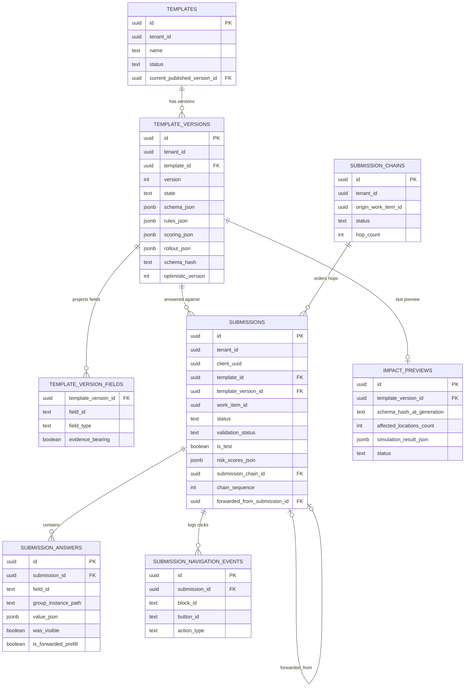
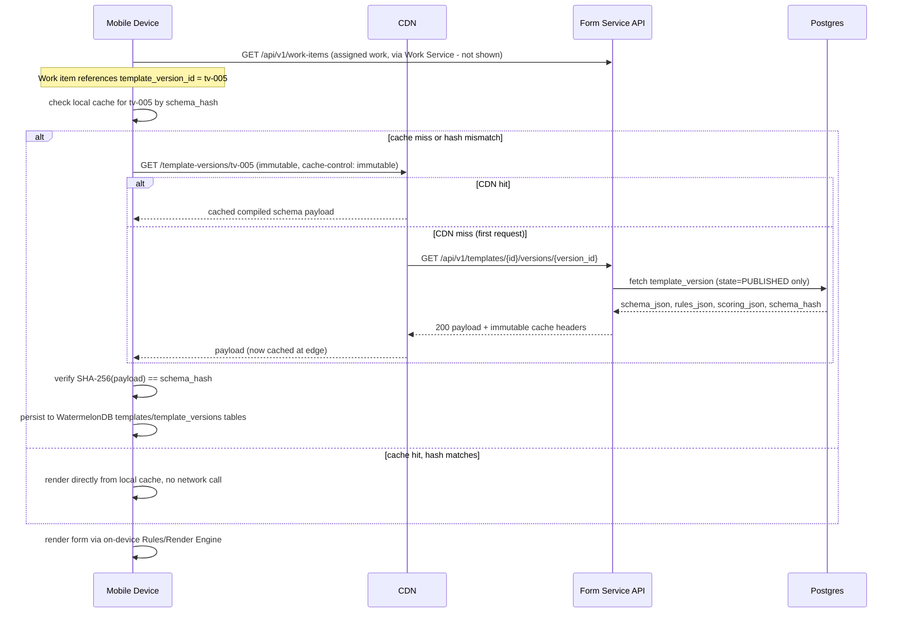
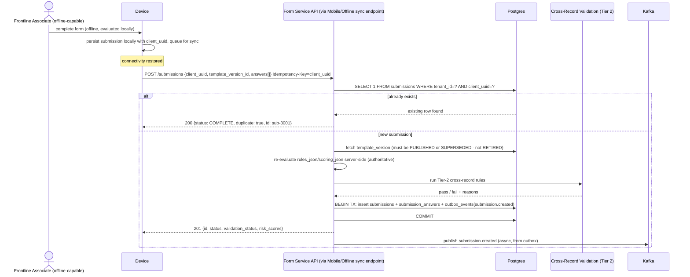
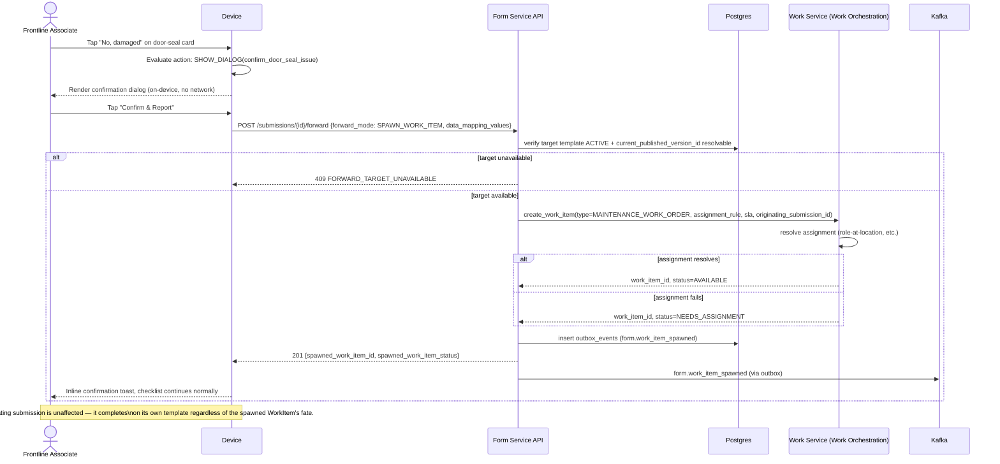

# Low-Level Design — No-Code Forms & Workflow Builder (Form Service)

## 1. Schema Representation Decision

`template_versions` stores the compiled schema as three `jsonb` columns (`schema_json`, `rules_json`,
`scoring_json`) rather than a fully normalized per-field table set. Rationale: (a) atomic, hash-
determinstic versioning — one canonicalizable document per concern; (b) a `TemplateVersion` is read
far more often (every render) than it is queried field-by-field (rare admin/analytics use); (c) jsonb
+ GIN indexing still supports the occasional "find templates containing field type X" query. A
lightweight `template_version_fields` **projection table** (populated by a trigger/application-level
write, not hand-maintained) exists purely to support fast structural-diff and analytics-dependency
queries (FR-FORM-052) without parsing jsonb at query time — see §2.

## 2. Postgres Schema

### 2.1 Tables

**`templates`**

| Column | Type | Constraints |
|---|---|---|
| `id` | uuid | PK |
| `tenant_id` | uuid | NOT NULL, indexed, RLS key |
| `name` | text | NOT NULL |
| `description` | text | |
| `category` | text | e.g. `AUDIT`, `INSPECTION`, `SURVEY`, `INCIDENT` |
| `owner_node_id` | uuid | FK → `organization_nodes.id`; scopes authoring |
| `status` | text | enum: `ACTIVE`, `ARCHIVED` (template-level lifecycle; distinct from per-version lifecycle) |
| `current_published_version_id` | uuid | FK → `template_versions.id`, nullable |
| `created_by` | uuid | FK → `users.id` |
| `created_at` | timestamptz | NOT NULL default `now()` |
| `updated_at` | timestamptz | NOT NULL |

**`template_versions`**

| Column | Type | Constraints |
|---|---|---|
| `id` | uuid | PK |
| `tenant_id` | uuid | NOT NULL, indexed, RLS key |
| `template_id` | uuid | FK → `templates.id`, NOT NULL, indexed |
| `version` | integer | NOT NULL; unique per `(template_id)`, monotonically increasing |
| `state` | text | enum: `DRAFT`, `REVIEW`, `APPROVED`, `PUBLISHED`, `SUPERSEDED`, `RETIRED` |
| `schema_json` | jsonb | NOT NULL; compiled field definitions, sections, options (FR-FORM-001–019) |
| `rules_json` | jsonb | NOT NULL; compiled visibility/mandatory/validation/branching/calculated-field rule graph (FR-FORM-020–024, 026–028) |
| `scoring_json` | jsonb | nullable; risk-scoring config (FR-FORM-025) |
| `rollout_json` | jsonb | nullable; pilot rollout scope — `{"scope_node_ids":[...], "window_start":..., "window_end":...}` (FR-FORM-045) |
| `schema_hash` | text | NOT NULL once `state IN ('APPROVED','PUBLISHED','SUPERSEDED','RETIRED')`; SHA-256 hex, indexed |
| `reference_set_versions` | jsonb | nullable; map of lookup field → `reference_set_version` snapshot pointer (FR-FORM-027) |
| `author_id` | uuid | FK → `users.id` |
| `reviewer_id` | uuid | FK → `users.id`, nullable |
| `approved_by` | uuid | FK → `users.id`, nullable |
| `published_by` | uuid | FK → `users.id`, nullable |
| `published_at` | timestamptz | nullable |
| `superseded_at` | timestamptz | nullable |
| `retired_at` | timestamptz | nullable |
| `impact_preview_id` | uuid | FK → `impact_previews.id`, nullable; last preview generated for this exact `schema_hash` |
| `optimistic_version` | integer | NOT NULL default 1; incremented on every mutation, used for `409` conflict detection (distinct from the business-facing `version` column) |
| `created_at` | timestamptz | NOT NULL |
| `updated_at` | timestamptz | NOT NULL |

Constraint: a trigger (`enforce_published_immutability`) rejects any `UPDATE` to `schema_json`,
`rules_json`, `scoring_json`, or `schema_hash` on a row whose `state` is not `DRAFT` or `REVIEW`
(REVIEW updates are allowed only when accompanied by a transition back to `DRAFT` in the same
statement — enforced in the application layer's state-machine service, with the DB trigger as the
last-line backstop for `PUBLISHED`/`SUPERSEDED`/`RETIRED`). This is the data-layer enforcement of
NFR-FORM-07.

**`template_version_fields`** (read-optimized projection, not authoritative)

| Column | Type | Constraints |
|---|---|---|
| `template_version_id` | uuid | FK → `template_versions.id`, part of composite PK |
| `field_id` | text | part of composite PK |
| `field_type` | text | enum matching §3 of functional-spec.md |
| `label` | text | |
| `section_id` | text | |
| `evidence_bearing` | boolean | |
| `referenced_by_scoring` | boolean | true if used in any `scoring_json` band |
| `referenced_by_calculated` | boolean | true if referenced by a calculated-field formula |

Indexes: `(field_id, field_type)` for cross-template field-type queries; `(template_version_id)` for
diffing.

**`impact_previews`**

| Column | Type | Constraints |
|---|---|---|
| `id` | uuid | PK |
| `tenant_id` | uuid | NOT NULL |
| `template_version_id` | uuid | FK → `template_versions.id`, NOT NULL |
| `schema_hash_at_generation` | text | NOT NULL; used to detect staleness (FR-FORM-050/052) |
| `affected_locations_count` | integer | |
| `affected_work_items_json` | jsonb | breakdown by state |
| `affected_users_count` | integer | |
| `active_schedules_count` | integer | |
| `downstream_diff_json` | jsonb | structural diff result (ADDED/REMOVED/RETYPED/RENAMED/OPTIONS_CHANGED/LOGIC_CHANGED) |
| `simulation_result_json` | jsonb | nullable; simulated execution output (FR-FORM-051) |
| `status` | text | enum: `RUNNING`, `COMPLETE`, `PARTIAL_TIMED_OUT` |
| `generated_by` | uuid | FK → `users.id` |
| `generated_at` | timestamptz | |

**`submissions`**

| Column | Type | Constraints |
|---|---|---|
| `id` | uuid | PK |
| `tenant_id` | uuid | NOT NULL, RLS key |
| `client_uuid` | uuid | NOT NULL; unique per `(tenant_id, client_uuid)` — idempotency key |
| `template_id` | uuid | FK → `templates.id`, NOT NULL |
| `template_version_id` | uuid | FK → `template_versions.id`, NOT NULL |
| `work_item_id` | uuid | FK → `work_items.id` (external), nullable |
| `location_id` | uuid | FK → `organization_nodes.id`, NOT NULL |
| `submitted_by` | uuid | FK → `users.id`, NOT NULL |
| `device_id` | text | |
| `client_sequence` | bigint | client-supplied ordering hint, not authoritative |
| `status` | text | enum: `COMPLETE`, `FAILED_CROSS_RECORD`, `PENDING_REVIEW` |
| `validation_status` | text | enum: `PASSED`, `FAILED_CROSS_RECORD`, `FAILED_CLIENT_OVERRIDE` (filler explicitly acknowledged a Tier-1 warning) |
| `is_test` | boolean | NOT NULL default false; true for Builder Test Mode / simulation-derived rows |
| `risk_scores_json` | jsonb | resolved `{score_id: {score, level}}` map (FR-FORM-025) |
| `created_at_client` | timestamptz | client-reported |
| `modified_at_client` | timestamptz | client-reported |
| `server_received_at` | timestamptz | NOT NULL default `now()`; authoritative ordering timestamp |
| `created_at` | timestamptz | NOT NULL |

Constraint: `UNIQUE (tenant_id, client_uuid)` — the idempotency backstop (NFR-FORM-06).
Index: `(tenant_id, template_id, location_id, server_received_at)` for cross-record Tier-2 lookups
(FR-FORM-028) and reporting rollups.

**`submission_answers`**

| Column | Type | Constraints |
|---|---|---|
| `id` | uuid | PK |
| `submission_id` | uuid | FK → `submissions.id`, NOT NULL, indexed |
| `field_id` | text | NOT NULL |
| `group_instance_path` | text | nullable; e.g. `line_items[2]` for repeating-group answers, `line_items[2].sub_items[0]` for nested |
| `value_json` | jsonb | typed answer value; for evidence-bearing types holds `{"evidence_id":..., "content_hash":...}` only |
| `was_visible` | boolean | NOT NULL; distinguishes "hidden, not answered" from "shown, left blank" (FR-FORM-020) |
| `is_inherited_default` | boolean | NOT NULL default false |

Index: `(submission_id, field_id)`.

**`outbox_events`** (transactional outbox for reliable Kafka emission, per high-level-design.md §7)

| Column | Type | Constraints |
|---|---|---|
| `id` | uuid | PK |
| `tenant_id` | uuid | NOT NULL |
| `event_type` | text | NOT NULL |
| `payload_json` | jsonb | NOT NULL — full event envelope |
| `created_at` | timestamptz | NOT NULL |
| `published_at` | timestamptz | nullable; set by the relay worker on successful Kafka publish |

**`submission_chains`** (FR-FORM-084 — ledger of `INLINE_CHAIN` cross-template forwarding hops)

| Column | Type | Constraints |
|---|---|---|
| `id` | uuid | PK |
| `tenant_id` | uuid | NOT NULL, RLS key |
| `origin_work_item_id` | uuid | FK → `work_items.id` (external), NOT NULL |
| `status` | text | enum: `IN_PROGRESS`, `COMPLETE`, `ABANDONED` |
| `hop_count` | integer | NOT NULL default 1; incremented per hop, checked against `max_chain_hops` (NFR-FORM-08) |
| `created_at` | timestamptz | NOT NULL |
| `updated_at` | timestamptz | NOT NULL |

`submissions` gains three columns to support chaining (all nullable — a standalone submission leaves
them null):

| Column (added to `submissions`) | Type | Constraints |
|---|---|---|
| `submission_chain_id` | uuid | FK → `submission_chains.id`, nullable, indexed |
| `chain_sequence` | integer | nullable; 1-based position within the chain |
| `forwarded_from_submission_id` | uuid | FK → `submissions.id`, nullable; the hop that produced this one |

`submission_answers` gains one column:

| Column (added to `submission_answers`) | Type | Constraints |
|---|---|---|
| `is_forwarded_prefill` | boolean | NOT NULL default false; true when this answer's value was carried over by a `data_mapping` rather than filler-entered or an admin-configured default (FR-FORM-083) |

**`submission_navigation_events`** (FR-FORM-080 Pattern-B — non-data-bearing card/button clicks, UX
telemetry only, never an input to validation/scoring/analytics-of-record)

| Column | Type | Constraints |
|---|---|---|
| `id` | uuid | PK |
| `tenant_id` | uuid | NOT NULL |
| `submission_id` | uuid | FK → `submissions.id` (or a `client_uuid` if the fill session has not yet been ingested), NOT NULL |
| `block_id` | text | the `CARD`'s `block_id` |
| `button_id` | text | which button was clicked |
| `action_type` | text | enum matching FR-FORM-081 (`NAVIGATE_SECTION`, `SHOW_DIALOG`, `FORWARD_TO_TEMPLATE`, `SUBMIT_FORM`, `NONE`) |
| `occurred_at_client` | timestamptz | |
| `created_at` | timestamptz | NOT NULL |

Retention: purged after 90 days by a scheduled job (Open Question in functional-spec.md §12 flags this
as a default, not yet a hard commitment) — distinct from `submissions`/`submission_answers`, which are
retained per the platform's standard data-lifecycle policy (see 01-FSD.md Security/Privacy section),
because this table is UX telemetry, not an attested record.

Schema additions to `schema_json` (compiled, inside a section, alongside `fields`) and `rules_json`
(action/dialog/forwarding config) are documented in §3a/§4a below rather than as new tables, per the
existing embedded-jsonb rationale (§1): a `CARD` block, a `DialogDefinition`, and a `FORWARD_TO_TEMPLATE`
action are all part of the same compiled, hash-covered, versioned document as everything else in
`template_versions.schema_json`/`rules_json` — they get their own runtime tables
(`submission_chains`, `submission_navigation_events`) only for the *execution-time facts* they produce,
never for the *definition*, which stays inside the immutable versioned schema like every other
component.

### 2.2 ER Diagram



## 3. Sample Compiled Schema Fragment

Excerpt of `schema_json` for a cold-chain check template (fields only — `rules_json`/`scoring_json`
shown separately in §4/§5):

```json
{
  "sections": [
    {
      "section_id": "temp_check",
      "label": "Temperature Check",
      "fields": [
        {
          "field_id": "temperature",
          "field_type": "NUMBER",
          "label": "Refrigeration temperature (°C)",
          "required": true,
          "config": { "min": -30, "max": 50, "decimal_places": 1, "unit_label": "°C" },
          "evidence_bearing": false,
          "pii_class": "NONE"
        },
        {
          "field_id": "door_seal_intact",
          "field_type": "YES_NO",
          "label": "Is the door seal intact?",
          "required": true
        },
        {
          "field_id": "corrective_action",
          "field_type": "TEXT_LONG",
          "label": "Corrective action taken",
          "required": { "rule_ref": "require_corrective_action" },
          "visible": { "rule_ref": "require_corrective_action" }
        },
        {
          "field_id": "corrective_photo",
          "field_type": "PHOTO",
          "label": "Photo evidence of corrective action",
          "evidence_bearing": true,
          "required": { "rule_ref": "require_corrective_action" },
          "config": { "min_count": 1, "capture_mode": "CAMERA_ONLY" }
        }
      ]
    }
  ]
}
```

## 4. Sample Conditional-Logic Rule (JSON)

`rules_json`, corresponding to the source-spec Appendix B `TEMP-001` pattern, generalized to this
module's rule-graph format:

```json
{
  "rules": [
    {
      "rule_id": "require_corrective_action",
      "type": "MANDATORY_CONDITION",
      "condition": {
        "op": "OR",
        "clauses": [
          { "field": "temperature", "op": ">", "value": 8 },
          { "field": "door_seal_intact", "op": "==", "value": false }
        ]
      },
      "applies_to": ["corrective_action", "corrective_photo"]
    }
  ],
  "calculated_fields": [],
  "evaluation_order": ["temperature", "door_seal_intact", "corrective_action", "corrective_photo"]
}
```

`scoring_json` for the same template (as introduced in functional-spec.md FR-FORM-025):

```json
{
  "risk_scores": [
    {
      "score_id": "cold_chain_risk",
      "inputs": [
        { "field": "temperature", "bands": [
          { "max": 8, "points": 0 },
          { "max": 12, "points": 40 },
          { "max": null, "points": 100 }
        ]},
        { "field": "door_seal_intact", "bands": [
          { "value": true, "points": 0 },
          { "value": false, "points": 30 }
        ]}
      ],
      "thresholds": [
        { "min": 0, "max": 39, "level": "LOW" },
        { "min": 40, "max": 69, "level": "MEDIUM" },
        { "min": 70, "max": 100, "level": "HIGH" }
      ],
      "actions_by_level": {
        "HIGH": [
          { "action": "require_field", "field": "corrective_action" },
          { "action": "create_issue", "severity": "CRITICAL" },
          { "action": "notify_role", "role": "store_manager" }
        ],
        "MEDIUM": [
          { "action": "require_field", "field": "corrective_action" }
        ]
      }
    }
  ]
}
```

## 4a. Compiled Schema Fragment — Card, Dialog, and Cross-Template Forwarding

`schema_json` excerpt (a section containing a Pattern-A decorated `YES_NO` field rendered as a card,
whose "No" option shows a confirmation dialog and then spawns a Maintenance Work Order):

```json
{
  "sections": [
    {
      "section_id": "door_seal_check",
      "label": "Door Seal Check",
      "fields": [
        {
          "field_id": "door_seal_intact",
          "field_type": "YES_NO",
          "label": "Is the door seal intact?",
          "required": true,
          "display_as": "CARD",
          "card_decoration": {
            "block_id": "door_seal_card",
            "image": { "asset_id": "asset-door-seal-diagram", "alt_text": "Door seal inspection points" },
            "body_text": "Check all four edges of the seal for gaps, tears, or compression damage.",
            "record_as_field": true,
            "buttons": [
              {
                "button_id": "btn_yes",
                "label": "Yes, sealed",
                "style": "PRIMARY",
                "option_value": true,
                "action": { "type": "NAVIGATE_SECTION", "target_section_id": "next_section" }
              },
              {
                "button_id": "btn_no",
                "label": "No, damaged",
                "style": "DESTRUCTIVE",
                "option_value": false,
                "action": {
                  "type": "SHOW_DIALOG",
                  "dialog_id": "confirm_door_seal_issue"
                }
              }
            ]
          }
        }
      ]
    }
  ],
  "dialogs": [
    {
      "dialog_id": "confirm_door_seal_issue",
      "title": "Report this as a maintenance issue?",
      "body_text": "This will create a Maintenance Work Order assigned to Facilities. Your checklist will still finish normally.",
      "dismissible": true,
      "buttons": [
        { "label": "Cancel", "style": "SECONDARY", "action": { "type": "NAVIGATE_SECTION", "target_section_id": "door_seal_check" } },
        {
          "label": "Confirm & Report",
          "style": "PRIMARY",
          "action": {
            "type": "FORWARD_TO_TEMPLATE",
            "forward_to_template_id": "tmpl-maintenance-request",
            "forward_mode": "SPAWN_WORK_ITEM",
            "work_item_type": "MAINTENANCE_WORK_ORDER",
            "assignment_rule": { "type": "ROLE_AT_LOCATION", "role": "facilities_technician" },
            "sla_minutes": 1440,
            "data_mapping": [
              { "source_field_id": "location_id", "target_field_id": "location_id", "locked": true },
              { "source_field_id": "door_seal_intact", "target_field_id": "reported_defect", "locked": false }
            ]
          }
        }
      ]
    }
  ]
}
```

Note the two-level composition this produces: the `YES_NO` field still evaluates through the exact
same engine as any other field (§7.1 unchanged) — `display_as`/`card_decoration` are purely a
rendering/action overlay on top of a normal field, never a second data model. The dialog and the
forward action are only reached through the field's "No" option; nothing about this schema fragment
requires the evaluation engine to understand cards or dialogs as anything other than "this field's
option carries an action to run after the answer is recorded," which is what keeps FR-FORM-080's
Pattern-A case a thin layer over the existing engine rather than a parallel one.

## 5. REST Endpoints

Base path `/api/v1/` per conventions.md. All mutation endpoints require `Idempotency-Key` where
retries are possible; all mutable-resource updates use `ETag`/`optimistic_version`.

### 5.1 `POST /api/v1/templates` — create template
Request:
```json
{ "name": "Cold Chain Daily Check", "category": "INSPECTION", "owner_node_id": "node-123" }
```
Response `201`:
```json
{ "id": "tmpl-001", "status": "ACTIVE", "current_published_version_id": null }
```

### 5.2 `POST /api/v1/templates/{template_id}/versions` — create a draft version
Creates a new `DRAFT` `TemplateVersion` (also the endpoint the Workflow Builder Agent calls).
Request:
```json
{
  "based_on_version_id": "tv-004",
  "schema_json": { "...": "..." },
  "rules_json": { "...": "..." },
  "scoring_json": { "...": "..." },
  "authored_by_agent": false
}
```
Response `201`:
```json
{ "id": "tv-005", "template_id": "tmpl-001", "version": 5, "state": "DRAFT", "optimistic_version": 1 }
```

### 5.3 `PUT /api/v1/templates/{template_id}/versions/{version_id}` — update a draft
Headers: `If-Match: <optimistic_version>`.
Request: same body shape as 5.2 (partial updates allowed via `PATCH` variant, omitted for brevity).
Response `200` on success; `409 Conflict` on stale `If-Match`:
```json
{
  "error": {
    "code": "DRAFT_EDIT_CONFLICT",
    "message": "This draft was modified by another editor since you last loaded it.",
    "trace_id": "trace-abc",
    "conflict": {
      "current_optimistic_version": 4,
      "current_schema_json": { "...": "..." },
      "changed_by": "user-789",
      "changed_at": "2026-09-19T10:02:00Z"
    }
  }
}
```

### 5.4 `POST /api/v1/templates/{template_id}/versions/{version_id}/transition` — advance lifecycle state
Request:
```json
{ "target_state": "REVIEW" }
```
Response `200`:
```json
{ "id": "tv-005", "state": "REVIEW", "reviewer_id": null }
```
Error (invalid transition), `422`:
```json
{ "error": { "code": "INVALID_STATE_TRANSITION", "message": "Cannot move DRAFT to PUBLISHED directly.", "trace_id": "trace-def" } }
```

### 5.5 `POST /api/v1/templates/{template_id}/versions/{version_id}/impact-preview` — run Impact Preview (dry run)
Request:
```json
{ "simulate": true, "simulation_sample_size": 20, "simulation_source": "RECENT_SUBMISSIONS" }
```
Response `202` (async job started):
```json
{ "impact_preview_id": "ip-777", "status": "RUNNING" }
```
Poll: `GET /api/v1/impact-previews/{impact_preview_id}` → `200`:
```json
{
  "impact_preview_id": "ip-777",
  "status": "COMPLETE",
  "schema_hash_at_generation": "9f3a...c21",
  "affected_locations_count": 4820,
  "affected_work_items": { "AVAILABLE": 310, "SCHEDULED": 4102, "IN_PROGRESS": 12 },
  "affected_users_count": 6120,
  "active_schedules_count": 4102,
  "downstream_diff": [
    { "field_id": "door_seal_intact", "change": "OPTIONS_CHANGED" },
    { "field_id": "legacy_temp_f", "change": "REMOVED", "referenced_by": ["risk_score:cold_chain_risk", "report:cold_chain_dashboard"] }
  ],
  "simulation_result": {
    "sampled_submissions": 20,
    "would_fail_validation": 2,
    "would_change_visibility": 5,
    "would_change_risk_level": 1,
    "formula_errors": []
  }
}
```

### 5.6 `POST /api/v1/templates/{template_id}/versions/{version_id}/publish` — publish
Requires `state == APPROVED`, a `COMPLETE` Impact Preview matching the current `schema_hash`, and
(if tenant policy requires) `approved_by != author_id`. High-severity downstream-diff warnings
(FR-FORM-052) must be included as `acknowledged_warnings` or the request is rejected.
Request:
```json
{ "impact_preview_id": "ip-777", "acknowledged_warnings": ["legacy_temp_f_removed"] }
```
Response `200`:
```json
{
  "id": "tv-005", "state": "PUBLISHED", "schema_hash": "9f3a...c21",
  "published_at": "2026-09-19T10:15:00Z",
  "superseded_version_id": "tv-004"
}
```
Error, `409` (concurrent publish already occurred):
```json
{ "error": { "code": "PUBLISH_CONFLICT", "message": "A newer version has already been published for this template.", "trace_id": "trace-ghi" } }
```
Error, `422` (unacknowledged warning):
```json
{ "error": { "code": "UNACKNOWLEDGED_IMPACT_WARNING", "message": "High-severity downstream impact must be acknowledged before publish.", "trace_id": "trace-jkl" } }
```

### 5.7 `GET /api/v1/templates/{template_id}/versions/{version_id}` — fetch for offline caching
Used by the mobile client. Cacheable, CDN-fronted for `PUBLISHED` versions (`Cache-Control:
public, max-age=31536000, immutable`).
Response `200`:
```json
{
  "id": "tv-005", "template_id": "tmpl-001", "version": 5, "state": "PUBLISHED",
  "schema_hash": "9f3a...c21",
  "schema_json": { "...": "..." },
  "rules_json": { "...": "..." },
  "scoring_json": { "...": "..." },
  "reference_set_versions": { "asset_lookup": "rs-2026-09-01" }
}
```

### 5.8 `POST /api/v1/submissions` — submit (idempotent)
Headers: `Idempotency-Key: <client_uuid>` (also carried in body for the offline-sync batch path).
Request:
```json
{
  "client_uuid": "c7f1e2a0-...-uuid",
  "template_version_id": "tv-005",
  "work_item_id": "wi-9001",
  "location_id": "node-123",
  "device_id": "device-456",
  "created_at_client": "2026-09-19T09:58:00Z",
  "modified_at_client": "2026-09-19T09:59:30Z",
  "answers": [
    { "field_id": "temperature", "value": 10.5, "was_visible": true },
    { "field_id": "door_seal_intact", "value": true, "was_visible": true },
    { "field_id": "corrective_action", "value": "Adjusted thermostat, re-checked in 30 min.", "was_visible": true }
  ]
}
```
Response `201` (first submission):
```json
{
  "id": "sub-3001", "client_uuid": "c7f1e2a0-...-uuid", "status": "COMPLETE",
  "validation_status": "PASSED",
  "risk_scores": { "cold_chain_risk": { "score": 40, "level": "MEDIUM" } }
}
```
Response `200` (duplicate `client_uuid`, per source-spec §19.4 — returns original result, no
duplicate row):
```json
{ "id": "sub-3001", "client_uuid": "c7f1e2a0-...-uuid", "status": "COMPLETE", "duplicate": true }
```
Error, `422` (Tier-2 cross-record failure):
```json
{
  "error": { "code": "CROSS_RECORD_VALIDATION_FAILED", "message": "...", "trace_id": "trace-mno" },
  "submission_id": "sub-3002",
  "validation_status": "FAILED_CROSS_RECORD"
}
```
Note: even on cross-record failure the submission row is persisted (`status =
FAILED_CROSS_RECORD`) and routed to a review queue — the API still returns `201`/`200` with
`validation_status` set, not a hard `4xx` that would suggest the data was rejected/discarded
(consistent with FR-FORM-028 Tier 2 semantics; the `422` example above documents the payload used by
a synchronous online submit path when the tenant is configured to surface it as a hard error
inline — Decision needed: default is `201` + `validation_status` flag, not `422`).

### 5.9 `POST /api/v1/templates/{template_id}/versions/{version_id}/simulate` — simulate execution (standalone)
Same simulation engine as §5.5's embedded Impact Preview step, invocable directly from Test Mode
without a full Impact Preview run.
Request:
```json
{ "test_cases": [ { "temperature": 15, "door_seal_intact": false } ] }
```
Response `200`:
```json
{
  "results": [
    {
      "input": { "temperature": 15, "door_seal_intact": false },
      "visible_fields": ["temperature", "door_seal_intact", "corrective_action", "corrective_photo"],
      "required_fields": ["temperature", "door_seal_intact", "corrective_action", "corrective_photo"],
      "risk_scores": { "cold_chain_risk": { "score": 130, "level": "HIGH" } },
      "would_trigger_actions": [
        { "action": "create_issue", "severity": "CRITICAL" },
        { "action": "notify_role", "role": "store_manager" }
      ],
      "validation_errors": []
    }
  ]
}
```

### 5.10a `POST /api/v1/submissions/{submission_id}/forward` — take a `FORWARD_TO_TEMPLATE` action
Called by the mobile client (or replayed from the offline mutation queue) when a filler selects a
button/option whose action resolves to `FORWARD_TO_TEMPLATE`. Idempotent on `client_uuid` exactly like
`POST /submissions` (§5.8).

Request:
```json
{
  "client_uuid": "f1a2...-uuid",
  "source_submission_id": "sub-3001",
  "button_id": "btn_no",
  "forward_to_template_id": "tmpl-maintenance-request",
  "forward_mode": "SPAWN_WORK_ITEM",
  "data_mapping_values": { "location_id": "node-123", "reported_defect": false }
}
```
Response `201` (`SPAWN_WORK_ITEM` mode):
```json
{
  "forward_id": "fwd-501",
  "forward_mode": "SPAWN_WORK_ITEM",
  "spawned_work_item_id": "wi-9050",
  "spawned_work_item_status": "AVAILABLE",
  "originating_submission_id": "sub-3001"
}
```
Response `201` (`INLINE_CHAIN` mode):
```json
{
  "forward_id": "fwd-502",
  "forward_mode": "INLINE_CHAIN",
  "submission_chain_id": "chain-77",
  "next_template_version_id": "tv-020",
  "chain_sequence": 2,
  "prefilled_answers": { "location_id": "node-123" }
}
```
Error, `409` (target unavailable — FR-FORM-087):
```json
{ "error": { "code": "FORWARD_TARGET_UNAVAILABLE", "message": "The target template is not currently published.", "trace_id": "trace-pqr" } }
```
Error, `409` (chain-hop limit exceeded):
```json
{ "error": { "code": "CHAIN_HOP_LIMIT_EXCEEDED", "message": "This workflow could not be completed automatically.", "trace_id": "trace-stu", "submission_chain_id": "chain-77", "hop_count": 10 } }
```
Error, `422` (spawn requested but assignment could not be resolved — item still created, not an error
response; included here for contrast): not applicable — see §5.10a note below.

Note: a `SPAWN_WORK_ITEM` assignment-resolution failure is **not** modeled as an HTTP error — the
`WorkItem` is always created; `spawned_work_item_status` simply reports `NEEDS_ASSIGNMENT` instead of
`AVAILABLE` (FR-FORM-087), consistent with the platform-wide principle that a valid downstream side
effect is never rolled back just because a secondary step (assignment) needs manual follow-up.

### 5.10b `GET /api/v1/submissions/{submission_id}/chain` — fetch a submission's chain context
Response `200`:
```json
{
  "submission_chain_id": "chain-77",
  "status": "IN_PROGRESS",
  "hops": [
    { "submission_id": "sub-3001", "chain_sequence": 1, "template_id": "tmpl-cold-chain-check", "status": "COMPLETE" },
    { "submission_id": "sub-3010", "chain_sequence": 2, "template_id": "tmpl-maintenance-request", "status": "IN_PROGRESS" }
  ]
}
```

### 5.10 Error Codes Summary

| Code | HTTP | Meaning |
|---|---|---|
| `SCOPE_DENIED` | 403 | Principal lacks `UserScope` for the template's owner node |
| `TEMPLATE_NOT_FOUND` | 404 | |
| `DRAFT_EDIT_CONFLICT` | 409 | Concurrent draft edit (§10) |
| `INVALID_STATE_TRANSITION` | 422 | Illegal lifecycle transition |
| `PUBLISH_CONFLICT` | 409 | Concurrent publish race |
| `UNACKNOWLEDGED_IMPACT_WARNING` | 422 | High-severity downstream diff not acknowledged |
| `SCHEMA_VALIDATION_FAILED` | 422 | Build-time cycle/dangling-ref/type error (§9) |
| `IDEMPOTENCY_KEY_REUSED_DIFFERENT_PAYLOAD` | 409 | Same key, different body — client bug |
| `CROSS_RECORD_VALIDATION_FAILED` | 201 (flagged) / 422 (tenant-configured hard mode) | See §5.8 note |
| `RETIRED_TEMPLATE_VERSION` | 409 | Attempt to start new submission against `RETIRED` |
| `TENANT_MISMATCH` | 403 | Cross-tenant access attempt |
| `FORWARD_TARGET_UNAVAILABLE` | 409 | `forward_to_template_id` does not resolve to an `ACTIVE` template with a current published version (FR-FORM-087) |
| `CHAIN_HOP_LIMIT_EXCEEDED` | 409 | An `INLINE_CHAIN` exceeded `max_chain_hops` (default 10, NFR-FORM-08) |
| `DIALOG_NESTING_NOT_ALLOWED` | 422 | Build-time: a dialog button attempted to open a second dialog (FR-FORM-082) |
| `DIALOG_NO_BUTTONS` | 422 | Build-time: a `DialogDefinition` has zero buttons (FR-FORM-082) |
| `FORWARD_MAPPING_TYPE_MISMATCH` | 422 | Build-time: a `data_mapping` pair's source/target field types are incompatible (FR-FORM-085) |

## 6. Sequence Diagrams

### 6.1 Publish Flow Including Impact Preview Simulation

```mermaid
sequenceDiagram
    actor Admin
    participant BuilderUI
    participant API as Form Service API
    participant Validator
    participant HashEngine
    participant ImpactSvc as Impact Preview Service
    participant RulesEngine
    participant DB as Postgres
    participant Kafka

    Admin->>BuilderUI: Click "Publish"
    BuilderUI->>API: POST .../transition {target_state: APPROVED}
    API->>Validator: run structural + logic validation
    Validator-->>API: OK (no cycles, no dangling refs)
    API->>HashEngine: compute schema_hash
    HashEngine-->>API: hash = 9f3a...c21
    API->>DB: persist state=APPROVED, schema_hash
    BuilderUI->>API: POST .../impact-preview {simulate:true}
    API->>ImpactSvc: enqueue scan job
    ImpactSvc->>DB: enumerate affected locations/work_items/users/schedules
    ImpactSvc->>DB: structural diff vs current PUBLISHED version
    ImpactSvc->>RulesEngine: replay N recent submissions through new rules_json/scoring_json
    RulesEngine-->>ImpactSvc: per-case visibility/validation/risk deltas
    ImpactSvc->>DB: persist impact_previews row (status=COMPLETE)
    ImpactSvc-->>API: impact_preview_id, summary
    API-->>BuilderUI: 200 impact preview result
    Admin->>BuilderUI: Acknowledge high-severity warnings
    Admin->>BuilderUI: Confirm Publish
    BuilderUI->>API: POST .../publish {impact_preview_id, acknowledged_warnings}
    API->>DB: verify impact_preview.schema_hash matches current schema_hash
    API->>DB: BEGIN TX: set state=PUBLISHED, published_at/by; prior PUBLISHED -> SUPERSEDED
    API->>DB: insert outbox_events (template.published)
    API->>DB: COMMIT
    API-->>BuilderUI: 200 published
    Note over API,Kafka: async relay
    API->>Kafka: publish template.published (from outbox)
```

### 6.2 Offline Device Fetching and Caching a Published Template Version



### 6.3 Submission Ingestion with Idempotency-Key / client_uuid Dedupe



### 6.4 Cross-Template Forwarding — `SPAWN_WORK_ITEM` Mode



### 6.5 Cross-Template Forwarding — `INLINE_CHAIN` Mode

```mermaid
sequenceDiagram
    actor Filler as Frontline Associate
    participant Device
    participant API as Form Service API
    participant DB as Postgres

    Filler->>Device: Select option with action FORWARD_TO_TEMPLATE (forward_mode=INLINE_CHAIN)
    Device->>Device: Check local cache for target TemplateVersion by schema_hash
    alt target not cached (offline)
        Device-->>Filler: Button rendered disabled: "unavailable offline"
    else target cached, or online
        Device->>API: POST /submissions/{id}/forward {forward_mode: INLINE_CHAIN}
        API->>DB: verify target ACTIVE + resolve current_published_version_id
        API->>DB: BEGIN TX: create/extend submission_chains row; increment hop_count
        alt hop_count > max_chain_hops
            API->>DB: ROLLBACK; flag chain ABANDONED
            API-->>Device: 409 CHAIN_HOP_LIMIT_EXCEEDED
        else within limit
            API->>DB: apply data_mapping -> prefilled_answers for next hop
            API->>DB: COMMIT
            API-->>Device: 201 {submission_chain_id, next_template_version_id, chain_sequence, prefilled_answers}
            Device-->>Filler: "Continuing to: <target template name>" transition, then renders next form
        end
    end
```

## 7. Pseudocode

### 7.1 Conditional-Visibility / Validation Evaluation Engine

```
function evaluateTemplate(templateVersion, answers: Map<fieldId, value>) -> EvaluationResult:
    order = templateVersion.rules.evaluation_order   // precomputed topological order at compile time
    visible = {}
    required = {}
    errors = []

    for fieldId in order:
        field = templateVersion.schema.fieldsById[fieldId]

        // 1. Resolve visibility (depends only on upstream fields per topological order)
        visRule = field.visible
        visible[fieldId] = (visRule == null) ? true : evalCondition(visRule, answers, visible)

        if not visible[fieldId]:
            required[fieldId] = false
            continue   // hidden fields are excluded from validation entirely (FR-FORM-020)

        // 2. Resolve mandatory condition
        reqRule = field.required
        required[fieldId] = (reqRule == true) ? true
                           : (reqRule == false) ? false
                           : evalCondition(reqRule, answers, visible)

        value = answers.get(fieldId)

        // 3. Required-but-missing check
        if required[fieldId] and isBlank(value):
            errors.add(ValidationError(fieldId, "REQUIRED"))
            continue

        // 4. Intrinsic type/range validation (per field_type config)
        intrinsicErrors = validateIntrinsic(field, value)
        errors.addAll(intrinsicErrors)

        // 5. Conditional / cross-field validation rules attached to this field
        for rule in templateVersion.rules.validationRulesFor(fieldId):
            // skip rules referencing a currently-hidden field (FR-FORM-022)
            if any(ref in rule.referencedFields where visible.get(ref) == false):
                continue
            if rule.condition == null or evalCondition(rule.condition, answers, visible):
                if not evalPredicate(rule.predicate, answers):
                    errors.add(ValidationError(fieldId, rule.rule_id, rule.error_message))

    // 6. Calculated fields (evaluated in the same topological order, interleaved by dependency,
    //    not as a separate pass, so a calculated field can feed a later field's visibility rule)
    for calc in templateVersion.rules.calculated_fields:
        answers[calc.field_id] = evalFormula(calc.formula, answers)   // aggregate funcs resolve
                                                                        // repeating-group instances

    // 7. Risk scoring (after all fields, including calculated, are resolved)
    riskScores = {}
    for score in templateVersion.scoring.risk_scores:
        points = sum(bandPoints(input, answers[input.field]) for input in score.inputs)
        level = resolveThreshold(score.thresholds, points)
        riskScores[score.score_id] = {score: points, level: level}
        // level-triggered actions (require_field, create_issue, notify_role) are surfaced as
        // intents, not executed here — execution happens at ingestion / by consuming services

    return EvaluationResult(visible, required, errors, riskScores)


function evalCondition(condition, answers, visible) -> boolean:
    // supports AND/OR/NOT composition of leaf clauses {field, op, value}
    switch condition.op:
        case "AND": return all(evalCondition(c, answers, visible) for c in condition.clauses)
        case "OR":  return any(evalCondition(c, answers, visible) for c in condition.clauses)
        case "NOT": return not evalCondition(condition.clause, answers, visible)
        default:    // leaf comparison
            if condition.field not in visible or visible[condition.field] == false:
                return false   // a rule can never fire off a currently-hidden field's value
            return compare(answers.get(condition.field), condition.op, condition.value)
```

Key properties enforced by construction: (1) evaluation is a single linear pass in a precomputed
topological order — no runtime cycle possible because the compiler rejected cycles (§7.2 note below
and functional-spec.md FR-FORM-024/FR-FORM-071); (2) identical code path runs on-device (mobile,
offline, TypeScript port) and server-side (Kotlin, authoritative) — the rule graph JSON is the shared
contract, not the implementation language.

### 7.2 Cycle Detection at Compile Time (used by the Publish-time Validator)

```
function computeEvaluationOrder(schema, rules) -> List<fieldId> OR raises CycleError:
    graph = buildDependencyGraph(schema, rules)
    // edge A -> B means "A must be evaluated before B" (B depends on A)
    // edges come from: visibility conditions, mandatory conditions, cross-field validation refs,
    // calculated-field formula refs, risk-scoring input refs

    visited = {}, inStack = {}, order = []

    function dfs(node):
        if node in inStack: raise CycleError(path=inStack.pathTo(node))
        if node in visited: return
        inStack.add(node)
        for dep in graph.dependenciesOf(node):
            dfs(dep)
        inStack.remove(node)
        visited.add(node)
        order.append(node)

    for node in graph.allNodes():
        dfs(node)

    return order   // topological order; calculated fields land after all their inputs
```

### 7.3 Schema-Hash Computation

```
function computeSchemaHash(schema_json, rules_json, scoring_json) -> string:
    canonical = {
        "schema": canonicalize(schema_json),   // stable key ordering, no whitespace, numbers in
        "rules": canonicalize(rules_json),     // fixed normal form, exclude non-functional metadata
        "scoring": canonicalize(scoring_json)  // (internal admin notes, tags) per FR-FORM-042
    }
    serialized = jsonSerializeCanonical(canonical)   // RFC 8785-style JCS
    return sha256Hex(serialized)

function canonicalize(node):
    // Recursively: sort object keys lexicographically; arrays retain semantic order (field/section
    // order is meaningful and must be part of the hash — reordering fields changes what the filler
    // saw); strip fields tagged `hash_excluded: true` in the compiler's field metadata
    // (e.g. `internal_notes`); normalize numeric formatting (no trailing zeros ambiguity).
```

Determinism is verified by a CI contract test: compiling the same source draft twice (different
service instance, different run) must yield an identical hash — this guards NFR-FORM-02.

### 7.4 Button/Option Action Resolution and Forwarding

```
function resolveAction(action, sourceSubmission, answers) -> ActionResult:
    switch action.type:
        case "NAVIGATE_SECTION":
            return NavigateResult(target_section_id = action.target_section_id)   // unchanged FR-FORM-023 path

        case "SHOW_DIALOG":
            dialog = templateVersion.dialogs.byId(action.dialog_id)
            // build-time already guaranteed: dialog exists, has >=1 button, and none of its
            // buttons carry a SHOW_DIALOG action (DIALOG_NESTING_NOT_ALLOWED enforced at compile time)
            return ShowDialogResult(dialog)

        case "SUBMIT_FORM":
            return SubmitNowResult()   // still runs full evaluateTemplate() mandatory-condition pass, §7.1

        case "NONE":
            return NoOpResult()

        case "FORWARD_TO_TEMPLATE":
            target = resolveCurrentPublishedVersion(action.forward_to_template_id)
            if target == null or target.template.status != "ACTIVE":
                return ErrorResult("FORWARD_TARGET_UNAVAILABLE")

            prefill = {}
            for mapping in action.data_mapping:
                prefill[mapping.target_field_id] = answers.get(mapping.source_field_id)

            if action.forward_mode == "SPAWN_WORK_ITEM":
                workItem = WorkService.createWorkItem(
                    type = action.work_item_type,
                    template_version_id = target.id,
                    assignment_rule = action.assignment_rule,
                    sla_minutes = action.sla_minutes,
                    originating_submission_id = sourceSubmission.id,
                    prefilled_answers = prefill
                )   // WorkService returns status=AVAILABLE or NEEDS_ASSIGNMENT; never fails outright
                return SpawnedWorkItemResult(workItem.id, workItem.status)

            else:  // INLINE_CHAIN
                chain = findOrCreateChain(sourceSubmission)
                if chain.hop_count >= MAX_CHAIN_HOPS:   // default 10, NFR-FORM-08
                    markChainAbandoned(chain)
                    return ErrorResult("CHAIN_HOP_LIMIT_EXCEEDED")
                chain.hop_count += 1
                persistChainAdvance(chain, sourceSubmission, target, prefill)
                return InlineChainResult(chain.id, target.id, chain.hop_count, prefill)


function findOrCreateChain(submission) -> SubmissionChain:
    if submission.submission_chain_id != null:
        return loadChain(submission.submission_chain_id)
    // first hop of a new chain: the origin submission itself becomes chain_sequence = 1
    chain = SubmissionChain(origin_work_item_id = submission.work_item_id, status = "IN_PROGRESS", hop_count = 1)
    persist(chain)
    submission.submission_chain_id = chain.id
    submission.chain_sequence = 1
    return chain
```

Key properties enforced by construction: (1) `FORWARD_TARGET_UNAVAILABLE` and
`CHAIN_HOP_LIMIT_EXCEEDED` are the only two forwarding-time failure modes, and neither ever discards or
corrupts the **source** submission — forwarding failure is always a property of the *next* hop, never
the current one; (2) `SPAWN_WORK_ITEM` never returns an error to the filler — assignment-resolution
failure is folded into the success response as `status = NEEDS_ASSIGNMENT`, consistent with
`evaluateTemplate()`'s general pattern (§7.1) of surfacing intents/outcomes rather than throwing for
conditions the platform already has a durable state for.

## 8. Caching Strategy

| Cached artifact | Layer | Invalidation |
|---|---|---|
| `PUBLISHED` `TemplateVersion` payload | CDN/edge | Never (content-addressed, immutable) — a new version is a new URL/key, not an update to the old one |
| `Template.current_published_version_id` pointer | Redis, short TTL (60s) | Explicit invalidation on publish; used only to resolve "give me the current version" lookups, not to serve the payload itself |
| Reference-data snapshots (lookup fields) | CDN + device-local, TTL-tagged (`reference_set_version`) | New snapshot published as a new version; devices detect staleness via `reference_set_versions` map mismatch (FR-FORM-027/FR-FORM-063) |
| Impact Preview affected-object counts | Redis, keyed by `template_version_id + schema_hash`, TTL 15 min | Re-run explicitly if the draft changes after the last preview (schema_hash changes → cache key changes automatically) |
| Idempotency-Key dedupe check | Redis (fast-path) + Postgres unique constraint (authoritative) | Redis entry TTL 24h; Postgres constraint is the permanent source of truth so a Redis eviction cannot cause a duplicate insert |
| `Template` reachability for `FORWARD_TO_TEMPLATE` target picker (Builder) | Redis, keyed by authoring admin's `UserScope`, TTL 5 min | Invalidated on any template create/archive within the admin's scope; short TTL bounds staleness for a low-frequency authoring-time lookup, not a hot runtime path |

## 9. Concurrency Control

### 9.1 Draft Edit Conflicts (Concurrent Admin Editors)
`template_versions.optimistic_version` is incremented on every successful mutation while in `DRAFT`/
`REVIEW`. Every `PUT`/`PATCH` requires `If-Match: <optimistic_version>`; a mismatch returns `409
DRAFT_EDIT_CONFLICT` with the current server state so the client's Builder UI can offer a merge view
(field-level diff, since most concurrent edits touch different fields/sections) rather than forcing a
blind overwrite-or-abandon choice. For same-field concurrent edits, the second writer must explicitly
choose to keep their version or accept the server's — no silent last-write-wins (source-spec §19.3
principle applied to authoring, not just offline submissions).

A live-collaboration lock is layered on top for UX smoothness (not correctness): opening a
`TemplateVersion` in the Builder acquires a soft, renewable Redis lock (`draft_lock:{version_id}`,
30s TTL, renewed on activity) that shows "Jane is currently editing this template" to a second admin
who opens it — advisory only, the optimistic-concurrency check above is the actual correctness
guarantee if the lock expires or is bypassed.

### 9.2 Publish Race
Two concurrent publish attempts against the same `template_id` are serialized by requiring the
`APPROVED` version being published to still be the template's latest `APPROVED` version at publish
time (checked inside the same transaction that flips state, using `SELECT ... FOR UPDATE` on the
`templates` row); the loser gets `409 PUBLISH_CONFLICT` (§5.6).

### 9.3 Submission Ingestion
No locking needed on the hot path — inserts are append-only keyed by the `(tenant_id, client_uuid)`
unique constraint, which itself provides the correctness guarantee against concurrent duplicate
submits (e.g., a retried sync request racing a slow first attempt): the loser of the unique-constraint
race gets a constraint-violation, caught and converted to the "return existing" `200` response.

### 9.4 Chain-Hop Increment Race
Two devices should never both be advancing the same `submission_chain_id` concurrently in normal
operation (a chain belongs to one filler's session), but a retried/duplicated forward request must
still be safe: `POST /submissions/{id}/forward` (§5.10a) is idempotent on `client_uuid` exactly like
`POST /submissions` (§9.3) — the `hop_count` increment happens inside the same transaction as the
idempotency check under `SELECT ... FOR UPDATE` on the `submission_chains` row, so a retried forward
request returns the already-recorded hop's result rather than double-incrementing `hop_count` and
false-triggering `CHAIN_HOP_LIMIT_EXCEEDED`.

## 10. Background Jobs

| Job | Trigger | Work |
|---|---|---|
| Impact Preview affected-object scan | Enqueued by `POST .../impact-preview` | Enumerates affected `OrganizationNode`s/`WorkItem`s/users/schedules; for tenants exceeding a size threshold (default 50,000 locations, NFR-FORM-05), falls back from synchronous to background execution and notifies the admin on completion. |
| Simulated-execution sampler | Part of the same Impact Preview job | Pulls last-N real submissions of the prior version, replays through new `rules_json`/`scoring_json` in the sandboxed evaluation engine (§7.1, same pure-function engine, no side-effect execution). |
| Reference-data snapshot refresh | Scheduled (per tenant-configured cadence, default daily) or triggered by upstream reference-data change event | Produces a new immutable `reference_set_version` snapshot for lookup fields; does not mutate any `PUBLISHED` `TemplateVersion` (the version's `reference_set_versions` map is fixed at publish time — a refreshed snapshot only affects *future* versions unless the admin explicitly republishes). |
| Outbox relay | Continuous poller (or CDC-based, e.g., Debezium tailing `outbox_events`) | Publishes pending `outbox_events` rows to Kafka, marks `published_at`, retries with backoff on failure (source-spec §22.3 reliability patterns). |
| Cross-record rolling-window aggregate refresh | Scheduled, every 5 min per tenant | Refreshes the pre-aggregated per-`(template_id, location_id)` rolling statistics table that Tier-2 cross-record validation reads, so ingestion-path reads never scan raw `submissions`. |
| Stale-draft reaper | Daily | Flags `DRAFT` versions untouched for >180 days for admin cleanup review (does not auto-delete — historical/compliance caution). |
| Forwarding-reachability scan | Triggered on template publish (part of Impact Preview, FR-FORM-085) | Static reachability check across `forward_to_template_id` edges from the publishing template; surfaces a `FORWARDING_CHANGED`/circular-reference warning, never a hard block (best-effort, since a target template can change its own forwards independently later). |
| Abandoned-chain reaper | Scheduled, hourly | Marks an `IN_PROGRESS` `submission_chain` `ABANDONED` if its most recent hop is older than a tenant-configured timeout (default 24h) with no further activity, so a filler who never returns to finish a chained hand-off does not leave it silently `IN_PROGRESS` forever; does not delete or alter the individual `Submission` rows already recorded. |
| `submission_navigation_events` retention purge | Daily | Deletes rows older than the configured retention window (default 90 days, functional-spec.md §12 Open Questions) — UX telemetry only, distinct from the platform's standard submission-data retention policy. |

## 11. Error Handling Table

| Error condition | Detection point | Response | Recovery |
|---|---|---|---|
| Cyclic calculated-field or visibility dependency | Publish-time Validator (compile step) | `422 SCHEMA_VALIDATION_FAILED` with cycle path | Admin edits the rule; no partial save of the offending rule |
| Dangling field reference (rule points at deleted field) | Builder inline (save time) + Validator (publish time, authoritative) | Inline red badge; publish blocked with `SCHEMA_VALIDATION_FAILED` | Admin removes/repoints the rule |
| Schema-hash mismatch between last autosave and publish-time recompute | Publish action, before state transition | Publish aborted, Sev-2 alert (compiler drift bug, not user error) | Engineering investigates; admin retries once fixed |
| Concurrent draft edit | `PUT`/`PATCH` version endpoint | `409 DRAFT_EDIT_CONFLICT` + current state | Client offers merge UI |
| Concurrent publish | Publish endpoint | `409 PUBLISH_CONFLICT` | Admin reloads latest `APPROVED` version, re-runs Impact Preview if needed |
| Duplicate submission (`client_uuid` reuse, identical payload) | Ingestion unique-constraint | `200` with original result (`duplicate: true`) | None needed — expected retry path |
| Duplicate submission (`client_uuid` reuse, **different** payload — client bug) | Ingestion, payload hash compared against stored submission | `409 IDEMPOTENCY_KEY_REUSED_DIFFERENT_PAYLOAD` | Client must generate a new `client_uuid`; original record untouched |
| Submission against `RETIRED` version | Ingestion pre-check | `409 RETIRED_TEMPLATE_VERSION` | Client should not have offered this form; device syncs retirement status and removes it from the picker |
| Tier-2 cross-record validation failure | Ingestion, post-insert async or inline check | `201`/`200` with `validation_status = FAILED_CROSS_RECORD` (submission still persisted) | Routed to admin review queue; submission never silently discarded |
| Impact Preview scan timeout | Background job runner | Job row `status = PARTIAL_TIMED_OUT`; Builder shows partial counts | Job retried in background; admin notified on completion |
| Evidence reference not yet uploaded at ingestion time | Ingestion, answer validation for evidence-bearing fields | Submission accepted with answer in `PENDING_UPLOAD` state | Evidence Service later confirms upload; a reconciliation job flags submissions whose evidence never arrives past a TTL |
| Reference-data lookup snapshot stale beyond TTL | On-device render (client) / ingestion (server, authoritative) | Client: field-level "may be out of date" indicator, non-blocking. Server: re-validates against current reference data at ingestion; flags if the value no longer resolves | Submission still accepted; flagged for review, never blocked outright |
| `FORWARD_TO_TEMPLATE` target retired/archived at forward-time | `POST /submissions/{id}/forward` pre-check | `409 FORWARD_TARGET_UNAVAILABLE`; source template unaffected | Button disabled client-side going forward once the device syncs the target's status; admin alerted via `form.forward_target_unavailable` event |
| `INLINE_CHAIN` exceeds `max_chain_hops` | Forward endpoint, chain-hop increment | `409 CHAIN_HOP_LIMIT_EXCEEDED`; chain marked `ABANDONED` | Flagged for admin review; the completed hops so far remain valid, individually-submitted records |
| Dialog authored with nested `SHOW_DIALOG` or zero buttons | Publish-time Validator (compile step) | `422 DIALOG_NESTING_NOT_ALLOWED` / `422 DIALOG_NO_BUTTONS` | Admin restructures the dialog before the version can leave `DRAFT`/`REVIEW` |
| `data_mapping` type mismatch (build time, or introduced later by target template change) | Builder save time (authoring) / target template publish (ongoing) | `422 FORWARD_MAPPING_TYPE_MISMATCH` at authoring; silent mapping-entry disable + `FORWARDING_CHANGED` Impact Preview warning if introduced later | Admin re-maps the field; source template's own content and hash are unaffected either way |
| `SPAWN_WORK_ITEM` assignment resolution fails | Work Orchestration's `create_work_item` call | `201` with `spawned_work_item_status = NEEDS_ASSIGNMENT` (not an error) | Work Orchestration's existing manual-assignment queue handles it; this module takes no further action |
